# Masthead 0.2.0: the server core

> **History.** This plan was built in 0.2.0. It is kept as the record of the design and the evidence; where it
> differs from the code, the code and `docs/wiki/` are right.

Status: proposal, 2026-11-27, by foxtrot (server core). Written against branch `next` at 0.1.4
(`478601f`). The agent/backend layer is echo's (`docs/plans/0.2.0/` backend plan); the page is
charlie's. Section 0 records what was agreed with them. Nothing here has been built.

Scope: the server core (team rules, the agent state machine, scheduling, settings, storage, the
server↔page protocol, prompts and tools), its module layout, and the order to get there without the
app ever being broken.

---

## 0. Agreements with the other designers

| With | Topic | State |
|---|---|---|
| echo | Core ↔ runtime ↔ backend seam (section 2.4) | Agreed 2026-11-27, with echo's seven amendments (neutral events, runtime owns held messages, extra caps, `canAskPerson`, neutral permission ask/answer, per-session ToolDefs, `ModelInfo`). |
| charlie | Protocol v2 (section 7), image blobs (section 6.2) | Agreed 2026-11-27, with charlie's amendments (error codes, seq + resync ring buffer, draft gaps and `draft_end` item id, clipped heavy fields + `item_full`, palette slots, `BlobRef`, `POST /blob`, `blobToken`). Charlie's storage needs: per-conversation blob folders, magic-byte types, size/pixel caps, tool-result images (agreed; one change by foxtrot: the fetch URL names the conversation, `/blob/<convId>/<hash>`, so no hash index is needed). |
| bravo | Codex CLI facts | Not received; section 4 marks what depends on them. |

---

## 1. Today, in one table

| File | Lines | Holds |
|---|---|---|
| `server/agent.ts` | 994 | One Claude Code session: SDK options, message parsing, input ids, held messages, generation guard, missing-session restart, background tracking, effort, drafts |
| `server/conversation.ts` | 919 | Team rules, every flag of the agent life cycle (status, `waits`, `pausedUntil`, `bgSince`, `runMs`, `held`, `stoppedByPerson`, `liveSince`, …), timers, restore |
| `server/app.ts` | 411 | Composition root, socket dispatch, broadcast to every tab, approvals, save scheduling, image checks, folder listing |
| `server/http.ts`, `main.ts`, `cli.ts`, `config.ts` | 251 / 231 / 189 / 215 | Transport, launcher, settings + secret + Claude discovery mixed in `config.ts` |
| `server/scheduler.ts`, `store.ts`, `prompts.ts`, `tools.ts` | 129 / 103 / 87 / 99 | Already small and mostly pure |
| `shared/protocol.ts` | 321 | Types, `Tier` = the four Claude tiers, Claude model naming, agent names, effort |

The core problems the re-architecture must fix:

1. **Life-cycle state is scattered.** Whether an agent may finish depends on six maps and two
   properties in `Conversation` plus `busy`, `starting`, `generation` and held messages inside
   `Agent`. Every 0.1.x bug of the last three releases (ghost start, stuck running after a pause,
   reports lost to a "Noted" turn, waiting for ever) was two of these disagreeing.
2. **Claude Code is everywhere.** `Tier` names Claude models; `agent.ts` mixes the session protocol
   with life-cycle bookkeeping; tools are built with the Claude SDK's MCP helper; prompts name
   Claude tool conventions.
3. **One process-wide broadcast.** Every tab gets every draft of every conversation every 70 ms.
4. **Unversioned data.** Settings, `conversation.json` and transcripts have no version field;
   0.1.4 already added optional fields by hand.

---

## 2. Module structure

### 2.1 Target layout

```
shared/
  protocol/v2.ts        ClientMsg / ServerMsg v2, AppState, capability flags
  protocol/v1.ts        frozen 0.1.x message types (read-only; for the compatibility adapter)
  model.ts              AgentInfo, Item, ConversationMeta, Draft, PermissionRequest (unchanged shapes + additions)
  profile.ts            TeamProfile, TierSpec, built-in profile ids, colour palette
  settings.ts           Settings v2 type + SettingsPatch
  effort.ts             Effort, EFFORTS, effortRank, capEffort
  names.ts              agentName, displayName, AGENT_NAMES
  toolline.ts           (unchanged)

server/
  main.ts, cli.ts       launcher (unchanged role)
  app/
    app.ts              composition root only: builds stores, registry, conversations, clients (~150 lines)
    commands.ts         ClientMsg validation + dispatch (today's App.dispatch/check*)
    clients.ts          tabs, subscriptions, per-conversation fan-out, draft coalescing
    approvals.ts        open permission requests and questions (today's App.askPermission/answer)
  core/                 PURE unless noted: no fs, no timers, no processes
    machine.ts          the agent state machine: state, events, transitions (section 3)
    team.ts             the tree: parent/children, names, find(), isAncestor(), profile tiers
    rules.ts            spawn / message / stop / effort checks and their reply texts
    reports.ts          report text assembly, envelopes (today's prompts.ts envelope half)
    prompts.ts          system text from fragments + backend vars (section 8)
    tools.ts            team tool definitions as ToolDef (backend-neutral; section 8)
    scheduler.ts        slots per (profile, tier) (today's scheduler.ts, unchanged logic)
    limits.ts           usage-limit pause, run-time limit, background cap as pure functions of (state, now)
    conversation.ts     SHELL: holds TeamState + runtimes, applies machine effects, owns the one timer
  runtime/
    agent-runtime.ts    backend-neutral session bookkeeping: input ids, unanswered, backlog,
                        held-for-resend, generation guard, slot acquire/release, run texts
  backends/
    types.ts            Backend, BackendCaps, SessionSpec, Session, SessionEvents, ToolDef
    registry.ts         detection + list of available backends
    claude-code/        adapter.ts (SDK query + options), events.ts (SDK msg → SessionEvents),
                        mcp.ts (ToolDef → createSdkMcpServer), detect.ts (today's findClaude)
    codex/              same four files once bravo's research says how (section 4.5)
  settings/
    schema.ts           validation in one place (today's sanitizeSettings), defaults
    migrate.ts          v1 (0.1.x) → v2
    file.ts             load/save, atomic write
  storage/
    store.ts            conversation records (interface ConversationStore + file implementation)
    transcript.ts       append, paged read from the end, compaction
    blobs.ts            content-addressed image files
    migrate.ts          on-disk format versions
  transport/
    http.ts             server, static files, Host/Origin checks (today's http.ts)
    ws.ts               socket framing, size limits, protocol negotiation
    auth.ts             secret, proof, sign-in (today's config.ts secret half + cli.ts sign-in)
  remote/               golf's Tailscale work; depends only on transport/ and auth.ts
```

### 2.2 What moves where

| Today | Goes to |
|---|---|
| `agent.ts` session/SDK half (options, `handle()`, stream parsing, MCP building, missing-session detection text) | `backends/claude-code/*` |
| `agent.ts` bookkeeping half (ids, unanswered, backlog, held, generation, slot, runTexts) | `runtime/agent-runtime.ts` |
| `conversation.ts` flags and timers | `core/machine.ts` + `core/limits.ts` (pure), shell in `core/conversation.ts` |
| `conversation.ts` spawn/message/stop/effort checks and texts | `core/rules.ts` |
| `conversation.ts` find/slug/tree helpers | `core/team.ts` |
| `prompts.ts` | `core/prompts.ts` (system text) + `core/reports.ts` (envelopes) |
| `tools.ts` | `core/tools.ts` (ToolDef list, neutral) + `backends/claude-code/mcp.ts` |
| `app.ts` | `app/app.ts`, `app/commands.ts`, `app/clients.ts`, `app/approvals.ts` |
| `config.ts` | `settings/*`, `transport/auth.ts`, `backends/claude-code/detect.ts`, `server/paths.ts` (XDG dirs) |
| `store.ts` | `storage/*` |
| `shared/protocol.ts` | split as in 2.1 |

### 2.3 Pure and testable without a process

- `core/machine.ts`: `step(state, event, ctx) → { state, effects }`. Every transition in section 3
  is one test row.
- `core/rules.ts`: every refusal text and permission check, as functions of `(TeamState, caller, args)`.
- `core/limits.ts`: `due(state, now)` returns the events a tick should feed the machine
  (`PauseOver`, `RunLimitHit`, `BackgroundCapHit`).
- `core/scheduler.ts`, `core/prompts.ts`, `core/reports.ts`, `core/team.ts`, `settings/schema.ts`,
  `settings/migrate.ts`, `storage/migrate.ts`, `transcript.ts` paging (on a temp folder).
- `runtime/agent-runtime.ts` against a fake `Session` (echo's `test/agent.test.ts` style).
- The shell (`core/conversation.ts`) keeps a fake-host test like today's `test/conversation.test.ts`,
  but most of its 118-test weight moves to `machine` and `rules` tables.

### 2.4 The seam with echo (core ↔ runtime ↔ backend)

Agreed with echo (2026-11-27); echo's `backends.md` uses the same names.

```ts
// backends/types.ts
export interface Backend {
  id: string;                                  // 'claude-code' | 'codex' | …
  label: string;                               // "Claude Code"
  detect(): Promise<BackendInfo>;              // { available, path, version, error? }
  caps: BackendCaps;
  models(): Promise<ModelInfo[]>;
  open(spec: SessionSpec, ev: SessionEvents): Session;
}
export interface ModelInfo {
  id: string; label: string;
  efforts: Effort[];                           // Masthead levels this model supports
  nativeEffort: Record<Effort, string>;        // how each maps to the backend's own setting
  contextWindow?: number; default?: boolean;
}
export interface BackendCaps {
  efforts: Effort[];          // [] = no effort control
  liveEffort: boolean;        // effort change reaches a running session
  liveModel: boolean;         // Session.setModel exists
  resume: boolean;
  images: boolean;
  interrupt: boolean;
  background: boolean;        // reports background commands
  permissions: 'callback' | 'mode-only' | 'none';
  approvalsAlways: boolean;   // "always allow" rules can be offered
  questions: boolean;         // the agent can ask the person a question
  consumedIds: boolean;       // false => the runtime's older-CLI rule
  midTurnDelivery: boolean;   // false => the runtime queues sends until turnEnded and sends them as one batch
  contextUsage: boolean;
  lean: boolean;              // can skip the person's own MCP servers
}
export interface SessionSpec {
  resume?: string; model: string; effort: Effort; cwd: string;
  instructions: string;       // Masthead's system text for this agent (core/prompts.ts)
  tools: ToolDef[];           // bound to this session (run() closes over the calling agent)
  canAskPerson: boolean;      // false for every non-lead (Claude: AskUserQuestion disallowed)
  permissionMode: string; lean: boolean;
  env: Record<string, string>; // without credentials, as today
}
export type Content = string | Array<TextPart | ImagePart>;   // images only if caps.images
export interface Session {
  send(id: string, content: Content): void;
  interrupt(): Promise<void>;
  setEffort(e: Effort): void;
  setModel?(model: string): void;
  close(how: 'graceful' | 'now'): void;
  contextUsage?(): Promise<{ used: number; max: number }>;
}
/** Neutral events: an adapter reports what happened; it never builds protocol Items or UI text. */
export interface SessionEvents {
  sessionStarted(id: string): void;
  turnStarted(): void;                         // Claude: system/init or the first stream event
  text(final: string): void;
  thinking(text: string): void;
  draft(d: { kind: 'text' | 'thinking'; append: string } | null): void;
  toolStarted(t: { id: string; name: string; input: unknown }): void;
  toolFinished(t: { id: string; result: string; isError: boolean; images?: ImagePart[] }): void;
  turnEnded(r: { consumed: string[] | null; text: string; error?: string; apiError?: 'rate_limit' | string; interrupted: boolean }): void;
  rateLimit(n: RateLimitNotice): void;
  background(activeIds: string[]): void;
  usage(u: Partial<AgentUsage>): void;
  exited(r: { failure?: string; sessionMissing?: boolean }): void;
  askPermission(ask: PermissionAsk): Promise<PermissionAnswer>;
}
export interface PermissionAsk {
  kind: 'command' | 'file' | 'tool' | 'question';
  toolName: string; input: unknown; title?: string; description?: string;
  canAlways: boolean; questions?: Question[]; signal: AbortSignal;
}
export interface PermissionAnswer { decision: 'allow' | 'always' | 'deny'; answers?: Record<string, string>; message?: string }
export interface ToolDef { name: string; description: string; input: JSONSchema; run(input: unknown): Promise<string> }
```

Ownership:

- **Adapter** (`backends/<name>/`): option mapping, its own deny list of built-in tools, lean mode,
  translating permissions (Claude: suggestions → `updatedPermissions`; Codex: approve-for-session),
  mapping `ToolDef[]` to its tool mechanism (Claude: in-process MCP; Codex: a per-session token
  selects the session's tool set). Flags `sessionMissing`; decides nothing.
- **Runtime** (`runtime/agent-runtime.ts`): input ids and `unanswered`; when a turn is finished
  (consumed ids, or the older-CLI rule when `consumedIds` is false); batching when
  `midTurnDelivery` is false; the fresh-session restart after `sessionMissing`; the generation
  guard against ghost starts; slots; mapping neutral events to Items and activity (`describeTool`
  stays in core and is passed in); deciding **usage limit** from `rateLimit` + `apiError` with one
  rule for every backend; and **held messages** — the single owner, because only it knows id →
  content and which ids a turn consumed. Runtime API used by the core:
  `send(content, { urgent? })`, `pause()`, `resume(note)`, `dropHeld()`, `setEffort()`, `stop(kind)`.
  While paused, `send` holds unless `urgent` (the person's own messages are urgent).
- **Core**: decides; keeps `pausedUntil`, pause counts and every other hold (section 3); never sees
  a backend type, an SDK message or a held message's content.

---

## 3. The agent state machine

### 3.1 State

One record per agent, owned by the core. It replaces `status` + `waits` + `pausedUntil` + `bgSince`
+ `runMs`/`runStart` + `held` + `personWoke` + `bgStopped` + `stoppedByPerson` + `liveSince` +
`pauseCount` + `openCards` in `Conversation`, and `closing`/`starting`/`generation` as life-cycle
signals in `Agent` (the runtime keeps `generation` internally as its own guard).

```ts
export type Phase = 'queued' | 'running' | 'waiting' | 'idle' | 'ended';
export type EndKind = 'done' | 'failed' | 'stopped';

/** Why a 'waiting' agent is not finished. More than one can hold at once. */
export interface Holds {
  children: number;                                   // live agents it started
  answer?: { from: string; reminded: boolean };       // send_message with wait
  background: number;                                 // background commands reported by the backend
  backgroundSince?: number;                           // waiting on background alone since
  pause?: { until: number; count: number; personWoke: boolean; backgroundStopped: boolean };
  approvals: number;                                  // open approval cards (only while running)
}

export interface AgentState {
  phase: Phase;
  end?: { kind: EndKind; error?: string; by?: 'person' | 'agent' | 'limit' | 'restart' };
  holds: Holds;
  owesReport: boolean;              // held messages live in the runtime (2.4), not here
  run: { ms: number; since?: number };  // run-time clock: counts only phase 'running' with approvals 0
  liveSince?: number;
  stoppedByPerson: boolean;         // persisted
}

/** For display and for list_agents: the one reason shown, by priority. */
export type WaitReason = 'paused' | 'approval' | 'answer' | 'children' | 'background';
export function waitReason(s: AgentState): WaitReason | undefined;
// paused > approval > answer > children > background
```

`AgentInfo` (what the page sees) gets `phase`-derived `status` as today (so the page keeps
working), plus `waitReason?: WaitReason`, `waitingFor?`, `pausedUntil?` derived from `holds`.

### 3.2 Diagram

```mermaid
stateDiagram-v2
  [*] --> queued: Spawned
  queued --> running: Launched
  queued --> ended: Stop / TierOff / LaunchFailed
  running --> running: Input (joins the turn)
  running --> waiting: TurnEnded [any hold]
  running --> ended: TurnEnded [no hold] (done/failed)
  running --> waiting: LimitHit (pause)
  waiting --> running: Input / PauseOver / Reminder
  waiting --> ended: LastHoldReleased [sub-agent] (done)
  waiting --> idle: LastHoldReleased [lead]
  running --> idle: TurnEnded [lead, no hold]
  idle --> running: Input [lead]
  ended --> queued: Woken (message/person; resume)
  waiting --> ended: Stop / RunLimitHit / BackgroundCapHit / PauseCount>3
  running --> ended: Stop / RunLimitHit / ProcessLost
```



### 3.3 Transitions

Events come from three places: the **person** (via commands), **agents** (via tools), and the
**runtime/backend** (via SessionEvents), plus **ticks** (`core/limits.ts`). Effects are executed by
the shell: `deliver`, `report(parent, text, status)`, `notice`, `end(kind)`, `release-slot`,
`set-effort`, `runtime.pause/resume/dropHeld`, `remind(recipient)`, `save`.

| # | Event | Guard | From → To | Effects |
|---|---|---|---|---|
| 1 | Spawned | rules.spawn ok | — → queued | owesReport=true; seed task; acquire slot |
| 2 | Launched | runtime started | queued → running | liveSince=now; run.since=now |
| 3 | TierOff / LaunchFailed | — | queued → ended(failed) | report(parent) if owed |
| 4 | Input(from agent) | not paused | idle/waiting/running → running | deliver |
| 5 | Input(from agent) | paused | waiting → waiting | runtime.send holds it (paused) |
| 6 | Input(from person) | paused | waiting → running | runtime.send(urgent); pause.personWoke=true |
| 7 | TurnEnded ok | holds empty, sub-agent | running → ended(done) | report(text); set-effort low; release slot |
| 8 | TurnEnded ok | holds empty, lead | running → idle | set-effort low |
| 9 | TurnEnded ok | any hold | running → waiting | if answer hold and recipient: remind once (12) |
| 10 | TurnEnded error | sub-agent | running → ended(failed) | stop children; report |
| 11 | TurnEnded usageLimit / exited usageLimit | count < 3 or same window | running → waiting(pause) | release slot; notice once per window |
| 11a | same | 4th window in a row | → ended(failed) / lead idle | as 10 |
| 12 | RecipientTurnEnded | answer hold on it, not reminded | — | remind recipient |
| 13 | RecipientTurnEnded | reminded, recipient not lead | waiting → running | "No answer…" deliver |
| 14 | RecipientTurnEnded | recipient is lead | — | keep waiting |
| 15 | AnswerArrived (any msg from recipient, or person) | answer hold | hold cleared | deliver |
| 16 | ChildEnded(reported) | — | holds.children-- | report arrives as Input (4/5) |
| 17 | ChildEnded(not reported) | last hold released | waiting → ended(done)/idle | report(lastText) |
| 18 | Background(n) | — | holds.background=n | backgroundSince set/cleared |
| 19 | BackgroundIdle | last hold released | waiting → ended/idle | as 17 |
| 20 | PauseOver (tick) | — | waiting → running | runtime.resume(note): held first, then "limit has reset" (no note if already in a turn; + background note) |
| 21 | RunLimitHit (tick) | sub-agent, run.ms > max | → ended(stopped, by limit) | stop subtree; report |
| 22 | BackgroundCapHit (tick) | background only ≥ 10 min | waiting → ended(done) | report(lastText + note) |
| 23 | Stop(by person) | — | live → ended(stopped) | stoppedByPerson=true (live only); drop held; report if owed |
| 24 | Stop(by agent) | ancestor | live → ended(stopped) | no report; settle parent |
| 25 | ApprovalOpened/Closed | running | holds.approvals ± | run clock stops/starts |
| 26 | Woken(from) | not stoppedByPerson unless person; tier on | ended → queued | owesReport if parent can receive; liveSince reset |
| 27 | Restored | — | live → ended(stopped, by restart) / lead idle | restart note pending |

`settle()` disappears: "last hold released" is a guard evaluated after every event that changes
`holds`, in one place.

### 3.4 Tests

`test/core/machine.test.ts`: one test per row above, plus property-style checks: no event sequence
leaves a sub-agent `waiting` with empty holds; `ended` agents have no holds; a paused agent never
receives agent input until PauseOver.

---

## 4. Configurable teams: team profiles

### 4.1 Types

```ts
// shared/profile.ts
export interface TierSpec {
  id: string;            // stable within the profile: 'lead', 'opus', … or 't1', 't2' for user profiles
  label: string;         // "Opus 5.5" (from the model unless set)
  backend: string;       // 'claude-code'
  model: string;
  effortCeiling: Effort; // with autoEffort; otherwise the fixed level
  limit: number;         // concurrent agents of this tier, app-wide; ignored for tier 0
  lean: boolean;
  colour: string;        // palette key ('amber','violet','blue','teal','rose','slate'), not CSS
}
export interface TeamProfile {
  id: string;            // 'claude' | 'codex' | user slug
  label: string;
  builtIn: boolean;
  tiers: TierSpec[];     // index 0 is the lead; tier i starts tier i+1; the last starts nothing
}
export const MAX_TIERS = 5;
```

Rules: the chain is linear (tier i may start only tier i+1), as today. `CHILD_TIER` becomes
`childTier(profile, tierId)`. `Tier` becomes `string` (a tier id); `AgentInfo.tier` keeps its name.

### 4.2 Number of tiers: capped, 1 to 5

- 1 tier: the lead works alone (no `spawn_agent`).
- 2–5: lead plus up to four levels. More than five adds context cost (each level re-explains the
  task) and has no use case seen so far; names and colours stay legible.
- Rejected: free count. Deep chains multiply token cost and make the team map unreadable.

### 4.3 Built-in profiles

- **claude**: `lead` Fable 5.2, `opus` Opus 5.5, `sonnet` Sonnet 5.5, `haiku` Haiku 5.5, with today's
  defaults. Tier ids stay `lead/opus/sonnet/haiku` so every stored 0.1.x agent stays valid.
- **codex**: built from `backends/codex` `models()` at start-up, if the CLI is found. Number of
  tiers and model choice depend on bravo's findings; placeholder: 3 tiers (strongest model as lead
  and tier 1, smaller as tier 2). Not shipped until bravo's research is in.
- Built-in profiles are editable (limits, models, effort, lean); "Reset to defaults" restores them.
  User profiles are copies with any 1–5 tiers.

### 4.4 Per conversation

`ConversationMeta.profileId` chosen when the conversation starts (default: settings
`defaultProfile`). The conversation stores a **snapshot of tier ids and labels** so its tree renders
even if the profile is later deleted; models/limits are read live from the profile, with the
existing rule that a running sub-agent keeps the model it started with. Deleting a profile used by a
conversation: refused while any of its agents is live; otherwise the conversation falls back to its
snapshot for display and to `claude` for new agents, with a notice.

### 4.5 Mixed backends per tier (later)

The type already has `backend` per tier. To allow e.g. a Claude lead with Codex workers it would
take: per-tier tool exposure (ToolDef → each backend's mechanism, already designed), per-backend
permission behaviour shown on the card, prompt fragments per backend per agent (already designed),
effort mapping per tier (`BackendCaps.efforts`), and a validator that the chain's backends are all
available. 0.2.0 ships one backend per profile; the validator enforces it; lifting it is a later S–M.

### 4.6 Limits

Slots are keyed `${profileId}/${tierId}` app-wide. Two conversations on the same profile share a
tier's limit, as today. Optional later: a per-backend total.

### 4.7 Migration

Settings v1 (no `version`) → v2: one profile `claude` from `settings.tiers` (model, effort→
effortCeiling, max→limit), `leanSubagents` → `lean` on sonnet/haiku, `leanOpus` → `lean` on opus,
colours amber/violet/blue/teal. Stored conversations without `profileId` get `claude`. No agent
record changes. The page gets tier colour and label from the profile, so `app.css` loses its four
`.tier-*` classes in favour of `--tier: var(--palette-<colour>)` set from data.

---

## 5. Settings model

```ts
// shared/settings.ts
export interface SettingsV2 {
  version: 2;
  general: {
    permissionMode: PermissionChoice;
    autoEffort: boolean;
    maxRunMinutes: number;          // 0..1440
    collapseReports: boolean;
    defaultCwd: string;
    defaultProfile: string;
  };
  profiles: TeamProfile[];
  backends: Record<string, { enabled: boolean; path?: string }>;  // path overrides discovery
  remote?: { enabled: boolean };     // golf owns the shape
}
export interface ConversationOverrides {   // stored in conversation.json
  permissionMode?: PermissionChoice;
  maxRunMinutes?: number;
  autoEffort?: boolean;
}
```

- **Effective settings** for an agent = general ⊕ conversation overrides ⊕ its profile tier. One
  function, `effective(settings, conv, tierId)`, used everywhere (core never reads raw settings).
- **Validation in one place**: `settings/schema.ts` exports `parseSettings(raw) → SettingsV2` (drop
  unknown, clamp, fall back per field, as `sanitizeSettings` does today) and `applyPatch(s, patch)`.
  A small hand-written validator, not a library (rejected zod-for-settings: it is already a
  dependency for tools, but error-to-fallback per field is simpler by hand and is what exists).
- **Versioning**: `version` field; `settings/migrate.ts` has `migrations: Array<(raw) => raw>`, run
  in order on load; the file is rewritten only on the next save, after `settings.json.v1.bak` is
  written once.
- **Run-time reconfigurable** (applies to running agents): effort ceilings (already), limits (new
  starts only; a lowered limit never stops anyone, as today), maxRunMinutes (next tick), permission
  mode (next tool call where the backend allows: Claude's `setPermissionMode`), collapseReports.
  **Next start only**: model, lean, backend path, profile tier list.

---

## 6. Storage

### 6.1 Layout (version 2)

```
$XDG_DATA_HOME/masthead/
  conversations/<convId>/
    conversation.json      { format: 2, meta, profileId, tierSnapshot, overrides, agents[], stoppedByPerson[], agentMessages, restartNote? }
    items/<agentId>.jsonl  unchanged line format (one Item per line, last line per id wins)
    items/<agentId>.idx    optional: byte offsets of every 200th distinct item, for paging
    blobs/<sha256>.<ext>   image bytes, deduplicated by hash within the conversation, mode 0600
  format                   "2" (whole-store version marker)
```

### 6.2 Rules

- **Migrations** in `storage/migrate.ts`, keyed by `format`. 0.1.x files (no `format`) are read as
  format 1: same shape, so the migration only adds `profileId: 'claude'` and the snapshot. The file
  is rewritten on the next save; `conversation.json.v1.bak` is written once first. 0.1.x cannot read
  format 2; that is stated in the release notes (downgrade = restore the `.bak` files).
- **Bounded transcript reads**: `readPage(convId, agentId, { before?: cursor, limit })` reads the
  file backwards in 64 KiB chunks from `before` (a byte offset) until `limit` distinct ids are
  collected; updated items (same id later in the file) are resolved by keeping the last line seen
  for an id within the scan, and the page reports `more`. The `.idx` file is an optimisation, not
  required. Today's whole-file read stays for small files (< 1 MiB).
- **Compaction**: when a transcript file has more than 2× as many lines as distinct ids (tool items
  are written twice), it is rewritten atomically at conversation load, off the hot path.
- **Blobs** (agreed with charlie). Per conversation, so deleting a conversation deletes its images
  with the folder and no global sweep is needed.
  - `blobs.ts`: `put(convId, bytes) → BlobRef` (atomic temp + rename; dedup by hash),
    `path(convId, hash)`, `total(convId)`.
    `BlobRef = { blob: sha256hex, mediaType, w, h, bytes }`.
  - Accepted: PNG, JPEG, GIF, WebP only, decided by **magic bytes** (never the client's or the
    backend's media type; mismatch is rejected). Never SVG. Width/height read from the header by a
    small parser (no native image library); rejected over 8192 px a side, over 40 megapixels, over
    10 MB per file, or past 500 MB per conversation, each with a clear error code (`too_large`).
  - Sources: (a) the person's uploads; (b) image blocks in tool results (Read of a PNG,
    screenshots, MCP tools): the runtime stores each as a blob and puts the ref in the tool item's
    `images` instead of "[image]"; (c) later, images in agent text if a backend produces them.
  - Items: `user` items get `images: BlobRef[]` (replacing the count); `tool` items
    `images?: BlobRef[]`. Image bytes never go into jsonl; restore and compaction keep the refs.
  - To the model nothing changes: uploads still go as base64 image blocks, built from the stored
    file when the message is sent.
  - Upload: `POST /blob?conv=<convId>` with the `X-Masthead-Key` header and the raw bytes →
    `BlobRef`; `send` then carries refs, not base64. This removes the 48 MB socket-frame problem
    (phones over Tailscale). Base64-in-socket stays one release as a fallback with the 0.1.4 caps. A first message (`send` with `convId: null`) has no conversation to upload into, so it keeps base64 images (0.1.4 caps) permanently; the server stores them as blobs of the new conversation before delivering.
  - Fetch: `GET /blob/<convId>/<hash>?t=<blobToken>`. Both parts are validated (safe id, 64 hex);
    the file is looked up only inside that conversation's `blobs/`, 404 otherwise; no path from the
    client. `state.blobToken` is random per socket, valid while it is open plus 60 s, so a plain
    `` works with the browser cache. Responses: Content-Type from the sniffed type,
    `X-Content-Type-Options: nosniff`, `Content-Disposition: inline`,
    `Cache-Control: private, max-age=31536000, immutable`. Same Host/Origin checks as everything else.
  - No server-side thumbnails in 0.2.0 (they would need a native dependency); revisit if phones struggle.
- **Backward compatible with 0.1.x data**: every 0.1.x `conversation.json` and jsonl loads; agent
  ids, names, tier ids and session ids are unchanged; `user` items with `images: n` (a count) still
  render as "n images".
- **Interface**: `ConversationStore` (load all, save, delete) and `TranscriptStore` (append, page,
  compact), so tests and a later other backend (none planned) can swap them.

Rejected: SQLite (native module; hurts delta's multi-platform packaging and the "plain files"
promise); event sourcing the whole conversation (heavier than the problem: the state that matters is
small and already snapshotted).

---

## 7. Protocol v2 (server ↔ page)

Agreed with charlie (2026-11-27), including charlie's six amendments.

- **Negotiation**: `{t:'hello', protocol: 2, caps: string[]}` → `{t:'state', protocol: 2, blobToken, …}`.
  Client caps: `drafts-delta`, `items-paging`, `blobs`, `resync`. A page without `protocol` is v1
  and gets today's messages through a v1 adapter in `app/clients.ts` for one release.
- **Errors** carry a code: `{t:'error', code, message, ref?}`, codes at least `protocol`, `refused`,
  `not_found`, `too_large`, `invalid`.
- **Subscriptions**: the global stream always carries the conversation list, settings, usage,
  backends and approval *summaries* `{id, convId, agentName, kind}` (for badges). Per conversation
  only after `{t:'subscribe', convId, since?}` until `{t:'unsubscribe', convId}` or disconnect:
  agents, items, drafts, full approval requests.
- **Resync**: every per-conversation event carries `seq`, monotonic per conversation. On reconnect
  the page sends `subscribe` with `since`; the server replays from a ring buffer (last 500 events
  per conversation, in memory) or, if `since` is too old, sends a fresh snapshot
  `{t:'conversation', conv, agents, pending, drafts, seq}`. This replaces "drop everything and
  refetch" on every reconnect.
- **Drafts as deltas**: `{t:'draft', convId, agentId, seq, dseq, kind, append}` (`dseq` per draft);
  on a gap the page sends `{t:'draft_sync', convId, agentId}` and gets the full text once;
  `{t:'draft_end', convId, agentId, itemId}` names the item that replaces the draft, so the page can
  swap them without a flicker. Coalesced per 70 ms per conversation, sent only to subscribers.
- **Paging**: `{t:'items', convId, agentId, before?, limit}` → `{t:'items', items, cursor, more}`,
  newest page first, cursor opaque.
- **Heavy fields clipped live**: in `item` events, tool input or result over 16 KiB is sent as a head
  with `truncated: true`; `{t:'item_full', convId, agentId, itemId}` fetches the whole item.
- **Profiles on the wire**: each conversation carries its tiers as an ordered list
  `{id, label, colour, backend, model, effort, max}`; `colour` is a palette slot name (`amber`,
  `violet`, `blue`, `teal`, `rose`, `green`, `slate`, `orange`). The page owns the light/dark values
  so contrast holds in both themes. `AgentInfo.tier` is the tier id.
- **Capabilities**: `state.backends: [{ id, label, available, version, caps: BackendCaps }]`.
- **Images**: see 6.2 (blobs, `BlobRef`, upload by `POST /blob?conv=`, fetch by `GET /blob/<convId>/<hash>?t=`).

---

## 8. Prompts and tools per backend

- **Shared** (`core/prompts.ts`): identity, report rules, delegation, wait-for-answer, effort reset,
  envelope trust rule, reuse line. Written once, parameterised by `PromptVars`:
  `{ name, parentName, selfLabel, childLabel?, childLimit, effort?, toolName(neutral) → string }`.
- **Backend-specific** (in the adapter, a few lines at most): how tool names appear
  (`mcp__masthead__send_message` vs Codex's naming), and lines dropped by capability: no effort
  lines when `caps.efforts` is empty; no background line when `caps.background` is false.
- **Tools** (`core/tools.ts`): one neutral `ToolDef[]` per agent from the profile (spawn only if a
  child tier exists and its limit > 0; effort tools only with autoEffort and `caps.efforts`). The
  adapter maps to its mechanism. Descriptions stay the 0.1.4 texts; every added word is reviewed for
  token cost (`AGENTS.md`).
- **Envelopes** stay as in 0.1.x (`core/reports.ts`), including escaping.

---

## 9. Extension points

Build now (each has a second user in 0.2.0 or in tests):

- `Backend` interface (Claude now, Codex next).
- `Clock` (tests; already exists).
- `ConversationStore` / `TranscriptStore` (tests; migrations).
- Profiles (built-in + user).

Do **not** build:

- A plugin or hook system, scripting, or user-supplied code.
- A generic event bus between modules (direct calls through the seams above are clearer).
- A database, sync, multi-user accounts or roles.
- Non-linear team shapes (a tier starting two different tiers).
- Mixed backends inside one profile (type allows it; validator forbids it in 0.2.0).
- A replay log for protocol resync.
- Per-agent settings beyond effort.

---

## 10. Order of work

Every step ends with: `npm run check`, all unit tests (118 at 0.1.4, more as added), `npm run
test:live`, `test/ui.e2e.mjs` on a test server, and a manual smoke of an installed build. No step
starts before the previous one passes.

| Step | What | Size | Behaviour change | Unblocks |
|---|---|---|---|---|
| 0 | Characterisation: protocol message snapshot tests (v1), a recorded live-run transcript replayed through a fake backend, a migration fixture set of real 0.1.x files | M | none | everything |
| 1 | Move files into the 2.1 folders with re-exports; split `config.ts` and `shared/protocol.ts`; no logic change | S | none | 2–9 |
| 2 | Backend seam: `backends/types.ts`, Claude adapter extracted from `agent.ts`, `runtime/agent-runtime.ts` (echo) | L | none | 7, 8 |
| 3 | State machine: `core/machine.ts` + `core/limits.ts`; `Conversation` becomes a shell; delete the scattered maps; `AgentInfo.waitReason` added (page may ignore it) | L | none intended; table tests prove it | 4, 6 |
| 4 | Settings v2 + profiles with the one built-in `claude` profile; `Tier` → string; migration; page colours from data | M | settings file rewritten (backup kept) | 8, profiles UI |
| 5 | Storage format 2: version marker, migrations, paging, compaction, blobs | M | files rewritten on save (backup kept) | charlie's images |
| 6 | Protocol v2: subscriptions, draft deltas, paging, capabilities; v1 adapter kept | M | page must move to v2 (charlie, same step) | golf's remote access |
| 7 | Prompts/tools neutral + per-backend fragments | S | none for Claude (text identical; snapshot test) | 8 |
| 8 | Codex backend + `codex` profile (after bravo's research) | L | new | mixed-backend later |
| 9 | User-defined profiles in the page; per-conversation profile choice | M | new | — |

Parallel work: golf's remote access needs step 6 (and `transport/auth.ts` from step 1); charlie's
image transcripts need step 5 (blobs) and step 6 (`/blob/` route and item shape); delta's packaging
needs step 1 only (paths split out of `config.ts`).

---

## 11. Risks

- **agent.ts ordering**: consumed ids, held messages, the missing-session restart and the usage-limit
  close all depend on event order inside one 994-line class. Mitigation: step 0's replayed
  transcript and echo's existing `test/agent.test.ts` before step 2 moves anything.
- **Codex semantics gap**: no consumed ids, different permission model, maybe no resume. Mitigation:
  `BackendCaps` makes each gap explicit; the runtime has a one-input-at-a-time mode; ship Codex only
  when its live run passes.
- **Data migration**: a bad migration loses conversations. Mitigation: `.bak` files written once,
  fixture tests on real 0.1.x data, migrations never delete.
- **Protocol coexistence**: two protocols for one release. Mitigation: v1 adapter is a thin mapping
  in one file with snapshot tests; removed in 0.3.0.
- **Scope**: this plan is roughly five L-sized steps. 0.2.0 can ship after step 7 (same features,
  new base) with Codex (8) and profile UI (9) as 0.2.x.

---

## 12. Alternatives rejected

| Alternative | Why not |
|---|---|
| A state-machine library (XState) | Adds a dependency and a DSL for ~25 transitions; a typed reducer with a table test is enough. |
| One `waitReason` field instead of `holds` | Several holds are real at once (children + background, paused + children); a single field loses information. `waitReason` is kept as the derived display value. |
| Free number of tiers | Cost and legibility; no use case beyond five. |
| Per-conversation full settings copy | Drift and migration burden; overrides of three fields cover the need. |
| SQLite / event sourcing | See 6.2. |
| Rewriting from scratch on a new branch | Loses 0.1.x fixes; the stepwise plan keeps the app working at every step. |
| Broadcast + client-side filtering | Bandwidth over Tailscale and CPU per tab; subscriptions are a small server change. |

---

## 13. Decisions for the person

1. Cap tiers at 5 (recommended) or allow more.
2. Ship 0.2.0 after step 7 (new base, same features) with Codex and profile UI as 0.2.x, or hold
   0.2.0 until Codex works.
3. Keep a v1 protocol adapter for one release (recommended) or require a page reload at upgrade.
4. Downgrade path: `.bak` files only (recommended), or a `masthead export-v1` command.
5. Mixed backends per profile: later (recommended) or in 0.2.0.
