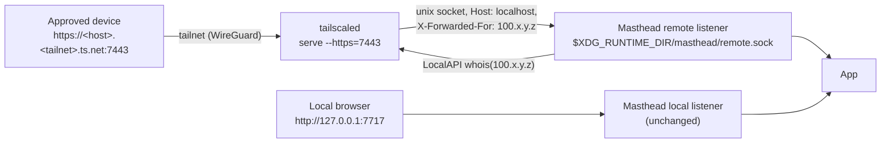
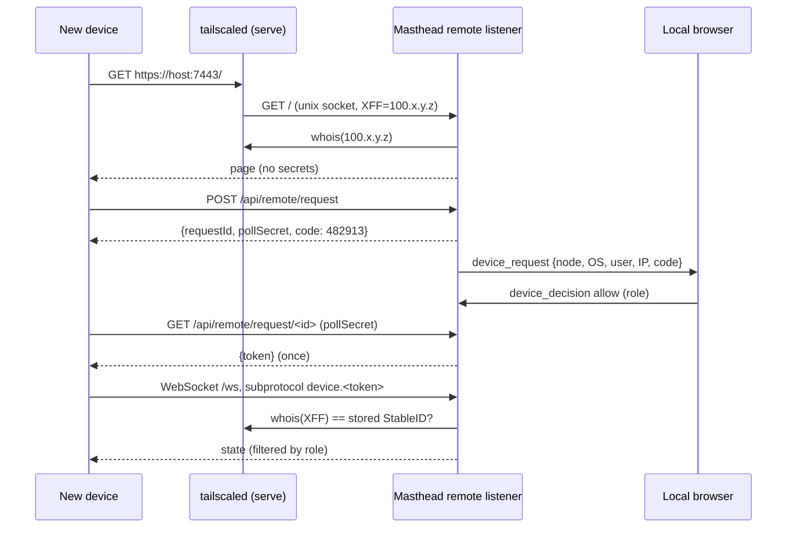

# 0.2.0: Remote access over the person's own Tailscale

> **History.** This plan was built in 0.2.0. It is kept as the record of the design and the evidence; where it
> differs from the code, the code and `docs/wiki/` are right.

Research and design, 2026-11-27, by golf. No code or Tailscale configuration was changed. Tailnet
names, logins and addresses below are replaced with placeholders (`<host>.<tailnet>.ts.net`,
`<login>`, `100.x.y.z`). Every claim is marked **[seen]** (a command here showed it), **[docs]**
(official documentation), **[source]** (Tailscale's source on GitHub, `ipn/ipnlocal/serve.go`,
main branch, read 2026-11-27) or **[unverified]**.

## Goal

When the machine is signed in to Tailscale, other devices on the same tailnet can open Masthead's
page, but only devices the person has allowed from inside Masthead. Funnel (public internet) is never
used. Masthead itself keeps listening only where the local machine can reach it.

## 1. Findings

### 1.1 The machine

```text
$ tailscale version
1.104.7                                          [seen]

$ tailscale status --json   (summarised)
BackendState Running; MagicDNS on; CertDomains: 1 (HTTPS certificates available)
Self.CapMap includes: https, funnel, .../cap/funnel-ports?ports=443,8443,10000   [seen]

$ ls -l /var/run/tailscale/
srw-rw-rw- 1 root root 0 ... tailscaled.sock     [seen]  (LocalAPI socket, every local user can connect)

$ tailscale debug prefs   (one field)
OperatorUser set: False                          [seen]
```

**Already in use:** this machine already has `tailscale serve` configuration from something else:

```text
$ tailscale serve status
https://<host>.<tailnet>.ts.net (tailnet only)
|-- / proxy http://127.0.0.1:<other port>
https://<host>.<tailnet>.ts.net:8443 (tailnet only)
|-- / proxy http://100.x.y.z:8000                 [seen]

$ tailscale serve status --json   (keys only)
{"TCP": {"443": …, "8443": …}, "Web": {"<host>…:443": …, "<host>…:8443": …}}   [seen]
```

So Masthead must **never take over `/` on 443** or run `serve reset`. Both would break the person's
other services. It needs an HTTPS port of its own (section 2.2).

### 1.2 `tailscale serve`

- **Targets:** a port, `http://127.0.0.1:N`, or `unix:/path.sock` on Linux. Proxying to tailscaled's
  own socket is refused (`ErrProxyToTailscaledSocket`). [docs: `tailscale serve --help`, seen] [source]
- **Persistence:** with `--bg`, serve "runs persistently in the background until you disable it" and
  resumes after a reboot or `tailscale down`/`up`. [docs: kb/1242]
- **Removal:** repeat the command with `off`, e.g. `tailscale serve --https=7443 off`. `tailscale serve
  reset` clears **all** serve config, which Masthead must never run. [docs: kb/1242]
- **Permissions:**
  - Docs say "forwarding a port does not require root" and that serving files, directories or a Unix
    socket does; on Linux use `sudo`. [docs: kb/1312, kb/1242]
  - On Linux tailscaled lets only root or the "operator" user change prefs and serve config. The
    operator is set by `sudo tailscale set --operator=$USER`; it is not set here. **[unverified]** whether
    an unprivileged, non-operator user can set a port-proxy serve config on this version. Not tested,
    because testing would change the config.
  - **Seen on 2026-11-27 (Tailscale 1.104.7, Linux, first real run):** being the operator is not enough
    for a Unix-socket target. `tailscale serve --bg --https=7443 unix:…` as the operator answered
    "401 Unauthorized: must be root, or be an operator and able to run 'sudo tailscale' to serve a path
    or Unix socket". Masthead now offers `sudo tailscale serve --bg --https=<port> unix:<socket>` once
    instead ([Source-Remote-Access](../../wiki/Source-Remote-Access.md)).
- **Headers added to proxied requests:** [source: `addTailscaleIdentityHeaders`,
  `addProxyForwardedHeaders`, `addAppCapabilitiesHeader`]
  - First **deletes** any incoming `Tailscale-User-Login`, `Tailscale-User-Name`,
    `Tailscale-User-Profile-Pic`, `Tailscale-Funnel-Request`, `Tailscale-Headers-Info`. Docs: "to avoid
    header spoofing". [docs: kb/1312]
  - Sets `Tailscale-User-Login`, `Tailscale-User-Name` (RFC 2047 Q-encoded when non-ASCII),
    `Tailscale-User-Profile-Pic` and `Tailscale-Headers-Info`. These are **not set for tagged devices**,
    or for Funnel traffic.
  - Users of **other tailnets who accepted a share** of this device do get identity headers. [docs: kb/1312]
  - `Tailscale-App-Capabilities`: only with `--accept-app-caps`; carries grants from the tailnet policy.
  - `X-Forwarded-For` is **set** (not appended) to the connecting node's tailnet IP.
    `X-Forwarded-Proto: https`. `X-Forwarded-Host` is the requested host.
  - **Host** is kept as the tailnet name for TCP backends. For `unix:` backends it becomes `localhost`.
  - **No node identity header.** The device (node) has to be looked up with `whois` on the address.
- **Identity lookup:** `whois` on a tailnet address returns `Node` (`StableID`, `ComputedName`,
  `Hostinfo` with OS, `Addresses`, `KeyExpiry`, `User`), `UserProfile` (`LoginName`, `DisplayName`) and
  `CapMap`. It works as an ordinary user (non-operator) over the 0666 LocalAPI socket. [seen:
  `tailscale whois --json <own ip>` keys] The HTTP form is `GET /localapi/v0/whois?addr=IP:port` on
  `/var/run/tailscale/tailscaled.sock`. [source, unverified by a request of my own]

### 1.3 Why the headers alone cannot be trusted

Any local process, including another user's, can connect to a loopback port and send
`Tailscale-User-Login: <login>` and `X-Forwarded-For: <an allowed device's IP>`. Masthead therefore
has to know that **tailscaled** made the connection. It cannot read that from the request; it has to
come from where the request arrived:

- **A Unix socket in a private folder** (`$XDG_RUNTIME_DIR/masthead/remote.sock`, folder 0700). Only
  the person's own processes and root can connect, and tailscaled runs as root. Other users cannot
  reach it at all. This is the recommended way. [design]
- A second loopback port is reachable by every local user. It would rely wholly on the per-device
  credential below, so it is weaker.

### 1.4 Binding the tailscale interface directly: no

Listening on `100.x.y.z` would:

- make Masthead terminate TLS itself, or serve plain HTTP across the tailnet;
- lose the identity headers;
- break the `AGENTS.md` rule;
- depend on interface addresses that change with `tailscale down`/`up`.

`serve` gives HTTPS with a valid `*.ts.net` certificate, identity, and no new listening interface.

## 2. Recommended design

### 2.1 Shape



- The local listener stays exactly as it is. It ignores every `Tailscale-*` and `X-Forwarded-*` header.
- The remote listener exists only while remote access is switched on. It accepts only requests that
  passed the checks in 2.4.

### 2.2 Who configures `serve`

Masthead must not edit Tailscale config without the person, and it may lack the rights to.
**Recommended:** Masthead shows the exact command and the person runs it once:

```sh
sudo tailscale serve --bg --https=7443 unix:/run/user/<uid>/masthead/remote.sock
```

- **7443** is a free port that is not on this tailnet's Funnel port list (443, 8443, 10000; seen above).
  So a mistaken `tailscale funnel` cannot expose Masthead without an ACL change.
- Masthead **detects** the state every 30 s and when its settings open, with
  `tailscale serve status --json` (read only, works unprivileged; seen). It looks for
  `Web["<self DNSName>:7443"].Handlers["/"].Proxy == "unix:<socket>"` and shows one of:
  not set up / set up / pointing elsewhere / **Funnel enabled on this port** (then it refuses to serve
  and says why; `AllowFunnel` in the JSON, [unverified] key name).
- **Removing it:** Masthead shows `sudo tailscale serve --https=7443 off`.
- An option for later: if the person has made themselves operator, Masthead could run the command
  itself after an explicit confirm. It must never run `reset` and never touch other ports.
- [unverified] whether the `unix:` target needs root even for an operator; the docs say a Unix socket
  "requires root". If the socket form turns out to be impractical, the fallback is
  `--https=7443 http://127.0.0.1:<remote port>`, a loopback port used only for remote traffic. It must
  then rely entirely on the device credential, because local users can reach it.
- The socket path lives in `/run/user/<uid>`, which is recreated at login. Masthead creates the socket
  when it starts. If Masthead is not running, serve answers 502. [unverified exact status]

### 2.3 Device approval

Identity of a device is the **Tailscale node StableID** from `whois`, plus the user login, or "tagged"
for a tagged node.

1. **First contact.** An unknown device opens `https://<host>.<tailnet>.ts.net:7443`. The page has no
   device credential, so it calls `POST /api/remote/request`.
2. The server runs `whois(X-Forwarded-For)` and gets node StableID, name, OS, user, tailnet IP. It
   creates (or reuses) **one** pending request per node and returns a 6-digit **pairing code** that the
   device shows on its screen.
3. Every **trusted session** gets `{t:'device_request', device}`, shown as a card: node name, OS, user
   (or "tagged device", or "user of another tailnet: <login>"), IP, and the pairing code. Trusted means
   the local browser, plus remote devices with the `admin` role if the person allows that (decision D3).
4. The person checks that the codes match, then chooses **Allow** (with a role) or **Deny**. The
   pairing code stops the person approving an attacker's request that arrived at the same moment.
5. **On Allow** the server makes a random 32-byte device token and stores only its SHA-256 with the
   device record. It hands the token to the waiting device once: the device polls
   `GET /api/remote/request/<id>` with a per-request secret it got in step 2. The page keeps the token
   in `localStorage` for that `https://…:7443` origin.
6. **Every later request** from that device must carry the token (WebSocket subprotocol
   `device.<token>`, as the local page sends `key.<secret>`), **and** `whois` of its address must name
   the same StableID. A token copied to another node fails.
7. **Deny:** the node is refused for 10 minutes, then may ask again. Repeated requests are limited to
   one pending request per node.
8. **Revoke** (from the device list): deletes the record and closes that device's open sockets at once.
9. **Expiry:** each record has `expiresAt`, 30 days by default (decision D4), and renews on use.
10. **Master switch:** "Remote access" off closes the remote listener and every remote socket. The
    records are kept.
11. **Audit log:** `<DATA_DIR>/remote/audit.jsonl` (0600), one line per request, allow, deny, revoke,
    expiry, connect and refusal, with node, user, IP and reason. The last 100 lines are shown in the
    settings.



### 2.4 Checks on the remote listener

- **Host:** `localhost` (what serve sends to a `unix:` backend) **and** `X-Forwarded-Host` =
  `<self DNSName>:7443`, where the DNS name is read from `tailscale status --json`, `Self.DNSName`.
- **Origin** for the WebSocket: exactly `https://<self DNSName>:7443`.
- **X-Forwarded-For** must be present and a tailnet address. This is trusted only because the socket is
  private (1.3).
- **whois** on it must succeed, and the node must not be the machine itself. The machine's own browser
  uses the local listener.
- **Policy:** optionally refuse users of other tailnets and tagged nodes (decision D5).
- **CSP** on this listener: `connect-src 'self' wss://<self DNSName>:7443`. Whether `'self'` alone
  covers `wss:` differs between browsers. [unverified for Safari]
- **Never accepted remotely:** the local secret (`key.<secret>`) and `/api/shutdown`. `/api/health`
  answers only `{name}` here: no pid and no busy count.
- **Rate limit:** at most 10 `request` calls per node per minute.

### 2.5 What a remote device may do (roles)

| Role | Allowed `ClientMsg` types |
|---|---|
| `full` | everything the local page can, except remote-access and device management (unless D3) |
| `approve` | `hello`, `open`, `items`, `permission` (answer cards), `interrupt`, `stop_agent`, `stop_all` |
| `read` | `hello`, `open`, `items` |

These are enforced in `App.handle()` by a per-client role, not by the page. `settings` from a remote
client never changes `permissionMode` to `bypassPermissions` (decision D6).

## 3. Exact changes by file

| File | Change |
|---|---|
| `shared/protocol.ts` | `Settings.remote: { enabled: boolean; httpsPort: number; allowOtherTailnets: boolean; allowTagged: boolean; tokenDays: number }`. `RemoteDevice { id (StableID); name; os; user?: {login, name}; tagged; tailnet IP; role; createdAt; lastSeen; expiresAt }`. `AppState.remote: { serve: 'off'│'ok'│'elsewhere'│'funnel'│'no-tailscale'; url?: string; devices: RemoteDevice[]; requests: DeviceRequest[]; command?: string }`. ClientMsg: `device_decision {requestId, decision: 'allow'│'deny', role}`, `device_revoke {id}`, `device_role {id, role}`. ServerMsg: `device_request`, `device_resolved`, `remote {…}`. |
| `server/config.ts` | `REMOTE_DIR = <DATA_DIR>/remote` (0700), `DEVICES_FILE`, `AUDIT_FILE`, socket path from `XDG_RUNTIME_DIR` (refuse remote access when it is unset). `sanitizeSettings` for `remote` (port 1024..65535, not 7717). |
| `server/tailscale.ts` (new) | `interface Tailnet { status(): Promise<{dnsName, selfIp}│null>; serveStatus(): Promise<ServeState>; whois(addr): Promise<Identity│null> }`. The real one uses LocalAPI over `/var/run/tailscale/tailscaled.sock` (HTTP over a Unix socket, `Host: local-tailscaled.sock`) or `tailscale … --json` via `execFile`. Tests use a fake. **The only seam needed to test without a second device.** |
| `server/remote.ts` (new) | `RemoteAccess`: device store (JSON file, 0600, token hashes only), pending requests with pairing codes and poll secrets, deny cool-down, rate limits, audit log, expiry sweep, `authorise(xff, token) → device│null`, `revoke()` closing sockets. |
| `server/http.ts` | `serveRemote(app, remote, tailnet, {socketPath, dnsName, port})`: a second `http.Server` listening on the Unix socket (folder 0700, socket 0600; stale socket removed first). Its own Host, Origin and XFF checks, `/api/remote/request` (+ poll), WebSocket upgrade with `device.<token>`, CSP with `wss://`. Shares `serveStatic()`. The local `serve()` is unchanged. |
| `server/app.ts` | `Client` gains `role: 'local'│'full'│'approve'│'read'` and `deviceId?`. `handle()` refuses messages the role does not allow. New handlers for device messages (local or allowed-admin only). `state()` adds `remote` (devices and requests only for clients allowed to manage them). |
| `server/main.ts` | Start or stop the remote listener when `settings.remote.enabled` changes. Add `masthead remote` to print the state and the exact `sudo tailscale serve …` / `… off` commands. |
| `web/` | Remote sign-in screen ("Waiting for approval: code 482913"), polling, token storage per origin, a device request card, and a Remote access section in settings (switch, state, command to copy, device list with role/revoke, audit). Phone layout fixes (section 5). |
| `AGENTS.md` | New rule wording (section 4). |
| `docs/wiki/` | Security-Model (remote section), a new Remote-Access page, Settings. |

## 4. Fit with the existing security model

- **Local listener:** unchanged. It binds 127.0.0.1, checks Host and Origin, requires `key.<secret>`
  on the socket, and needs `x-masthead` plus `x-masthead-key` for shutdown. The local secret never
  leaves the machine.
- **Remote listener:** a different credential (device token), a different origin (`https://…:7443`),
  wss. The page on a remote device never sees the local secret. Its sign-in screen is the pairing
  screen, not "open with `masthead`".
- **Proposed `AGENTS.md` wording:** "The server listens on `127.0.0.1` and, only while remote access is
  on, on a Unix socket in a private folder that `tailscale serve` connects to. It never binds another
  interface and never uses Funnel. Both listeners check `Host` and `Origin`; do not weaken either check
  or let a request from one listener be treated as coming from the other."

## 5. The page on a phone

Read from the code by yankee; not tried on a phone.

**Blocking**
- Below 900 px the sidebar (264 px) and team panel (316 px) become overlays with no backdrop. Choosing
  a conversation does not close them; only the header buttons do (`App.svelte` 354-369, 108).
- Whether the panels start open is decided once from `innerWidth` (`App.svelte` 27-28); rotating the
  phone does not change it.
- The height is `100%`, not `100dvh`. The on-screen keyboard can cover the composer dock (`app.css`
  64-68, `App.svelte` 193, 329).
- Map previews open only on hover (`TeamMap.svelte` 95), and so does the "Stop" label
  (`StopControl.svelte` 62-70). The Stop button is 24 px.

**Annoying**
- Input text is 15 px or less, so iOS zooms in on focus (Composer, FolderPicker, SettingsMenu,
  TeamPanel, the rename field).
- The delete × in the sidebar and the code Copy button only appear on hover.
- Tap targets under 44 px: composer round buttons 32 px, steppers 26×24, tabs, header icons, the
  remove-image button 20 px.
- The 48 px header crowds ☰, title, path, tabs, ⚙ and ◧ into 390 px.
- The settings popup uses `100vh`.

**Cosmetic**
- No `viewport-fit=cover` / safe-area inset under the dock.
- The map tree scrolls sideways.
- `title=` tooltips never show on touch.

## 6. Threats and what remains exposed

1. **An approved device that is compromised, or stolen and unlocked, has the person's machine.** With
   `full`, it can tell the lead to run any command (and with `bypassPermissions`, without a card).
   Mitigations: roles; never letting a remote client switch on bypass; expiry; revoke; the audit log.
   Tailscale device approval and key expiry (tailnet admin settings) also apply. A device whose node key
   expired cannot reach the tailnet at all. [docs, general]
2. **Approving the wrong device.** Pairing codes and node, OS and IP on the card make this hard. Nothing
   stops a person from approving carelessly.
3. **Tailnet scope.** Every device the tailnet policy lets reach this node on 7443 can ask to pair,
   including users of shared nodes from other tailnets. Recommend an ACL or grant that limits port 7443
   to the person's own devices. Masthead can refuse other tailnets and tagged nodes by setting (D5).
4. **Local processes running as the person** can connect to the remote socket and forge
   `X-Forwarded-For`. They could already read the local secret, so nothing new is exposed; other local
   users cannot reach the socket at all. With the loopback-port fallback this no longer holds for other
   users, who could forge XFF; they would still need a device token.
5. **Phishing inside the tailnet:** another tailnet member's device asks repeatedly. Limited by the deny
   cool-down and rate limits.
6. **Token theft from the device's browser storage** (another app on that device, a shared browser
   profile). The token is bound to the StableID, so it only works from that same node.
7. **Availability:** if `tailscale serve` is pointed elsewhere, Funnel gets enabled, or tailscaled
   stops, Masthead shows the state and serves nothing remotely.
8. **Unchanged:** the lead can run commands on the host; there is no time or spend cap. The Safety model
   still applies, now reachable from more places.

## 7. Tests (no second device needed)

- **Fake `Tailnet`** in `server/tailscale.ts`: `whois` returns a chosen node/user, null (unknown
  address), a tagged node, or another tailnet's user. `serveStatus` returns each state.
- **`test/remote.test.ts`:**
  - pending request and pairing code;
  - one request per node;
  - deny cool-down;
  - allow issues a token once;
  - the stored file holds only the hash;
  - a token with another StableID is refused;
  - expiry;
  - revoke closes sockets;
  - the master switch closes the listener;
  - every audit entry is written.
- **`test/http.test.ts` (remote part):** `serveRemote()` on a socket in a temp folder (folder 0700,
  socket 0600 checked). Check:
  - wrong `X-Forwarded-Host` → 403;
  - wrong Origin → 403;
  - no XFF → 403;
  - `key.<secret>` refused;
  - `device.<token>` accepted only when the fake whois matches;
  - `/api/shutdown` 404;
  - `/api/health` without pid or busy;
  - the local `serve()` ignores `Tailscale-User-Login` and XFF.
- **`test/app.test.ts`:** role filtering for each ClientMsg type; a remote `settings` cannot set bypass;
  device messages refused from non-admin clients.
- **Manual, once, with the person:** run the `sudo tailscale serve …` command, open from a phone, pair,
  revoke, then `… off`. Confirm the 502 behaviour, CSP `wss:` on Safari, and the `AllowFunnel` key.

## 8. Decisions for the person

- **D1 Who runs `tailscale serve`:** the person, with the command Masthead shows (recommended), or
  Masthead itself after a confirm if the person has made themselves operator.
- **D2 Port:** 7443 by default, kept off the Funnel list; or another port.
- **D3 Can a remote device approve other devices or change remote settings?** Recommended no: only the
  local browser.
- **D4 Token lifetime:** 30 days sliding (recommended), 7 days, or no expiry.
- **D5 Other tailnets' users and tagged devices:** refused by default (recommended), or allowed with a
  clear label.
- **D6 Roles:** offer `full` / `approve` / `read`, with `approve` as the default role for a phone? And
  should a remote `full` device be allowed to change `permissionMode` at all?
- **D7 Unix socket vs loopback port:** the socket (recommended; needs `sudo` once) or a loopback port if
  the socket form proves impractical.
- **D8 Phone layout work in 0.2.0:** without it, remote access on a phone is barely usable (section 5).
