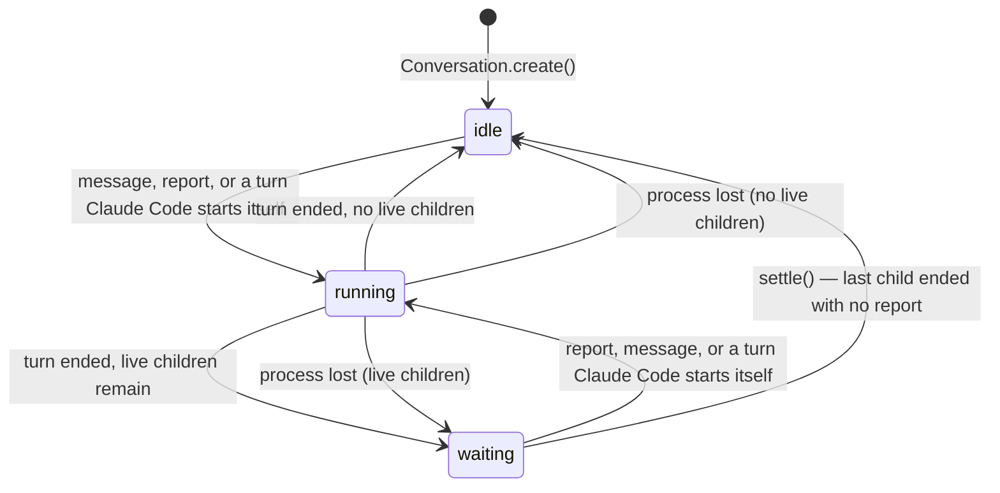

# Agent life cycle

This page follows one agent from creation to its end, names each **status** it can have, and explains what moves it between them. The code is in `server/agent.ts` (the `Agent` class) and `server/conversation.ts` (the `Conversation` class, which decides what happens when a turn ends).

## Terms

- **Turn**: one round of work by the model: it reads what it was sent, thinks, calls tools, and writes a final message. A turn ends with a `result` message from Claude Code.
- **Session**: Claude Code's saved history of an agent's conversation, identified by a `session_id`. A session outlives a process; it can be **resumed** later.
- **Process**: the running `claude` program for one agent. In code, the SDK's `Query` object (`Agent.q`) stands for it.
- **Slot**: permission from the `Scheduler` for one agent of a tier to have a process. See [Slot scheduling](Slot-Scheduling.md).
- **Live**: status `queued`, `running` or `waiting` (`LIVE_STATUSES` in `shared/protocol.ts`, and the `Agent.live` getter).

## Statuses

`AgentStatus` in `shared/protocol.ts`:

| Status | Meaning |
|---|---|
| `queued` | Waiting for a free slot in its tier. |
| `running` | A turn is in progress. |
| `waiting` | Its turn ended, but agents it started are still live (or, for a sub-agent, commands it put in the background still run), so it is not finished. It keeps its slot and its process. |
| `idle` | Lead only: nothing in progress. |
| `done` | A sub-agent finished normally. Its process is closed and slot returned. |
| `failed` | A sub-agent ended with an error, or its process was lost. |
| `stopped` | Ended on request (by the person, by an agent above it, or because the app closed). |

## Sub-agent statuses

```mermaid
stateDiagram-v2
  [*] --> queued: spawn() — no free slot
  [*] --> running: spawn() — slot free at once
  queued --> running: slot granted, process launched
  running --> waiting: turn ended, live children remain
  waiting --> running: report, message, or a turn Claude Code starts itself
  running --> running: more input arrived during the turn
  running --> done: turn ended, no live children
  waiting --> done: settle() — last child ended with no report
  running --> failed: turn error, or process lost
  queued --> stopped: stopTree()
  queued --> failed: tier set to 0 (TierOff)
  running --> stopped: stopTree()
  waiting --> stopped: stopTree()
  done --> queued: message from anyone (resume)
  failed --> queued: message (resume)
  stopped --> queued: message (resume; only the person, if the person stopped it)
  done --> running: message, slot free (resume)
```

`queued` only appears when the slot is not free immediately: `ensureProcess()` sets it in a `queueMicrotask` callback only if the slot has not been granted by then. A resumed agent goes through `ensureProcess()` again, so it may wait in the queue like a new one.

## Lead statuses

The lead is never `done`, `failed` or `stopped` in normal flow. `Conversation.shutdown()` ends the lead's process with `dispose()` (which leaves the status alone) and then sets it to `idle`.

## Step by step

### 1. Creation

- The lead is created by `Conversation.create()` with the name `alpha`, status `idle`, no session and no process. Its starting effort is `low` when automatic effort is on, otherwise its tier's effort from the settings.
- A sub-agent is created by `Conversation.spawn()` when its parent calls the `spawn_agent` tool. It gets the next free name from the phonetic alphabet (`bravo`, `charlie`, …), the short `title` its parent gave, status `queued`, `owesReport: true`, and the full task text as its **seed** (the first message of a brand-new session). `spawn()` then calls `agent.start()`, which is just `ensureProcess()`.

### 2. Getting a process: `ensureProcess()` and `launch()`

`ensureProcess()` returns early if a start is already in progress or a usable process exists. Otherwise it:

1. Sets `starting = true` (which also makes `busy` true) and notes the agent's current **generation**, a counter that `end()` and `dispose()` increase.
2. Asks the scheduler: `scheduler.acquire(tier, id, owner)`, where `owner` is the parent's id (the conversation id for the lead). This returns a promise that resolves when a slot is granted.
3. Once granted, waits for the previous process to have fully exited (`this.exited`), so a resume never overlaps the old process.
4. Checks the generation. If it changed, the agent was ended while it waited (a slot can be granted in the same pass that freed it, after `end()` found nothing left to cancel): the start is dropped and the slot given back, unless a newer start now holds it. A stopped agent is therefore never launched.
5. Otherwise calls `launch()`. If the slot request was cancelled (`SlotCancelled`, because the agent was stopped while queued), it quietly gives up. If it was refused with `TierOff` (the tier was set to 0 while the agent waited), that goes to `host.processLost()` like any other error, including an exception thrown by `launch()` itself: the agent fails with "This tier was switched off in the settings while the agent was waiting to start." and reports that to its parent.

`launch()` builds the SDK `Options` and calls `query({ prompt: input, options })`:

- If `claudePath()` is null (Claude Code not found), it releases the slot and reports `processLost`.
- The lead's model is refreshed from the current settings; other agents keep the model they were created with.
- The effort is set: with automatic effort on, the agent's current level capped at its tier's ceiling (`capEffort`); with it off, the tier's level.
- A new input `Channel` is created. For a new session (`sessionId` is null) the seed goes in first, then any `backlog` (messages accepted before the process existed). Everything put into this process's input is also kept in `sent`, so it can be sent again to a fresh session (see 7a).
- `resume: sessionId` is set if the agent has a session, so Claude Code continues the old conversation.
- The system prompt is Claude Code's own (`preset: 'claude_code'`) with Masthead's text appended (`systemAppend()` in `server/prompts.ts`), which names the effort level the agent actually runs at.
- Other options: `mcpServers: { masthead: teamTools(...) }`, `allowedTools: ['mcp__masthead']`, `disallowedTools` (see [server/agent.ts](Source-Agent.md)), `includePartialMessages: true` (for live drafts), adaptive thinking with summarized display, `strictMcpConfig` for lean agents (Sonnet and Haiku with `leanSubagents`, Opus with `leanOpus`; never the lead), the last 4,000 characters of Claude Code's error output kept in `stderrTail`, `canUseTool` routed to the app's approval system, and the permission mode from settings.

The status becomes `running`, and `consume()` starts reading the SDK's message stream in the background.

### 3. During a turn: `handle()`

Each SDK message is turned into app state:

| SDK message | What `Agent.handle()` does |
|---|---|
| `system` / `init` | Records `session_id` as `sessionId` and drops the seed (it is now in the session). If the agent is `idle` or `waiting`, sets it `running`: the code comment says Claude Code also starts turns by itself, for instance when a background command finishes. (Seen once with a real Claude Code 2.1.331: the self-started turn begins with `init`; see 4a.) |
| `system` / `status: compacting` | Activity line "Compacting its context". |
| `system` / `background_tasks_changed` | Replaces the set of background tasks with the non-ambient ones listed (see 4a). |
| `system` / `compact_boundary` | Adds an info notice: earlier context was summarized. |
| `stream_event` | Updates usage (context size, output tokens) and the live **draft** (text or thinking being written). A new text or thinking block clears the activity line. |
| `assistant` | Adds `text`, `thinking` and `tool` items. A tool call sets the activity line via `describeTool()`. |
| `user` (tool results) | Marks the matching tool item done, with its result clipped to 12,000 characters. When no tool is open any more, the activity line is cleared, so a finished tool is not shown as what the agent is doing. |
| `rate_limit_event` | Passed up as a rate-limit notice for the whole app. |
| `result` | Ends the turn: `handleResult()`. Exception: on a resume that has not reported `init` yet, a result whose errors say the session is gone is set aside for the fresh-session rule (7a). |

### 4. End of a turn: `handleResult()` and the "unanswered" set

Every message Masthead pushes into an agent's input gets a fresh id and is added to `unanswered`. Which ones a `result` answered follows the rule written in the code (from the SDK's `SDKResultSuccess`/`SDKResultError` types):

- A result names the ids the turn consumed in `user_message_uuids`, or older versions name one in `user_message_uuid`. Only those are removed.
- A result that names none is a turn Claude Code started by itself (a background command finished) or an error turn with no single triggering message. If this Claude Code has named consumed messages earlier in this process (`namesConsumed`, also set when an `assistant` message carries `user_message_uuid`), nothing is removed: messages still queued get turns and results of their own.
- If it has never named one in this process, it may be too old to, so everything is cleared, as 0.1.0 always did; that way an agent can never stay busy for ever. A process that dies clears everything anyway.

If anything is still unanswered, more input arrived during the turn and Claude Code will run another turn for it, so the agent stays `running` (an error, if any, is shown as a notice). Only when nothing is unanswered does it call `host.turnEnded()` with the text, any error, and whether the turn was interrupted.

**The text of a run.** A message that lands just as a turn ends makes Claude Code run one more turn, whose reply is often only "Noted". So the outcome's `text` is not the last turn's text but the final text of **every turn since the agent last took up work**, oldest first, joined by blank lines (`runTexts`; a turn whose text repeats the previous one is not added twice). The list is emptied when the outcome is sent (unless background work runs, see 4a), and by `end()`, `dispose()` and a lost process. `lastText`, used by `settle()`, holds the same joined text.

This mechanism is what makes "the agent is finished" mean "it has answered everything it was sent", not just "a turn ended".

### 4a. Background work

Claude Code can run a command in the background (Bash with `run_in_background`). It reports the full set of running tasks in each `system`/`background_tasks_changed` message; the agent keeps the non-ambient ones (`hasBackgroundWork`). The set belongs to one process: it is emptied when a process starts or ends, and by `end()` and `dispose()`.

- A turn that ends while background work runs still calls `host.turnEnded()`. The conversation keeps a sub-agent `waiting` instead of finishing it. `runTexts` is not emptied.
- When the command ends, Claude Code starts a turn by itself: `init`, then a `result` that names no message (its `origin.kind` is `task-notification`). That result calls `turnEnded()` again, and its text includes the earlier turn's text.
- If the set empties and no turn starts within `BACKGROUND_GRACE_MS` (3 s), the agent calls the optional `host.backgroundIdle(agent)`, so the normal ending happens.
- If the process exits instead, the usual process-lost path runs (section 7).

This sequence was checked once against a real Claude Code 2.1.331 with a throwaway script (Haiku, `sleep 20` in the background): the turn's result at 3.5 s, then the task updates, an empty `background_tasks_changed` and `init` at 22.8 s, then the self-started result. The grace timer, the idle path and the relaunch in section 10 were not run against the real Claude Code; only unit tests with a stand-in for `query` cover them (`test/agent.test.ts`).

### 5. What the conversation does: `Conversation.turnEnded()`

- Adds a notice: "Stopped." if interrupted, or the error text.
- **Lead:** status becomes `waiting` if it has live children, otherwise `idle`. It also asks Claude Code for the real context size (`refreshContext()`). The lead's process stays open.
- **Sub-agent with live children and no error:** status `waiting`. It keeps its process and slot.
- **Otherwise:** `finish(agent, 'done' | 'failed', text, error)`.

`finish()` stops any live children, calls `agent.end(status)`, and then either sends a report to the parent (if the agent `owesReport`) or calls `settle(parent)`. See [A report coming back](Walkthrough-Report-Coming-Back.md).

### 6. Ending: `Agent.end()`

`end(status, error)`:

1. Cancels a queued slot request, if any.
2. Increases the generation (so a start still waiting for a slot is dropped), marks `closing = true`, clears the backlog, `unanswered`, `runTexts` and the background set.
3. For `done`, closes the input stream so Claude Code finishes cleanly; for `stopped` or `failed`, closes the process at once (`q.close()`).
4. Releases the slot and sets the status (which records `endedAt`).

Because `closing` is set, when `consume()` sees the stream end it does not treat it as a crash.

### 7. Process lost

If the SDK stream ends or throws when Masthead did not ask (`closing` is false), `consume()` first checks the fresh-session rule (7a); otherwise it clears `unanswered` and `runTexts` and calls `host.processLost()`. `Conversation.processLost()` cancels the agent's open approval requests, adds an error notice, releases the slot, and then: for the lead, sets `waiting` or `idle`; for a sub-agent, `finish(agent, 'failed', '', message)`, which reports the failure to the parent if one was owed.

### 7a. A session that no longer exists

If an agent's Claude Code session file was deleted or moved, a resume cannot work. Claude Code reports this only as text ("No conversation found with session ID", seen in Claude Code 2.1.331 according to the code comment), so the rule is narrow (`resumeWasMissing()`): the process was a resume, it ended before reporting `init`, a fresh start has not already been tried for it, and the error, the error output (`stderrTail`) or a result set aside in `handle()` names the missing session. Any other failure is reported as before, so a session is never thrown away because of a network or sign-in problem.

Then `startFresh()` runs, once: it forgets the session id and seed, adds the notice "The earlier session could not be found, so its context is lost. This agent starts fresh.", and launches a new session whose input is a note to the agent saying the same, followed by every message the old process was sent and never answered, then the backlog. A second missing session in a row is not retried; the flag is cleared when a session does start (`init`). Covered by `test/agent.test.ts` with a stand-in for `query`; not verified against a real deleted session file.

### 8. App shutdown

`Conversation.shutdown()` ends live sub-agents with `end('stopped', 'Masthead was closed while this agent was working.')`, and every other agent with `dispose()`, which closes any process and returns any slot but keeps the recorded status (so a `done` agent stays `done`). The lead is then set to `idle`.

### 9. Waking a finished agent

A `done`, `failed` or `stopped` agent has no process, but it keeps its `sessionId`. `deliver()` puts the message in the backlog and calls `ensureProcess()`, which acquires a slot and launches with `resume`. If the agent never got a session (it was still queued when the app closed), its saved task (`seed`) is restored and sent first, so it still knows its job. When an agent wakes a finished sub-agent with `send_message`, the sub-agent owes its parent a fresh report (`owesReport = true` in `Conversation.message()`), whoever woke it, as long as the parent can still receive one (it is the lead or live). Agents cannot wake an agent the person stopped, and nobody can wake one whose tier is set to 0. See [Team rules](Team-Rules.md).

### 10. Settings changed while an agent runs

`applySettings(settings)` acts only on an agent with a live process; one without a process needs nothing, since `launch()` reads the settings. It caps the effort to a lowered ceiling (or sets the tier's fixed effort when automatic effort is off) through `setEffort()`, which uses `applyFlagSettings`. For the lead, a changed lead model goes through `Query.setModel()`; if that fails, the process is marked stale. A change of the automatic-effort switch marks the process stale, because the tools are built at launch.

A stale process is relaunched only when the next message arrives between turns (nothing unanswered, no turn running, no background work): `deliver()` closes the old input and `ensureProcess()` resumes the same session in a new process, keeping the slot. It is never relaunched mid-turn; a message sent during a turn goes into the running process.

## Interrupt versus stop

- **Interrupt** (`Agent.interrupt()`, used for the lead by the Stop button via `{t:'interrupt'}`) ends the current turn but keeps the process and session. Only acts when the status is `running`.
- **Stop** (`Agent.end('stopped')`, via `Conversation.stopTree()`) ends the process and returns the slot. Applies to sub-agents and everything under them. See [Stopping an agent](Walkthrough-Stopping-an-Agent.md).

## Related pages

[server/agent.ts](Source-Agent.md) · [server/conversation.ts](Source-Conversation.md) · [Slot scheduling](Slot-Scheduling.md) · [Team rules](Team-Rules.md)
