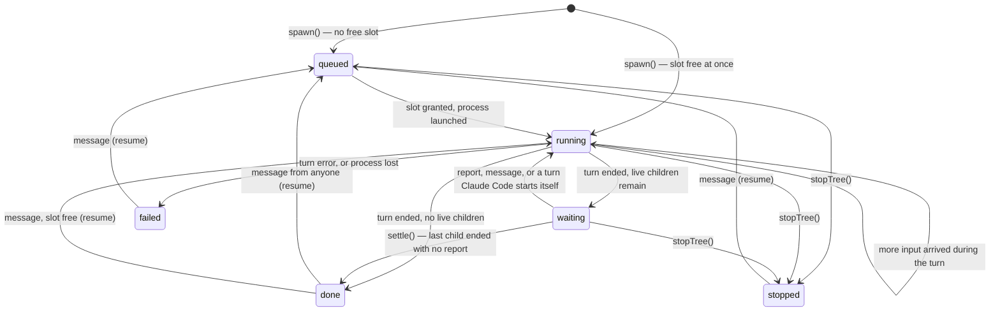
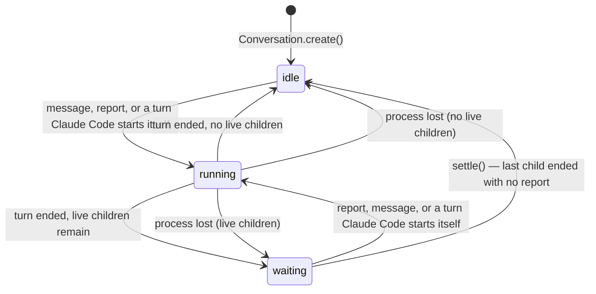

# Agent life cycle

This page follows one agent from creation to its end, names each **status** it can have, and explains what moves it between them. The code is in `server/agent.ts` (the `Agent` class) and `server/conversation.ts` (the `Conversation` class, which decides what happens when a turn ends).

## Terms

- **Turn**: one round of work by the model: it reads what it was sent, thinks, calls tools, and writes a final message. A turn ends with a `result` message from Claude Code.
- **Session**: Claude Code's saved history of an agent's conversation, identified by a `session_id`. A session outlives a process; it can be **resumed** later.
- **Process**: the running `claude` program for one agent. In code, the SDK's `Query` object (`Agent.q`) stands for it.
- **Slot**: permission from the `Scheduler` for one agent of a tier to have a process. See [Slot scheduling](Slot-Scheduling.md).
- **Live**: status `queued`, `running` or `waiting` (`LIVE_STATUSES` in `shared/protocol.ts`, and the `Agent.live` getter).

## Statuses

`AgentStatus` in `shared/protocol.ts`:

| Status | Meaning |
|---|---|
| `queued` | Waiting for a free slot in its tier. |
| `running` | A turn is in progress. |
| `waiting` | Its turn ended, but agents it started are still live, so it is not finished. It keeps its slot and its process. |
| `idle` | Lead only: nothing in progress. |
| `done` | A sub-agent finished normally. Its process is closed and slot returned. |
| `failed` | A sub-agent ended with an error, or its process was lost. |
| `stopped` | Ended on request (by the person, by an agent above it, or because the app closed). |

## Sub-agent statuses

`queued` only appears when the slot is not free immediately: `ensureProcess()` sets it in a `queueMicrotask` callback only if the slot has not been granted by then. A resumed agent goes through `ensureProcess()` again, so it may wait in the queue like a new one.

## Lead statuses

The lead is never `done`, `failed` or `stopped` in normal flow. `Conversation.shutdown()` ends the lead's process with `dispose()` (which leaves the status alone) and then sets it to `idle`.

## Step by step

### 1. Creation

- The lead is created by `Conversation.create()` with the name `alpha`, status `idle`, no session and no process. Its starting effort is `low` when automatic effort is on, otherwise its tier's effort from the settings.
- A sub-agent is created by `Conversation.spawn()` when its parent calls the `spawn_agent` tool. It gets the next free name from the phonetic alphabet (`bravo`, `charlie`, …), the short `title` its parent gave, status `queued`, `owesReport: true`, and the full task text as its **seed** (the first message of a brand-new session). `spawn()` then calls `agent.start()`, which is just `ensureProcess()`.

### 2. Getting a process: `ensureProcess()` and `launch()`

`ensureProcess()` returns early if a start is already in progress or a usable process exists. Otherwise it:

1. Sets `starting = true` (which also makes `busy` true).
2. Asks the scheduler: `scheduler.acquire(tier, id, owner)`, where `owner` is the parent's id (the conversation id for the lead). This returns a promise that resolves when a slot is granted.
3. Once granted, waits for the previous process to have fully exited (`this.exited`), so a resume never overlaps the old process.
4. Calls `launch()`. If the slot request was cancelled (`SlotCancelled`, because the agent was stopped while queued), it quietly gives up; any other error, including an exception thrown by `launch()` itself, goes to `host.processLost()`.

`launch()` builds the SDK `Options` and calls `query({ prompt: input, options })`:

- If `claudePath()` is null (Claude Code not found), it releases the slot and reports `processLost`.
- The lead's model is refreshed from the current settings; other agents keep the model they were created with.
- The effort is set: with automatic effort on, the agent's current level capped at its tier's ceiling (`capEffort`); with it off, the tier's level.
- A new input `Channel` is created. For a new session (`sessionId` is null) the seed goes in first, then any `backlog` (messages accepted before the process existed).
- `resume: sessionId` is set if the agent has a session, so Claude Code continues the old conversation.
- The system prompt is Claude Code's own (`preset: 'claude_code'`) with Masthead's text appended (`systemAppend()` in `server/prompts.ts`).
- Other options: `mcpServers: { masthead: teamTools(...) }`, `allowedTools: ['mcp__masthead']`, `disallowedTools` (see [server/agent.ts](Source-Agent.md)), `includePartialMessages: true` (for live drafts), adaptive thinking with summarized display, `strictMcpConfig` for lean Sonnet/Haiku agents, `canUseTool` routed to the app's approval system, and the permission mode from settings.

The status becomes `running`, and `consume()` starts reading the SDK's message stream in the background.

### 3. During a turn: `handle()`

Each SDK message is turned into app state:

| SDK message | What `Agent.handle()` does |
|---|---|
| `system` / `init` | Records `session_id` as `sessionId` and drops the seed (it is now in the session). If the agent is `idle` or `waiting`, sets it `running`: the code comment says Claude Code also starts turns by itself, for instance when a background command finishes. (That this happens on an `init` message per turn is what the code assumes; it was not checked against Claude Code.) |
| `system` / `status: compacting` | Activity line "Compacting its context". |
| `system` / `compact_boundary` | Adds an info notice: earlier context was summarized. |
| `stream_event` | Updates usage (context size, output tokens) and the live **draft** (text or thinking being written). |
| `assistant` | Adds `text`, `thinking` and `tool` items. A tool call sets the activity line via `describeTool()`. |
| `user` (tool results) | Marks the matching tool item done, with its result clipped to 12,000 characters. |
| `rate_limit_event` | Passed up as a rate-limit notice for the whole app. |
| `result` | Ends the turn: `handleResult()`. |

### 4. End of a turn: `handleResult()` and the "unanswered" set

Every message Masthead pushes into an agent's input gets a fresh id and is added to `unanswered`. A `result` names the ids the turn consumed (`user_message_uuids`), and those are removed. If anything is still unanswered, more input arrived during the turn and Claude Code will run another turn for it, so the agent stays `running` (an error, if any, is shown as a notice). Only when nothing is unanswered does it call `host.turnEnded()` with the final text, any error, and whether the turn was interrupted. If an older Claude Code does not send `user_message_uuids`, the whole set is cleared.

This mechanism is what makes "the agent is finished" mean "it has answered everything it was sent", not just "a turn ended".

### 5. What the conversation does: `Conversation.turnEnded()`

- Adds a notice: "Stopped." if interrupted, or the error text.
- **Lead:** status becomes `waiting` if it has live children, otherwise `idle`. It also asks Claude Code for the real context size (`refreshContext()`). The lead's process stays open.
- **Sub-agent with live children and no error:** status `waiting`. It keeps its process and slot.
- **Otherwise:** `finish(agent, 'done' | 'failed', text, error)`.

`finish()` stops any live children, calls `agent.end(status)`, and then either sends a report to the parent (if the agent `owesReport`) or calls `settle(parent)`. See [A report coming back](Walkthrough-Report-Coming-Back.md).

### 6. Ending: `Agent.end()`

`end(status, error)`:

1. Cancels a queued slot request, if any.
2. Marks `closing = true`, clears the backlog and `unanswered`.
3. For `done`, closes the input stream so Claude Code finishes cleanly; for `stopped` or `failed`, closes the process at once (`q.close()`).
4. Releases the slot and sets the status (which records `endedAt`).

Because `closing` is set, when `consume()` sees the stream end it does not treat it as a crash.

### 7. Process lost

If the SDK stream ends or throws when Masthead did not ask (`closing` is false), `consume()` calls `host.processLost()`. `Conversation.processLost()` cancels the agent's open approval requests, adds an error notice, releases the slot, and then: for the lead, sets `waiting` or `idle`; for a sub-agent, `finish(agent, 'failed', '', message)`, which reports the failure to the parent if one was owed.

### 8. App shutdown

`Conversation.shutdown()` ends live sub-agents with `end('stopped', 'Masthead was closed while this agent was working.')`, and every other agent with `dispose()`, which closes any process and returns any slot but keeps the recorded status (so a `done` agent stays `done`). The lead is then set to `idle`.

### 9. Waking a finished agent

A `done`, `failed` or `stopped` agent has no process, but it keeps its `sessionId`. `deliver()` puts the message in the backlog and calls `ensureProcess()`, which acquires a slot and launches with `resume`. If the agent never got a session (it was still queued when the app closed), its saved task (`seed`) is restored and sent first, so it still knows its job. When a parent wakes its own finished child with `send_message`, the child owes it a fresh report (`owesReport = true` in `Conversation.message()`); when anyone else wakes it, it does not. See [Team rules](Team-Rules.md).

## Interrupt versus stop

- **Interrupt** (`Agent.interrupt()`, used for the lead by the Stop button via `{t:'interrupt'}`) ends the current turn but keeps the process and session. Only acts when the status is `running`.
- **Stop** (`Agent.end('stopped')`, via `Conversation.stopTree()`) ends the process and returns the slot. Applies to sub-agents and everything under them. See [Stopping an agent](Walkthrough-Stopping-an-Agent.md).

## Related pages

[server/agent.ts](Source-Agent.md) · [server/conversation.ts](Source-Conversation.md) · [Slot scheduling](Slot-Scheduling.md) · [Team rules](Team-Rules.md)
