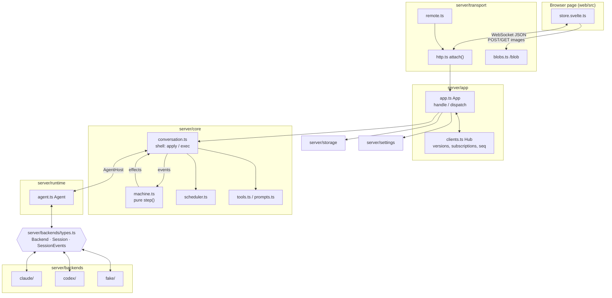

# Architecture

This page explains how Masthead 0.2.0 is put together: which folders exist, which part owns what, where the seams are, and how a message travels from the page to an agent and back. Each part has its own source page for detail.

Everything here was read from the code on the `next` branch. Nothing on this page was checked by running the app.

## Three layers

1. **The browser page** (`web/src/`, Svelte 5). It shows conversations, transcripts, the team map and the settings, and sends the person's actions to the server. It holds no authority: it is a view kept in step by one store object (`web/src/lib/store.svelte.ts`), which speaks protocol version 2 (it says `hello` with `protocol: 2`) and rebuilds itself from the server after a reconnect. Its components, store and styles are described in [Web front end](Source-Web-Front-End.md), [Web store](Source-Web-Store.md), [Web components](Source-Web-Components.md) and [Web styles](Source-Web-Styles.md).
2. **The Masthead server** (`server/`, TypeScript on Node). One long-running process that owns all state: settings, every conversation and agent, slot limits, open approval requests, images. It serves the built page, a WebSocket at `/ws` and the image routes under `/blob`.
3. **Backend processes.** Each agent runs on a *backend*: Claude Code (one `claude` process per running agent, through the Agent SDK), Codex (one shared `codex app-server` process, one thread per agent) or, in tests only, a scripted fake. Masthead uses the person's own installed, signed-in programs. See [Backend interface](Backend-Interface.md).

The page and server share the message types and helpers in `shared/`: `shared/protocol.ts` (version 1 messages, `Settings`, `TeamProfile`, `AgentInfo`, `Item`, agent names), `shared/protocol-v2.ts` (version 2 additions) and `shared/toolline.ts` (one-line tool-call wording). Nothing in `shared/` may import Node or DOM APIs. See [shared/protocol.ts](Source-Shared-Protocol.md), [shared/toolline.ts](Source-Shared-Toolline.md) and [Browser/server protocol](Browser-Server-Protocol.md).

## The server's folders

| Folder / file | What it holds | Page |
|---|---|---|
| `server/main.ts`, `server/cli.ts`, `server/doctor.ts`, `server/paths.ts` | The `masthead` command: argument parsing, starting the server, `masthead doctor`, data-folder paths. | [Command-line launcher](Command-Line-Launcher.md), [server/main.ts](Source-Main.md) |
| `server/app/app.ts` | `App`, the composition root: loads settings, builds the backend registry, the scheduler and the store, restores conversations, answers browser messages (`handle()` → `dispatch()`), holds open approval requests, drives `keepAwake`. | [server/app](Source-App.md) |
| `server/app/clients.ts` | `Hub`: every connected tab, its protocol version, subscriptions, per-conversation event rings with `seq`, draft deltas, clipping, coded errors; `admit()` is the one gate for what a remote device's role allows. | [Clients](Source-Clients.md) |
| `server/core/conversation.ts` | `Conversation`: one chat and its team. The shell around the state machine: owns `states` (one `AgentState` per agent), runs every change through `apply()`, carries out effects in `exec()`, enforces the team rules in the tool actions (`spawn`, `message`, `stop`, `setOwnEffort`, `setAgentEffort`), keeps held messages and the clocks. | [Conversation](Source-Core-Conversation.md) |
| `server/core/machine.ts` | The pure life-cycle state machine: `step(state, event, ctx)` → `{state, effects}`; phases, holds, wait reasons. | [Machine](Source-Core-Machine.md), [State machine](State-Machine.md) |
| `server/core/scheduler.ts` | `Scheduler`: slots per tier across all conversations, fair queueing. | [Scheduler](Source-Core-Scheduler.md) |
| `server/core/prompts.ts` | System text for agents and the `<agent-report>` / `<agent-message>` envelopes. | [Prompts](Source-Core-Prompts.md) |
| `server/core/tools.ts` | `teamToolDefs()`: the team tools as backend-neutral `ToolDef`s, and the `TeamActions` interface `Conversation` implements. | [Tools](Source-Core-Tools.md) |
| `server/runtime/agent.ts` | `Agent`: one team member's runtime around one backend `Session`. Turns neutral backend events into transcript items, drafts, usage and status; tracks unanswered message ids, background work and usage-limit detection. | [Runtime](Source-Runtime.md) |
| `server/backends/types.ts` | The seam: `Backend`, `Session`, `SessionSpec`, `SessionEvents`, `BackendCaps`. | [Backend interface](Backend-Interface.md) |
| `server/backends/registry.ts`, `claude/`, `codex/`, `fake/`, `proctree.ts` | Detection and the three backends; `proctree.ts` starts CLIs so that stopping them stops their child processes too. | [Claude](Source-Backend-Claude.md), [Codex](Source-Backend-Codex.md), [Fake](Source-Backend-Fake.md) |
| `server/settings/settings.ts` | Settings v2: load, migrate from 0.1.x, `sanitizeSettings()`, `tierLimit()`, team profiles. | [Settings](Source-Settings.md), [Team profiles and settings](Team-Profiles-and-Settings.md) |
| `server/storage/` | `store.ts` (conversations), `transcript.ts` (paged reading of `.jsonl` transcripts), `blobs.ts` and `images.ts` (content-addressed images), `migrate.ts` (file format), `atomic.ts` (safe writes). | [Storage](Source-Storage.md), [Storage on disk](Storage-on-Disk.md) |
| `server/transport/` | `http.ts` (local listener, page, `/ws`, `attach()`), `auth.ts` (local secret), `blobs.ts` (`/blob` routes and per-socket tokens), `remote.ts` (the private listener `tailscale serve` reaches). | [server/http.ts](Source-Http.md), [Auth](Source-Transport-Auth.md), [Transport remote](Source-Transport-Remote.md) |
| `server/remote/` | Remote access over Tailscale: `access.ts`, `authorise.ts` (roles), `registry.ts` (devices), `tailscale.ts`. | [Remote access](Remote-Access.md), [Security model](Security-Model.md) |
| `server/service/` | Background service install per platform (systemd, launchd, Task Scheduler) and `awake.ts` (holding off idle sleep). | [Building, testing, installing](Building-Testing-Installing.md) |

## Layers and the seam



The seams are interfaces, so each layer can be built and tested without the one below:

- **`ConversationHost`** (`server/core/conversation.ts`) is what a `Conversation` needs from `App`: settings, the scheduler, change callbacks (`agentChanged`, `itemChanged`, `draftChanged`, `metaChanged`, `rateLimit`), `askPermission` / `cancelPermissions`, the backend for a tier, `storeImage`, and an optional `clock`.
- **`AgentHost`** (`server/runtime/agent.ts`) is what an `Agent` needs from its `Conversation`: folder, scheduler, settings, its team tools, change callbacks, `turnEnded`, `processLost`, `backgroundIdle`, `askPermission` and its backend.
- **`TeamActions`** (`server/core/tools.ts`) is what the team tools can do. `Conversation` implements it, so every tool call lands in the object that enforces the rules.
- **`Backend` / `Session` / `SessionEvents`** (`server/backends/types.ts`) is the core↔runtime↔backend seam. A backend opens sessions from a `SessionSpec` (model, effort, folder, system text, `ToolDef`s, permission mode, `lean`, environment), takes messages with `Session.send(id, content)`, and reports what happened through neutral `SessionEvents` (`turnStarted`, `text`, `draft`, `toolStarted`/`toolFinished`, `turnEnded` with the consumed message ids, `background`, `usage`, `rateLimit`, `exited`, `askPermission`). The file's own rule: a backend "knows nothing about teams", "never builds protocol Items or page text, and it decides nothing about when an agent's work is over". What a backend can and cannot do is declared in `BackendCaps` (effort levels, live effort, resume, images, background reporting, permission model, …), and the runtime and tools read it (for example `teamToolDefs()` offers only the effort levels in `caps.efforts`).
- **`HubHost`** (`server/app/clients.ts`) is what the `Hub` needs from `App`: a conversation snapshot, one full item, the `state` for a tab.

Knowledge flows one way: an `Agent` reports events and never decides team policy; the `Conversation` decides policy (through its machine) and never touches sockets; `App` handles sockets, disk and approvals; the `Hub` decides who gets which event in which form.

## The shell and the machine

`Conversation` keeps one `AgentState` per agent in `states`. Every change to an agent's life cycle goes through `apply(agent, event)`:

1. Facts owned elsewhere are read fresh into the state: live children (`liveChildren()`), background work (`Agent.hasBackgroundWork`), the report debt (`Agent.owesReport`).
2. `step()` in `server/core/machine.ts` returns the next state and a list of effects. It is given a `Ctx` with the awake-time clock (`now`), the wall clock (`wall`), whether the runtime is busy, whether automatic effort is on, and the agent's last text.
3. `show()` updates what the page sees (`waiting`/`idle` status, `waitingFor`, `pausedUntil`).
4. `exec()` carries out each effect: `notice`, `end`, `setEffortLow`, `releaseSlot`, `dropHeld`, `resumeRuntime`, `stopChildren`, `report`, `childEndedQuietly`, `noAnswer`, `save` (`send`, `pauseRuntime` and `remind` are handled by the caller).

The runtime's own status changes (it started a process, a turn began, it ended) enter as a `Status` event from `Conversation.agentChanged()`. Two rules decide conflicts in the runtime's favour: `show()` does not overwrite a status the runtime just reported (so a paused agent the person woke shows `running` during that turn), and a `done`/`failed`/`stopped` status from the runtime does not end a state that is `queued` (a wake-up the runtime has not shown yet). The lead never ends: an end status makes it `waiting` or `idle`. Full detail: [State machine](State-Machine.md) and [Agent life cycle](Agent-Life-Cycle.md).

## How a message flows end to end

```mermaid
sequenceDiagram
  participant B as Page (store.svelte.ts)
  participant T as transport/http.ts attach()
  participant P as App
  participant H as Hub
  participant C as Conversation
  participant M as machine step()
  participant A as Agent (runtime)
  participant K as Backend session
  participant S as Store
  B->>T: {t:'send', convId, text, blobs?}
  T->>P: handle(client, parsed)
  P->>H: admit() / intercept()
  P->>P: dispatch(): check text, images, refs
  P->>C: userSend(text, images, agentId?, refs)
  C->>A: addItem({kind:'user'})
  C->>M: apply(Woken), apply(Input from person)
  C->>A: deliver(content)
  A->>K: send(id, content) (after a slot, if no session)
  K-->>A: SessionEvents: turnStarted, draft, text, toolStarted…
  A->>C: itemChanged / draftChanged / agentChanged
  C->>P: same, with the conversation
  P->>S: appendItem (items); scheduleSave (agent info, 400 ms)
  P->>H: publish(event)
  H-->>B: v2: seq'd item / draft delta / agent (subscribers only)
  K-->>A: turnEnded({consumed, text, error?})
  A->>C: turnEnded(outcome)
  C->>M: apply(TurnEnded) → effects (report, end, notice…)
```

In words:

1. The page sends `{t:'send'}` over `/ws`. `attach()` in `server/transport/http.ts` parses the JSON (bad JSON gets an `invalid` error) and calls `App.handle()`.
2. `App.handle()` lets the `Hub` check the tab (`admit()`: protocol version, the remote device's role, subscription) and take connection-level messages (`intercept()`: `hello`, `subscribe`, `draft_sync`, `item_full`, …). Remote-access messages go to `remoteMessage()`; everything else to `dispatch()`.
3. `dispatch()` checks the text (at most 400,000 characters), inline images and uploaded image refs, creates the conversation if `convId` is null (on the chosen team profile), and calls `Conversation.userSend()`.
4. `userSend()` adds the person's item, wakes the target through the machine (`Woken`, then `Input` from the person), delivers any messages held for a paused agent first, then calls `Agent.deliver()`.
5. The `Agent` opens a backend session if it has none, after asking the `Scheduler` for a slot in its tier, and sends the message with an id. The backend reports events; the `Agent` turns them into `Item`s, drafts and `AgentInfo` changes and passes them up through `AgentHost`.
6. `App` appends items to the agent's transcript file at once (`Store.appendItem`), saves conversation metadata at most every 400 ms (`scheduleSave()`), and hands every event to `Hub.publish()`. The `Hub` sends it to each tab in the form it speaks: unchanged to a version 1 tab; to a version 2 tab with a `seq`, clipped, drafts as deltas, and only for conversations it subscribed to.
7. When a turn ends with nothing of the agent's still unanswered, `Agent` calls `Conversation.turnEnded()`, which applies `TurnEnded` to the machine. Its effects decide what happens next: a sub-agent with no holds finishes and its report is delivered to its parent (wrapped by `reportEnvelope()`); one with holds goes `waiting`; the lead goes `idle` or `waiting`.

A report from a child to a parent, or a `send_message`, takes the same path from step 4 on, starting at `Conversation.deliverTo()` instead of `userSend()`. Walkthroughs: [Sending a message](Walkthrough-Sending-a-Message.md), [Starting an agent](Walkthrough-Starting-an-Agent.md).

## Clocks

`Conversation` uses two clocks (`Clock` in `server/core/conversation.ts`):

- the **wall clock** (`now()`) for deadlines, such as when a usage limit resets;
- the **awake-time clock** (`active()`) for durations: the run-time limit, the background cap, "running for 3m" in `list_agents`. It advances with the wall clock but by at most 60 s per reading (`ACTIVE_STEP_MS`), and a 15 s timer reads it, so time the computer slept counts as at most one step. A gap of more than 60 s is taken as a sleep, and each working conversation's lead gets the notice "This computer was asleep from HH:MM to HH:MM; work carried on afterwards." (`Conversation.wokeFromSleep()`).

A shared 30 s timer (`TICK_MS`, `tick()`) runs only while something needs watching (a pause, a background wait, or a run-time limit with live sub-agents) and feeds `Tick` events to the machine.

## What is pure and testable without a process

- **`server/core/machine.ts`** is pure: no process, timer, disk or other agent. `step()` takes a state, an event and a context and returns a new state and effects. Every row of the transition table has a test in `test/machine.test.ts`.
- **`Conversation`** runs without real backends or real time: the host can pass a `clock` (wall time, awake time, a manual timer) and a backend per tier, normally the scripted fake (`server/backends/fake/`). `test/conversation.test.ts` drives teams this way.
- **`Hub`** (`server/app/clients.ts`) takes a `HubHost` and fake `Client`s; `clipItem()` and `codeOf()` are plain functions (`test/protocol-v2.test.ts`, `test/protocol-v1.test.ts`).
- **`App`** accepts its store, settings, settings file, registry, remote access and awake holder in its constructor, so tests never touch the person's files or start Claude Code (`test/app.test.ts`).
- **Settings** (`sanitizeSettings()`, `tierLimit()`, `withBuiltInProfiles()`, `resetProfile()`), **prompts**, **`teamToolDefs()`**, **`Scheduler`**, `shared/` helpers, `awakeCommand()`, `authorise()` (with injected Tailscale and registry) and the service managers (with injected `Deps`) are plain code.
- Backends are checked against one shared contract (`test/backend-conformance.ts`); the real Claude Code and Codex runs are the live tests, which are not part of `npm test`. See [Live tests](Live-Tests.md) and [Tests](Source-Tests.md).

## Related pages

[State machine](State-Machine.md) · [Agent life cycle](Agent-Life-Cycle.md) · [Backend interface](Backend-Interface.md) · [Browser/server protocol](Browser-Server-Protocol.md) · [Team rules](Team-Rules.md) · [Safety model](Safety-Model.md) · [Glossary](Glossary.md)
