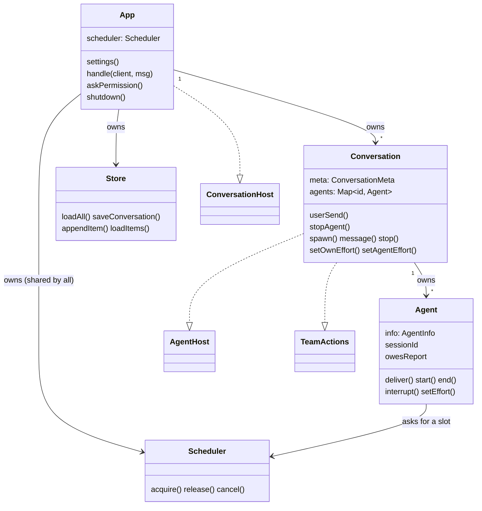
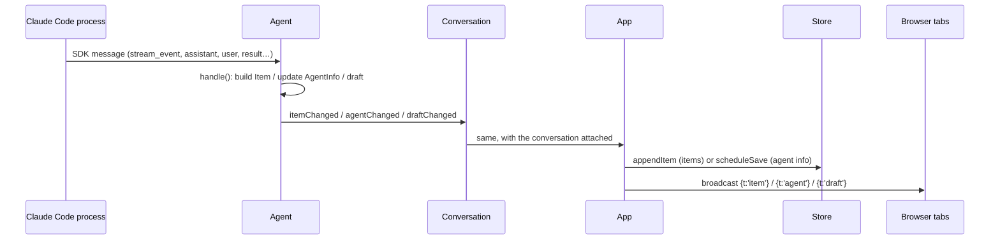

# Architecture

This page explains how Masthead is put together: which parts exist, which part owns what, and how they talk to each other. Each part has its own source page for detail.

## Three layers

1. **The browser page** (`web/src/`, Svelte 5). It shows conversations, transcripts, the team map and the settings, and sends the person's actions to the server. It holds no authority: it is a view, kept in step by one store object (`web/src/lib/store.svelte.ts`) and rebuilt from the server whenever the connection comes back. See [Web front end](Source-Web-Front-End.md).
2. **The Masthead server** (`server/`, TypeScript on Node 22 or newer). One long-running process that owns all state: settings, every conversation and agent, the slot limits and open approval requests. It serves the built page and a WebSocket at `/ws`.
3. **Claude Code processes.** Each running agent is one `claude` process, started by the Agent SDK's `query()` function. Masthead points the SDK at the `claude` program it finds on the machine (`findClaude()` in `server/config.ts`), so the agents use the person's own installation, sign-in and Claude Code settings.

A **WebSocket** is a two-way connection that stays open between the page and the server, so the server can push updates (new text, status changes) without the page asking. Messages on it are JSON objects whose shapes are defined once in `shared/protocol.ts` and imported by both sides; see [Browser/server protocol](Browser-Server-Protocol.md). The `shared/` folder also holds the helpers both sides need to agree on: agent names (`agentName()`), model names (`modelLabel()`) and tool-call wording (`shared/toolline.ts`).

## The server's objects

- **`App`** (`server/app.ts`) is the whole application behind the page. It loads settings, finds Claude Code, restores saved conversations, keeps the set of connected browser tabs, turns browser messages into calls, and turns every change into a broadcast to all tabs. See [server/app.ts](Source-App.md).
- **`Conversation`** (`server/conversation.ts`) is one chat: a lead plus every agent started under it. It **owns the team rules**: who may start whom, where reports go, who may stop or change the effort of whom. See [server/conversation.ts](Source-Conversation.md).
- **`Agent`** (`server/agent.ts`) is one team member: the app's record of it (`AgentInfo`) plus the Claude Code session behind it. It turns the stream of SDK messages into transcript items, statuses and usage numbers. See [server/agent.ts](Source-Agent.md).
- **`Scheduler`** (`server/scheduler.ts`) limits how many agents of each tier run at once across every conversation, and shares free slots fairly. See [Slot scheduling](Slot-Scheduling.md).
- **`Store`** (`server/store.ts`) reads and writes conversations on disk. See [Storage on disk](Storage-on-Disk.md).
- **`teamTools()`** (`server/tools.ts`) builds the extra tools each agent gets (`send_message`, `spawn_agent`, …) as an in-process MCP server. See [server/tools.ts](Source-Tools.md).
- **`serve()`** (`server/http.ts`) is the HTTP and WebSocket front door with the local-only security checks. See [Security model](Security-Model.md).
- **`server/main.ts`** is the program entry point: the `masthead` command. See [Command-line launcher](Command-Line-Launcher.md).

## Why the "host" interfaces exist

The objects are wired together through small interfaces rather than direct references to each other's classes:

- `AgentHost` (in `server/agent.ts`) is everything an `Agent` needs from its owner: the folder to run in, the scheduler, settings, the tools, and callbacks such as `agentChanged`, `itemChanged`, `turnEnded` and `processLost`. `Conversation` implements it.
- `ConversationHost` (in `server/conversation.ts`) is everything a `Conversation` needs from the app: settings, scheduler, Claude's path, change callbacks, and `askPermission` / `cancelPermissions`. `App` implements it.
- `TeamActions` (in `server/tools.ts`) is what the agents' tools can do. `Conversation` implements it, so every tool call lands in the object that enforces the rules.

The effect is a one-way chain of knowledge: an `Agent` reports events upward and never decides team policy; the `Conversation` decides policy and never deals with sockets; the `App` deals with sockets, disk and approvals. Changes bubble up the chain (`Agent` → `Conversation` → `App` → every browser tab), and requests travel down it.

## How events flow

Three kinds of change, three treatments in `App`:

| Change | Saved how | Sent as |
|---|---|---|
| A transcript item is added or updated | Appended to the agent's `.jsonl` file at once (`Store.appendItem`) | `{t:'item'}` |
| An agent's info changes (status, effort, usage, activity) | The conversation file is rewritten at most every 400 ms (`scheduleSave`) | `{t:'agent'}` |
| The text being streamed right now ("draft") | Not saved | `{t:'draft'}`, at most every 70 ms per agent |

Every broadcast goes to **every** connected tab, for every conversation. The server does not track which conversation a tab is looking at; the page filters by `convId` (`receive()` in `web/src/lib/store.svelte.ts`). The conversation list itself is re-sent whenever a conversation's title or time changes, or its `busy` flag flips.

## Agent sessions are long-lived processes

Each `Agent` feeds its Claude Code process through an input stream (the `Channel` class in `server/agent.ts`) instead of starting a new process per message. That is why a report or a message from another agent can reach an agent while it is still working: it is pushed into the open stream and Claude Code picks it up. When a sub-agent finishes, its process is closed and its slot returned; sending it something later starts a new process that **resumes** the same Claude Code session (by `sessionId`), so it keeps its context. The lead's process is not closed between turns; it stays open until the app shuts down or the lead's process is lost. See [Agent life cycle](Agent-Life-Cycle.md).

## Where the rules are enforced

The agents are told the rules in their system prompt (`server/prompts.ts`), but the prompt is advice. Enforcement is in code:

- An agent only gets the tools its tier allows (`teamTools()`): Haiku gets no `spawn_agent`; only agents that can start others get `stop_agent` and `set_agent_effort`; nobody gets the effort tools when automatic effort is off.
- Every tool call is checked again in `Conversation` (`spawn`, `stop`, `setOwnEffort`, `setAgentEffort`): tier, ancestry, limits and effort ceilings.
- Claude Code's own sub-agent and team tools (`Agent`, `Task`, `SendMessage`, …) and its ways to start work later or elsewhere (`CronCreate`, `RemoteTrigger`, `SendToProject`, `PushNotification`, …) are disallowed for every agent so they cannot bypass Masthead's team (`DISALLOWED` in `server/agent.ts`).
- Agents cannot wake an agent the person stopped, and nobody can wake an agent whose tier is set to 0 (`Conversation.message()` and `userSend()`).
- The socket only accepts a browser that presents the local secret (see [Security model](Security-Model.md)).
- The slot limits are enforced by the `Scheduler` before a process is started.

## Related pages

[Team rules](Team-Rules.md) · [Agent life cycle](Agent-Life-Cycle.md) · [Browser/server protocol](Browser-Server-Protocol.md) · [Index](Index.md)
