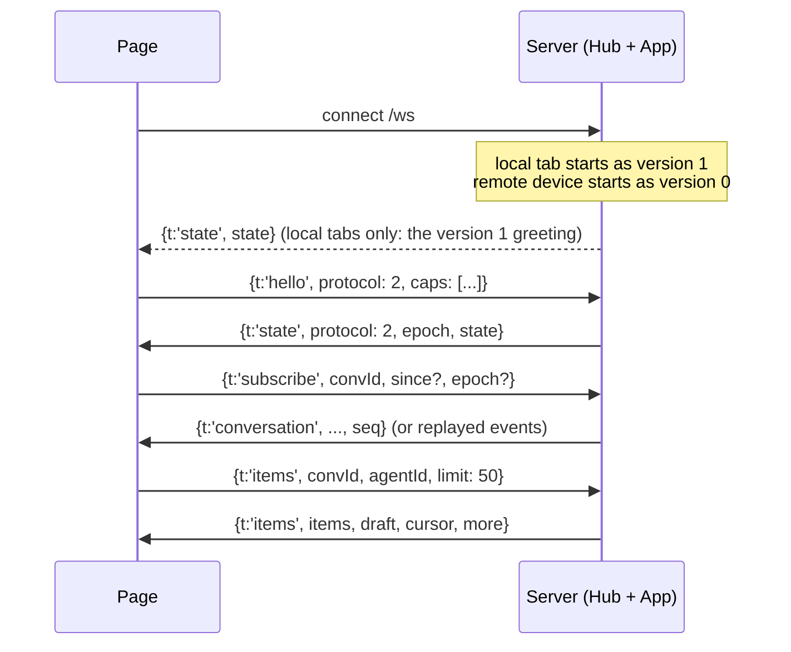

# Browser/server protocol

The page and the server talk over one WebSocket at `/ws`, plus two small HTTP routes for images (`/blob`). Every socket message is a JSON object with a `t` field naming its type. Masthead 0.2.0 speaks **protocol version 2**; an old (0.1.x) page that never asks for version 2 is still served through a **version 1 adapter**.

Where it lives:

- Types: `shared/protocol.ts` (`ClientMsg`, `ServerMsg`, the version 1 set, already extended with paging fields, `blobs`, `profile` and the error `code`) and `shared/protocol-v2.ts` (`ClientMsgV2`, `ServerMsgV2`, including the remote-access and backend messages, `PROTOCOL_VERSION = 2`, `Capability`, `ErrorCode`, `CLIP_CHARS`, `RING_SIZE`, `ApprovalSummary`). The comment in `protocol-v2.ts` says the two files are to merge into one before 0.2.0; on disk they are still two.
- Per-tab handling: `Hub` in `server/app/clients.ts` (versions, subscriptions, sequence numbers, draft deltas, clipping, error shapes, the role gate).
- Requests: `App.handle()` → `Hub.admit()` → `Hub.intercept()` → `App.remoteMessage()` → `App.dispatch()` in `server/app/app.ts`.
- Socket plumbing: `attach()` in `server/transport/http.ts` (local) and `server/transport/remote.ts` (remote devices).
- Image routes: `server/transport/blobs.ts`.

Everything here was read from the code. It was not checked by running the app; the behaviour is covered by `test/protocol-v2.test.ts`, `test/protocol-v1.test.ts`, `test/backpressure.test.ts` and `test/send-images.test.ts`; the compaction messages by `test/compact-app.test.ts`.

## The socket

- **Local browser.** The page opens `/ws` offering two subprotocols, `masthead` and `key.<secret>`. Without the right key, or with a wrong Host or Origin, the upgrade is refused with 403. The server answers with the `masthead` subprotocol only. See [Security model](Security-Model.md).
- **Remote device** (over Tailscale). The socket arrives through the private listener in `server/transport/remote.ts` with a `device.<token>` subprotocol and is given the device's role (`read`, `approve` or `full`). See [Remote access](Remote-Access.md) and [Using Masthead from your phone](Using-Masthead-From-Your-Phone.md).
- Largest message accepted: 48 MiB (`MAX_WS_PAYLOAD`, both listeners).
- The server pings every 30 s (`PING_MS`); a socket that did not answer the previous ping is terminated.
- **Back-pressure** (`attach()`): while more than 4 MiB is waiting to go out to a socket, `draft` messages to it are dropped (the page sees a gap in `dseq` and asks for the whole draft); past 32 MiB the socket is closed with code 4002, "Too far behind.", and the page resyncs when it reconnects.
- Each socket gets its own **blob token** (`BlobTokens.issue()`), sent in `state.blobToken`, for fetching images.

## Negotiation

`Hub.add()` gives each new socket a session with a version:

| Version | Who | What it is sent |
|---|---|---|
| 0 | A remote device that has not said hello with protocol 2 yet | Nothing. Any message other than `hello` is refused with code `protocol` ("Say hello with protocol 2 first."). A plain `hello` without `protocol` is refused too ("Say hello with protocol 2."). |
| 1 | A local tab, until it says hello with protocol 2 | The version 1 greeting `{t:'state', state}` on connect (`App.connect()`, `Hub.greets()`), then every event unchanged, for every conversation. |
| 2 | Any tab after `{t:'hello', protocol: 2}` | List-level events always; a conversation's detailed events only while subscribed to it, with sequence numbers. |

`hello` handling (`Hub.intercept()`):

- `{t:'hello'}` without `protocol` from a local tab: answered by `App.dispatch()` with a version 1 `state`. From a tab already on version 2: answered with the version 2 `state`.
- `{t:'hello', protocol: 2, caps?}`: the tab becomes version 2; `caps` (strings) are recorded; the reply is the version 2 `state`.
- Any other `protocol` value: error `protocol`, "This Masthead speaks protocol 2. Reload the page."

**Capabilities.** `Capability` is `'drafts-delta' | 'items-paging' | 'blobs' | 'resync'`, and the page sends all four. The `Hub` stores them (`Session.caps`) for later use; nothing reads them yet, so every version 2 tab gets deltas, paging, blob refs and resync whatever it listed.

**Version 2 `state`** (`Hub.stateV2()`): `{t:'state', protocol: 2, epoch, state}`. `state` is the `AppState` (`version`, `settings`, `conversations`, `claude`, `home`, `usage`, `blobToken`), with two differences from version 1: `pending` holds `ApprovalSummary` objects (`id`, `convId`, `agentName`, `kind`) instead of whole requests, and `backends` (the registry's detection status) is added. A local tab also gets `remote` (the remote-access state); a remote device never does (`App.state()`).

**`epoch`** is six random bytes in hex, made when the server starts (`Hub.epoch`). A page sends it back with `subscribe`, so a `seq` from an earlier server start is never replayed.

## Subscriptions, `seq` and resync

Per conversation, the `Hub` keeps a ring of recent version 2 events (`record()`): each gets the next `seq` for that conversation. The ring holds at most 500 events (`RING_SIZE`) and stops growing past 8 MiB (`RING_BYTES`); older events drop off the front.

Which events are per-conversation (`convOf()`): `agent`, `item`, `draft` (and the `Hub`'s own `draft_end`) and `permission_request`. These get a `seq` and go only to version 2 tabs subscribed to that conversation. Everything else (`conversations`, `deleted`, `settings`, `rate_limit`, `permission_resolved`, `backends`, and the team-compaction events `compact` and `archived`) is list-level and goes to every version 1 and 2 tab. `remote` goes only to local tabs (`Hub.publishLocal()`).

`{t:'subscribe', convId, since?, epoch?}` (`Hub.intercept()`):

1. Unknown conversation: error `not_found`, "That conversation no longer exists."
2. The tab is subscribed.
3. `epoch` given and different from the server's: `{t:'resync', convId}` then a snapshot.
4. `since` given and still in the ring (`oldest − 1 ≤ since ≤ current seq`): every event after `since` is replayed, and nothing else is sent.
5. Otherwise a snapshot; if `since` was given (and is not the current `seq`) a `{t:'resync', convId}` comes first.

The **snapshot** is `{t:'conversation', conv, agents, pending, drafts, lastItemIds, seq}`: the conversation meta, every agent's `AgentInfo`, its open approval requests in full, each open draft with its `dseq` (keyed by agent id), each agent's newest stored item id (`lastItemIds`, so a reconnecting page fetches only newer items), and the current `seq`. A conversation's compaction state travels in `conv.compact`, and archived agents are in `agents` with their `archived` time; there is no separate compaction snapshot.

`{t:'unsubscribe', convId}` stops the detailed events. A `deleted` event also removes the subscription and the conversation's ring and draft state.

While subscribed to nothing, a version 2 tab still learns that a conversation needs attention: every `permission_request` also sends `{t:'approval', summary}` (an `ApprovalSummary`) to every version 2 tab, subscribed or not, for badges.

## Draft deltas

The runtime reports the whole current draft each time (`App.draftChanged()`, at most every 70 ms per agent). For version 2 tabs `Hub.draftEvent()` turns that into:

- `{t:'draft', convId, agentId, dseq: 1, kind, text}`: a new draft, sent whole (also when the kind changed or the text no longer starts with the old text);
- `{t:'draft', convId, agentId, dseq, kind, append}`: the text grew; `dseq` counts up by one within the draft;
- `{t:'draft_end', convId, agentId, itemId?}`: the draft ended. `itemId` names the `text` or `thinking` item that replaces it. When the draft ends before that item arrives, the end waits up to 1.5 s for it; if it does not come (a turn cut off), `draft_end` is sent without `itemId`.

A gap in `dseq` (for example after back-pressure dropped a delta) is repaired with `{t:'draft_sync', convId, agentId}`: the reply is the whole draft as `{t:'draft', …, dseq, kind, text, seq}` or, if there is none, `{t:'draft_end', convId, agentId, seq}`. The `seq` on these replies is the ring's current one; the replies are not recorded in the ring.

Version 1 tabs get `{t:'draft', convId, agentId, draft}` with the whole text, or `draft: null`, as before.

## Clipped items and `item_full`

For version 2 tabs, a live `item` of kind `tool` is clipped (`clipItem()`): a `result` longer than 16 KiB (`CLIP_CHARS` = 16,384 characters) is cut to that length, and an `input` whose JSON is longer than that becomes `{clipped: "<first 16,384 characters of the JSON>"}`. Such an event carries `truncated: true`. Other kinds are sent whole. The transcript on disk is never clipped by the hub.

`{t:'item_full', convId, agentId, itemId}` returns `{t:'item_full', convId, agentId, item}` with the stored item (`App`'s `fullItem`, which reads the agent's transcript). Unknown agent or item: error `not_found`, "That item no longer exists."

Version 1 tabs get every `item` unclipped.

## Paging transcripts

`{t:'items', convId, agentId, before?, limit?}` (`App.dispatch()`):

- With a numeric `limit`: one page, newest first, `limit` clamped to 1..500. The reply is `{t:'items', convId, agentId, items, draft, cursor, more}`; `items` are oldest first within the page; `cursor` is a byte offset into the transcript file to pass as `before` for the next older page, `null` when there is none (`readPage()` in `server/storage/transcript.ts`). An item written more than once (a tool call and later its result) appears once, in its newest version.
- Without `limit`: the whole transcript (`Store.loadItems()`), as version 1 did.
- Unknown agent: error `not_found`, "That agent no longer exists."

`items` replies are sent straight to the asking tab; they are not clipped and carry no `seq`.

## Page → server

Messages handled by the `Hub` (version 2 only, except `hello`):

| `t` | Fields | Reply |
|---|---|---|
| `hello` | `protocol?`, `caps?` | `state` (see Negotiation). |
| `subscribe` | `convId`, `since?`, `epoch?` | Replayed events, or `resync` and/or `conversation`. |
| `unsubscribe` | `convId` | None. |
| `draft_sync` | `convId`, `agentId` | `draft` (whole) or `draft_end`. |
| `item_full` | `convId`, `agentId`, `itemId` | `item_full`. |

Messages handled by `App.dispatch()`:

| `t` | Fields | What the server does | Reply |
|---|---|---|---|
| `open` | `convId` | Looks up the conversation. | Version 1 `conversation` (`conv`, `agents`, `pending`) to this tab. Version 2 pages use `subscribe` instead. |
| `items` | `convId`, `agentId`, `before?`, `limit?` | See Paging. | `items` to this tab. |
| `send` | `convId` (null = new conversation), `cwd?`, `text`, `images?`, `blobs?`, `agentId?`, `ref?`, `profile?` | Refuses an empty message ("The message is empty."), text over 400,000 characters, more than 8 images, an image over 5 MB, or images over 30 MB together (uploaded and inline counted together). Inline `images` must be PNG, JPEG, GIF or WebP in base64. `blobs` must name pictures already stored in **this** conversation (`checkRefs()`). With `convId: null`: `profile` must name an existing team profile (default: `settings.defaultProfile`), the lead tier's backend must be usable, `cwd` must be a folder (default `settings.defaultCwd`; `~` expands; a different folder becomes the new default), and inline images become stored files. Then `Conversation.userSend()` to the lead, or to `agentId`. **`/compact`**: text that is exactly `/compact`, optionally followed by words, sent to the lead (no `agentId`, or the lead's id) of an existing conversation with no images, is not delivered as chat: it calls `Conversation.startCompact(words)` (see [Compact team](Compact-Team.md)). Sent to a helper, or with images, it is an ordinary message. | `created {convId, ref}` to this tab for a new conversation; then events. |
| `interrupt` | `convId` | `interruptLead()`: ends the lead's current turn, keeps its session; agents it started keep working. | Events. |
| `stop_agent` | `convId`, `agentId` | `stopAgent(agentId, 'Stopped by the person.')`: that agent and everything under it; on the lead, its agents are stopped and the lead interrupted. | Events. |
| `stop_all` | `convId` | `stopAll()`. | Events. |
| `permission` | `requestId`, `decision` (`allow`/`always`/`deny`), `answers?`, `message?` | Settles an open approval or question; an unknown id is ignored (another tab may have answered). See [Permissions and questions](Permissions-and-Questions.md). | `permission_resolved` to every tab. |
| `settings` | `settings` (a `SettingsPatch`) | `sanitizeSettings(patch, current)`: only valid named fields change. Saved, limits re-checked, running agents updated (`Conversation.settingsChanged()`), keep-awake re-evaluated. | `settings` to every tab. |
| `rename` | `convId`, `title` | Whitespace collapsed, trimmed, at most 120 characters; ignored if empty. | `conversations`. |
| `delete` | `convId` | Stops everything, ends all processes, removes the conversation and its folder. | `deleted`, then `conversations`. |
| `compact_answer` | `convId`, `id`, `keep` (helper names), `accept` | The person's answer to the compaction card: `Conversation.answerCompact(id, keep, accept)`. `keep` is filtered to strings and cut to 200 names. Ignored unless `id` is the flow's id and its phase is `proposed`. See [Compact team](Compact-Team.md). | `compact` and `archived` to every tab. |
| `compact_cancel` | `convId` | `Conversation.cancelCompact()`: the flow becomes `cancelled` (allowed until the compacting step ends; helpers already archived stay archived). | `compact` to every tab. |
| `restore_agent` | `convId`, `agentId` | `Conversation.restoreAgent(agentId)`: the archived helper rejoins the team (an id that is not archived is ignored). | `agent`, `conversations`. |
| `archive_items` | `convId`, `agentId`, `before?`, `limit?` | Like `items`, for an archived agent only; any other agent is `not_found` ("That agent is not archived here."). | `archive_items {convId, agentId, items, cursor?, more?}` to this tab (no `draft`). |
| `auto_compact` | `convId`, `on` | `Conversation.setAutoCompact(on)`: switches automatic tidying off (`meta.autoCompact: false`) or back to the setting for this conversation only. A non-boolean `on` is `invalid` ("Say on or off."). | `conversations`. |
| `dirs` | `path` | Lists sub-folders for the folder picker (default home; `~` expands; hidden folders left out; symbolic links to folders included; on Windows, a `drives:` list above a drive root). | `dirs` to this tab. |

Messages handled by `App.remoteMessage()`:

| `t` | Who may send it | What it does |
|---|---|---|
| `remote_settings` | Local browser only | Changes remote-access options and switches it on or off; a refusal arrives later as an error with code `refused`, Tailscale's reason and, if needed, "Run: <command>". |
| `device_decision`, `device_revoke`, `device_role` | Local browser only | Answer a pairing request, remove a device, change its role. |
| `remote_audit` | Local browser only | Replies `{t:'remote_audit', entries}`. |
| `reset_profile` | Local browser, `full` devices | `{id}`: puts a built-in team profile back to how Masthead ships it; an unknown or non-built-in id is `not_found` ("Only a built-in team can be reset."). |
| `check_backends` | Local browser, `full` and `approve` devices | Runs backend detection again; then a `backends` event to every tab. |
| `forget_me` | Remote devices only | The device removes itself. |

The role table is `allowedMessage()` in `server/remote/authorise.ts`: `read` may send `hello`, `open`, `items`, `subscribe`, `unsubscribe`, `draft_sync`, `item_full`, `archive_items`; `approve` adds `permission`, `interrupt`, `stop_agent`, `stop_all`, `check_backends`, `compact_answer`, `compact_cancel`; `full` may send everything except the local-only messages. So for team compaction: any device may read archived chats; an `approve` device may answer the card or cancel; only the local browser and `full` devices may `restore_agent`, switch `auto_compact`, or start a compaction (typing `/compact` is a `send`).

A version 2 tab must also be subscribed to the conversation before sending `archive_items`, `compact_answer`, `compact_cancel`, `restore_agent` or `auto_compact` (`Hub.admit()`; otherwise `refused`, "Subscribe to that conversation first."). Golf's [Security model](Security-Model.md) explains the roles.

Any other `t` gets "Unknown request." (code `invalid`).

## Server → page

| `t` | Fields | When |
|---|---|---|
| `state` | Version 1: `{state}`; version 2: `{protocol: 2, epoch, state}` | On connect (version 1 local tabs), and as the reply to `hello`. |
| `conversations` | `conversations` (newest first, each with `busy`) | A title or time changes, one is deleted, or a conversation's `busy` flag flips. |
| `conversation` | Version 1: `conv`, `agents`, `pending`. Version 2 snapshot: plus `drafts`, `lastItemIds`, `seq` | Reply to `open` (v1) or `subscribe` (v2). |
| `created` | `convId`, `ref?` | Reply to a `send` that started a conversation. |
| `deleted` | `convId` | A conversation was deleted. |
| `items` | `convId`, `agentId`, `items`, `draft`, `cursor?`, `more?` | Reply to `items`. |
| `agent` | `agent: AgentInfo` (+ `seq` for v2) | Any change to an agent: status, effort, usage, activity, `waitingFor`, `pausedUntil`. |
| `item` | `convId`, `agentId`, `item` (+ `seq`, `truncated?` for v2) | A transcript item was added or updated; an update has the same `id` and replaces the earlier one. |
| `draft` | v1: `draft: Draft \| null`. v2: `dseq`, `kind`, `append` or `text` (+ `seq`) | The text or thinking being written now. |
| `draft_end` | `convId`, `agentId`, `itemId?` (+ `seq`) | Version 2 only: the draft ended. |
| `permission_request` | `request` (+ `seq` for v2) | An agent needs approval or the lead asked a question. Version 2 tabs get it only when subscribed. |
| `approval` | `summary: ApprovalSummary` | Version 2 only, every tab: a request was opened somewhere. |
| `permission_resolved` | `requestId` | A request was answered, cancelled or withdrawn. |
| `settings` | `settings` | Settings changed. |
| `rate_limit` | `notice: RateLimitNotice` | A backend reported the usage-limit state; the latest per `type` is kept for `state.usage`. |
| `backends` | `backends` | After `check_backends`. |
| `remote` | `remote` | Local tabs only: the remote-access state changed. |
| `remote_audit` | `entries` | Reply to `remote_audit`. |
| `resync` | `convId` | Version 2: the events since `since` cannot be replayed; a snapshot follows. |
| `item_full` | `convId`, `agentId`, `item` | Reply to `item_full`. |
| `compact` | `convId`, `compact: CompactState \| null` | Every tab (list-level, no `seq`): the team-compaction flow of a conversation changed (`App.compactChanged()`). `null` when the conversation has none. |
| `archived` | `convId`, `agents: AgentInfo[]` | Every tab, right after each `compact`: the conversation's archived agents (those with `archived` set). Restoring sends `agent` instead. |
| `archive_items` | `convId`, `agentId`, `items`, `cursor?`, `more?` | Reply to `archive_items`. |
| `dirs` | `path`, `parent`, `entries`, `error?` | Reply to `dirs`. |
| `error` | `message`, `code?`, `ref?` | Something the tab sent failed (below). |

## Errors

Any error while handling a message is caught in `App.handle()` and sent to that tab only, through `Hub.error()`. The server never crashes on bad input from a tab. If the failed message carried a string `ref` (a `send` does), it is echoed, cut to 80 characters.

- A **version 2 tab, or a remote device still on version 0**, gets `{t:'error', code, message, ref?}`.
- A **local version 1 tab** gets `{t:'error', message, ref?}` without `code`. One exception: unparseable JSON is answered directly by `attach()` with `code: 'invalid'` whatever the version.

Codes (`ErrorCode` in `shared/protocol-v2.ts`):

| Code | Meaning |
|---|---|
| `protocol` | Wrong or missing protocol version: a remote device sent something before saying hello with protocol 2; a tab sent a version 2 message (`subscribe`, `unsubscribe`, `draft_sync`, `item_full`) before saying hello with protocol 2; or `hello` named a protocol other than 2. |
| `refused` | Not allowed: the device's role does not permit the message ("This device may not do that."), a version 2 tab asked for a conversation it has not subscribed to (`open`, `items`, `item_full`, `draft_sync`, `archive_items`, `compact_answer`, `compact_cancel`, `restore_agent`, `auto_compact`: "Subscribe to that conversation first."), a remote-access change was refused (with Tailscale's reason and, if needed, the command to run), or the local browser sent `forget_me`. |
| `not_found` | The conversation, agent, item, picture or team profile does not exist here (also a picture ref from another conversation, and remote access on a server that does not offer it). |
| `too_large` | Over a limit: message text (400,000 characters), image count (8), one image over 5 MB, images over 30 MB together. |
| `invalid` | Malformed JSON or message, unknown request, or a bad field ("The message is empty.", "Unsupported image.", "Bad image list.", a folder that is not a folder, "Allow or deny."). |

Most errors are thrown as `ClientError` with their code. An error thrown as plain `Error` gets a code from its text (`codeOf()`): "no longer exists" → `not_found`; "too long", "larger than", "at most", "too large" → `too_large`; anything else → `invalid` (for example "Claude Code was not found." when a conversation cannot start).

## Image routes (`server/transport/blobs.ts`)

Images are stored per conversation and named by their SHA-256 (`BlobStore` in `server/storage/blobs.ts`). A page uploads pictures before sending, then names them in `send.blobs`.

**Upload: `POST /blob?conv=<convId>`** with the raw image bytes as the body.

- Who may: the local browser, which sends the secret in an `x-masthead-key` header (a custom header no other site can send without a preflight the server never grants); or an approved remote device whose role may send (`server/transport/remote.ts`).
- Answers `200` with a `BlobRef` (`blob` hash, `mediaType`, `w`, `h`, `bytes`), or JSON `{code, message}`:
  - `405 invalid` for another method; `403 refused` when not authorised;
  - `404 not_found` for a bad or unknown conversation id;
  - `413 too_large` for a declared or actual body over 5 MB ("An image may be at most 5 MB."), an image over 8192 pixels a side or 40 megapixels, or a conversation that already holds 500 MB of images;
  - `400 invalid` for an empty body, bytes that are not PNG, JPEG, GIF or WebP (the type is sniffed from the bytes), or a `content-type` that disagrees with the bytes (`application/octet-stream` is accepted as "no type");
  - `500 invalid` if storing fails otherwise.

**Fetch: `GET /blob/<convId>/<sha256>?t=<blobToken>`** (also `HEAD`).

- The token is the socket's `state.blobToken`. It is valid while that socket is open and for 60 s after it closes (`BlobTokens`, `GRACE_MS`), so a quick reconnect does not break images already on the page. Tokens are compared as SHA-256 hashes in constant time.
- `403` without a live token, `404` for an unknown picture, `405` for another method.
- The response carries the stored type, `content-security-policy: default-src 'none'; img-src 'self'; style-src 'unsafe-inline'; sandbox`, `x-content-type-options: nosniff`, `cache-control: private, max-age=31536000, immutable`, `cross-origin-resource-policy: same-origin` and `referrer-policy: no-referrer`.
- No path from the client reaches the file system: the ids and hash are matched against fixed patterns, and only names Masthead wrote are looked up.

## The version 1 adapter

A 0.1.x page (or any local tab that never says hello with protocol 2) keeps working:

- On connect it gets `{t:'state', state}` with full pending requests (`App.connect()`).
- Every event `App` publishes reaches it unchanged, for every conversation; it filters by `convId` itself. It gets no `seq`, no clipping, no `draft_end`, no `approval`.
- `open` and `items` without `limit` work as before.
- Errors come without `code`.
- New conversations use the default team profile unless `send.profile` is given.

Remote devices never get the adapter: `Hub.add()` starts them at version 0, and `App.handle()` refuses a plain `hello` from them.

## Transcript items (`Item`)

Each item has an `id` and a timestamp `ts`, plus one of these kinds (`Item` in `shared/protocol.ts`):

| `kind` | Fields |
|---|---|
| `user` | `text`, `images?`: stored image refs (`BlobRef[]`) in 0.2.0; a count in 0.1.x transcripts |
| `text` | `text` |
| `thinking` | `text` |
| `tool` | `name`, `input`, `result?`, `isError?`, `done`, `images?` (`BlobRef[]` from a tool result) |
| `inbound` | `via` (`task`/`report`/`message`), `from`, `text`, `status?` |
| `notice` | `level` (`info`/`error`), `text` |

## Related pages

[shared/protocol.ts](Source-Shared-Protocol.md) · [Clients](Source-Clients.md) · [server/app](Source-App.md) · [server/http.ts](Source-Http.md) · [Web store](Source-Web-Store.md) · [Security model](Security-Model.md) · [Remote access](Remote-Access.md) · [Architecture](Architecture.md) · [Compact team](Compact-Team.md)
