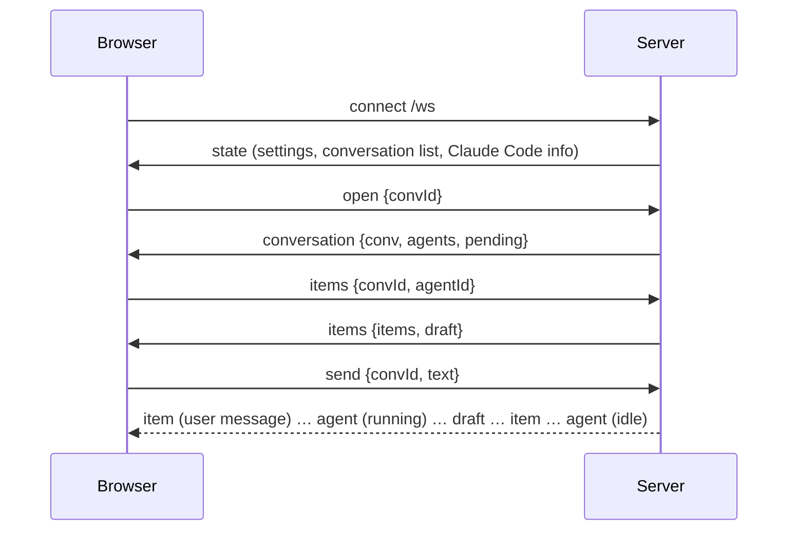

# Browser/server protocol

The page and the server talk over one WebSocket at `/ws`. The page opens it offering two subprotocols, `masthead` and `key.<secret>`; without the right key the upgrade is refused with `403` (see [Security model](Security-Model.md#4-the-local-secret)). The server answers with the `masthead` subprotocol only. Every message is a JSON object with a `t` field naming its type. The types are defined in `shared/protocol.ts`: `ClientMsg` (browser → server) and `ServerMsg` (server → browser). Because both sides import the same file, the TypeScript compiler checks that they agree. The server side is `App.dispatch()` in `server/app.ts`; the socket plumbing is `attach()` in `server/http.ts`.

## General behaviour

- On connecting, the server immediately sends `{t:'state'}` to the new tab (`App.connect()`).
- Messages that cannot be parsed as JSON get `{t:'error', message:'Malformed message.'}` (`attach()`).
- Any error thrown while handling a message is caught and sent back to that tab only as `{t:'error', message, ref?}` (`App.handle()`). If the refused message carried a string `ref` (a `send` does), it is echoed, cut to 80 characters, so the page can tell which of its requests failed. The server never crashes on bad input from a tab.
- Change events (`agent`, `item`, `draft`, `conversations`, `settings`, `permission_*`, `rate_limit`, `deleted`) are **broadcast to every connected tab**, whatever conversation it is showing. The page must filter by `convId`.
- The server pings each socket every 30 seconds; a socket that did not answer the previous ping is terminated.
- The largest message accepted is 48 MiB (`MAX_WS_PAYLOAD`), which leaves room for image attachments.

## Typical exchange

## Browser → server (`ClientMsg`)

| `t` | Fields | What the server does | Reply |
|---|---|---|---|
| `hello` | — | Nothing else. | `state` to this tab. |
| `open` | `convId` | Looks up the conversation. | `conversation` with its meta, every agent's `AgentInfo`, and pending approval requests for it. |
| `items` | `convId`, `agentId` | Reads that agent's transcript from disk (`Store.loadItems`). | `items` with the transcript and the agent's current draft. |
| `send` | `convId` (null = new conversation), `cwd?`, `text`, `images?`, `agentId?`, `ref?` | Validates (non-empty, at most 400,000 characters, at most 8 images of PNG/JPEG/GIF/WebP in base64). With `convId: null`: requires Claude Code to be found, checks `cwd` is a folder (default: settings `defaultCwd`; `~` expands to the home folder), creates the conversation, and remembers a different `cwd` as the new `defaultCwd`. Then `Conversation.userSend()` to the lead, or to `agentId` if given. | `created {convId, ref}` to this tab for a new conversation; then broadcasts. |
| `interrupt` | `convId` | `interruptLead()`: ends the lead's current turn, keeps its session. Agents it started keep working. | Broadcasts. |
| `stop_agent` | `convId`, `agentId` | `stopAgent(agentId, 'Stopped by the person.')`: that agent and everything under it. For the lead: stops all its children and interrupts it. | Broadcasts. |
| `stop_all` | `convId` | `stopAll()`: everything in the conversation. | Broadcasts. |
| `permission` | `requestId`, `decision` (`allow`/`always`/`deny`), `answers?`, `message?` | Settles a pending approval or question; see [Permissions and questions](Permissions-and-Questions.md). Unknown ids are ignored. | `permission_resolved` broadcast. |
| `settings` | `settings` (the type says a whole `Settings`; the server accepts part of one) | `sanitizeSettings(msg.settings, current)`: fields that are missing or invalid keep their current value, so a partial update changes only what it names. Then save to disk and re-check queued slots (`limitsChanged()`, which also fails agents queued for a tier now set to 0). | `settings` broadcast. |
| `rename` | `convId`, `title` | Collapses whitespace, trims, max 120 characters; ignored if empty. | `conversations` broadcast. |
| `delete` | `convId` | Stops everything, ends all processes, cancels a pending save, removes the conversation from memory and its folder from disk. | `deleted` and `conversations` broadcasts. |
| `dirs` | `path` | Lists sub-folders of `path` (default home; `~` expands) for the folder picker. Hidden folders (starting with `.`) are left out; symbolic links to folders are included. | `dirs` to this tab. |

Any other `t` gets "Unknown request."

## Server → browser (`ServerMsg`)

| `t` | Fields | When |
|---|---|---|
| `state` | `state: AppState` = `version`, `settings`, `conversations` (newest first), `claude` (`path`, `version`, `error?`), `home`, `pending` (every open approval request and question, in any conversation), `usage` (the latest `RateLimitNotice` of each limit type reported since the server started) | On connect and on `hello`. |
| `conversations` | `conversations: ConversationMeta[]` (each with `busy`: whether any of its agents is live) | Whenever any conversation's meta changes (title, `updatedAt`), one is deleted, or a conversation's `busy` flag flips. |
| `conversation` | `conv`, `agents: AgentInfo[]`, `pending: PermissionRequest[]` | Reply to `open`. |
| `created` | `convId`, `ref?` | Reply to a `send` that started a conversation; `ref` echoes the browser's own reference so it can match the request. |
| `deleted` | `convId` | A conversation was deleted. |
| `items` | `convId`, `agentId`, `items: Item[]`, `draft: Draft \| null` | Reply to `items`. |
| `agent` | `agent: AgentInfo` (including its `name` from the phonetic alphabet, its `title`, and `waitingFor` while it waits for an answer) | Any change to an agent: status, effort, usage, activity line, session, the start or end of a wait for an answer or of background work. Also sent when an agent is created. |
| `item` | `convId`, `agentId`, `item: Item` | A transcript item was added **or updated**. An update has the same `id` as an earlier item and replaces it (tool calls are sent once when called and again when their result arrives). |
| `draft` | `convId`, `agentId`, `draft: Draft \| null` | The text or thinking being streamed right now (`{kind:'text'\|'thinking', text}`), sent at most every 70 ms; `null` when the block is finished. |
| `permission_request` | `request: PermissionRequest` | An agent needs approval or the lead asked a question. |
| `permission_resolved` | `requestId` | That request was answered, cancelled or withdrawn. |
| `settings` | `settings` | Settings changed (from any tab, or when a new conversation's folder became the default). |
| `rate_limit` | `notice: RateLimitNotice` (`status`: `allowed`/`allowed_warning`/`rejected`, `type?`, `utilization?`, `resetsAt?`) | Claude Code reported the account's usage limit state. Passed straight through from the SDK's `rate_limit_event`; the server also keeps the latest notice per `type` for `AppState.usage`. |
| `dirs` | `path`, `parent` (null at `/`), `entries`, `error?` | Reply to `dirs`. |
| `error` | `message`, `ref?` | Something the tab sent failed. `ref` is the refused message's own `ref`, when it had one. |

## How the page uses them

The page's single store (`web/src/lib/store.svelte.ts`) is the only code that sends or receives these messages. In short:

- On `state` (first load or reconnect), it reopens the conversation in the URL (`#/c/<id>`) or shows the new-conversation screen.
- `open` replaces all agent data. `items` is requested only for agents whose transcript is shown (or previewed in the team map). An `item` for a transcript that has not been loaded is ignored, because it will be fetched whole later.
- `agent`, `item` and `draft` events for other conversations are dropped.
- `created` is matched to the page's own request by `ref`.
- When the page is showing a sub-agent's chat, `send` carries that agent's `agentId`.

Details: [Web store](Source-Web-Store.md).

## Transcript items (`Item`)

Each item has an `id` and a timestamp `ts`, plus one of these kinds:

| `kind` | Fields | Made by |
|---|---|---|
| `user` | `text`, `images?` (a count only; image data is not kept) | `Conversation.userSend()` |
| `text` | `text` | The agent's written text (`Agent.handle`, `assistant` message) |
| `thinking` | `text` | The summarized thinking shown by Claude Code |
| `tool` | `name`, `input`, `result?` (clipped to 12,000 characters), `isError?`, `done` | A tool call; updated when the result arrives (id `tool-<tool_use id>`) |
| `inbound` | `via` (`task`/`report`/`message`), `from`, `text`, `status?` | Something from another agent: the task it was started with, a report from a child, or a message |
| `notice` | `level` (`info`/`error`), `text` | Masthead's own notes: "Stopped.", errors, effort changes, context compaction |

`NewItem` is the same type without `id` and `ts`, used when creating an item (`Agent.addItem()` fills them in).

## Related pages

[shared/protocol.ts](Source-Shared-Protocol.md) · [server/app.ts](Source-App.md) · [server/http.ts](Source-Http.md) · [Web front end](Source-Web-Front-End.md)
