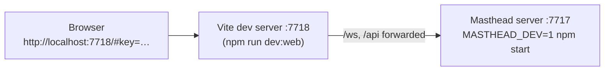

# Building, testing and installing

How Masthead is installed, built, checked and tested on Linux, macOS and Windows. Read from `package.json`, `vite.config.ts`, `web/vitest.config.ts`, `test/`, `scripts/`, `.github/workflows/ci.yml` and `AGENTS.md` on branch `next` on 2026-11-27 (0.1.4, on the way to 0.2.0). Detailed pages: [Build configuration](Source-Build-Config.md), [Tests](Source-Tests.md), [Installing](Source-Install-Scripts.md), [CI](Source-CI.md), [Platforms](Platforms.md).

## Requirements

- **Linux, macOS 13+ or Windows 10 1809+ / 11** (`os` in `package.json`). WSL counts as Linux.
- **Node.js 22 or newer** (`engines`).
- **Claude Code**, installed and signed in. It is not an npm dependency: Masthead finds the one on the machine ([Platforms](Platforms.md#finding-claude-code)).
- For the browser test only: Chromium (Playwright's own, or a system one).

## Installing from npm (once published)

**The package is not published yet.** `package.json` has `"private": true` and the name `@luxorium/masthead` is a placeholder until the person decides. The commands below are the planned way (`docs/plans/0.2.0/distribution.md` §2), with that placeholder. They are the same on all three systems:

```sh
npm install -g --omit=optional @luxorium/masthead
masthead service install      # start at login (optional)
masthead doctor               # one line per check, exit 1 if something is wrong
masthead                      # open the page, signed in
```

`--omit=optional` skips the Agent SDK's private Claude Code binary, which Masthead never runs ([Build configuration](Source-Build-Config.md#optional-packages)).

| System | Service written by `masthead service install` | Opens the browser with |
|---|---|---|
| Linux | systemd user unit | `xdg-open` or `gio` |
| macOS | launchd agent `io.github.luxorium.masthead` | `open` |
| Windows | Task Scheduler task `Masthead` (no admin) | `explorer.exe` |

On Windows npm installs a `masthead.cmd` shim, so `masthead` works from PowerShell and `cmd`. Package-manager outlines (Homebrew, AUR, Scoop) exist but are not published ([Installing](Source-Install-Scripts.md#the-packaging-files)). Only the Linux path has been run on a real machine; macOS and Windows are covered by CI's pack-and-install and by the release checklist ([Platforms](Platforms.md#what-ci-proves-and-what-needs-a-real-machine)).

To try the packed package from a checkout, as CI and the release checklist do:

```sh
npm pack                                                    # runs prepack (a build)
npm install -g --omit=optional ./luxorium-masthead-0.1.4.tgz
masthead --version
```

## Installing from source

- **Linux:** `scripts/install.sh [--force]` builds, asks the copy on 7717 whether agents are working, installs under `~/.local/lib/masthead`, writes a `masthead` command, a systemd user unit and a desktop entry, and restarts the service. `scripts/uninstall.sh` removes it and keeps the data. This is now the developer path ([Installing](Source-Install-Scripts.md#what-installsh-does)).
- **macOS and Windows:** there is no script. Build, pack and install the tarball as above, then `masthead service install`.

## npm scripts

| Script | Runs | Purpose |
|---|---|---|
| `npm run build` | `build:server`, then `build:web` | Full build into `dist/`. |
| `npm run build:server` | `tsc -p tsconfig.server.json` | Compiles `server/` and `shared/` into `dist/server/` and `dist/shared/`. |
| `npm run build:web` | `vite build` | Bundles the page from `web/` into `dist/web/`. |
| `npm run dev:web` | `vite` | The page with hot reload on `MASTHEAD_DEV_WEB_PORT` (default 7718), forwarding `/ws` and `/api` to `127.0.0.1:<MASTHEAD_PORT>` (default 7717). Stops if the port is taken or a port value is invalid. |
| `npm run check` | `tsc … --noEmit` and `svelte-check` | Type-checks the server and the page without writing files. |
| `npm test` | `node --import tsx --test test/*.test.ts` | Server unit tests. No Claude Code needed. |
| `npm run test:web` | `vitest run --config web/vitest.config.ts` | Page tests in happy-dom (some in jsdom). No browser needed. |
| `npm run test:live` | `node … --import tsx test/live.e2e.ts` | End-to-end against the real Claude Code. **Spends usage.** |
| `npm start` | `node --disable-warning=… dist/server/main.js serve` | Runs the built server in the terminal, on 7717 unless `--port` or `MASTHEAD_PORT` says otherwise. |
| `npm pack` | `prepack` (`npm run build`), then packs | The tarball, from the `files` list. |

On 2026-11-27 (working tree on `next`, Linux, other agents editing): `npm run check` found 0 errors; `npm test` ran 379 tests, 378 passed, 1 skipped, 0 failed; `npm run test:web` ran 15 files, 62 tests, all passed. `npm pack --dry-run` gave 425 files, 325.8 kB.

## Output layout

```text
dist/
  server/   compiled server (main.js is the `masthead` command)
  shared/   compiled shared/
  web/      built page: index.html, favicon.svg, and hashed files under assets/
```

`dist/` is ignored by git. The server looks for the page in `../web` next to `dist/server/` (`webDir` in `server/main.ts`).

## Tests

| Kind | Command | Needs | Where it runs |
|---|---|---|---|
| Server unit tests | `npm test` | nothing | locally, CI on all three systems (Node 22, 24) |
| Page tests | `npm run test:web` | nothing | locally, CI on all three |
| Browser test, fake backend | `node scripts/ci-e2e.mjs [shots]` | a build, Chromium | locally, CI on all three (Node 24) |
| Browser test, real Claude Code | `node test/ui.e2e.mjs <url> <shots>` against a test server | a build, Chromium, Claude Code; spends usage | locally only |
| Live run | `npm run test:live` | Claude Code; spends usage (Haiku for every tier) | locally only |

Some unit tests are skipped on Windows because they need POSIX modes or bash (for example in `test/launcher.test.ts` and `test/doctor.test.ts`). Details of every test file: [Tests](Source-Tests.md).

### Browser test on the fake backend

```sh
npm run build
npx playwright-core install chromium     # once
node scripts/ci-e2e.mjs e2e-shots
```

`scripts/ci-e2e.mjs` makes fresh temporary folders, picks a free port (never 7717), starts the built server with `MASTHEAD_BACKEND=fake` and `MASTHEAD_ALLOW_FAKE=1` plus its own `MASTHEAD_DATA_DIR` and `MASTHEAD_CONFIG_DIR`, waits for `/api/health`, runs `test/ui.e2e.mjs` with `MASTHEAD_E2E_BACKEND=fake`, and stops the server through `/api/shutdown`. It needs no Claude account and runs the same on all three systems. Step by step: [CI](Source-CI.md#scriptsci-e2emjs-step-by-step).

`MASTHEAD_BACKEND=fake` alone is refused ("for tests only and also needs MASTHEAD_ALLOW_FAKE=1"), so a stray variable cannot put a real install on the fake backend. `MASTHEAD_E2E_BACKEND=fake` is read only by the test: it builds the team one tool call per message and skips checks that need a model's writing.

### Browser test against real Claude Code

```sh
npm run build
T=$(mktemp -d)
MASTHEAD_CONFIG_DIR=$T/config MASTHEAD_DATA_DIR=$T/data npm start -- --port 7799 &
MASTHEAD_DATA_DIR=$T/data node test/ui.e2e.mjs http://127.0.0.1:7799 $T/shots   # finds the key in $T/data/secret
MASTHEAD_CONFIG_DIR=$T/config MASTHEAD_DATA_DIR=$T/data node dist/server/main.js stop --port 7799
```

(bash; not run for this page.) Put cheap models and `permissionMode: "default"` in `$T/config/settings.json` first, because the test sends real messages; [Tests](Source-Tests.md#running-it-against-real-claude-code) has a settings file. `test/ui.e2e.mjs` refuses port 7717. The key is taken from the URL's `?key=`, else `MASTHEAD_KEY`, else `$MASTHEAD_DATA_DIR/secret`, else `$XDG_DATA_HOME/masthead/secret`. The browser is `$CHROMIUM`, else `/usr/bin/chromium` if present, else Playwright's own.

Set the folder variables per command, not exported. A shell left with exported test folders would make a later `scripts/install.sh` bake them into the service ([Installing](Source-Install-Scripts.md#where-things-go)). `XDG_CONFIG_HOME`/`XDG_DATA_HOME` work as well; `MASTHEAD_*_DIR` win over them and work the same on every system ([Platforms](Platforms.md#folders)).

### Live run

`npm run test:live` runs `test/live.e2e.ts` against the real Claude Code with its own store and settings. It uses Haiku for every tier and still spends usage. `AGENTS.md` asks for it for anything touching agents, messaging, limits or effort.

## The check before calling a change done

`AGENTS.md` asks for:

1. `npm run check && npm test && npm run build`, always. CI also runs `npm run test:web`, so run that too.
2. `npm run test:live` for anything touching agents, messaging, limits or effort.
3. The browser test for page changes, against a test server with its own folders, never the installed one.
4. Update this wiki when behaviour changes.

## Development set-up



1. `npm ci`: a **plain** install. Do not add `--omit=optional`: esbuild and rolldown keep their native parts in optional packages, and the build and web tests fail without them ([Build configuration](Source-Build-Config.md#optional-packages)).
2. `npm run build`, then `MASTHEAD_DEV=1 npm start` in one terminal and `npm run dev:web` in another.
3. Open the dev page address the server prints.

How it works (read from the code, not run):

- `runServer` in `server/main.ts` reads `MASTHEAD_DEV=1` and lets `http://localhost:<dev port>` and `http://127.0.0.1:<dev port>` through the Origin check (`extraOrigins`). The dev port is `MASTHEAD_DEV_WEB_PORT` (`parseDevWebPort()` in `server/cli.ts`), 7718 by default; an invalid value exits 2. The secret is still required.
- On start the server prints, to its own terminal only, the `npm run dev:web` command with the matching ports, and the page's address `http://localhost:<dev port>/#key=<secret>`.
- The page takes `#key=` from the address, keeps it in its own storage and removes it from the address bar (`takeKey` in `web/src/lib/store.svelte.ts`). See [Security model](Security-Model.md).

7717 is also the installed service's port. To run beside an installed Masthead, give both commands other ports and their own folders, set per command:

```sh
T=$(mktemp -d)
MASTHEAD_CONFIG_DIR=$T/config MASTHEAD_DATA_DIR=$T/data MASTHEAD_DEV=1 MASTHEAD_DEV_WEB_PORT=7720 npm start -- --port 7790
MASTHEAD_PORT=7790 MASTHEAD_DEV_WEB_PORT=7720 npm run dev:web
```

Without its own folders the dev server uses the real settings, conversations and secret. On Windows set the variables with PowerShell (`$env:MASTHEAD_DEV='1'`) instead; the commands above are bash. (Not run for this page.)

## Related pages

[Build configuration](Source-Build-Config.md) · [CI](Source-CI.md) · [Platforms](Platforms.md) · [Tests](Source-Tests.md) · [Installing](Source-Install-Scripts.md) · [Command-line launcher](Command-Line-Launcher.md) · [masthead doctor](Source-Doctor.md) · [Project documents](Project-Documents.md)
