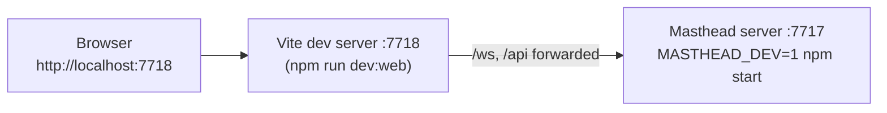

# Building, testing and installing

This page explains how the project is built, checked, tested and installed. It draws on `package.json`, the two tsconfig files, `vite.config.ts`, `svelte.config.js`, `test/`, `scripts/` and `AGENTS.md`. Each part has its own detailed page: [Build configuration](Source-Build-Config.md), [Tests](Source-Tests.md), and [Installing](Source-Install-Scripts.md).

## Requirements

- **Linux.**
- **Node.js 22 or newer** (`engines` in `package.json`; `install.sh` checks it).
- **Claude Code**, installed and signed in. Masthead finds it at start-up (see [Configuration and settings](Configuration-and-Settings.md)); it is not an npm dependency.
- For the browser test only: Chromium.

## npm scripts

| Script | Runs | Purpose |
|---|---|---|
| `npm run build` | `build:server`, then `build:web` | Full build into `dist/`. |
| `npm run build:server` | `tsc -p tsconfig.server.json` | Compiles `server/` and `shared/` into `dist/server/` and `dist/shared/`. |
| `npm run build:web` | `vite build` | Bundles the Svelte page from `web/` into `dist/web/`. |
| `npm run dev:web` | `vite` | Development server for the page on port 7718, with hot reload. It forwards `/ws` and `/api` to the Masthead server on 7717. |
| `npm run check` | `tsc … --noEmit` and `svelte-check` | Type-checks the server and the page without writing files. |
| `npm test` | `node --import tsx --test test/*.test.ts` | The unit tests. |
| `npm run test:live` | `node --disable-warning=… --import tsx test/live.e2e.ts` | The live end-to-end run against the real Claude Code (spends usage). |
| `npm start` | `node --disable-warning=CLAUDE_SDK_CAN_USE_TOOL_SHADOWED dist/server/main.js serve` | Runs the built server in the terminal. |

The browser test has no npm script. Run it as `node test/ui.e2e.mjs <url> <screenshot folder>` against a separate test server.

## Output layout

```text
dist/
  server/   compiled server (main.js is the `masthead` command)
  shared/   compiled shared/protocol.js and shared/toolline.js
  web/      built page: index.html, favicon.svg, and hashed files under assets/
```

`dist/` is ignored by git (`.gitignore`). The server looks for the page in `../web` next to `dist/server/`, which is `dist/web`.

## The check before calling a change done

`AGENTS.md` asks for these steps:

1. `npm run check && npm test && npm run build`, always.
2. `npm run test:live` for anything touching agents, messaging, limits or effort. It uses real usage, with Haiku for every tier.
3. `test/ui.e2e.mjs` for page changes, against a test server with its own `XDG_CONFIG_HOME` and `XDG_DATA_HOME`.
4. Update this wiki when behaviour changes.

## Development set-up



`README.md` describes this arrangement. `MASTHEAD_DEV=1` makes the server accept the Vite server's Host and Origin; see [Security model](Security-Model.md).

## Testing without touching real data

Several pieces of the code can be pointed elsewhere for testing:

- `App` accepts `store`, `claude`, `settings` and `settingsFile` options.
- `Store` accepts a root folder.
- `Scheduler` takes its limits as a function.

The unit tests use temp folders. The live test passes its own store and settings file. The browser test is meant to run against a server with separate XDG folders. Details: [Tests](Source-Tests.md).

## Installing

`scripts/install.sh` builds and installs into `~/.local/lib/masthead`, writes the `masthead` command, a systemd user unit and a desktop entry, and starts the service. `scripts/uninstall.sh` removes them and keeps the data. Details: [Installing](Source-Install-Scripts.md).

## Related pages

[Build configuration](Source-Build-Config.md) · [Tests](Source-Tests.md) · [Installing](Source-Install-Scripts.md) · [Command-line launcher](Command-Line-Launcher.md) · [Project documents](Project-Documents.md)
