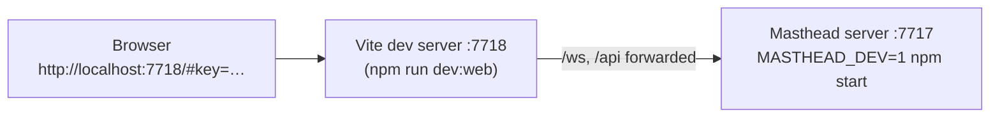

# Building, testing and installing

This page explains how Masthead 0.1.4 is built, checked, tested and installed. It draws on `package.json`, the two tsconfig files, `vite.config.ts`, `svelte.config.js`, `test/`, `scripts/` and `AGENTS.md`. Each part has its own detailed page: [Build configuration](Source-Build-Config.md), [Tests](Source-Tests.md), and [Installing](Source-Install-Scripts.md).

## Requirements

- **Linux.**
- **Node.js 22 or newer** (`engines` in `package.json`; `install.sh` checks it).
- **Claude Code**, installed and signed in. Masthead finds it at start-up (see [Configuration and settings](Configuration-and-Settings.md)); it is not an npm dependency.
- For the browser test only: Chromium.

## npm scripts

| Script | Runs | Purpose |
|---|---|---|
| `npm run build` | `build:server`, then `build:web` | Full build into `dist/`. |
| `npm run build:server` | `tsc -p tsconfig.server.json` | Compiles `server/` and `shared/` into `dist/server/` and `dist/shared/` (target ES2023, `NodeNext` modules, `strict`, `noUncheckedIndexedAccess`). |
| `npm run build:web` | `vite build` | Bundles the Svelte page from `web/` into `dist/web/` (`vite.config.ts`: `root: 'web'`, `outDir: '../dist/web'`, `emptyOutDir`, target ES2022). |
| `npm run dev:web` | `vite` | Development server for the page on port `MASTHEAD_DEV_WEB_PORT` (default 7718), with hot reload. It forwards `/ws` and `/api` to `127.0.0.1:<MASTHEAD_PORT>` (default 7717; `server.proxy` in `vite.config.ts`). `strictPort` makes it stop rather than move to another port if that port is taken. |
| `npm run check` | `tsc … --noEmit` and `svelte-check` | Type-checks the server (`tsconfig.server.json`) and the page with `svelte-check` (`tsconfig.web.json`: `web/src` and `shared/`, `noEmit`) without writing files. |
| `npm test` | `node --import tsx --test test/*.test.ts` | The unit tests: six files, 87 tests, no Claude Code needed. All 87 passed on 2026-11-26. |
| `npm run test:live` | `node --disable-warning=… --import tsx test/live.e2e.ts` | The live end-to-end run against the real Claude Code: five scenarios, 15 checks (spends usage). |
| `npm start` | `node --disable-warning=CLAUDE_SDK_CAN_USE_TOOL_SHADOWED dist/server/main.js serve` | Runs the built server in the terminal, on 7717 unless `--port` or `MASTHEAD_PORT` says otherwise. |

The browser test has no npm script. Run it as `node test/ui.e2e.mjs <url> <screenshot folder>` against a separate test server (see below); it refuses port 7717.

## Output layout

```text
dist/
  server/   compiled server (main.js is the `masthead` command)
  shared/   compiled shared/protocol.js and shared/toolline.js
  web/      built page: index.html, favicon.svg, and hashed files under assets/
```

`dist/` is ignored by git (`.gitignore`). The server looks for the page in `../web` next to `dist/server/` (`webDir` in `server/main.ts`), which is `dist/web`. `favicon.svg` comes from `web/public/`.

## The check before calling a change done

`AGENTS.md` asks for these steps:

1. `npm run check && npm test && npm run build`, always.
2. `npm run test:live` for anything touching agents, messaging, limits or effort. It uses real usage, with Haiku for every tier.
3. `test/ui.e2e.mjs` for page changes, against a test server with its own `XDG_CONFIG_HOME` and `XDG_DATA_HOME`.
4. Update this wiki when behaviour changes.

## Development set-up



`README.md` describes this arrangement. How it works (read from the code, not run):

- `runServer` in `server/main.ts` reads `MASTHEAD_DEV=1` and passes `http://localhost:<dev port>` and `http://127.0.0.1:<dev port>` to `serve()` as `extraOrigins`. The dev port is `MASTHEAD_DEV_WEB_PORT` (`parseDevWebPort()` in `server/cli.ts`), 7718 by default; an invalid value exits 2. `serve()` in `server/http.ts` then accepts those Origins and their Hosts. The secret is still required.
- On start the server prints, to its own terminal only, the `npm run dev:web` command with the matching `MASTHEAD_PORT` and `MASTHEAD_DEV_WEB_PORT`, and the page's address `http://localhost:<dev port>/#key=<secret>`.
- The page takes `#key=` (or an older `?key=`) from the address, keeps it in its own storage (`masthead.key`) and removes it from the address bar (`takeKey` in `web/src/lib/store.svelte.ts`). It sends the key as the `key.<secret>` subprotocol when it opens the socket. See [Security model](Security-Model.md).

By default the ports are 7717 and 7718, and 7717 is also the installed service's port. To run beside the installed service, give both commands other ports and their own folders, set per command (not exported):

```sh
T=$(mktemp -d)
XDG_CONFIG_HOME=$T/config XDG_DATA_HOME=$T/data MASTHEAD_DEV=1 MASTHEAD_DEV_WEB_PORT=7720 npm start -- --port 7790
XDG_CONFIG_HOME=$T/config XDG_DATA_HOME=$T/data MASTHEAD_PORT=7790 MASTHEAD_DEV_WEB_PORT=7720 npm run dev:web
```

Then open the address the server printed. Without its own `XDG_CONFIG_HOME` and `XDG_DATA_HOME`, the dev server uses the real settings, conversations and secret. (Read from the code, not run.)

## Testing without touching real data

Several pieces of the code can be pointed elsewhere for testing:

- `App` accepts `store`, `claude`, `settings` and `settingsFile` options.
- `Store` accepts a root folder.
- `Scheduler` takes its limits as a function.

The unit tests use temp folders and free ports picked by the system. The live test passes its own store and settings file. The browser test runs against a server with separate XDG folders. Details: [Tests](Source-Tests.md).

### A test server with its own folders

```sh
npm run build
T=$(mktemp -d)
XDG_CONFIG_HOME=$T/config XDG_DATA_HOME=$T/data npm start -- --port 7799 &   # its own settings, conversations and secret
XDG_DATA_HOME=$T/data node test/ui.e2e.mjs http://127.0.0.1:7799 $T/shots    # finds the key in $T/data/masthead/secret
XDG_CONFIG_HOME=$T/config XDG_DATA_HOME=$T/data node dist/server/main.js stop --port 7799
```

The variables are set per command, not exported. A shell left with exported test folders would make a later `scripts/install.sh` put the unit and desktop entry in them and bake them into the service (see [Installing](Source-Install-Scripts.md#where-things-go)).

Put cheap models in `$T/config/masthead/settings.json` first, because the browser test sends real messages; [Tests](Source-Tests.md#running-it) has a settings file that suits it. The secret file is created on first start (`loadSecret` in `server/config.ts`). `stop` reads the same secret and calls `/api/shutdown`. On any port other than 7717, `masthead` and `masthead stop` handle that copy over HTTP and never touch the systemd unit (`unitServes` in `server/main.ts`; read from the code, not run here). Never use port 7717 or the real `~/.config/masthead` and `~/.local/share/masthead` for tests.

## Installing

`scripts/install.sh [--force]` builds, asks the copy on 7717 whether agents are working before it changes anything, stages a new copy in `~/.local/lib/masthead.new` and swaps it in, writes the `masthead` command, a systemd user unit and a desktop entry, and restarts the service. `scripts/uninstall.sh` stops any running copy, removes those files and keeps the data. Details: [Installing](Source-Install-Scripts.md).

## Related pages

[Build configuration](Source-Build-Config.md) · [Tests](Source-Tests.md) · [Installing](Source-Install-Scripts.md) · [Command-line launcher](Command-Line-Launcher.md) · [Project documents](Project-Documents.md)
