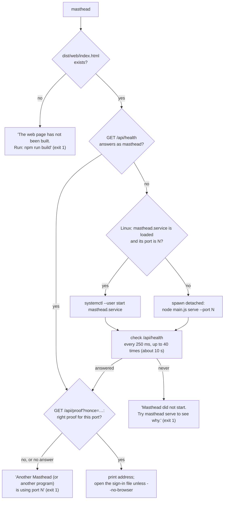

# Command-line launcher

`masthead` is the command you run. It is the compiled [server/main.ts](Source-Main.md) (`dist/server/main.js`), with its argument parsing in [server/cli.ts](Source-Cli.md). `scripts/install.sh` installs a small shell script, `~/.local/bin/masthead`, that runs that file with the Node it found; a global npm install puts the same file on `PATH`. The same file is the **launcher** (it starts a server if needed and opens the browser), the **server** itself (`masthead serve`), the **service installer** (`masthead service`) and the **set-up check** (`masthead doctor`). Folders differ per platform ([server/paths.ts](Source-Paths.md)); what differs between Linux, macOS and Windows is summed up on [Platforms](Platforms.md).

> Checked against the 0.2.0 source on branch `next` (2026-11-27). The behaviour described here is read from the code, not verified by running. The macOS and Windows paths are not verified on those systems.

## Commands

| Command | What it does | Exit code |
|---|---|---|
| `masthead` (same as `masthead open`) | Checks that the web page has been built, starts a server if none answers on the port, checks that the server proves it knows this data folder's secret, prints the address and opens the browser signed in (through a private sign-in file, see below). | 0; 1 if the page is not built, the server did not start, the secret cannot be read, or the server on the port did not prove it knows the secret |
| `masthead serve` | Runs the server in this terminal until Ctrl+C. | 1 if the port is taken or it cannot start |
| `masthead status` | Says whether a Masthead server answers on the port, with its version and process id. | 0 running, 3 not running |
| `masthead stop` | Stops the server on the port and checks that it stopped. Working agents are stopped too. | 0 (also when nothing was running); 1 if it is still running, did not prove it knows the secret, refused the secret, or there is no local secret file |
| `masthead service install` | Installs and starts a background service that starts Masthead when you log in: a systemd user unit (Linux), a launchd agent (macOS) or a Task Scheduler task (Windows). Refuses while agents are working unless `--force`. See [`service`](#service). | 0; 1 if agents are working (without `--force`), a step failed, or there is no service manager for this platform |
| `masthead service uninstall` | Stops and removes that service. | 0; 1 if a step failed |
| `masthead service status` (also plain `masthead service`) | Says whether the service is installed and running, and its port. | 0 installed; 3 not installed; 1 no service manager for this platform |
| `masthead service <other>` | Prints `Usage: masthead service install\|uninstall\|status [--port N] [--force]`. | 2 |
| `masthead doctor` | Checks the set-up, one line per check, with a fix for each problem. `--json` prints the checks as JSON instead. See [`doctor`](#doctor). | 0 when no check failed (warnings allowed); 1 otherwise |
| `masthead version`, `masthead --version` | Prints the version (`VERSION` in `shared/protocol.ts`). `--version` anywhere wins over every other word. | 0 |
| `masthead help`, `--help`, `-h` | Prints the usage. `--help` or `-h` anywhere wins over the command word. | 0 |
| anything else | Prints the usage. | 2 |

Options can come before or after the command word.

- **`--port N`**, **`--port=N`**, or the **`MASTHEAD_PORT`** variable, in that order; the default is 7717. The value must be digits only and from 1024 to 65535, and `--port` must be followed by a value that does not start with `-`. Otherwise the command prints the reason and exits 2, for every command (`parsePort()`). An empty `MASTHEAD_PORT` is ignored.
- **`--force`**: with `service install`, install even though agents are working (installing restarts Masthead, which stops them).
- **`--json`**: with `doctor`, print the checks as a JSON array of `{ name, ok, warn?, detail, fix? }`.
- **`--no-browser`**: with `open`, start the server and print the address but do not open a browser. When stdout is a terminal it also prints the sign-in address, key included, to paste into a browser by hand.

## How `open` starts the server



### Is it already running?

The launcher asks `GET http://127.0.0.1:<port>/api/health`, waiting at most 1.5 seconds. The answer only counts if it says `name: "masthead"`, so another program on the port is not mistaken for Masthead (`health()`).

### Is it ours?

Answering `/api/health` as `masthead` proves nothing: any program can say that. So before the launcher sends the key anywhere, it asks the server to prove it already knows it (`serverProves()` in `server/cli.ts`). It sends `GET /api/proof?nonce=<nonce>` with a fresh random nonce (64 hex characters) and checks that the reply's `proof` is the HMAC-SHA256 of `masthead-proof`, the port and the nonce, keyed with the secret from `<DATA_DIR>/secret`. The question carries no secret and the answer reveals none. Because the port is part of the proof, a program on port N cannot pass the question to a real Masthead on another port and hand back its answer.

If the proof is wrong or missing, the launcher prints `Another Masthead (or another program) is using port N: it did not prove it knows <file>, so it was not sent the key. If it is a Masthead started with another data folder (this one is <DATA_DIR>), use that one; if it is an older Masthead, restart it; otherwise use another port.` and exits 1, without opening the browser. That covers a Masthead started with another data folder (`MASTHEAD_DATA_DIR` or `XDG_DATA_HOME`), another program (possibly another user's) holding the port, and a Masthead older than this check, which has no `/api/proof`. The check is tested in `test/launcher.test.ts` and `test/http.test.ts`; the full launcher run against such servers was not verified by running.

### systemd unit or a server of its own

systemd is Linux's service manager; a *user unit* is a service that runs as you. `scripts/install.sh` and `masthead service install` create `masthead.service` ([Installing](Source-Install-Scripts.md), [server/service](Source-Service.md)). This check runs on Linux only (`unitServes()`). On macOS and Windows the launcher always starts its own copy and `stop` uses `/api/shutdown`, even when a launchd agent or scheduled task is installed; per the code comment, those do not restart a server that exits cleanly (not verified by running).

**Only the unit's own port goes through `systemctl`.** The launcher runs `systemctl --user show -p LoadState -p Environment masthead.service` and reads it with `unitPortFrom()`:

- not installed (`LoadState` is not `loaded`), or `systemctl` missing: no unit;
- installed: the unit's port is `MASTHEAD_PORT` from its `Environment=` if that is a valid port, else 7717. The install script does not set it, so a unit it installed serves 7717; `masthead service install --port N` sets it for N other than 7717.

If the unit's port is the port you asked for, `open` runs `systemctl --user start masthead.service` and `stop` runs `systemctl --user stop masthead.service`. Any other port gets a separate server of its own, so `masthead --port 7720` never touches the installed service.

That separate server is a second copy of `masthead serve --port N`, started with the same Node, detached from the terminal (with no console window on Windows), with its output thrown away. It keeps running after the launcher exits and has the launcher's environment. Because you cannot see its output, a failure only says "Masthead did not start. Try `masthead serve` to see why." Running `masthead serve --port N` shows the real error.

### Opening the browser

After the server answers, the launcher prints `Masthead is at http://127.0.0.1:<port>`. The browser is signed in with

```
http://127.0.0.1:<port>/#key=<secret>
```

The key is in the fragment (after `#`), which the browser never sends to the server, so it is not in any request, log or `Referer` header. The secret comes from `<DATA_DIR>/secret` (on Linux normally `~/.local/share/masthead/secret`; see [server/paths.ts](Source-Paths.md)), created on first use.

The key is never put on a command line, where other users could read it with `ps`. Instead `openSignedIn()` in `server/cli.ts` writes a private page, `sign-in-<random>.html`, mode `0600`, in `$XDG_RUNTIME_DIR/masthead` when that is set, on macOS otherwise `$TMPDIR/masthead`, and otherwise (always on Windows) `<DATA_DIR>/open` (`signInDir()`). The page sends the browser on to the address above and has a plain link in case that does not happen. The opener gets only the file's path: `xdg-open`, or `gio open` if that is all there is, on Linux; `open` on macOS; `explorer.exe` on Windows (found on `PATH` without a shell, `onPath()`). `explorer.exe` exits with 1 even when it worked, so there only a failure to start counts as failing. The launcher waits for the opener at most 3 seconds; one still running then (some run the browser in the foreground) counts as having opened it, so `masthead` does not hang. A minute after the opener succeeds, a background Node process removes the file (`removeLaterArgs()`); leftover files older than two minutes are removed on the next run. See [Security model](Security-Model.md#the-local-secret).

The page saves the key in that browser for this address and removes it from the address bar, so it is not left in the address or in bookmarks (the browser may still record the addresses in its history; not verified). There is no cookie and no login. See [Security model](Security-Model.md#the-local-secret).

- If neither opener exists, the file cannot be written, or the opener fails, no file is left. In a terminal it prints `Open this address in your browser to sign it in (keep it private):` with the address, key included. When output goes to a pipe or a file, the key is not printed; it prints ``Could not open the browser. Run `masthead --no-browser` in a terminal to get the sign-in address.`` instead.
- In a terminal, the output always ends with `If the browser did not open signed in, run: masthead --no-browser`, also after the browser was opened.
- With `--no-browser` nothing is opened. In a terminal it prints `Sign-in address (keep it private):` and the address; when output goes to a pipe or a file the key is not printed. A tab you open by hand at the plain address works only if that browser already holds the key for that address (each address, such as `127.0.0.1:7717` and `localhost:7717`, has its own storage).
- A snap or flatpak browser may be unable to read the sign-in file in `$XDG_RUNTIME_DIR` or the data folder. Then run `masthead --no-browser` in a terminal and paste the printed address.
- Whether a real browser follows the sign-in file's redirect was not verified by running.

## `serve`

1. Creates the app, which loads settings and saved conversations. It is given remote access (off unless turned on in the app; [Remote access](Remote-Access.md)) and the keep-awake helper: while any agent works and the `keepAwake` setting is on (the default), the computer is kept from idling to sleep ([Keep awake](Source-Service.md#keep-awake-awakets)).
2. Loads the local secret, creating it if needed. If it can be neither read nor created: `Could not read or create <file>: <reason>`, exit 1.
3. Serves `dist/web` on `127.0.0.1:<port>`. With `MASTHEAD_DEV=1` (development) it also accepts the Vite development server on port `MASTHEAD_DEV_WEB_PORT` (default 7718); an invalid value exits 2.
4. If the port is in use: `Port N is already in use. Is Masthead already running?`, exit 1. Any other start error: `Could not start: <reason>`, exit 1.
5. Prints `Masthead <version> is running at http://127.0.0.1:<port>`, then ``Open it with `masthead` to sign the browser in.`` (with `--port N` when not on 7717). In development mode it prints the `npm run dev:web` command to use and the Vite page's address **with the key** (`#key=`) instead.
6. Once serving, remote access starts in the background when it is on; if it fails for a reason other than Tailscale missing, it prints `Masthead: remote access did not start: <reason>` and the server keeps running. An unhandled promise rejection is logged and the server keeps running; an uncaught exception still ends the process (an installed service restarts it). A request it cannot parse gets `400` and any other error while answering a request gets `500`, without stopping the server. (The malformed request is tested; the rest was not verified by running.)
7. On Ctrl+C (SIGINT), SIGTERM, SIGHUP (on Windows: closing the console window), SIGBREAK (Windows only: Ctrl+Break), or an authorised `POST /api/shutdown`, it shuts down once: the keep-awake hold is released, waiting approval requests are denied, every agent is stopped, everything is saved, and the process exits with code 0 after 300 ms.

## `stop`

1. If nothing answers on the port: `Masthead is not running.`, exit 0.
2. On Linux, if the systemd unit serves this port, `systemctl --user stop masthead.service`.
3. If the server still answers (it was not the unit's, or systemd did not stop it), the launcher reads the secret, asks the server for its proof (as for `open`; on failure it prints the same `Another Masthead (or another program) is using port N …` message and exits 1 without sending the key), and then sends `POST /api/shutdown` with two headers:
   - `x-masthead: 1`;
   - `x-masthead-key: <secret>`, read from `<DATA_DIR>/secret`. If that file is missing or not a valid secret, nothing is sent: `There is no local secret (<file>) for this data folder, so the Masthead on port N cannot be stopped from here. Use the data folder it was started with (MASTHEAD_DATA_DIR or XDG_DATA_HOME).`, exit 1.

   The server checks both ([server/transport/http.ts](Source-Http.md#http-requests-handlerequest)). If it answers `403`, it was started with a different secret, usually another data folder: `Masthead on port N refused to stop: it was started with a secret other than <file> (another data folder?).`, exit 1.
4. It waits up to about 5 seconds for the server to stop answering, then prints `Masthead stopped.` (exit 0) or `Masthead is still running.` (exit 1).

## `service`

`masthead service install|uninstall|status [--port N] [--force]`. With no sub-command it is `status`. The service runs `node <dist/server/main.js> serve` as you, at login, with no admin rights. What each one writes is on [server/service](Source-Service.md).

| Platform | Kind | What `install` does |
|---|---|---|
| Linux | systemd user unit `masthead.service` | Checks that `systemctl --user` works, writes `~/.config/systemd/user/masthead.service` (under `XDG_CONFIG_HOME` when set), then `daemon-reload`, `enable`, `restart`. |
| macOS | launchd agent `io.github.luxorium.masthead` | Writes `~/Library/LaunchAgents/io.github.luxorium.masthead.plist`, boots out an old copy, `launchctl bootstrap gui/<uid>`. Logs go to `~/Library/Logs/Masthead/masthead.log`. Not verified on a Mac. |
| Windows | Task Scheduler task `Masthead` | Writes the task XML to a temporary file, ends a running copy, `schtasks /Create … /F`, removes the file, `schtasks /Run`. Not verified on Windows. |
| other | none | ``Masthead has no background service for <platform>; run `masthead serve` instead.``, exit 1. |

- `install` first asks the server on the port how many conversations are working (`busy` in `/api/health`). If any are and `--force` is not given: `Masthead has agents working in <n> conversation(s); installing restarts it and stops them. Run again when they have finished, or with --force.`, exit 1.
- The service gets the port you asked for (`--port` or `MASTHEAD_PORT`) when it is not 7717. On Linux and macOS it also gets a cleaned `PATH`, the Claude Code that was found (`MASTHEAD_CLAUDE`) and `XDG_CONFIG_HOME`/`XDG_DATA_HOME` if set. It does not get `MASTHEAD_CONFIG_DIR` or `MASTHEAD_DATA_DIR`. On Windows only the port is passed; `install` says so when `MASTHEAD_CLAUDE` or `XDG_*` were set, so you can set them with `setx`.
- `status` prints `Installed (<kind>), running|not running|state unknown, port N. <detail>` or `Not installed (<kind>). <detail>`.
- A step that must succeed and fails prints `<command> <args> failed: <reason>`, exit 1.

## `doctor`

`masthead doctor [--port N] [--json]` checks the set-up and prints one line per check, marked `[ OK ]`, `[WARN]` or `[FAIL]`, with a `fix:` line under a warning or failure that has one. It does not change anything. The checks ([server/doctor.ts](Source-Doctor.md)):

| Check | Fails when | Warns when |
|---|---|---|
| Node.js | older than 22 | |
| Claude Code | not found, or its version cannot be read | |
| Config folder, Data folder | not a folder, or not writable | it does not exist yet |
| Secret | it is a folder, or (not on Windows) others can read it | it does not exist yet |
| Port N | another program answers there, or it could not be checked | |
| Service | installed but not running; it could not be checked | not installed, none on this platform, or its state is unknown |
| SDK private binary | | the Agent SDK's unused private copy of Claude Code is installed |
| Keep awake | | the tool is missing, or the platform has none |

Exit 0 when no check failed (warnings allowed), else 1. `--json` prints the same checks as JSON with the same exit code.

## Messages and exit codes

| Exit | When |
|---|---|
| 0 | Success; `stop` with nothing running; `help` |
| 1 | Page not built; server did not start; port in use; secret unreadable; the server on the port did not prove it knows the secret; `stop` refused, had no local secret, or server still running; `service`: no service manager here, agents working without `--force`, or a step failed; `doctor`: a check failed |
| 2 | Bad `--port`, `MASTHEAD_PORT` or (for `serve`) `MASTHEAD_DEV_WEB_PORT`; unknown command (the usage is printed); unknown `service` sub-command |
| 3 | `status` and nothing is running; `service status` and no service installed |

## Related pages

[server/main.ts](Source-Main.md) · [server/cli.ts](Source-Cli.md) · [server/paths.ts](Source-Paths.md) · [server/doctor.ts](Source-Doctor.md) · [server/service](Source-Service.md) · [Platforms](Platforms.md) · [Remote access](Remote-Access.md) · [server/transport/http.ts](Source-Http.md) · [Security model](Security-Model.md) · [Configuration and settings](Configuration-and-Settings.md) · [Installing](Source-Install-Scripts.md)
