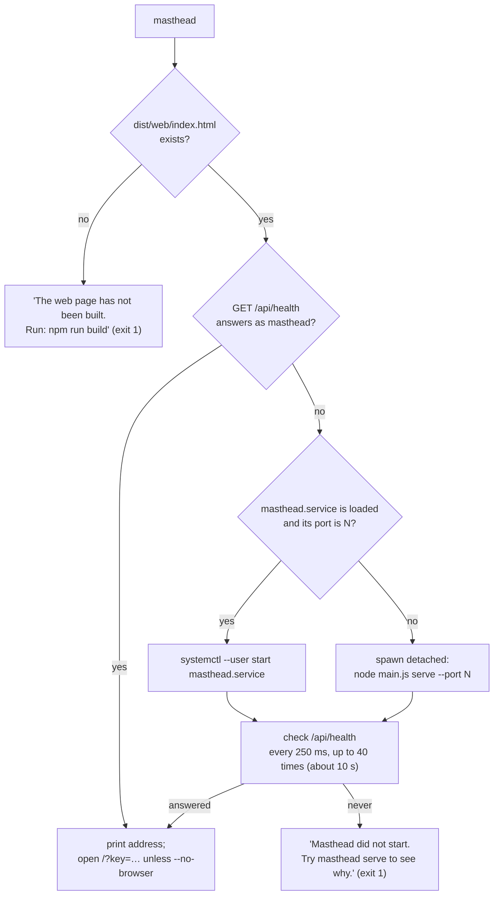

# Command-line launcher

`masthead` is the command you run. It is the compiled [server/main.ts](Source-Main.md) (`dist/server/main.js`), with its argument parsing in [server/cli.ts](Source-Cli.md). `scripts/install.sh` installs a small shell script, `~/.local/bin/masthead`, that runs that file with the Node it found. The same file is both the **launcher** (it starts a server if needed and opens the browser) and the **server** itself (`masthead serve`).

> Checked against the 0.1.3 source. The behaviour described here is read from the code, not run (`npm test` passes).

## Commands

| Command | What it does | Exit code |
|---|---|---|
| `masthead` (same as `masthead open`) | Checks that the web page has been built, starts a server if none answers on the port, prints the address and opens the browser at `/?key=<secret>`, which signs that browser in. | 0; 1 if the page is not built, the server did not start or the secret cannot be read |
| `masthead serve` | Runs the server in this terminal until Ctrl+C. | 1 if the port is taken or it cannot start |
| `masthead status` | Says whether a Masthead server answers on the port, with its version and process id. | 0 running, 3 not running |
| `masthead stop` | Stops the server on the port and checks that it stopped. Working agents are stopped too. | 0 (also when nothing was running); 1 if it is still running or refused the secret |
| `masthead version`, `masthead --version` | Prints the version (0.1.3). `--version` anywhere wins over every other word. | 0 |
| `masthead help`, `--help`, `-h` | Prints the usage. `--help` or `-h` anywhere wins over the command word. | 0 |
| anything else | Prints the usage. | 2 |

Options can come before or after the command word.

- **`--port N`**, **`--port=N`**, or the **`MASTHEAD_PORT`** variable, in that order; the default is 7717. The value must be digits only and from 1024 to 65535, and `--port` must be followed by a value that does not start with `-`. Otherwise the command prints the reason and exits 2, for every command (`parsePort()`). An empty `MASTHEAD_PORT` is ignored.
- **`--no-browser`**: with `open`, start the server and print the address but do not open a browser.

## How `open` starts the server



### Is it already running?

The launcher asks `GET http://127.0.0.1:<port>/api/health`, waiting at most 1.5 seconds. The answer only counts if it says `name: "masthead"`, so another program on the port is not mistaken for Masthead (`health()`).

### systemd unit or a server of its own

systemd is Linux's service manager; a *user unit* is a service that runs as you. `scripts/install.sh` creates `masthead.service` ([Installing](Source-Install-Scripts.md)).

**Only the unit's own port goes through `systemctl`.** The launcher runs `systemctl --user show -p LoadState -p Environment masthead.service` and reads it with `unitPortFrom()`:

- not installed (`LoadState` is not `loaded`), or `systemctl` missing: no unit;
- installed: the unit's port is `MASTHEAD_PORT` from its `Environment=` if that is a valid port, else 7717. The install script does not set it, so the installed unit serves 7717.

If the unit's port is the port you asked for, `open` runs `systemctl --user start masthead.service` and `stop` runs `systemctl --user stop masthead.service`. Any other port gets a separate server of its own, so `masthead --port 7720` never touches the installed service.

That separate server is a second copy of `masthead serve --port N`, started with the same Node, detached from the terminal, with its output thrown away. It keeps running after the launcher exits and has the launcher's environment. Because you cannot see its output, a failure only says "Masthead did not start. Try `masthead serve` to see why." Running `masthead serve --port N` shows the real error.

### Opening the browser

After the server answers, the launcher prints `Masthead is at http://127.0.0.1:<port>` and opens

```
http://127.0.0.1:<port>/?key=<secret>
```

with `xdg-open`, or `gio open` if that is all there is. The secret comes from `<DATA_DIR>/secret` (normally `~/.local/share/masthead/secret`), created on first use. The page saves the key in that browser for this address and removes it from the address bar, so it is not left in the address or in bookmarks (the browser may still record the first address in its history; not verified). There is no cookie and no login. See [Security model](Security-Model.md#4-the-local-secret).

- If neither opener exists, it prints `Open http://127.0.0.1:<port>/?key=<secret> in your browser.`, key included.
- With `--no-browser` nothing is opened and the key is not printed. A tab you open by hand at the plain address works only if that browser already holds the key for that address (each address, such as `127.0.0.1:7717` and `localhost:7717`, has its own storage).

## `serve`

1. Creates the app, which loads settings and saved conversations.
2. Loads the local secret, creating it if needed. If it can be neither read nor created: `Could not read or create <file>: <reason>`, exit 1.
3. Serves `dist/web` on `127.0.0.1:<port>`. With `MASTHEAD_DEV=1` (development) it also accepts the Vite development server on port 7718.
4. If the port is in use: `Port N is already in use. Is Masthead already running?`, exit 1. Any other start error: `Could not start: <reason>`, exit 1.
5. Prints `Masthead <version> is running at http://127.0.0.1:<port>`, then ``Open it with `masthead` to sign the browser in.`` (with `--port N` when not on 7717). In development mode it prints the Vite page's address **with the key** instead.
6. On Ctrl+C (SIGINT), SIGTERM, or an authorised `POST /api/shutdown`, it shuts down once: waiting approval requests are denied, every agent is stopped, everything is saved, and the process exits with code 0 after 300 ms.

## `stop`

1. If nothing answers on the port: `Masthead is not running.`, exit 0.
2. If the systemd unit serves this port, `systemctl --user stop masthead.service`.
3. If the server still answers (it was not the unit's, or systemd did not stop it), the launcher sends `POST /api/shutdown` with two headers:
   - `x-masthead: 1`;
   - `x-masthead-key: <secret>`, read from `<DATA_DIR>/secret` (empty if the file is missing or not a valid secret).

   The server checks both ([server/http.ts](Source-Http.md#http-requests)). If it answers `403`, it was started with a different secret, usually another `XDG_DATA_HOME`: `Masthead on port N refused to stop: it was started with a secret other than <file> (another XDG_DATA_HOME?).`, exit 1.
4. It waits up to about 5 seconds for the server to stop answering, then prints `Masthead stopped.` (exit 0) or `Masthead is still running.` (exit 1).

## Messages and exit codes

| Exit | When |
|---|---|
| 0 | Success; `stop` with nothing running; `help` |
| 1 | Page not built; server did not start; port in use; secret unreadable; `stop` refused or server still running |
| 2 | Bad `--port` or `MASTHEAD_PORT`; unknown command (the usage is printed) |
| 3 | `status` and nothing is running |

## Related pages

[server/main.ts](Source-Main.md) · [server/cli.ts](Source-Cli.md) · [server/http.ts](Source-Http.md) · [Security model](Security-Model.md) · [Configuration and settings](Configuration-and-Settings.md) · [Installing](Source-Install-Scripts.md)
