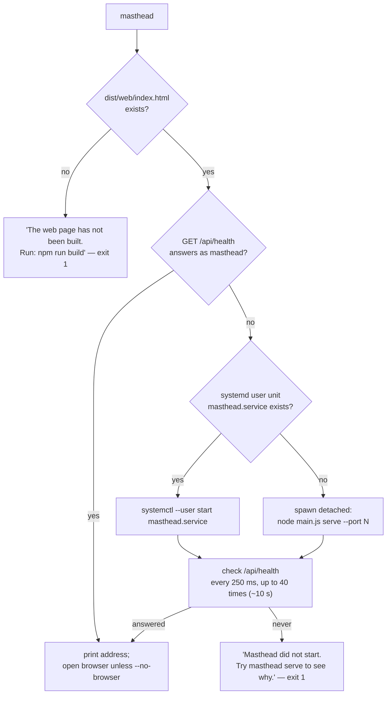

# Command-line launcher

`masthead` is the command you run. It is the compiled `server/main.ts` (`dist/server/main.js`). `scripts/install.sh` installs a small shell script, `~/.local/bin/masthead`, that runs that file with the Node it found. The same file is both the **launcher** (it starts the server if needed and opens the browser) and the **server** itself (`masthead serve`).

## Commands

| Command | What it does | Exit code |
|---|---|---|
| `masthead` (same as `masthead open`) | Checks that the web page has been built, starts the server in the background if it is not already answering, prints the address and opens the browser. | 0; 1 if the page is not built or the server did not start |
| `masthead serve` | Runs the server in this terminal until Ctrl+C. | 1 if the port is taken or it cannot start |
| `masthead status` | Says whether a Masthead server answers on the port, with its version and process id. | 0 running, 3 not running |
| `masthead stop` | Stops a running server and checks that it stopped. Working agents are stopped too. | 0; 1 if it is still running |
| `masthead version`, `masthead --version` | Prints `0.1.0`. | 0 |
| `masthead help`, `--help`, `-h` | Prints the usage. | 0 |
| anything else | Prints the usage. | 2 |

Options:

- `--port N`, or the `MASTHEAD_PORT` variable. The default is 7717, and the port must be 1024–65535; otherwise the command exits with code 2.
- `--no-browser`, with `open`.

Options can come before or after the command word.

## How `open` starts the server

Details from the code:

- **Health check** (`health()`): `GET http://127.0.0.1:<port>/api/health` with a 1.5-second timeout. It only counts if the reply's `name` is `masthead`, so another program on the port is not mistaken for Masthead.
- **systemd** (`hasUnit()`): systemd is Linux's service manager, and a *user unit* is a service that runs as you. `scripts/install.sh` creates `masthead.service`, and if it exists the launcher starts and stops Masthead through systemd. See [Installing](Source-Install-Scripts.md).
- **Detached start:** without the unit, the launcher starts a second copy of itself with `serve`, detached from the terminal and with its output discarded, so it keeps running after the launcher exits.
- **Opening the browser** (`openBrowser()`): uses `xdg-open` or `gio open`, whichever exists. If neither does, it prints the address.

## `serve`

1. Creates the `App`, which loads settings, finds Claude Code and restores saved conversations.
2. Serves `dist/web`. In development mode (`MASTHEAD_DEV=1`) it also accepts the Vite development server on port 7718.
3. If the port is in use, prints "Port N is already in use. Is Masthead already running?" and exits with code 1.
4. On Ctrl+C (SIGINT), SIGTERM, or a `POST /api/shutdown`, it runs `app.shutdown()` once. That stops every agent and saves everything, and the process exits 300 ms later.

## `stop`

1. If nothing answers, it prints "Masthead is not running." and stops.
2. If the systemd unit exists, it stops it with `systemctl --user stop`.
3. If the server still answers, it sends `POST /api/shutdown` with the header `x-masthead: 1` (see [Security model](Security-Model.md)).
4. It then waits up to about 5 seconds for the server to stop answering, and reports success or "Masthead is still running."

## Related pages

[server/main.ts](Source-Main.md) · [server/http.ts](Source-Http.md) · [Configuration and settings](Configuration-and-Settings.md) · [Installing](Source-Install-Scripts.md)
