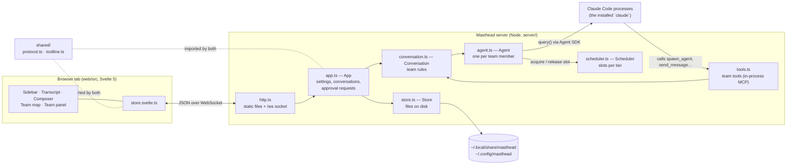

# Masthead wiki

Masthead is a local web app for Linux that you use instead of claude.ai or `claude` in a terminal. It runs on your own machine, serves a page at `http://127.0.0.1:7717`, and drives the **Claude Code** program that is already installed and signed in there. Masthead never asks for, stores or handles a login. Every agent it runs is a Claude Code process started through the Claude Agent SDK (`@anthropic-ai/claude-agent-sdk`), and that process uses whatever sign-in Claude Code already has.

You talk to one **lead** agent (Fable 5.2 by default). The lead can start **Opus 5.5** agents, each Opus can start **Sonnet 5.5** agents, and each Sonnet can start **Haiku 5.5** agents. Haiku agents start nothing. Together these agents form a **team** inside one **conversation**.

Agents are named in the order they start, from the radio spelling alphabet. The lead is always **Alpha**; the next agents are Bravo, Charlie, and so on. Each agent also carries a short **title** describing its job. Agents can message each other by name, and a finished agent sends a **report** to the agent that started it. A settings panel decides how many agents of each tier may run at the same time across the whole app, and a **team map** shows the whole team as a tree.

Every agent starts at low **thinking effort**, which is how hard the model reasons before answering. The lead may raise its own effort; any other agent has to ask the agent that started it; and an agent can set the effort of any agent below it. The levels are Low, Medium, High and Extra (`xhigh`). There is deliberately no `max` level.

## The whole picture

The browser is only a view. All state lives in the server process, and closing a tab stops nothing (see [Architecture](Architecture.md)).

## Map of this wiki

Start with **[Architecture](Architecture.md)**, then read **[Agent life cycle](Agent-Life-Cycle.md)** and **[Team rules](Team-Rules.md)**. The full grouped list of pages is on the **[Index](Index.md)**.

- **Concepts:** [Architecture](Architecture.md) · [Agent life cycle](Agent-Life-Cycle.md) · [Team rules](Team-Rules.md) · [Slot scheduling](Slot-Scheduling.md) · [Thinking effort](Thinking-Effort.md) · [Permissions and questions](Permissions-and-Questions.md) · [Glossary](Glossary.md)
- **Interfaces:** [Browser/server protocol](Browser-Server-Protocol.md) · [Configuration and settings](Configuration-and-Settings.md) · [Command-line launcher](Command-Line-Launcher.md)
- **Operations:** [Storage on disk](Storage-on-Disk.md) · [Security model](Security-Model.md) · [Safety model](Safety-Model.md) · [Code coverage map](Code-Coverage-Map.md) · [Building, testing and installing](Building-Testing-Installing.md) · [Tests](Source-Tests.md) · [Installing](Source-Install-Scripts.md) · [Project documents](Project-Documents.md)
- **Server and shared source:** [shared/protocol.ts](Source-Shared-Protocol.md) · [shared/toolline.ts](Source-Shared-Toolline.md) · [server/config.ts](Source-Config.md) · [server/scheduler.ts](Source-Scheduler.md) · [server/store.ts](Source-Store.md) · [server/prompts.ts](Source-Prompts.md) · [server/agent.ts](Source-Agent.md) · [server/tools.ts](Source-Tools.md) · [server/conversation.ts](Source-Conversation.md) · [server/app.ts](Source-App.md) · [server/http.ts](Source-Http.md) · [server/main.ts](Source-Main.md) · [server/cli.ts](Source-Cli.md) · [Build configuration](Source-Build-Config.md)
- **Web source:** [Web front end](Source-Web-Front-End.md) · [Web store](Source-Web-Store.md) · [Web components](Source-Web-Components.md) · [Web styles](Source-Web-Styles.md)
- **Walkthroughs:** [Sending a message](Walkthrough-Sending-a-Message.md) · [An agent starting another](Walkthrough-Starting-an-Agent.md) · [A report coming back](Walkthrough-Report-Coming-Back.md) · [An effort request](Walkthrough-Effort-Request.md) · [Stopping an agent](Walkthrough-Stopping-an-Agent.md) · [Restarting with saved conversations](Walkthrough-Restarting-the-App.md)

## Security and safety

How Masthead keeps the local server closed to others, and how it keeps its agents in hand:

- **[Security model](Security-Model.md)**: who can reach the server: loopback only, Host and Origin checks, the local secret, response headers, path and input checks, file modes, and what it does not defend against.
- **[Safety model](Safety-Model.md)**: how agents are kept in hand: fixed tiers, limits and the queue, disallowed tools, approvals and permission modes, stopping, effort ceilings, caps, envelope escaping, safe rendering, credentials, and what it does not protect against.
- **[Permissions and questions](Permissions-and-Questions.md)**: approval requests, permission modes and the lead's questions.

## Known limitations in 0.1.4

These follow from the code as it is today (not verified by running unless the linked page says so):

- **Any program running as the person can drive Masthead**, because it can read the local secret; other user accounts cannot ([Security model](Security-Model.md)).
- **A background command that never ends keeps the lead waiting.** A sub-agent waiting only on background work is finished after 10 minutes with its text so far and the note "A background command was still running when Masthead closed this agent." (`BACKGROUND_WAIT_MS`, `tick()` in `server/conversation.ts`). The lead is exempt: it shows `waiting` with background work for as long as that runs ([Agent life cycle](Agent-Life-Cycle.md#4a-background-work)).
- **Usage-limit pauses are not verified against a real limit.** An agent (the lead too) whose turn ends at a usage limit pauses as `waiting` until Claude Code's reset time (else 15 minutes), its slot freed and messages to it held, and a 30-second timer resumes it; after 3 pauses in a row it fails as before (`pause()`, `tick()` in `server/conversation.ts`). Covered by unit tests with a fake clock only.
- **Waits for an answer are kept in memory only** (`waits` in `server/conversation.ts`); a restart stops the waiting agents anyway. The agents the person stopped and the inter-agent message counter are saved (`stoppedByPerson`, `agentMessages` in `StoredConversation`).
- **Lowering a tier limit does not stop agents already running**; it only affects who starts next ([Slot scheduling](Slot-Scheduling.md)). A lowered effort ceiling, by contrast, is applied to running agents at once (`Agent.applySettings()`).
- **Sub-agents' context maximum is assumed to be 1,000,000 tokens**; only the lead asks Claude Code for the real figure ([server/agent.ts](Source-Agent.md)).
- **No spend cap.** A run-time limit exists (`settings.maxRunMinutes`, 0 = off): a sub-agent that has been running longer than that on one piece of work is stopped with a report to its parent. Only time spent actually running counts (not queued, waiting, paused or waiting for an approval; `ranMs()`), and the lead is never stopped (`Conversation.tick()`). Nothing limits spend; the tier limits and low default effort are the only brakes ([Safety model](Safety-Model.md)).

## How to read this wiki

Every statement here was written from the source code. Where the code leaves something open, the page says so. The pages describe what the code does, not observed behaviour of a running system: nothing here was checked by running Masthead. Source files are named by their path from the project folder, for example `server/agent.ts`.

---

Written 2026-11-26, updated for Masthead version 0.1.4 (`VERSION` in `shared/protocol.ts`). To find the page that explains a given source file, use the [Code coverage map](Code-Coverage-Map.md).
