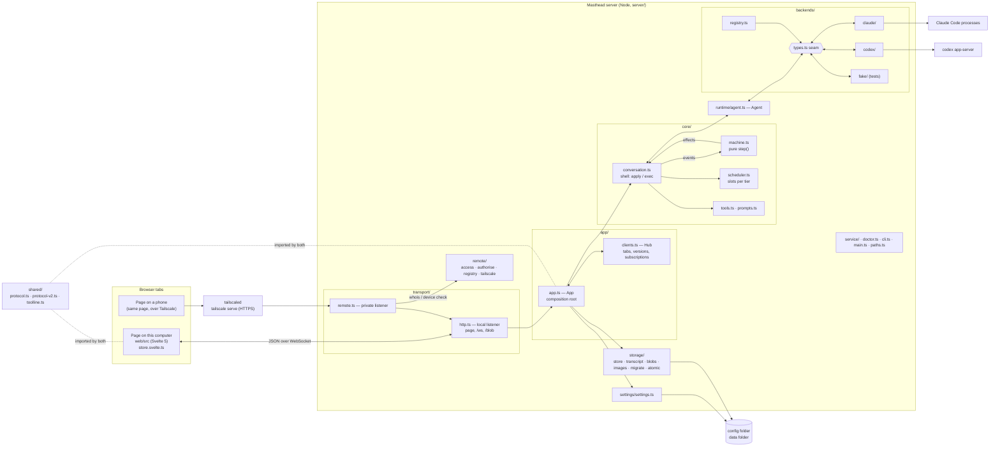

# Masthead wiki

Masthead is a local web app that runs a team of AI agents for you. It runs on your own computer (Linux, macOS 13 or newer, Windows 10 1809 or newer and 11; see [Platforms](Platforms.md)), serves a page at `http://127.0.0.1:7717` (`DEFAULT_PORT` in `server/paths.ts`) and drives the **agent programs already installed and signed in there**. Masthead never asks for, stores or handles a login: every agent uses whatever sign-in its program already has.

The agent programs are called **backends** (`server/backends/registry.ts`, see [Backend interface](Backend-Interface.md)):

- **Claude Code**, driven through the Claude Agent SDK, one process per running agent ([Claude backend](Source-Backend-Claude.md)).
- **Codex**, where it is installed and usable, driven through one shared `codex app-server` process with one thread per agent ([Codex backend](Source-Backend-Codex.md)). `codex app-server` is marked experimental by Codex itself.
- A scripted **fake** backend for tests and CI only. The page can never choose it; it needs `MASTHEAD_BACKEND=fake` together with `MASTHEAD_ALLOW_FAKE=1` ([Fake backend](Source-Backend-Fake.md)).

`BackendRegistry.detectAll()` looks for each backend at start-up and on demand, and reads the models of the usable ones.

You talk to one **lead** agent. Which agents it may start is set by a **team profile**: an ordered list of 1 to 5 tiers (`MAX_TIERS` in `shared/protocol.ts`), each naming a backend, a model, an effort ceiling and how many agents of that tier may run at once. Tier *i* may start only tier *i*+1, and the last tier starts nobody. The built-in **Claude** profile (`claudeProfile()` in `server/settings/settings.ts`) is Fable 5.2 (lead) → Opus 5.5 → Sonnet 5.5 → Haiku 5.5. When Codex is usable, the registry also builds a **Codex** profile from the installed Codex's model list (`codexProfile()`). The person can edit profiles and make their own ([Team profiles and settings](Team-Profiles-and-Settings.md)).

Agents are named in the order they start, from the radio spelling alphabet: the lead is **Alpha**, then Bravo, Charlie, and so on. Each agent also carries a short **title** describing its job. Agents message each other by name, and a finished agent sends a **report** to the agent that started it. Every agent starts at low **thinking effort**; the lead may raise its own, any other agent must ask the agent that started it ([Thinking effort](Thinking-Effort.md)).

The page can also be opened from your phone or another computer on your own Tailscale network, once you switch remote access on and approve that device on this computer ([Remote access](Remote-Access.md), [Using Masthead from your phone](Using-Masthead-From-Your-Phone.md)).

For people who just want to use Masthead, there is a plain-language **user guide** in `docs/guide/`: [Guide home](../guide/README.md) · [Installing](../guide/installing.md) · [Your first chat](../guide/first-chat.md) · [Helpers and the team](../guide/helpers-and-team.md) · [Tidying a long chat](../guide/tidying-a-long-chat.md) · [Teams and agent programs](../guide/teams-and-agent-programs.md) · [Pictures](../guide/pictures.md) · [Keeping the computer awake](../guide/keeping-awake.md) · [Updating, and where your data is kept](../guide/updating-and-your-data.md) · [Troubleshooting](../guide/troubleshooting.md). This wiki is the developer's view.

## The whole picture

The browser is only a view. All state lives in the server process, and closing a tab stops nothing. Every change to an agent's life cycle goes through the pure state machine in `server/core/machine.ts`, driven by the `Conversation` shell in `server/core/conversation.ts`. The folders and seams are explained on [Architecture](Architecture.md) and the machine on [State machine](State-Machine.md).

## Map of this wiki

Start with **[Architecture](Architecture.md)**, then **[State machine](State-Machine.md)**, **[Team rules](Team-Rules.md)** and **[Team profiles and settings](Team-Profiles-and-Settings.md)**. The full grouped list of pages is on the **[Index](Index.md)**. To find the page that explains a given source file, use the **[Code coverage map](Code-Coverage-Map.md)**.

- **Concepts:** [Architecture](Architecture.md) · [State machine](State-Machine.md) · [Agent life cycle](Agent-Life-Cycle.md) · [Team rules](Team-Rules.md) · [Compact team](Compact-Team.md) · [Team profiles and settings](Team-Profiles-and-Settings.md) · [Slot scheduling](Slot-Scheduling.md) · [Thinking effort](Thinking-Effort.md) · [Permissions and questions](Permissions-and-Questions.md) · [Backend interface](Backend-Interface.md) · [Glossary](Glossary.md)
- **Interfaces and operation:** [Browser/server protocol](Browser-Server-Protocol.md) · [Configuration and settings](Configuration-and-Settings.md) · [Command-line launcher](Command-Line-Launcher.md) · [Storage on disk](Storage-on-Disk.md) · [Platforms](Platforms.md) · [Remote access](Remote-Access.md) · [Using Masthead from your phone](Using-Masthead-From-Your-Phone.md) · [Building, testing and installing](Building-Testing-Installing.md) · [Live tests](Live-Tests.md) · [Project documents](Project-Documents.md)
- **Server source:** [core/conversation.ts](Source-Core-Conversation.md) · [core/machine.ts](Source-Core-Machine.md) · [core/scheduler.ts](Source-Core-Scheduler.md) · [core/prompts.ts](Source-Core-Prompts.md) · [core/tools.ts](Source-Core-Tools.md) · [runtime/agent.ts](Source-Runtime.md) · [Claude backend](Source-Backend-Claude.md) · [Codex backend](Source-Backend-Codex.md) · [Fake backend](Source-Backend-Fake.md) · [app/app.ts](Source-App.md) · [app/clients.ts](Source-Clients.md) · [transport/http.ts](Source-Http.md) · [transport/auth.ts](Source-Transport-Auth.md) · [transport/remote.ts](Source-Transport-Remote.md) · [remote/access.ts](Source-Remote-Access.md) · [remote/registry.ts](Source-Remote-Registry.md) · [remote/tailscale.ts](Source-Remote-Tailscale.md) · [settings](Source-Settings.md) · [paths.ts](Source-Paths.md) · [storage](Source-Storage.md) · [storage format](Source-Storage-Format.md) · [pictures](Source-Blobs.md) · [main.ts](Source-Main.md) · [cli.ts](Source-Cli.md) · [doctor.ts](Source-Doctor.md) · [service](Source-Service.md) · [Install scripts](Source-Install-Scripts.md) · [Build configuration](Source-Build-Config.md) · [CI](Source-CI.md)
- **Shared and web source:** [shared/protocol.ts](Source-Shared-Protocol.md) · [shared/toolline.ts](Source-Shared-Toolline.md) · [Web front end](Source-Web-Front-End.md) · [Web store](Source-Web-Store.md) · [Web components](Source-Web-Components.md) · [Web styles](Source-Web-Styles.md)
- **Walkthroughs:** [Sending a message](Walkthrough-Sending-a-Message.md) · [An agent starting another](Walkthrough-Starting-an-Agent.md) · [A report coming back](Walkthrough-Report-Coming-Back.md) · [An effort request](Walkthrough-Effort-Request.md) · [Stopping an agent](Walkthrough-Stopping-an-Agent.md) · [Restarting with saved conversations](Walkthrough-Restarting-the-App.md)
- **Tests:** [Tests](Source-Tests.md) · [Live tests](Live-Tests.md)

## Security and safety

Masthead's agents can run commands and change files as you, so two pages cover how it is kept in hand:

- **[Security model](Security-Model.md)**: who can reach the server. Two listeners: the local one on `127.0.0.1` (Host and Origin checks, the local secret, response headers, input checks, private file modes) and the private remote listener that only your own `tailscale serve` reaches, where every request is checked against Tailscale's `whois` and the approved-device registry. Ends with what it does not defend against.
- **[Safety model](Safety-Model.md)**: how the agents are kept bounded, visible and stoppable: tiers, the state machine's guarantees, backend tools that are switched off, approvals and permission modes, stopping, effort, limits, safe rendering, credentials, and what it does not protect against.
- **[Permissions and questions](Permissions-and-Questions.md)**: the approval cards, permission modes and the lead's questions, for both backends.
- **[Remote access](Remote-Access.md)**: the switch, pairing codes, device roles and tokens.

## Known limitations in 0.2.0

These follow from the code as it is on branch `next`. None was verified by running unless the linked page says so.

- **Any program running as you can drive Masthead**, because it can read the local secret (and on Windows reach the remote port); other user accounts cannot. An approved remote device with the `full` role can do everything the local page can, including running commands through the agents ([Security model](Security-Model.md#what-this-does-not-protect-against)).
- **Remote access has only run against a fake Tailscale** in the tests (`test/remote*.test.ts`); it has not been checked against a real tailnet ([Remote access](Remote-Access.md)).
- **macOS and Windows are not verified by running.** CI type-checks, tests, builds and runs the page on the fake backend on all three systems; the service at login, finding Claude Code per install method, process-tree stopping on Windows, the secret's privacy on Windows and keep-awake still need a real machine (`docs/plans/0.2.0/release-checklist.md`; [Platforms](Platforms.md#what-ci-proves-and-what-needs-a-real-machine)). CI has no account, so nothing with a real Claude Code runs there.
- **Codex is experimental.** `codex app-server` and its `dynamicTools` API are marked experimental by Codex and may change between versions; Masthead vendors the protocol types of codex-cli 0.172.0. Codex's own sub-agent tools must be switched off for a Codex team to keep the tier rules: if `detect()` cannot switch them off, Codex is reported unavailable, and a native sub-agent that starts anyway is stopped by `police()` ([Codex backend](Source-Backend-Codex.md#what-is-experimental)). Codex does not report background commands, so nothing waits for them, and effort changes apply from the next turn, not mid-turn (file comment in `server/backends/codex/index.ts`).
- **Usage-limit pauses are not verified against a real limit.** An agent whose turn ends at a usage limit pauses until the reset time the backend gives (else 15 minutes, `DEFAULT_PAUSE_MS` in `server/core/machine.ts`); a 30-second timer (`TICK_MS`, `Conversation.tick()`) resumes it; after more than 3 pauses in a row (`MAX_PAUSES`) it gives up. Covered by unit tests with a fake clock only.
- **A background command that never ends keeps the lead waiting.** A sub-agent waiting only on background work is finished after 10 minutes (`BACKGROUND_WAIT_MS` in `server/core/conversation.ts`) with its text so far and the note "A background command was still running when Masthead closed this agent." (`BACKGROUND_CLOSED`). The lead is exempt ([Agent life cycle](Agent-Life-Cycle.md)).
- **Waits for an answer do not survive a restart.** An agent's state (`AgentState` in `states`) is rebuilt on restore; agents that were working come back stopped, and nobody is waiting for a report afterwards (`Conversation.restore()`). Which agents the person stopped and the count of messages between agents are saved (`stoppedByPerson`, `agentMessages` in `StoredConversation`, `server/storage/store.ts`).
- **Lowering a tier limit does not stop agents already running**; it only affects who starts next. Requests queued for a tier set to 0 are refused (`Scheduler.limitsChanged()`, [Slot scheduling](Slot-Scheduling.md)). A lowered effort ceiling, by contrast, is applied to running agents at once ([Thinking effort](Thinking-Effort.md#known-limitations)).
- **No spend cap.** A run-time limit exists (`settings.maxRunMinutes`, 0 = off): a sub-agent that has run longer than that on one piece of work is stopped with the notice "Stopped after N minutes: the run-time limit set by the person." Only time actually running counts (`ranMs()` in `server/core/machine.ts`), and the lead is never stopped. Nothing limits spend; tier limits and low starting effort are the only brakes ([Safety model](Safety-Model.md)).
- **Sleep stops work.** Keep-awake (`keepAwake`, `server/service/awake.ts`) prevents only idle sleep. After a sleep, working conversations' leads get the notice "This computer was asleep from HH:MM to HH:MM; work carried on afterwards." (`Conversation.wokeFromSleep()`).
- **The Anthropic and OpenAI terms for driving a signed-in CLI from a third-party app have not been settled**; `docs/plans/0.2.0/PLAN.md` lists this as a gate before any wide release.

## How to read this wiki

Every statement here was written from the source code on branch `next`. Where the code leaves something open, the page says so. The pages describe what the code does, not observed behaviour of a running system; where a page did run something (a test, a live run), it says what and when. Source files are named by their path from the project folder, for example `server/core/machine.ts`. Function and section names are more reliable than line numbers, which move.

Related pages: [Index](Index.md) · [Architecture](Architecture.md) · [Glossary](Glossary.md) · [Code coverage map](Code-Coverage-Map.md)

---

Updated 2026-11-27 for Masthead 0.2.0 (branch `next`). The `VERSION` constant in `shared/protocol.ts` may not yet show 0.2.0; this wiki describes 0.2.0.
