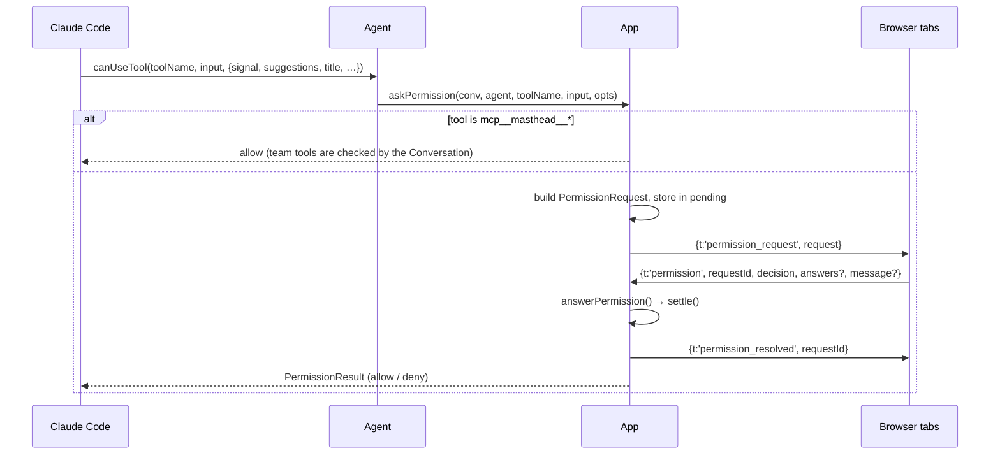

# Permissions and questions

Claude Code asks before it does some things (editing files, running commands), depending on its **permission mode** and the person's own Claude Code permission rules. Masthead shows those requests in the browser. The same channel carries **questions**: the lead's `AskUserQuestion` tool, which asks the person to pick from options. This page explains how both work. Code: `askPermission()`, `answerPermission()` and `cancelPermissions()` in `server/app.ts`; `canUseTool` in `launch()` in `server/agent.ts`.

## Permission mode

The settings field `permissionMode` (`PermissionChoice` in `shared/protocol.ts`) is one of:

| Value | Effect in `launch()` |
|---|---|
| `inherit` (default) | Masthead passes no permission mode, so Claude Code uses the person's own Claude Code settings. |
| `default`, `acceptEdits`, `auto` | Passed to the SDK as `permissionMode`. These are Claude Code's own modes; Masthead does not define them. |
| `bypassPermissions` | Passed as `permissionMode`, together with `allowDangerouslySkipPermissions: true`, which the SDK requires for that mode. Claude Code then does not ask. |

The mode applies to every agent and is read each time a process is launched.

## The approval path

Whenever Claude Code would ask about a tool call, the SDK calls the `canUseTool` function Masthead supplied. `Agent.launch()` routes it to `host.askPermission()`, which the `Conversation` passes to `App.askPermission()`.

`askPermission()` returns a promise. Claude Code waits on it, so the agent's turn is paused until the person answers.

### The request

A `PermissionRequest` (in `shared/protocol.ts`) carries a fresh id, the conversation and agent (id and name), `kind` (`permission` or `question`), the tool name, the `title` and `description` Claude Code offered (`description` falls back to `decisionReason`), the tool input, `canAlways`, any `questions`, and a timestamp.

- `canAlways` is true when Claude Code offered permission **suggestions**: rule changes that would stop it asking again (for example "always allow this command in this project").
- For `AskUserQuestion`, `kind` is `question` and `questions` is copied from the tool input (`Question` has the question text, an optional header, options with labels and descriptions, and `multiSelect`).

### The answer

`answerPermission()` handles `{t:'permission'}`:

| Decision | Result returned to Claude Code |
|---|---|
| `deny` | `{behavior: 'deny', message}`, with the person's message or "The person declined this." |
| any non-deny on a **question** | `{behavior: 'allow', updatedInput: {...input, answers}}`: the chosen answers (question text → answer string) are added to the tool input, which is how `AskUserQuestion` receives them. |
| `always`, when suggestions exist | `{behavior: 'allow', updatedInput: input, updatedPermissions: suggestions}`: Claude Code applies the suggested rules. |
| `allow` (or `always` without suggestions) | `{behavior: 'allow', updatedInput: input}`. |

An answer for an unknown id is ignored. This is expected when two tabs are open: the first answer settles it, and `permission_resolved` tells every tab to remove it.

### When a request goes away without an answer

- **Claude Code aborts it** (the SDK's `signal` fires, e.g. the turn was interrupted): denied with "The request was cancelled."
- **The agent is stopped or its process is lost**: `Conversation.stopTree()` and `processLost()` call `cancelPermissions(agentId)`, which denies all of that agent's requests with "The agent was stopped."
- **Masthead shuts down**: `App.shutdown()` denies all with "Masthead is shutting down."

In every case `settle()` removes it from `pending` and broadcasts `permission_resolved`.

Pending requests live only in memory. A tab that connects gets all of them, from every conversation, in `AppState.pending`, and a tab that opens a conversation gets the ones for that conversation in the `{t:'conversation'}` reply.

## In the page

Each pending request is shown as a card (`web/src/lib/PermissionCard.svelte`) above the message box, and also in the team map view. The sidebar shows a count next to any conversation with requests waiting for an answer.

- **Permission card:** the agent's name and Claude Code's `title`, or else a fixed phrase for common tools ("wants to run a command", "wants to write a file", "wants to edit a file", "wants to edit a notebook", "wants to read a file", "wants to fetch a web page", "wants to search the web"), or "wants to use <tool>" for any other (an MCP tool's `mcp__` prefix removed and `__` shown as " · "), with the target from `toolLine()` underneath when there is no title. A shell command is shown in full; other input sits behind "Show details". Claude Code's description, if any, appears below. The buttons are **Deny**, **Always allow** (only when `canAlways`), and **Allow**.
- **Question card:** each question with its options as buttons (one choice, or several when `multiSelect`), plus a "Something else…" box for a typed answer. **Answer** is enabled once every question has a choice or typed text. Each answer is sent as the chosen labels and typed text joined with ", ". **Skip** sends `deny`.
- The page removes the card as soon as the person answers, without waiting for `permission_resolved`. The page never sends the optional deny `message`, so a denial always reads "The person declined this."

The labels in the team panel's "Permissions" menu are "Use my Claude Code settings" (`inherit`), "Ask me first" (`default`), "Accept file edits, ask for the rest" (`acceptEdits`), "Auto (a classifier decides)" (`auto`), and "Bypass all checks" (`bypassPermissions`). With bypass selected, the panel warns: "Every agent can run any command and change any file without asking."

## Masthead's own tools skip the person

Calls to tools whose names start with `mcp__masthead__` (`send_message`, `spawn_agent`, …) are allowed without asking anyone. They are also listed in `allowedTools: ['mcp__masthead']`. The reason: those tools only act on the team, and every call is checked by the `Conversation` against the tier rules (see [Team rules](Team-Rules.md)).

## Who can ask questions

Only the lead may use `AskUserQuestion`; it is in the disallowed list for every other tier (`launch()`). Sub-agents are told to ask their parent instead. Tool permission requests, however, can come from any agent, and the request names the agent so the person knows who is asking.

## Related pages

[server/app.ts](Source-App.md) · [Browser/server protocol](Browser-Server-Protocol.md) · [Configuration and settings](Configuration-and-Settings.md) · [Security model](Security-Model.md)
