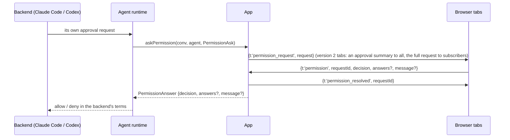

# Permissions and questions

The agent programs Masthead runs (Claude Code, Codex) ask before they do some things: run a command,
change a file, use a tool. When they ask depends on the **permission mode** and, for Claude Code, the
person's own permission rules. Masthead shows each request in the browser as a card. The same channel
carries **questions**: the main assistant asking the person to pick from options. Code:
`askPermission()`, `answerPermission()` and `cancelPermissions()` in `server/app/app.ts`; each
backend's translation in `server/backends/claude/session.ts` (`canUseTool`) and
`server/backends/codex/index.ts` (approval requests).

## Permission mode

The settings field `permissionMode` (`PermissionChoice` in `shared/protocol.ts`) applies to every
agent and is read when a session starts.

| Value | Claude Code (`session.ts`) | Codex (`permissions()` in `codex/index.ts`) |
|---|---|---|
| `inherit` (default) | no mode passed: the person's own Claude Code settings decide | only `approvalsReviewer: 'user'`: Codex's own configuration decides |
| `default` | `permissionMode: 'default'` | `approvalPolicy: 'untrusted'`, `sandbox: 'workspace-write'` |
| `acceptEdits`, `auto` | passed as `permissionMode` | `approvalPolicy: 'on-request'`, `sandbox: 'workspace-write'` |
| `bypassPermissions` | passed with `allowDangerouslySkipPermissions: true`; nothing is asked | `approvalPolicy: 'never'`, `sandbox: 'danger-full-access'`; nothing is asked |

The modes belong to the backends; Masthead only passes the choice on. With bypass, every agent can run
any command and change any file without asking, and the settings say so.

## The approval path

Each backend turns its own request into one neutral `PermissionAsk` (`server/backends/types.ts`):
`kind` (`command`, `file`, `tool` or `question`), the tool name, its input, an optional title and
description, whether "always allow" can be offered, the questions, and an abort signal. The runtime
passes it to the `Conversation`, which passes it to `App.askPermission()`.

- **Claude Code:** the SDK's `canUseTool` callback. Masthead's own team tools (`mcp__masthead__…`) are
  allowed at once: the conversation checks them. `AskUserQuestion` becomes a question. "Always" is
  offered when Claude Code suggested permission rules.
- **Codex:** the app-server's approval requests: a shell command (`commandExecution`), a file change
  (`fileChange`, with the patch), a permissions request, and `request_user_input` as a question.

`askPermission()` returns a promise; the agent's turn waits until the person answers. There is no time
limit.

### From another device

A device paired through [Remote access](Remote-Access.md) with the `full` or `approve` role can answer
cards; a `read` device sees them but cannot answer. A device sees the full request only for the
conversation it is subscribed to.

### The request

A `PermissionRequest` (in `shared/protocol.ts`) carries a fresh id, the conversation and agent (id and name), `kind` (`permission` or `question`), the tool name, the backend's `title` and `description`, the input, `canAlways`, any `questions`, and a timestamp (`App.askPermission()`).

- `canAlways` is true when the backend can apply an "always allow" rule: Claude Code's permission suggestions, or Codex's session-wide approval for commands, file changes and permissions.
- For a question, `questions` holds each question's text, an optional header, its options and `multiSelect`.

### The answer

`answerPermission()` handles `{t:'permission'}` and resolves the waiting promise with a neutral `PermissionAnswer`:

| Decision | Sent back | What the backend does with it |
|---|---|---|
| `deny` | `{decision: 'deny', message}`, the person's message or "The person declined this." | Claude Code: `behavior: 'deny'`. Codex: the approval is declined. |
| any answer to a **question** | `{decision: 'allow', answers}` (question text → answer) | Claude Code: added to `AskUserQuestion`'s input. Codex: the `request_user_input` reply. |
| `always` | `{decision: 'always'}` | Claude Code applies its suggested rules; Codex approves for the session. |
| `allow` | `{decision: 'allow'}` | allowed once. |

An answer for an unknown id is ignored. This is expected when two tabs are open: the first answer settles it, and `permission_resolved` tells every tab to remove it.

### When a request goes away without an answer

- **The backend aborts it** (its `signal` fires, e.g. the turn was interrupted): denied with "The request was cancelled."
- **The agent is stopped or its process is lost**: `Conversation.stopTree()` and `processLost()` call `cancelPermissions(agentId)`, which denies all of that agent's requests with "The agent was stopped."
- **Masthead shuts down**: `App.shutdown()` denies all with "Masthead is shutting down."

In every case `settle()` removes it from `pending` and broadcasts `permission_resolved`.

Pending requests live only in memory. A version 1 tab gets all of them in `state.pending`; a version 2 tab gets summaries (`{id, convId, agentName, kind}`) for every conversation in `state.pending` and `{t:'approval'}`, and the full requests of a conversation in its subscription snapshot.

## In the page

Each pending request is shown as a card (`web/src/lib/PermissionCard.svelte`) above the message box, and also in the team map view. The sidebar shows a count next to any conversation with requests waiting for an answer. Because `state` carries every open request (`App.state()`), a tab that reconnects sees approvals in conversations it does not have open (the page keeps them in `store.pending`, `web/src/lib/store.svelte.ts`).

- **Who is asking.** Both kinds of card name the agent (`displayName(request.agentName)`), and the card's accessible label is "Permission request from X" or "Question from X". So the person always knows which agent is asking, even for a sub-agent's request.
- **Focus.** A new card is an `alertdialog` and takes keyboard focus when it appears (`onMount`), unless the person is typing: a key pressed in the last 1.5 seconds, text in the field that has focus, or focus already on another card. Focus goes to the card itself, not to its Allow button, so a stray Enter answers nothing.

- **Permission card:** the agent's name and Claude Code's `title`, or else a fixed phrase for common tools ("wants to run a command", "wants to write a file", "wants to edit a file", "wants to edit a notebook", "wants to read a file", "wants to fetch a web page", "wants to search the web"), or "wants to use <tool>" for any other (an MCP tool's `mcp__` prefix removed and `__` shown as " · "), with the target from `toolLine()` underneath when there is no title. A shell command is shown in full; other input sits behind "Show details". Claude Code's description, if any, appears below. The buttons are **Deny**, **Always allow** (only when `canAlways`), and **Allow**.
- **Question card:** headed "<agent> asks", then each question with its options as buttons (one choice, or several when `multiSelect`), plus a "Something else…" box for a typed answer. **Answer** is enabled once every question has a choice or typed text. Each answer is sent as the chosen labels and typed text joined with ", ". **Skip** sends `deny`.
- The page removes the card as soon as the person answers, without waiting for `permission_resolved`. The page never sends the optional deny `message`, so a denial always reads "The person declined this."

The settings choose the permission mode in plain words (the text is in `web/src/lib/text.ts`); with bypass selected the page warns that every agent can run any command and change any file without asking.

## Masthead's own tools skip the person

Masthead's team tools (`send_message`, `spawn_agent`, …) never reach the person. Claude Code shows them as `mcp__masthead__…` and `canUseTool` allows them at once; Codex calls them as dynamic tools, which need no approval. They only act on the team, and every call is checked by the `Conversation` (see [Team rules](Team-Rules.md)).

## Who can ask questions

Only the main assistant may ask the person: the runtime sets `canAskPerson` in the session spec for it alone (`server/runtime/agent.ts`), and Claude Code's `AskUserQuestion` is disallowed for every other agent (`session.ts`). Helpers are told to ask the agent that started them instead. Tool permission requests, however, can come from any agent, and the request names the agent so the person knows who is asking.

## Related pages

[server/app/app.ts](Source-App.md) · [Remote access](Remote-Access.md) · [Browser/server protocol](Browser-Server-Protocol.md) · [Configuration and settings](Configuration-and-Settings.md) · [Security model](Security-Model.md) · [Safety model](Safety-Model.md)
