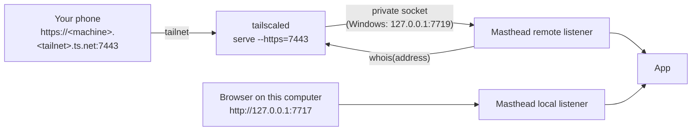
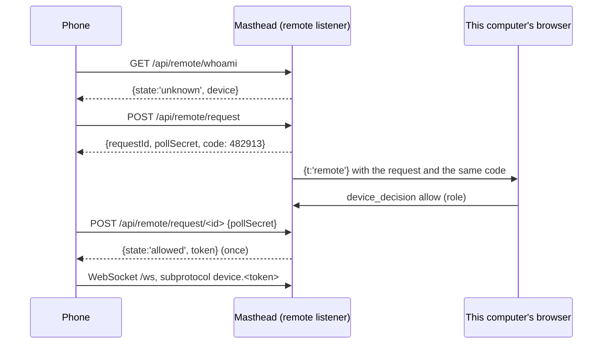

# Remote access

**In plain words:** if this computer and your phone (or another computer) are on the same Tailscale
network, you can open Masthead on the phone and use it there. A device can get in only after you allow
it on this computer, by checking that a six-digit code matches. Nothing is opened to the internet.
Remote access is off until you switch it on.

Remote access has been checked on a real tailnet (a Linux computer running Masthead, an Android phone
and a Windows device); its unit tests (`test/remote*.test.ts`) use a fake Tailscale. Setting it up is described step by step in [Using Masthead from your phone](Using-Masthead-From-Your-Phone.md).

## How it works

### The switch, and what it runs

- **Settings → Remote access → "Allow my other devices to connect"** sends `remote_settings` with
  `enabled`. `RemoteAccess.setEnabled()` (`server/remote/access.ts`) then runs exactly one Tailscale
  command through its provider (`server/remote/tailscale.ts`):
  - on: `tailscale serve --bg --https=7443 <target>`;
  - off: `tailscale serve --https=7443 off`.

  The target is Masthead's own private socket or, on Windows, `http://127.0.0.1:7719`. Masthead never
  runs `serve reset`, never touches another port's entry, and never uses Funnel.
- **Before changing anything** it reads `tailscale serve status --json`. If the port already serves
  something else, is published with Funnel, or has a layout Masthead does not fully understand, it
  refuses and says why. It also refuses when HTTPS certificates are off for the tailnet.
- **When Tailscale says no**, the settings show the command to run once, with a Copy button. For
  Masthead's private socket (Linux, macOS) Tailscale wants root: being the Tailscale operator is not
  enough unless `sudo` works without a password. So Masthead offers its own entry added once as root,
  `sudo tailscale serve --bg --https=<port> unix:<socket>`; after that switching on finds the entry
  and succeeds. On Windows (loopback target) the advice is to run Tailscale as an administrator, and
  any other refusal ends with what Tailscale said.
- **Switching off always works.** The listener closes and the setting is saved off even if Tailscale
  refuses to remove the entry; the leftover entry points at a closed socket, so nothing is reachable,
  and the settings show a quiet note with `sudo tailscale serve --https=<port> off`.
- **The setting is remembered** in `<data folder>/remote/config.json`. At every start Masthead brings
  Tailscale in line with it (`reconcile()`): its entry is re-added when the setting is on, and a
  leftover entry is removed when the setting is off, but only if this instance had added it
  (`hadEntry`). Someone else's entry is never touched.
- **One instance never touches another's entry.** Each data folder has its own socket (the usual one
  `remote.sock`, any other `remote-<hash>.sock`), so a second instance or a test server sees the real
  entry as someone else's. Test and fake servers (`MASTHEAD_BACKEND=fake` or `MASTHEAD_TAILSCALE=off`)
  never run `tailscale` at all.
- **The port** (7443 by default; not 7717, 8443 or 10000) can be changed only while the switch is off.

### Who a request comes from

- Every request to the remote listener must look as Tailscale `serve` sends it: the right
  `X-Forwarded-Host`, an `X-Forwarded-For` address, and the expected Host (`fromServe()` in
  `server/transport/remote.ts`).
- The address is looked up with `tailscale whois`, cached for a minute per address, at most four at
  once, failures not cached (`CachedWhois`). The answer names the device by its stable node id, its
  name, system, tailnet user and tailnet.
- The requests from this same computer are refused (use the local address). Devices from other tailnets
  and tagged devices are refused unless the person allows them in the settings.

### Pairing

- **One waiting request per device**, and its poll secret never changes, so nobody else can take it
  over (`DeviceRegistry.request()` in `server/remote/registry.ts`). The phone keeps the poll secret
  across a reload.
- **On Windows** (where the listener is a local port), a device may have up to three waiting requests,
  and turning one down locks out only that request, so a program faking the phone's address cannot
  block the real phone. The code on the card is what tells them apart.
- Requests expire after 10 minutes. A device turned down may ask again after 10 minutes (not on
  Windows, see above). Limits: 10 requests per address per minute, 20 waiting in all, 3 per tailnet user.

### Tokens, roles, expiry, revoke

- On approval the device receives a 32-byte token, once. Only its SHA-256 is stored, in
  `<data folder>/remote/devices.json` (`0600`). The token works only from the node it was issued to: a
  copy used on another device is refused and logged.
- **Roles:** `full` (everything the local page can, except shutting Masthead down and managing remote
  access or devices), `approve` (read, answer approvals, stop work), `read` (only read). The role can be
  changed at any time; open connections follow at once.
- **Expiry:** 30 days, renewed whenever the device is used.
- **Remove** ends the device's connections at once; it must pair again.
- Approving a device that was approved before replaces its old token.

### The audit log

`<data folder>/remote/audit.jsonl` (`0600`) records switching on and off, requests, approvals,
denials, token collection, connections, role changes, removals, expiries and refusals, with time,
device, user and address. Refusals are written at most once a minute per device and reason. The file
is moved aside at 1 MB; the settings show the newest entries.

### A device that cannot resolve the address

The address is a MagicDNS name (`<computer>.<tailnet>.ts.net`). A device whose Tailscale has "Use
Tailscale DNS" off (`accept-dns=false`) cannot resolve it at all: the browser says the server was not
found, while the computer's `100.x.y.z` address still answers. This was seen on a real Windows machine
on 2026-11-27. The fix is on that device: turn on **Use Tailscale DNS** in the Tailscale app, or run
`tailscale set --accept-dns=true`. Masthead cannot detect this from its side, and opening the
`100.x.y.z` address instead does not work, because the HTTPS certificate is for the name.

## What a remote device can and cannot do

| | Local page | Remote `full` | `approve` | `read` |
|---|---|---|---|---|
| Read conversations | ✓ | ✓ | ✓ | ✓ |
| Read archived helpers' chats | ✓ | ✓ | ✓ | ✓ |
| Answer approvals, stop work, answer or cancel tidying the team | ✓ | ✓ | ✓ | |
| Send messages (including `/compact`), start conversations, change settings, attach pictures, restore an archived helper, switch automatic tidying | ✓ | ✓ | | |
| Manage remote access and devices, see the audit log | ✓ | | | |
| Shut Masthead down | ✓ | | | |

## Threats that remain

- **An approved device that is lost or compromised** can, with `full`, do everything you can here,
  including running commands through the agents. Remove it.
- **Approving carelessly.** The code must match; Masthead cannot check that you looked.
- **On Windows,** other programs on the computer (also of other user accounts) can ask to pair while
  pretending to be one of your devices. They cannot get in unless you approve a request whose code does
  not match your device.
- **Your tailnet's own rules** decide which devices can reach port 7443 at all. Limiting it to your own
  devices in the Tailscale admin console is a good idea.
- Not checked: Safari's handling of the page's `wss:` policy, and the exact errors
  Tailscale gives when it refuses.

## Related pages

[Using Masthead from your phone](Using-Masthead-From-Your-Phone.md) · [Security model](Security-Model.md) · [server/remote/access.ts](Source-Remote-Access.md) · [server/remote/registry.ts](Source-Remote-Registry.md) · [server/remote/tailscale.ts](Source-Remote-Tailscale.md) · [server/transport/remote.ts](Source-Transport-Remote.md)
