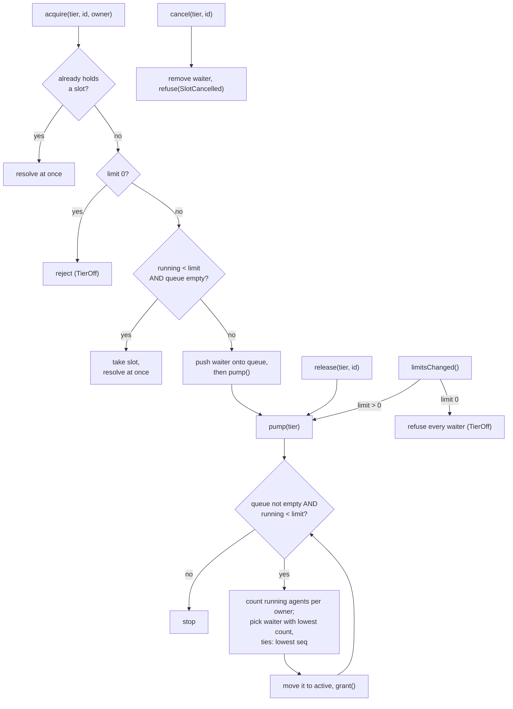

# Slot scheduling

Each tier of a team profile has a `max`: how many agents of that tier may run at once. This page explains how `server/core/scheduler.ts` enforces it and shares free places fairly.

## Terms

- **Slot**: one of the N places for a tier. An agent must hold a slot before its process starts.
- **Owner**: who asked for the slot. `Agent.ensureProcess()` (`server/runtime/agent.ts`) passes the agent's **parent id** (the conversation id for the lead). Fairness is measured per owner.
- **Waiter**: a queued request: agent id, owner, a sequence number (`seq`, the order of asking), and the functions that grant or refuse it.

## Where the limit comes from

There is one `Scheduler`, created by `App` (`server/app/app.ts`) as `new Scheduler((tier) => tierLimit(settings, tier))`. `tierLimit()` in `server/settings/settings.ts` looks the tier id up in every profile:

- the first tier of any profile (the lead's tier, `lead` or `<profile>:0`) is unlimited (`Infinity`): each conversation always has its lead;
- any other tier gives its `max` (0 to 12, `MAX_PER_TIER`);
- a tier no profile has any more gives 0, so it reads as switched off.

The scheduler's own `cap()` also treats the tier id `lead` and an `Infinity` limit as unlimited, and clamps anything else at 0 or more. Because the limit function reads the current settings, a change to a profile applies to the next decision; `App.updateSettings()` then calls `limitsChanged()`.

## Rules

- The limit is **app-wide**: it counts agents of that tier in every conversation.
- An agent asks for a slot each time it needs a process: when it starts, when it is woken after finishing, and when it resumes after a usage-limit pause or a lost process. Asking again while it holds a slot resolves at once.
- An agent that is `waiting` for its children, an answer or background work **keeps its slot** and its process.
- The slot is given back when the agent ends (`Agent.end()` releases it; the machine emits no separate `releaseSlot` for an end), when its process is lost (`ProcessLost` emits `releaseSlot`), when it pauses at a usage limit (the pause emits `releaseSlot`; the process is closed), and when `Agent.dispose()` closes it at shutdown. `launch()` also releases it when it cannot open a session.
- A tier at 0 is off. `Conversation.spawn()` refuses before reaching the scheduler, and `message()` / `userSend()` refuse to wake a finished agent of it. The scheduler also refuses at once: `acquire()` rejects with `TierOff` on a tier at 0, so any other start (a paused agent resuming, say) fails instead of queuing for ever.
- Setting a tier to 0 while agents of it are queued refuses them: `limitsChanged()` rejects each waiter with `TierOff`. `ensureProcess()` passes the error to `Conversation.processLost()`, which applies `ProcessLost` to the machine: the sub-agent fails with "This tier was switched off in the settings while the agent was waiting to start." and its parent gets the usual failure report (or is settled if no report was owed). (`TierOff.toString()` returns the bare message, without an "Error:" prefix.)
- Otherwise, lowering a limit does not stop agents already running; it only affects who starts next. Raising it starts queued agents at once (`limitsChanged()` calls `pump()`).

## Fair queueing

When a slot frees up, the scheduler does not simply take the oldest request. It picks the request whose **owner currently has the fewest running agents of that tier**, and among equals, the one that asked first. This stops one busy parent that asked for many agents from starving another parent that asked for one.

Note the condition "queue empty" in `acquire()`: a newcomer never jumps ahead of agents already waiting, even if a slot happens to be free at that instant; it joins the queue and `pump()` decides.

### Example

Sonnet limit 4. Opus agent `A` has 3 Sonnets running; Opus agent `B` has 1. Both have one more Sonnet queued, `A`'s asked first. When a Sonnet finishes (say one of `A`'s), `A` has 2 running and `B` 1, so `B`'s request goes first, even though `A`'s is older.

## Cancelling

When a queued agent is ended (the machine's `end` effect calls `Agent.end()`), `Agent.end()` calls `scheduler.cancel()`, which removes the waiter and rejects its promise with `SlotCancelled`. `ensureProcess()` recognises that error and quietly gives up instead of reporting a failure. If the stop came too late to cancel (the slot was granted in the same pass that freed it), `ensureProcess()` sees that the agent was ended meanwhile, does not launch it, and releases the slot.

## What the person sees

An agent waiting for a slot shows the status `queued`. `ensureProcess()` sets it in a microtask only when the slot was not granted at once, so an agent that starts straight away never flashes `queued`. How the page shows tier limits is described on the `Source-Web-*` pages (not checked for this page).

## What the agents are told

The system prompt tells each agent that can start others how many of its child tier may run at once and that more wait in a queue (`systemAppend()` in `server/core/prompts.ts`: "At most N of them run at once across the app; more wait in a queue."). `spawn()`'s reply says "(queued: N may run at once)" when it predicts the new agent will wait, by checking `scheduler.running(tier) >= max || scheduler.queued(tier) > 0` before starting it. The prompt line is left out when the child tier is off; the agent is told "Starting <label> agents is switched off in the settings, so do the work yourself." instead.

Related pages: [Source: core/scheduler.ts](Source-Core-Scheduler.md) · [State machine](State-Machine.md) · [Agent life cycle](Agent-Life-Cycle.md) · [Team profiles and settings](Team-Profiles-and-Settings.md) · [Configuration and settings](Configuration-and-Settings.md)
