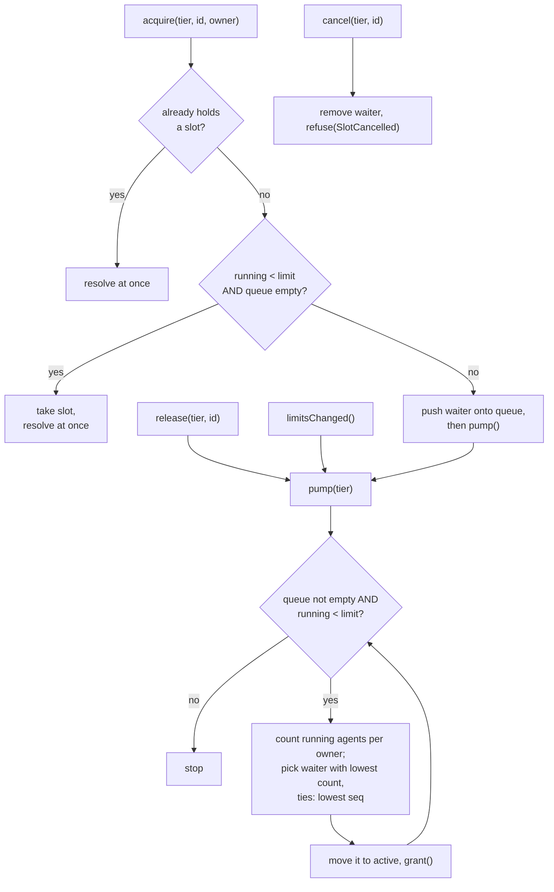

# Slot scheduling

The settings sidebar sets, for each of the Opus, Sonnet and Haiku tiers, how many agents may be running at once. This page explains how `server/scheduler.ts` enforces that and how it shares free places fairly.

## Terms

- **Slot**: one of the N places for a tier, where N is the tier's `max` in the settings. An agent must hold a slot before its Claude Code process starts.
- **Owner**: who asked for the slot. `Agent.ensureProcess()` passes the agent's **parent id** (the conversation id for the lead). Fairness is measured per owner.
- **Waiter**: a queued request: agent id, owner, a sequence number (`seq`, the order of asking), and the functions that grant or refuse it.

## Rules

- The limit is **app-wide**: it counts agents of that tier in every conversation, not per conversation. There is one `Scheduler`, created by `App`.
- The **lead is never limited** (`cap('lead')` is `Infinity`). Each conversation always has its lead.
- An agent asks for a slot every time it needs a process: when it starts, and again when it is resumed after finishing.
- An agent that is `waiting` for its children **keeps its slot**: it is still part of the running team, and its process stays open.
- The slot is given back when the agent finishes, fails, is stopped, or its process is lost (`Agent.end()` and `Conversation.processLost()` call `release()`).
- A tier limit of 0 means agents of that tier cannot be started at all (`spawn()` refuses before reaching the scheduler).
- Lowering a limit in the settings does not stop agents already running; it only affects who starts next (a known limitation, deliberate for 0.1.0, and checked by a unit test). Raising it starts queued agents at once (`limitsChanged()`).

## Fair queueing

When a slot frees up, the scheduler does not simply take the oldest request. It picks the request whose **owner currently has the fewest running agents of that tier**, and among equals, the one that asked first. This stops one busy parent that asked for many agents from starving another parent that asked for one.

Note the condition "queue empty" in `acquire()`: a newcomer never jumps ahead of agents already waiting, even if a slot happens to be free at that instant; it joins the queue and `pump()` decides.

### Example

Sonnet limit 4. Opus agent `A` has 3 Sonnets running; Opus agent `B` has 1. Both have one more Sonnet queued, `A`'s asked first. When a Sonnet finishes (say one of `A`'s), `A` has 2 running and `B` 1, so `B`'s request goes first, even though `A`'s is older.

## Cancelling

When a queued agent is stopped, `Agent.end()` calls `scheduler.cancel()`, which removes the waiter and rejects its promise with `SlotCancelled`. `ensureProcess()` recognises that error and quietly gives up instead of reporting a failure.

## What the person sees

The team panel shows each tier's limit as a stepper labelled "At once" (0 is shown as "Off"), with "· N now" when agents of that tier are running or waiting. That count covers only the conversation on screen, while the limit is app-wide. An agent waiting for a slot shows the status "Queued" and, in its chat, "Waiting for a free slot…". See [Web components](Source-Web-Components.md).

## What the agents are told

The system prompt tells each agent that can start others how many of its child tier may run at once and that more wait in a queue (`systemAppend()` in `server/prompts.ts`). `spawn()`'s reply says "(queued: N may run at once)" when it predicts the new agent will wait, by checking `running(tier) >= cap || queued(tier) > 0` before starting it.

## Related pages

[server/scheduler.ts](Source-Scheduler.md) · [Agent life cycle](Agent-Life-Cycle.md) · [Configuration and settings](Configuration-and-Settings.md)
