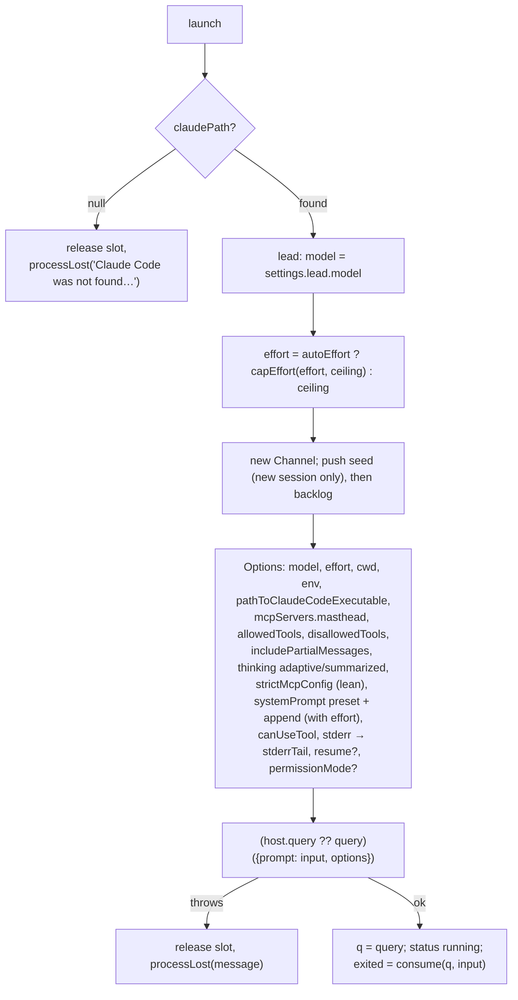

# server/agent.ts

**Role:** one member of the team. An `Agent` wraps a Claude Code session started through the Agent SDK, feeds it input, and turns the SDK's stream of messages into the app's view of it: transcript items, a live draft, a status, usage numbers and an activity line. It does not decide team policy; it reports events to its host (the `Conversation`) and the host decides. The status flow is on [Agent life cycle](Agent-Life-Cycle.md).

## Interfaces

### `AgentHost`

What an agent needs from the conversation that owns it. `Conversation` implements it.

| Member | Purpose |
|---|---|
| `cwd`, `scheduler` | The folder Claude Code runs in; the shared slot scheduler. |
| `settings()`, `claudePath()` | Current settings; path to `claude` or null. |
| `parentName(agent)` | For the system prompt. |
| `tools(agent)` | The in-process MCP server with the team tools (`teamTools()`). |
| `agentChanged`, `itemChanged`, `draftChanged`, `rateLimit` | Change notifications, passed up to the app. |
| `askPermission(...)` | Where `canUseTool` goes. |
| `turnEnded(agent, outcome)` | A turn finished and nothing it was sent is still unanswered. |
| `processLost(agent, message)` | The process went away without being asked. |
| `query?` | Optional. Starts a Claude Code session in place of the SDK's `query`; only the tests set it (`test/agent.test.ts`). |

### `TurnOutcome`

`{ text, error?, interrupted }`: what the agent said since it last took up work (the final text of every turn in that run, oldest first; see [Agent life cycle](Agent-Life-Cycle.md#4-end-of-a-turn-handleresult-and-the-unanswered-set)), an error if the turn failed, and whether it was interrupted.

## `Channel<T>`

A small asynchronous queue that is also an async iterable: `push()` adds an item and wakes the reader; `close()` ends the iteration once the queue is empty. Its iterator is passed to `query()` as the prompt, which puts the SDK in **streaming input** mode: Claude Code keeps reading new user messages from it for as long as it is open. This is what lets Masthead deliver reports and messages to an agent that is in the middle of working, and keep the lead's process open between the person's messages.

## Helpers

- `TOOL_RESULT_LIMIT = 12_000`: tool results are clipped to this many characters for the transcript.
- `DRAFT_INTERVAL_MS = 70`: the live draft is sent at most this often.
- `DISALLOWED`: Claude Code built-in tools turned off for every agent: `Agent`, `Task`, `Workflow`, `SendMessage`, `ListAgents`, `EnterPlanMode`, `ExitPlanMode`, `EnterWorktree`, `ExitWorktree`, `ScheduleWakeup`, and the ways to start work later or elsewhere, outside the team: `CronCreate`, `CronDelete`, `CronList`, `RemoteTrigger`, `SendToProject`, `SendToProjectContext`, `PushNotification`. The comment gives the reason: they would bypass Masthead's own team, or Masthead has no screen for them. Non-lead agents also lose `AskUserQuestion`.
- `MISSING_SESSION`: the pattern `No conversation found with session ID`, what Claude Code writes when a session to resume no longer exists (seen in Claude Code 2.1.331, per the comment).
- `STDERR_KEEP = 4_000`: how much of Claude Code's error output is kept.
- `clip(text, limit)` (exported): cuts text and appends "… (N more characters not shown)".
- `toolResultText(content)`: flattens a tool result to text (text blocks as text, images as `[image]`, loaded tools as `[tool loaded: name]`, other blocks as `[type]`).
- `describeTool(name, input)` (exported): one line for the activity display, e.g. "Running npm test" or "Messaging alpha". It calls `toolLine(name, input, true)` from `shared/toolline.ts` (the present-tense wording), joins verb and target, and cuts the result to 90 characters. See [shared/toolline.ts](Source-Shared-Toolline.md).

## `class Agent`

### Public state

- `info: AgentInfo` (read-only reference; its fields are changed in place and broadcast).
- `sessionId`: Claude Code session id, set from the `init` message.
- `owesReport`: whether it owes its parent a report when it next finishes (set and cleared by `Conversation`).
- `lastText`: what it said in its most recent run of turns, the same joined text as the outcome (used by `Conversation.settle()`).

### Private state worth knowing

| Field | Meaning |
|---|---|
| `q` | The SDK `Query` for the running process, or null. `hasProcess` is `q !== null`. |
| `input` | The `Channel` feeding that process. |
| `starting` | A slot request or launch is in progress. |
| `backlog` | Messages accepted while no process exists; handed to the next process. |
| `unanswered` | Ids of messages sent to the session that no finished turn has consumed. |
| `seed` | The first message of a brand-new session (a sub-agent's task); dropped once the session id is known. |
| `closing` | Masthead asked the process to end, so its end is not a crash. |
| `exited` | Promise that settles when the current process has fully exited; a new launch waits for it. |
| `interrupted` | An interrupt was requested for the current turn. |
| `costBefore` | Cost accumulated by earlier processes, since the SDK's `total_cost_usd` counts per process. |
| `openTools` | Tool calls waiting for their result, by tool-use id. |
| `draft`, `draftTimer` | The streamed block and its throttle timer. |
| `turnText`, `turnError` | Collected during a turn for the outcome. |
| `runTexts` | Final texts of the turns in the current run (turns that ended while more input was unanswered); emptied when the run's outcome is sent, and by `end()`, `dispose()` and a lost process. |
| `generation` | Increased by `end()` and `dispose()`. A start waiting for a slot or for the old process checks it, so an agent stopped meanwhile is never launched (`closing` cannot tell, since it stays true for a finished agent being resumed). |
| `sent` | Everything put into the current process's input, so unanswered messages can be sent again to a fresh session. |
| `resumedFrom`, `sawInit`, `sessionMissing`, `freshRetried` | The fresh-session rule: the session this process resumed, whether it reported `init`, whether a result said the session is gone, and whether a fresh session was already tried (never twice). |
| `namesConsumed` | Whether this Claude Code has named the messages a turn consumed, earlier in this process. |
| `stderrTail` | The last 4,000 characters of Claude Code's error output for the current process. |

### Getters

`id`, `name`, `tier`, `status`; `live` (queued, running or waiting); `hasProcess`; `pendingSeed` (the task text of an agent whose session has not started yet, otherwise null; `Conversation.toStored()` saves it so the task survives a restart); `busy` (something unanswered, or starting).

### Methods

| Method | What it does |
|---|---|
| `setStatus(status, error?)` | Sets status and error; clears the activity line unless running; sets `endedAt` for done/failed/stopped and clears it otherwise; notifies only if something changed. |
| `addItem(item)` | Gives a `NewItem` an id (unless it has one) and timestamp and passes it to `itemChanged` (which saves and broadcasts it). |
| `start()` | `ensureProcess()`. |
| `deliver(content)` | Wraps content as a user message with a fresh id (added to `unanswered`). If a process is open, pushes it into the input and sets `running`. Otherwise adds it to `backlog` and calls `ensureProcess()`. |
| `static imageContent(text, images)` | Plain text, or image blocks followed by a text block. |
| `ensureProcess()` (private) | Requests a slot (owner = parent id, or conversation id for the lead), shows `queued` only if not granted immediately, waits for the old process to exit (`exited`), then checks the generation: if `end()` or `dispose()` ran meanwhile, it gives the slot back (unless a newer start holds it) and does not launch. Otherwise `launch()`. If `launch()` throws, it resets `starting`, `input`, `q` and `unanswered` and reports `processLost()` (which releases the slot), so an unexpected error becomes a failed agent rather than an unhandled rejection. |
| `launch()` (private) | Builds `Options` and calls `query()`. Detailed below. |
| `consume(q, input)` (private) | Reads every SDK message into `handle()`. When the stream ends: closes the input, clears `q`, carries cost forward, clears the draft, marks open tools done; if Masthead did not ask for the end, either starts a fresh session (`resumeWasMissing()` → `startFresh()`) or clears `unanswered` and `runTexts` and calls `processLost()`. |
| `resumeWasMissing(failure)` (private) | True only when this process was a resume, ended before `init`, no fresh start was tried yet, and the failure, the error output or a set-aside result names the missing session. |
| `startFresh()` (private) | Once: forgets the session and seed, adds an info notice, and launches a new session with a note to the agent, then the unanswered messages from `sent`, then the backlog. |
| `handle(m)` (private) | Dispatches SDK messages; see the table on [Agent life cycle](Agent-Life-Cycle.md#3-during-a-turn-handle). |
| `handleStream(e)` (private) | Partial-message events: `message_start` sets context size (input + cache read + cache creation tokens); `message_delta` adds output tokens to output and context; `content_block_start` for text or thinking clears the activity line and starts a draft; `content_block_delta` appends to it. |
| `handleResult(m)` (private) | Turn end. Removes the ids the turn names from `unanswered` (`user_message_uuids`, or the single `user_message_uuid`; a result naming none clears everything only if this Claude Code has never named one), counts the turn, updates cost, closes tools, works out the error (ignoring `[ede_diagnostic]` lines, and ignoring errors on an interrupted turn), adds the turn's text to `runTexts` and records the joined text as `lastText`. If anything is still unanswered, another turn follows (an error becomes a notice); otherwise empties `runTexts` and calls `turnEnded()`. |
| `setActivity()`, `setDraft()` (private) | Update and broadcast; the draft is throttled to one send per 70 ms unless `now` is true. |
| `currentDraft()` | For `{t:'items'}` replies. |
| `interrupt()` | If running, sets `interrupted` and calls `q.interrupt()`. |
| `end(status, error?)` | Cancels a queued slot request, increases the generation, marks closing, clears backlog, unanswered and `runTexts`, closes the input gracefully (`done`) or the process at once (`stopped`/`failed`), releases the slot, sets the status. |
| `dispose()` | Like `end()` but without changing the status: cancels a queued request, increases the generation, marks closing, clears backlog, unanswered and `runTexts`, closes the process at once, releases the slot. Used by `Conversation.shutdown()` for agents that are not live (the lead, and finished agents whose process may still be closing), so their saved status stays what it was. |
| `setEffort(level)` | Updates `info.effort`, broadcasts, and calls `q.applyFlagSettings({ effortLevel })` on a live process; failures are ignored because the level is applied at the next launch anyway. |
| `refreshContext()` | Asks Claude Code for real context usage (`q.getContextUsage()`) and stores `totalTokens` / `maxTokens`. Called by the conversation after each lead turn. |

### `launch()` in detail

Notes:

- `thinking: { type: 'adaptive', display: 'summarized' }` lets the model decide when to think, and asks for summarized thinking text, which becomes `thinking` items.
- `stderr` keeps the last 4,000 characters of Claude Code's error output in `stderrTail`; it is used only to recognise a missing session.
- `strictMcpConfig` is true for Sonnet and Haiku when `leanSubagents` is on, and for Opus when `leanOpus` is on: they then get only the `masthead` MCP server, not the person's configured ones. The lead always gets them.
- `systemAppend()` is given the effort the agent launches at, so the prompt names its real level.

## Points to be aware of

- **Known limitation (deliberate since 0.1.0):** sub-agents never call `refreshContext()`, so their `usage.contextMax` is assumed to be 1,000,000 and their `context` is the estimate from the stream.
- If `launch()` threw *after* `query()` had succeeded (for example inside a status callback), the catch in `ensureProcess()` sets `q` to null without closing that process. Nothing in the current callbacks is expected to throw, so this is theoretical.
- `message_delta` output tokens are added each time the event arrives. This assumes one such usage figure per message; whether Claude Code emits more than one per message was not checked.

## Related pages

[Agent life cycle](Agent-Life-Cycle.md) · [server/conversation.ts](Source-Conversation.md) · [Permissions and questions](Permissions-and-Questions.md)
