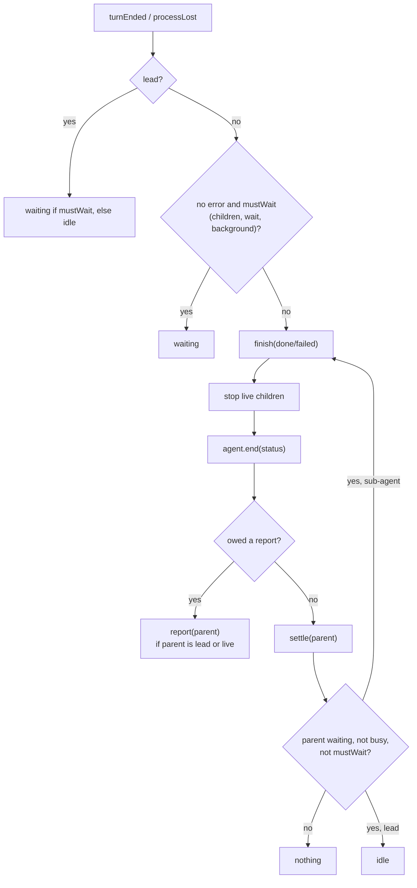

# server/conversation.ts

**Role:** one conversation, meaning the lead the person talks to and every agent started under it. The class comment says the `Conversation` **owns the rules of the team**:

- agents can start only the tier directly below their own;
- reports travel up to whoever started an agent;
- messages can go to anyone;
- effort changes go through the agent above.

It implements two interfaces: `AgentHost` (what its agents need from it) and `TeamActions` (what their tools do). The same rules in plain language are on [Team rules](Team-Rules.md).

## `ConversationHost`

What a conversation needs from the app. `App` implements it with:

- `scheduler`, `settings()`, `claudePath()`;
- the change callbacks `agentChanged`, `itemChanged`, `draftChanged`, `metaChanged`;
- `rateLimit`, `askPermission`, and `cancelPermissions(agentId)`.

## Constants and helpers

- `MAX_AGENTS = 200`, `MAX_AGENT_MESSAGES = 1000`, `TASK_PREVIEW = 400` (see [Team rules](Team-Rules.md#limits-per-conversation)).
- `slug(name)`: lower case, runs of non-alphanumeric characters turned into `-`, trimmed, at most 40 characters, `agent` if nothing is left. It is now used only when looking a name up (`find()`), so that "Bravo " still matches `bravo`.
- `CLOSED_WHILE_WORKING` = "Masthead was closed while this agent was working.", the error of an agent cut off by a shutdown or restart; `CLOSED_LEAD_TOLD` adds " The lead was told." once the lead knows.
- `duration(ms)`: "45s", "12m", "3h05m", used by `list()`.
- `titleFrom(text)`: the first non-empty line of the person's first message, with whitespace collapsed, cut to 60 characters with `…`.

## Creating, restoring, saving

| Method | What it does |
|---|---|
| `static create(host, cwd)` | Makes new ids for the conversation and its lead, sets the title "New conversation", and creates the lead `Agent`: name `agentName(0)` = `alpha`, empty title and task, status `idle`, effort `low` (automatic effort) or the lead tier's level. |
| `static restore(host, stored)` | Rebuilds a conversation from disk. Any agent saved as live (queued, running or waiting) was cut off when the app closed: the lead becomes `idle`; any other agent becomes `stopped` with the error "Masthead was closed while this agent was working." It also clears the activity line, sets `title` to `''` if the saved record has none, keeps `sessionId`, and sets `owesReport` to false for every agent. The code comment explains: nobody is waiting for a report after a restart, and a parent that messages the agent asks for one again. An agent that never started gets its saved `seed` back, so its task is not lost. Nothing is started. Finally, if `restartNote()` finds agents to tell about, an info notice with its text is added to the lead's transcript, deferred with `queueMicrotask` because the app registers the conversation only after `restore()` returns. |
| `toStored()` | The meta (with `busy` removed) plus each agent's `info`, `sessionId`, `owesReport`, and `seed` when the agent has a `pendingSeed`. Passed to `Store.saveConversation()`. Also `stoppedByPerson` (as a list) and `agentMessages`. |
| `busy()` | True while any agent in the conversation is live. `App` adds it to the conversation list it sends. |
| `infos()` | Every agent's `AgentInfo`, for the `{t:'conversation'}` reply. |

Private helpers:

- `restartNote()` finds agents that are `stopped` with the error exactly `CLOSED_WHILE_WORKING`. Because it reads the stored error, it survives saves and further restarts until the lead is told. It returns `null` or the text "Masthead was restarted; these agents were stopped while working: bravo (Audit). Message one to resume it." with those agents.

- `newInfo()` fills in `convId`, the tier's model from the settings, `createdAt`, and zeroed usage with `contextMax` 1,000,000.
- `addAgent()`, `touch()` (sets `updatedAt` and notifies), `children()`, `liveChildren()`, `parent()`.
- `isAncestor(a, b)` walks up from `b` looking for `a`.
- `find(name, relativeTo?)` turns a name into an agent:
  - `parent` means `relativeTo`'s parent;
  - `lead` means the lead;
  - otherwise it tries an exact name match (case-insensitive), then a match on the slug.

## Actions by the person

| Method | Called for | What it does |
|---|---|---|
| `userSend(text, images, agentId?)` | `{t:'send'}` | The target is the agent with `agentId`, or the lead. If the title is still "New conversation" and the target is the lead, it sets the title from the text. It adds a `user` item. If the target is a finished sub-agent whose tier is off, it adds an error notice and stops there. Otherwise it clears the target's `stoppedByPerson` mark and any open wait of the target (the person answering a waiting agent ends its wait). When the target is the lead and `restartNote()` returns a note, the delivered text becomes "[note]", a blank line, then the person's text (the `user` item shows only what they typed), and those agents' error becomes `CLOSED_LEAD_TOLD`, so the lead is told once. Then it `deliver()`s the text (with any images). |
| `interruptLead()` | `{t:'interrupt'}` | `lead.interrupt()`. Children keep working. |
| `stopAgent(agentId, why)` | `{t:'stop_agent'}` | Only the person calls it. First marks the agent and every agent under it (not the lead) in `stoppedByPerson`, but only those that were live (a finished helper stays reusable by the lead) (private `markStoppedByPerson()`, recursive). **Lead:** `stopTree()` on each child, interrupt the lead, then `settle(lead)` so a lead that was only waiting on those children goes `idle`. **Any other agent:** `stopTree()` it; if it was live and owed a report, `report(parent, 'stopped', why)`; otherwise `settle(parent)`. |
| `stopAll()` | `{t:'stop_all'}`, delete | `stopAgent(lead)` then `settle(lead)`. |
| `shutdown()` | app shutdown, delete | Live sub-agents: `end('stopped', CLOSED_WHILE_WORKING)`. Every other agent: `dispose()`, which ends any process without changing its status. Then the lead is set to `idle`. |

`settingsChanged()` (called by `App.updateSettings`) calls `applySettings(settings)` on every agent, so running agents take what they can at once.

`stoppedByPerson` (private `Set` of agent ids) holds agents the person stopped; `message()` refuses to wake them. It is saved (`toStored()` writes it, `restore()` reads it back, keeping only ids of existing agents), and marking asks the app to save through `host.metaChanged()`. `tierOff(agent)` (private) is true for a sub-agent that is not live and whose tier's `max` is 0.

`stopTree(agent, why)` (private) recurses into the children first. Then, for an agent that is live, it:

1. cancels the agent's approval requests;
2. clears `owesReport` and the agent's own wait;
3. calls `end('stopped', why)`;
4. adds an info notice with `why`;
5. `releaseWaitsOn(agent)`.

## `AgentHost` implementation

Most methods just forward to the app with the conversation attached (`cwd` is the conversation folder; `parentName(agent)` gives the parent's name for the system prompt; `tools(agent)` builds `teamTools(agent, this)`). The two that carry policy:

**`turnEnded(agent, outcome)`**:

1. updates `updatedAt`;
2. adds a "Stopped." notice if the turn was interrupted, or an error notice if it failed;
3. then:
   - the lead becomes `waiting` if `mustWait()` or `idle`, refreshes its context size, and runs `checkWaitsOn(lead, interrupted)`;
   - a sub-agent with no error that `mustWait()` becomes `waiting`, keeps its slot and its report debt, and runs `checkWaitsOn()`;
   - any other sub-agent goes to `finish()` as `done` or `failed`.

`mustWait(agent)` (private) is true while the agent has live children, an open wait for an answer, a usage-limit pause, or background commands still running (`agent.hasBackgroundWork`, see [server/agent.ts](Source-Agent.md)). **`backgroundIdle(agent)`**: the agent calls it when its background work ends and no new turn followed; it runs `settle(agent)`. If Claude Code starts a turn by itself after the command finishes, its result comes through `turnEnded` as usual, and its text includes the earlier turn's text.

`agentChanged()` also keeps the private `liveSince` map: the time each agent last became live, removed when it stops being live. `list()` uses it.

`outcome.text` is what the agent said since it last took up work: the final text of every turn in that run, oldest first (see [server/agent.ts](Source-Agent.md)). It becomes the report.

**`processLost(agent, message)`**: cancels the agent's approval requests, adds an error notice, and releases its slot. The lead then becomes `waiting` (if `mustWait()`) or `idle`; agents waiting for its answer keep waiting, since the person can still answer them. A sub-agent goes to `finish(agent, 'failed', '', message)`.

## Reports

- **`finish(agent, status, text, error?)`**:
  1. stops live children with the note "\"name\" ended before this agent finished.";
  2. reads `owesReport` and clears it;
  3. clears the agent's own wait, calls `agent.end(status, error)`, then `releaseWaitsOn(agent)`;
  4. if a report was owed, `report()` to the parent (for a failure: "The agent failed: …" plus its last message); otherwise `settle(parent)`.
- **`report(parent, child, status, text)`**: acts only if the parent is the lead or is live. Adds an `inbound` `report` item to the parent's transcript and delivers `reportEnvelope(...)`, which escapes envelope tags inside the text.
- **`settle(agent)`**: if the agent is `waiting`, not busy, and not `mustWait()` (no live children, open wait or background work), nothing else will wake it. The lead goes `idle`; a sub-agent goes to `finish()` as `done` with its `lastText`.

## Waiting for an answer

`waits` (private `Map`, waiting agent id → `Wait { to, reminded }`) holds sub-agents that sent `send_message` with `wait: true` to their parent or the lead. In memory only.

- **`checkWaitsOn(r, interrupted)`**: `r`'s turn ended. For each live agent waiting on `r`: if the turn was interrupted, or it was already reminded and `r` is not the lead, `noAnswer()`; if already reminded and `r` is the lead, nothing (it keeps waiting: the lead may be asking the person); otherwise it is marked reminded, and `r` gets a notice "Reminded: "charlie" still waiting for an answer." and the message ""charlie" is still waiting for your answer. Reply with send_message, even if only to say you cannot help." (to the lead: "… Answer with send_message, or ask the person; it keeps waiting.").
- **`releaseWaitsOn(r)`**: `r` finished or was stopped: `noAnswer()` for every live agent waiting on it.
- **`clearWait(id)`**: removes a wait and clears the asker's `info.waitingFor` (set to the recipient's name in `message()` while the wait lasts), broadcasting the change. Every place that ends a wait goes through it.
- **`noAnswer(waiter, r)`**: removes the wait, adds the notice "No answer from "X"." and delivers "No answer from "X"; carry on with your best judgment or report what you have."

A wait also ends when any message from the recipient reaches the waiter (`message()`), or the person messages the waiter (`userSend()`).

## `TeamActions` implementation

| Method | Checks, in order | Effect |
|---|---|---|
| `label(tier)` | none | `modelLabel()` of the tier's configured model, used in every reply and in `list()`. |
| `spawn(parent, rawTitle, task, effort?)` | the parent's tier has a child tier; that tier's `max` > 0; fewer than 200 agents; the task is not empty | Picks the **name** `agentName(agents.size)`, moving on to the next name while one is taken. Cleans the **title** (whitespace collapsed, at most 60 characters). Start effort is `capEffort(effort ?? 'low', ceiling)` with automatic effort, otherwise the ceiling. Creates a new `Agent` with `owesReport: true` and the task as its seed, adds a `task` inbound item, and calls `start()`. Returns e.g. "Started Opus 5.5 agent "bravo" (Review the API) at low effort. …", noting if it will queue. |
| `message(from, to, text, wait = false)` | the target exists; it is not the caller; it is not a finished agent the person stopped; it is not a finished agent of a tier that is off; fewer than 1000 messages so far | Records the target's status **before** delivery. If the target is not live and has a parent that can receive (the lead, or live), sets `owesReport`, whoever sent the message; a live target keeps its debt as it is. If the target was waiting for an answer from `from`, that wait ends. `wait` counts only from a sub-agent toward its parent or the lead; then a `Wait` is recorded for `from`. Adds a `message` inbound item; when a waiting question goes to the lead, also a notice ""bravo" is waiting for an answer to this. You can also answer it yourself by messaging bravo directly." Delivers `messageEnvelope(...)` with hint `'wait'` for a waiting question, else `'reply'` when `from` is not the target's parent. Returns "Delivered to …" with the earlier status, or "was done, now resuming", plus "Its report goes to "parent"; it answers you only with send_message." when the woken agent reports to someone other than the sender. A waiting sender gets " End your turn when you have nothing else to do; you resume when the answer arrives."; a `wait` that does not count gets " (Not waiting: you can wait only for your parent or the lead.)" |
| `list(viewer)` | none | One line per agent: name, "(you)", model label, then status (or "waiting for your answer" when it waits for the viewer, "waiting for an answer from X" otherwise), with the activity when running ("running: Reading a.ts"); "for 3m" while live (from `liveSince`) or "ended 5m ago"; context ("41k ctx") and cost ("$0.12") only when non-zero; effort; "started by" its parent; and its title (or the first 120 characters of its task). |
| `stop(caller, name)` | the target exists; the caller is its ancestor; the target is live | Clears `owesReport` and calls `stopTree()`. If the target's parent is not the caller, calls `settle()` on that parent. |
| `setOwnEffort(agent, level, reason)` | automatic effort is on; not already at that level; not above the ceiling; for a request to the parent, fewer than 1000 messages so far | **Lowering, or the lead:** apply now, add a notice, reply "Effort lowered/raised from X to Y…". **Raising, for a sub-agent:** the parent must be the lead or live. Sends the parent an effort request (inbound item plus envelope) and adds a note on the agent; the reply says the change applies by itself if approved. |
| `setAgentEffort(caller, name, level)` | automatic effort is on; the target exists; the caller is its ancestor; not above the ceiling; not already at that level | Calls `target.setEffort()` and adds a notice on the target ("Effort set to Y by … (was X)."). Sends the target no message, so it costs no extra turn. Replies ""name" raised/lowered from X to Y effort." |

`autoEffort()` returns the current setting. `teamTools()` uses it to decide which tools to build.

## Tests

`test/conversation.test.ts` runs a `Conversation` with a fake host whose `claudePath()` is null, so an agent fails as soon as it gets a slot; tests keep agents queued by filling their tier's slots first. It covers spawn and the tiers, names and `find()`, stop, reports and settle, effort, restore, and regressions for Off tiers, report routing when woken, person-stopped agents and envelope escaping. The 0.1.2 tests at the end cover `list_agents`, waiting for an answer (reminder, no answer, interruption, the lead, stopping), the restart note and background work.

## Usage-limit pause and run-time limit (0.1.4)

- **Effort back to low.** With automatic effort on, `turnEnded()` sets the lead to low when its turn ends and it goes `idle`; `finish()` sets a sub-agent to low when it finishes. Nothing changes effort when an agent is woken, so a level a parent set with `set_agent_effort` on a finished child holds when it is woken.
- **`pause()`.** When `TurnOutcome.usageLimit` is set (or `processLost()` gets a `usageLimit` third argument), the agent (the lead too) stays live as `waiting` with `info.pausedUntil` = the reset time, or now + 15 minutes (`DEFAULT_PAUSE_MS`) if unknown. Notice: "Paused at the usage limit until HH:MM; Masthead resumes it then." No report is sent and its children keep going. `mustWait()` counts the pause, so `settle()` does not finish it. `pause()` releases the agent's slot (its process is closed at the limit). Further limited turns while `pausedUntil` is set are the same pause: they add no notice and do not count, unless the person's own message woke the agent (private `personWoke`). At most 3 pauses in a row (`MAX_PAUSES`); the 4th fails as before. A turn that gets through resets the count and ends any pause. Messages from agents and from Masthead (reports, messages, reminders, "No answer", effort requests) go through private `send()`: while the agent is paused they are held in order (their transcript items still appear at once) and delivered when the pause ends (`clearPause(agent, flush)`). The person's message (`userSend()`) is delivered at once; a limit it runs into counts as a new pause. Stopping it, or stop everything, ends the pause and drops held messages (`dropHeld()`, here and in `Agent.dropHeld()`). `restore()` clears `pausedUntil`. `list()` shows "paused until HH:MM (usage limit)".
- **`tick()`.** Every 30 s (`TICK_MS`), one shared timer per conversation through the `Clock` interface on `ConversationHost`. `ensureTimer()` starts it; it stops itself when nothing needs watching; `shutdown()` clears it (the app also calls it on delete). It resumes every agent whose pause has ended, whatever its status (Conversation owns the status while paused): `clearPause(a, true)` delivers the held messages first, then it adds "The usage limit has reset; resumed." and delivers "The usage limit has reset. Carry on from where you stopped." A resuming sub-agent whose tier is now set to 0 is refused at once by `Scheduler.acquire()` (`TierOff`), so it fails and reports instead of queuing for ever. If the agent is already in a turn (status `running` and busy, e.g. the person woke it), the pause just ends without the note, to save a turn; if the pause ended background commands (`usageLimit.backgroundStopped`, kept in `bgStopped`), the note adds "Background commands you had running were stopped."
- **Run-time limit.** `settings.maxRunMinutes` (0 = off, 0..1440). `tick()` stops any live sub-agent (never the lead) that has run longer than that on one piece of work. Only time in status `running` with no approval card open counts (`runMs`/`runStart`, kept by `runClock()`; `askPermission()` counts open cards in `openCards`); queued, waiting on children, an answer or background work, paused, and waiting for an approval do not, with everything under it, and reports to its parent "Stopped after N minutes: the run-time limit set by the person." (or settles the parent if no report was owed). `settingsChanged()` starts the timer, so a new or lowered limit applies to running agents at the next tick.
- **Background cap.** A sub-agent waiting only on background work (no live children, no open wait, not paused: `backgroundOnly()`) for 10 minutes (`BACKGROUND_WAIT_MS`) is finished by `tick()` with its last text plus "A background command was still running when Masthead closed this agent." The lead is exempt. `list()` shows "waiting on a background command for 4m".

## Known limitations (deliberate in 0.1.4)

- Waits for an answer (`waits`) are in memory only; a restart stops every waiting agent anyway.

- Lowering a tier limit does not stop agents that are already running. (A lowered effort ceiling is applied to running agents at once by `settingsChanged()`.) See [Thinking effort](Thinking-Effort.md#known-limitations).

## Related pages

[Team rules](Team-Rules.md) · [Agent life cycle](Agent-Life-Cycle.md) · [server/agent.ts](Source-Agent.md) · [server/tools.ts](Source-Tools.md)
