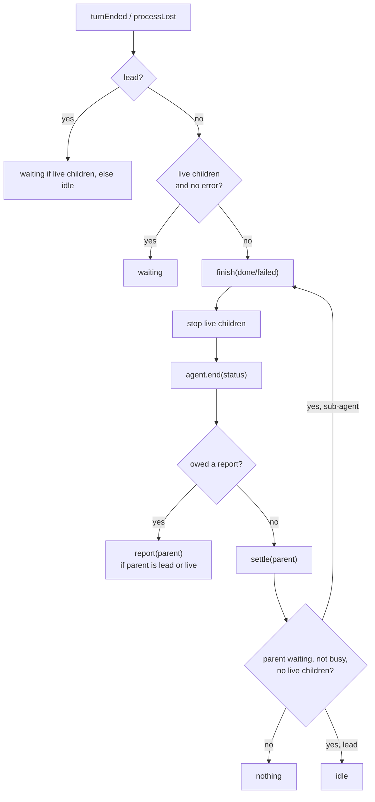

# server/conversation.ts

**Role:** one conversation, meaning the lead the person talks to and every agent started under it. The class comment says the `Conversation` **owns the rules of the team**:

- agents can start only the tier directly below their own;
- reports travel up to whoever started an agent;
- messages can go to anyone;
- effort changes go through the agent above.

It implements two interfaces: `AgentHost` (what its agents need from it) and `TeamActions` (what their tools do). The same rules in plain language are on [Team rules](Team-Rules.md).

## `ConversationHost`

What a conversation needs from the app. `App` implements it with:

- `scheduler`, `settings()`, `claudePath()`;
- the change callbacks `agentChanged`, `itemChanged`, `draftChanged`, `metaChanged`;
- `rateLimit`, `askPermission`, and `cancelPermissions(agentId)`.

## Constants and helpers

- `MAX_AGENTS = 200`, `MAX_AGENT_MESSAGES = 1000`, `TASK_PREVIEW = 400` (see [Team rules](Team-Rules.md#limits-per-conversation)).
- `slug(name)`: lower case, runs of non-alphanumeric characters turned into `-`, trimmed, at most 40 characters, `agent` if nothing is left. It is now used only when looking a name up (`find()`), so that "Bravo " still matches `bravo`.
- `titleFrom(text)`: the first non-empty line of the person's first message, with whitespace collapsed, cut to 60 characters with `…`.

## Creating, restoring, saving

| Method | What it does |
|---|---|
| `static create(host, cwd)` | Makes new ids for the conversation and its lead, sets the title "New conversation", and creates the lead `Agent`: name `agentName(0)` = `alpha`, empty title and task, status `idle`, effort `low` (automatic effort) or the lead tier's level. |
| `static restore(host, stored)` | Rebuilds a conversation from disk. Any agent saved as live (queued, running or waiting) was cut off when the app closed: the lead becomes `idle`; any other agent becomes `stopped` with the error "Masthead was closed while this agent was working." It also clears the activity line, sets `title` to `''` if the saved record has none, keeps `sessionId`, and sets `owesReport` to false for every agent. The code comment explains: nobody is waiting for a report after a restart, and a parent that messages the agent asks for one again. An agent that never started gets its saved `seed` back, so its task is not lost. Nothing is started. |
| `toStored()` | The meta (with `busy` removed) plus each agent's `info`, `sessionId`, `owesReport`, and `seed` when the agent has a `pendingSeed`. Passed to `Store.saveConversation()`. |
| `busy()` | True while any agent in the conversation is live. `App` adds it to the conversation list it sends. |

Private helpers:

- `newInfo()` fills in `convId`, the tier's model from the settings, `createdAt`, and zeroed usage with `contextMax` 1,000,000.
- `addAgent()`, `touch()` (sets `updatedAt` and notifies), `children()`, `liveChildren()`, `parent()`.
- `isAncestor(a, b)` walks up from `b` looking for `a`.
- `find(name, relativeTo?)` turns a name into an agent:
  - `parent` means `relativeTo`'s parent;
  - `lead` means the lead;
  - otherwise it tries an exact name match (case-insensitive), then a match on the slug.

## Actions by the person

| Method | Called for | What it does |
|---|---|---|
| `userSend(text, images, agentId?)` | `{t:'send'}` | The target is the agent with `agentId`, or the lead. If the title is still "New conversation" and the target is the lead, it sets the title from the text. It adds a `user` item and `deliver()`s the text (with any images). |
| `interruptLead()` | `{t:'interrupt'}` | `lead.interrupt()`. Children keep working. |
| `stopAgent(agentId, why)` | `{t:'stop_agent'}` | **Lead:** `stopTree()` on each child, interrupt the lead, then `settle(lead)` so a lead that was only waiting on those children goes `idle`. **Any other agent:** `stopTree()` it; if it was live and owed a report, `report(parent, 'stopped', why)`; otherwise `settle(parent)`. |
| `stopAll()` | `{t:'stop_all'}`, delete | `stopAgent(lead)` then `settle(lead)`. |
| `shutdown()` | app shutdown, delete | Live sub-agents: `end('stopped', 'Masthead was closed…')`. Every other agent: `dispose()`, which ends any process without changing its status. Then the lead is set to `idle`. |

`stopTree(agent, why)` (private) recurses into the children first. Then, for an agent that is live, it:

1. cancels the agent's approval requests;
2. clears `owesReport`;
3. calls `end('stopped', why)`;
4. adds an info notice with `why`.

## `AgentHost` implementation

Most methods just forward to the app with the conversation attached. The two that carry policy:

**`turnEnded(agent, outcome)`**:

1. updates `updatedAt`;
2. adds a "Stopped." notice if the turn was interrupted, or an error notice if it failed;
3. then:
   - the lead becomes `waiting` (live children) or `idle`, and refreshes its context size;
   - a sub-agent with live children and no error becomes `waiting`;
   - any other sub-agent goes to `finish()` as `done` or `failed`.

**`processLost(agent, message)`**: cancels the agent's approval requests, adds an error notice, and releases its slot. The lead then becomes `waiting` or `idle`; a sub-agent goes to `finish(agent, 'failed', '', message)`.

## Reports

- **`finish(agent, status, text, error?)`**:
  1. stops live children with the note "\"name\" ended before this agent finished.";
  2. reads `owesReport` and clears it;
  3. calls `agent.end(status, error)`;
  4. if a report was owed, `report()` to the parent (for a failure: "The agent failed: …" plus its last message); otherwise `settle(parent)`.
- **`report(parent, child, status, text)`**: acts only if the parent is the lead or is live. Adds an `inbound` `report` item to the parent's transcript and delivers `reportEnvelope(...)`.
- **`settle(agent)`**: if the agent is `waiting`, not busy, and has no live children, nothing else will wake it. The lead goes `idle`; a sub-agent goes to `finish()` as `done` with its `lastText`.

## `TeamActions` implementation

| Method | Checks, in order | Effect |
|---|---|---|
| `label(tier)` | none | `modelLabel()` of the tier's configured model, used in every reply and in `list()`. |
| `spawn(parent, rawTitle, task, effort?)` | the parent's tier has a child tier; that tier's `max` > 0; fewer than 200 agents; the task is not empty | Picks the **name** `agentName(agents.size)`, moving on to the next name while one is taken. Cleans the **title** (whitespace collapsed, at most 60 characters). Start effort is `capEffort(effort ?? 'low', ceiling)` with automatic effort, otherwise the ceiling. Creates a new `Agent` with `owesReport: true` and the task as its seed, adds a `task` inbound item, and calls `start()`. Returns e.g. "Started Opus 5.5 agent "bravo" (Review the API) at low effort. …", noting if it will queue. |
| `message(from, to, text)` | the target exists; it is not the caller; fewer than 1000 messages so far | Records the target's status **before** delivery. If the target is not live, not the lead, and `from` is its parent, sets `owesReport`. Adds a `message` inbound item and delivers `messageEnvelope(...)`. Returns "Delivered to …" with the earlier status, or "was done, now resuming". |
| `list(viewer)` | none | One line per agent: name, "(you)", model label, status, effort, who started it, and its title (or the first 120 characters of its task). |
| `stop(caller, name)` | the target exists; the caller is its ancestor; the target is live | Clears `owesReport` and calls `stopTree()`. If the target's parent is not the caller, calls `settle()` on that parent. |
| `setOwnEffort(agent, level, reason)` | automatic effort is on; not already at that level; not above the ceiling | **Lowering, or the lead:** apply now and add a notice. **Raising, for a sub-agent:** the parent must be the lead or live. Sends the parent an effort request (inbound item plus envelope) and adds a note on the agent. |
| `setAgentEffort(caller, name, level)` | automatic effort is on; the target exists; the caller is its ancestor; not above the ceiling; not already at that level | Calls `target.setEffort()` and adds a notice on the target. Sends an envelope message only if the target is `running`. |

`autoEffort()` returns the current setting. `teamTools()` uses it to decide which tools to build.

## Known limitations (deliberate for 0.1.0)

- The inter-agent message counter `agentMessages` is not saved, so it starts again at zero after a restart. Effort requests add to it but are never refused by the limit.
- Agents do not drop back to low effort by themselves, and lowering a ceiling or a limit does not change agents that are already running. See [Thinking effort](Thinking-Effort.md#known-limitations).

## Related pages

[Team rules](Team-Rules.md) · [Agent life cycle](Agent-Life-Cycle.md) · [server/agent.ts](Source-Agent.md) · [server/tools.ts](Source-Tools.md)
