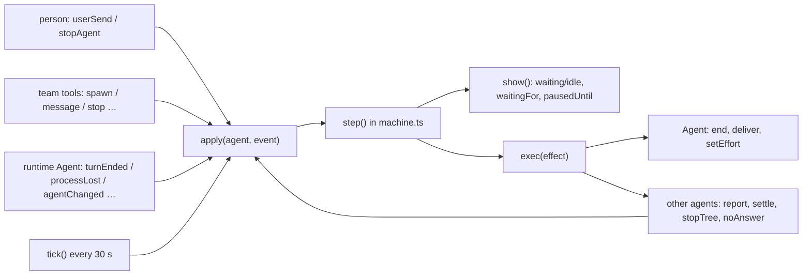

# server/core/conversation.ts

**Role:** one conversation, meaning the lead the person talks to and every agent started under it. The class comment says the `Conversation` **owns the rules of the team**:

- agents can start only the tier directly below their own (in their team profile);
- reports travel up to whoever started an agent;
- messages can go to anyone;
- effort changes go through the agent above.

Since 0.2.0 the conversation is a **shell over a pure state machine** (`server/core/machine.ts`, see [server/core/machine.ts](Source-Core-Machine.md) and [State machine](State-Machine.md)). It keeps one `AgentState` per agent and makes every life-cycle change through `apply()`, which runs `step()` and carries out the effects it returns. It implements two interfaces: `AgentHost` from `server/runtime/agent.ts` (what its agents need from it, see [server/runtime/agent.ts](Source-Runtime.md)) and `TeamActions` from `server/core/tools.ts` (what their tools do). The same rules in plain language are on [Team rules](Team-Rules.md).

## `ConversationHost`

What a conversation needs from the app (`App` in `server/app/app.ts` implements it):

| Member | Use |
|---|---|
| `scheduler` | The shared [Scheduler](Source-Core-Scheduler.md). |
| `settings()`, `claudePath()` | Current settings; the Claude Code path (null when not found). |
| `agentChanged`, `itemChanged`, `draftChanged`, `metaChanged` | Change callbacks; the app broadcasts and saves. |
| `rateLimit(notice)` | Passes a rate-limit notice on. |
| `askPermission(conv, agent, ask)`, `cancelPermissions(agentId)` | Approval cards. |
| `backend?(tier)` | The backend for a tier when not the default Claude Code (the fake, in tests and CI). |
| `storeImage?(convId, data, mediaType)` | Stores an image from a tool result as a blob of this conversation. |
| `clock?` | A test clock; the app leaves it out and the real one is used. |
| `readItems?(convId, agentId)` | An agent's stored transcript, for `read_archive`. |
| `compactChanged?(conv)` | The team compaction's state changed; the app broadcasts it and the archived agents. |

## `Clock`

Time and a repeating timer, so tests can run the pause and run-time rules without sleeping.

- `now()`: **wall-clock** time (ms since 1970). Used for deadlines, such as a usage limit's reset time, and for "ended 5m ago".
- `active?()`: **awake time**, for durations: the run-time limit, the background cap, `liveSince` ("for 3m"). A suspend or sleep must not count. Defaults to `now`.
- `every(ms, fn)`: calls `fn` every `ms` until the returned function is called.

### The real clock and sleep watchers

`REAL_CLOCK` (private) is used when the host gives no clock. Its `active()` is built from module-level state:

- `activeNow()` reads the wall clock and advances `activeBase` by the gap since the last reading, but by at most `ACTIVE_STEP_MS` (60 s). An unref'd timer (`activeTimer`, started by the first `active()` call) reads it every 15 s, so while the computer is awake each gap is about 15 s and counts in full, and a sleep shows up as one gap capped at 60 s. The comment explains why `performance.now()` is not used: whether it pauses during suspend differs between systems.
- A gap above `ACTIVE_STEP_MS` that the 15 s reader cannot explain means the computer was asleep: every function in the module-level `sleepWatchers` set is called with the wall times `(from, to)`.
- `every()` is `setInterval`, unref'd so it never keeps the process alive.

The constructor adds the conversation's `sleepWatcher` to `sleepWatchers` and calls `REAL_CLOCK.active()` to start the reader, but only when the host has no clock of its own. `shutdown()` removes it.

### `wokeFromSleep(from, to)`

Public. If the conversation is `busy()` (any agent live), the lead's transcript gets the info notice "This computer was asleep from HH:MM to HH:MM; work carried on afterwards." Idle conversations get nothing. Either way the time asleep never counts as running time, because durations use the awake clock. `test/conversation.test.ts` calls it directly.

## Creating, restoring, saving

| Method | What it does |
|---|---|
| `static create(host, cwd, profileId?)` | New ids for the conversation and its lead. The team profile is `profileId` if it exists, else the settings' `defaultProfile`, else the Claude profile; `meta.profileId` records it and `meta.team` keeps a copy of its tiers (also passed to `rememberTeam()` in `server/settings/settings.ts`, so the scheduler still knows the limits if the profile is deleted later). The lead is the profile's first tier: name `agentName(0)` = `alpha`, empty title and task, status `idle`, effort `low` with automatic effort, otherwise the tier's effort. Title "New conversation". |
| `static restore(host, stored)` | Rebuilds a conversation saved by an earlier run; nothing runs afterwards. Clears `activity`, `waitingFor` and `pausedUntil`, and sets a missing `title` to `''`. An agent saved as live (queued, running or waiting) was cut off when the app closed: the lead becomes `idle`; any other agent becomes `stopped` with the error `CLOSED_WHILE_WORKING`. Each agent keeps its `sessionId`, gets `owesReport: false` (nobody waits for a report after a restart; a parent that messages the agent asks for one again) and, if it never started, its saved `seed`. Ids in `stoppedByPerson` that still exist get the mark in their machine state; `agentMessages` is restored, clamped to 0..`MAX_AGENT_MESSAGES`. Then `adoptTeam()` (below). If `adoptTeam()` returns a notice, or `restartNote()` finds agents, an info notice with that text is added to the lead, deferred with `queueMicrotask` because the app registers the conversation only after `restore()` returns. The machine's `Restored` event is not used: the conversion is done here and `st()` builds each state from the result (an agent whose `info.archived` is set gets `archived` in its state). Archived agents are left out of the restart note. In the same deferred step `resumeCompact()` carries on with a team compaction that was under way. |
| `toStored()` | `meta` without `busy` (so `compact`, `compactMark`, `compactSuggested` and `autoCompact` are saved with it); per agent its `info`, `sessionId`, `owesReport`, and `seed` when it has a `pendingSeed`; `stoppedByPerson` as a list of ids (from the machine states); `agentMessages`. Passed to the store, see [Storage](Source-Storage.md). |
| `lead` (getter) | The agent with `meta.leadId`. |
| `busy()` | True while any agent is live. The app adds it to the conversation list; `wokeFromSleep()` uses it. |
| `infos()` | Every agent's `AgentInfo`. |

### `adoptTeam()` (private)

Makes sure `meta.team` holds the conversation's tiers: a fresh copy of the profile's tiers while the profile (`meta.profileId`, default `claude`) exists; the stored copy once the profile is gone; and, for older 0.2.0 data with neither, the built-in Claude team's tiers renamed to this conversation's ids (`<profile>:<i>`). Only that last case returns a notice: "The team "<id>" no longer exists, so this chat now runs on the built-in Claude team." Every path ends with `rememberTeam(meta.team)`. Called by `restore()` and `settingsChanged()`.

### `restartNote()` (private)

Finds agents that are `stopped` with the error exactly `CLOSED_WHILE_WORKING` and are not archived. Because it reads the stored error, it survives saves and further restarts until the lead is told. Returns `null` or `{ text, agents }` with the text "Masthead was restarted; these agents were stopped while working: bravo (Audit). Message one to resume it." `userSend()` uses it to tell the lead once.

### Small private helpers

- `newInfo(p)`: fills in `convId`, the tier's model (from `spec()`), `createdAt` and zeroed usage with `contextMax` 1,000,000.
- `addAgent()`, `touch()` (sets `updatedAt` and calls `metaChanged`), `children()`, `liveChildren()`, `parent()`.
- `isLead(agent)`: `parentId === null`. With profiles the lead's tier id is not always `lead`.
- `spec(tier)`: the tier's `TierSpec` from its profile (`findTier`), else from the conversation's own copy (`meta.team`) once the profile is gone. A tier found in neither reads as switched off (`max: 0`, empty model, its id as label, effort `low`, colour `slate`), so its agents still show and can be stopped but no new ones start.
- `nextTier(tier)`: the tier after `tier`: `childTierOf(settings, tier)` while the tier is in a profile, otherwise the next entry of `meta.team` (null when there is none).
- `isAncestor(a, b)`: walks up from `b` looking for `a`.
- `find(name, relativeTo?)`: `parent` means `relativeTo`'s parent; `lead` means the lead; otherwise an exact name match (case-insensitive), then a match on `slug(name)`.
- `tierOff(agent)`: a sub-agent that is not live and whose tier's `max` is 0 or less: it could only queue for ever.

## Actions by the person

| Method | Called for | What it does |
|---|---|---|
| `userSend(text, images, agentId?, refs?)` | sending a message | The target is the agent with `agentId`, or the lead. A lead message sets the title from the text while it is still "New conversation" (`titleFrom`). Adds a `user` item (with `refs` or the image count). If the target is archived, adds the error notice ""x" is archived. Restore it from the archived helpers to message it." and stops. If `tierOff(target)`, adds the error notice "<label> agents are switched off in the settings. Turn them on to wake "<name>"." and stops. Otherwise applies `Woken` (by the person, `parentCanReceive: false`: this clears the stop mark, wakes an ended sub-agent, and does **not** make it owe a report), then `AnswerArrived` if the target was waiting for an answer (the person answering ends the wait). For the lead, a `compactHint()` is put in brackets before the text. For the lead with a `restartNote()`, the delivered text becomes `[note]`, a blank line, then the person's text, and those agents' error becomes `CLOSED_LEAD_TOLD`. If the target is paused, what agents sent it meanwhile is delivered first, in order. Then `Input` from the person (urgent) and `target.deliver()` of the text with images. |
| `interruptLead()` | Stop button on the lead | `lead.interrupt()`. Children keep working. |
| `stopAgent(agentId, why)` | stopping an agent | Only the person calls it. **Lead:** `stopTree(child, why, 'person')` for each child, `interrupt()` the lead, then `Stop` by the person on the lead, which ends its pause, drops what was held and, if nothing else holds it, makes it `idle`. **Other agent:** stops its children the same way, cancels its approval cards, applies `Stop` by the person (stop mark, report if owed). If that produced neither `report` nor `childEndedQuietly` (the agent was not live), `settle(parent)` so a parent waiting only on it moves on. |
| `stopAll()` | stop everything, delete | `stopAgent(lead, 'Stopped by the person.')` then `settle(lead)`. |
| `shutdown()` | app shutdown, delete | Removes the sleep watcher and stops the shared timer. Each live sub-agent gets `Stop` with `by: 'restart'` and `why` = `CLOSED_WHILE_WORKING`, with the `SHUTDOWN` effects dropped (nothing is told or shown; the state is saved as it ends). Every other agent is `dispose()`d (process ended, status kept). The lead is then set to `idle`. |
| `settingsChanged()` | settings saved | Runs `adoptTeam()` and calls `metaChanged` if `meta.team` changed (the copy follows the profile while it exists). Calls `applySettings(settings)` on every agent that has it, so running agents take what they can at once, then `ensureTimer()` so a new run-time limit applies from the next tick. |

### `stopTree(agent, why, by)` (private)

Stops `agent` and everything under it as part of stopping an agent above: children first, then, if the agent is live, cancels its approval cards and applies `Stop` (by `person` when the person's stop caused it, otherwise `agent`), dropping the `QUIET` effects (`report`, `childEndedQuietly`, `stopChildren`). Nobody below the stopped agent reports or settles a parent, because those parents are being stopped too.

## AgentHost implementation

Most members forward to the host with the conversation attached:

- `cwd` (the conversation folder), `scheduler`, `settings()`, `claudePath()`, `itemChanged()`, `draftChanged()`, `rateLimit()`.
- `backend(agent)`: `host.backend?.(agent.tier)`.
- `caps(agent)`: the backend's `caps`, or all four effort levels when no backend is known. `teamToolDefs()` reads it for the effort tools.
- `storeImage(agent, data, mediaType)`: `host.storeImage` with this conversation's id, or `{ error: 'images are not stored here' }`.
- `parentName(agent)`: the parent's name for the system prompt (`null` for the lead).
- `tools(agent)`: `teamToolDefs(agent, this)`, see [server/core/tools.ts](Source-Core-Tools.md).

The ones that feed the machine:

| Method | Event(s) |
|---|---|
| `agentChanged(agent)` | The runtime changes the status itself when it starts a process or a turn, or ends. If the machine's `statusOf()` differs from `agent.status`, applies `Status` with the runtime's status. Drops held messages of an agent that is no longer live. Then forwards to the host. |
| `askPermission(agent, ask)` | `ApprovalOpened`, then `ApprovalClosed` when the host's promise settles either way: time waiting for an approval does not count toward the run-time limit. |
| `turnEnded(agent, outcome)` | `touch()`, then `TurnEnded` with the outcome's text, error, interruption and `usageLimit`. If the agent is now paused, stops there. The lead refreshes its context size. If the agent did not end, `checkWaitsOn(agent, interrupted)`: agents waiting for its answer are reminded or told there is none. For the lead after a turn without interruption or error, `leadTurnEndedForCompact()`. |
| `processLost(agent, message, usageLimit?)` | Cancels its approval cards, then `ProcessLost`. At a usage limit the agent pauses instead of failing. |
| `backgroundIdle(agent)` | `BackgroundIdle`: background commands ended and no new turn followed. |

`outcome.text` is what the agent said since it last took up work; it becomes the report (see [server/runtime/agent.ts](Source-Runtime.md)).

## The state machine

### `states`, `held`, `stopTimer`

- `states: Map<agentId, AgentState>`: each agent's machine state.
- `held: Map<agentId, string[]>`: messages from agents and Masthead to a paused agent, delivered in order when the pause ends.
- `stopTimer`: cancels the shared 30 s timer; null while nothing needs watching.

### `st(agent)`

Returns the agent's state, creating it on first use from what the `Agent` shows: `initial(isLead)`, its `owesReport`, its status as the phase (an end status becomes `ended` with its error). A live agent gets `liveSince` = now (awake time), and a running one also starts its run clock.

### `apply(agent, ev, opts)`

The only way a state changes.

1. Reads facts owned elsewhere fresh into the state: `holds.children` = number of live children; `holds.background` = 1 if the agent reports background work, else 0; `owesReport` from the agent.
2. Calls `step()` with `now` = awake time, `wall` = wall time, `busy` (from `opts.busy` or `agent.busy`), optional `inTurn`, `autoEffort` and `agent.lastText`.
3. Stores the new state and writes `owesReport` back to the agent.
4. `show()`, pushing a status only when the event was not `Status`.
5. `exec()` for each effect not in `opts.drop`.
6. `ensureTimer()` if no timer runs.

Returns the effects, which callers inspect (e.g. `stopAgent()` looks for `report`).

### `show(agent, st, push)`

What the page sees. Sets `info.waitingFor` (the name of the agent it waits on) and `info.pausedUntil`. If `push` and the phase is `waiting` or `idle` and differs from the agent's status, calls `agent.setStatus(phase)`; otherwise, if `waitingFor` or `pausedUntil` changed, notifies the host. `queued` and `running` are left to the runtime, which starts the process; ended comes with the `end` effect. Because a `Status` event does not push, **a status the runtime just reported is not overwritten**: a paused agent the person woke shows `running` during that turn.

### `exec(agent, effect, st)`

Carries out one effect; the table is on [server/core/machine.ts](Source-Core-Machine.md#effect). Notable cases: `end` calls `agent.end()` then `releaseWaitsOn()`; `resumeRuntime` delivers `held` then the note; `stopChildren` uses `stopTree(…, 'agent')`; `noAnswer` adds "No answer from "X"." and delivers "No answer from "X"; carry on with your best judgment or report what you have."; `send`, `pauseRuntime` and `remind` do nothing here.

### `deliverTo(agent, content, from)`

Delivers a message from an agent (`from: 'agent'`) or from Masthead (`'masthead'`): applies `Input`, then, if the agent is paused, appends to `held`; otherwise `agent.deliver(content)`. Reports, messages, reminders, "No answer" and effort requests all go through it. The person's messages do not (see `userSend()`).

### `settle(agent)`

Applies `ChildEnded` with `reported: false`: a sub-agent under `agent` ended without a report, so if `agent` was only waiting on it, it moves on (idle for the lead, finished with its last text for a sub-agent).

### `report(parent, child, status, text)`

Acts only if the parent is the lead or live. Adds an `inbound` `report` item (text "(no report text)" if empty) and `deliverTo()`s `reportEnvelope(child.name, child.tier, status, text)` (see [server/core/prompts.ts](Source-Core-Prompts.md)).

`hasBackgroundWork(agent)` (private) reads the runtime's `hasBackgroundWork` flag.

## Clocks and the shared timer

- `now()`: wall time from the host's clock or `REAL_CLOCK`.
- `active()`: awake time; the clock's `active()`, or `now()` if it has none.
- `needsTimer()`: true while any agent is paused or timing a background-only wait (`backgroundSince`), or, with a run-time limit set (`settings.maxRunMinutes > 0`), any live sub-agent exists.
- `ensureTimer()`: starts one timer per conversation (`every(TICK_MS, tick)`) if none runs and one is needed.

### `tick()`

Public; every 30 s. For each agent that has a machine state, applies `Tick` with `maxRunMs` = `maxRunMinutes` × 60,000 and `backgroundCapMs` = `BACKGROUND_WAIT_MS`, passing `inTurn` = status `running` and busy. The machine then resumes agents whose pause has ended (a note costs a turn, so none is sent when the person already woke it), enforces the run-time limit on sub-agents and finishes sub-agents that waited on background work alone for 10 minutes (see [server/core/machine.ts](Source-Core-Machine.md#stepprev-ev-ctx)). Afterwards the timer stops itself if `needsTimer()` is false.

## Waiting for an answer

A sub-agent that sends `send_message` with `wait: true` to its parent or the lead gets an `answer` hold in its machine state (in memory only; not saved). The helpers:

- **`checkWaitsOn(r, interrupted)`**: `r`'s turn ended. Applies `RecipientTurnEnded` to each agent waiting on `r`. The machine reminds once; after that a non-lead recipient's askers get "No answer", while the lead's keep waiting (the lead may be asking the person, who can also answer them directly); an interrupted turn tells the askers at once. Reminders are batched: `r` gets the notice "Reminded: "charlie" still waiting for an answer." and the message ""charlie" is still waiting for your answer. Reply with send_message, even if only to say you cannot help." To the lead: "… Answer with send_message, or ask the person; it keeps waiting." With several askers the names are listed and "is" becomes "are".
- **`releaseWaitsOn(r)`**: `r` ended: `RecipientEnded` for every agent waiting on it.
- **`waitersOn(r)`**: agents whose `holds.answer.from` is `r`.

A wait also ends when any message from the recipient reaches the waiter (`message()`), or the person messages the waiter (`userSend()`); both apply `AnswerArrived`.

## TeamActions implementation

| Method | Checks, in order | Effect and reply |
|---|---|---|
| `autoEffort()` | | The current setting; `teamToolDefs()` uses it to decide the effort tools. |
| `childTier(tier)` | | `nextTier(tier)`: the next tier in the same profile, or in the conversation's copy once the profile is gone; null for the last tier. |
| `label(tier)` | | `spec(tier).label`, or `modelLabel()` of its model. Used in every reply and in `list()`. |
| `spawn(parent, rawTitle, task, effort?)` | the parent's tier has a child tier; that tier's `max` > 0; fewer than `MAX_AGENTS`; the task is not empty | Picks the next free phonetic name from `agentName(agents.size)`. Title: whitespace collapsed, at most 60 characters. Start effort: `capEffort(effort ?? 'low', ceiling)` with automatic effort, otherwise the tier's ceiling. `info.task` is the task clipped to `TASK_PREVIEW`; the full task is the seed. Creates the `Agent` with `owesReport: true`, sets its state to `initial(false)`, adds a `task` inbound item and calls `start()`. Reply: "Started <label> agent "bravo" (title) at low effort (queued: N may run at once). Its report will arrive as a message when it finishes." (the queued part only when it will queue). |
| `message(from, to, text, wait = false)` | the target exists; it is not the caller; it is not archived ("Error: "x" is archived and cannot be woken. Read its chat with read_archive."); it is not a finished agent the person stopped; not `tierOff`; fewer than `MAX_AGENT_MESSAGES` so far | Counts the message. A finished sub-agent gets `Woken` by an agent, owing a report if its parent is the lead or live (whoever woke it); a live target keeps its debt. If the target was waiting for an answer from `from`, `AnswerArrived`. `wait` counts only from a sub-agent to its parent or the lead; then `Asked` on the sender. Adds a `message` inbound item; when a waiting question goes to the lead, also the notice ""bravo" is waiting for an answer to this. You can also answer it yourself by messaging bravo directly." Delivers `messageEnvelope()` with hint `wait` for a waiting question, else `reply` when `from` is not the target's parent. Reply: "Delivered to "x" (status)." where status is "the lead", the status before delivery, or "was done, now resuming"; plus " Its report goes to "parent"; it answers you only with send_message." when the woken agent reports to someone else; plus " End your turn when you have nothing else to do; you resume when the answer arrives." or " (Not waiting: you can wait only for your parent or the lead.)". |
| `list(viewer)` | | Archived helpers are left out and counted in a last line, "N archived helpers: read their chats with read_archive." ("1 archived helper: read its chat with read_archive."). One line per agent, the viewer included and marked "(you)": `- name (you): <label>, <facts> — <title or first 120 characters of task>`. Facts: status ("waiting for your answer", "waiting for an answer from X", "paused until HH:MM (usage limit)", "waiting on a background command for 4m", or the status with ": activity" while running); "for 3m" while live (awake time) or "ended 5m ago" (wall time); context ("41k ctx") and cost ("$0.12") when non-zero; effort; "started by" its parent. |
| `stop(caller, name)` | the target exists; it is not archived ("\"x\" is archived (not running)."); the caller is its ancestor; the target is live (else "\"x\" is not running (status).") | Stops the target's children with `stopTree(…, 'agent')`, cancels its approval cards, applies `Stop` by an agent with why "Stopped by "caller".": no report (the caller asked for it), and `childEndedQuietly` settles the target's parent. Reply "Stopped "x" and everything under it." |
| `setOwnEffort(agent, level, reason)` | automatic effort on; not already at that level; not above the tier's ceiling | **Lowering, or the lead:** `setEffort()` now, notice "Effort lowered/raised to Y: reason", reply "Effort lowered/raised from X to Y, from your next step on." **Raising, for a sub-agent:** the parent must be the lead or live, and fewer than `MAX_AGENT_MESSAGES`. Sends the parent an effort request (inbound item plus `messageEnvelope()` without a hint) whose text ends "Approve with set_agent_effort (name "x", level "y"), choose another level, or decline with send_message."; saves the message counter; notes on the agent; reply "Asked "parent" to raise you from X to Y. Keep working at X; if approved, the change applies by itself." |
| `compactTeam`, `readArchive` | | See [Archived helpers and team compaction](#archived-helpers-and-team-compaction). |
| `setAgentEffort(caller, name, level)` | automatic effort on; the target exists and is not archived; the caller is its ancestor; not above the ceiling; not already at that level | `target.setEffort(level)` and the notice "Effort set to Y by "caller" (was X)." on the target. No message is sent: it would force an extra turn whose reply could replace the agent's report. Reply ""x" raised/lowered from X to Y effort." |

## Archived helpers and team compaction

The section "archived helpers and team compaction" implements [Compact team](Compact-Team.md) (design: `docs/plans/0.2.0/compact.md`). The flow's state is `meta.compact` (a `CompactState` from `shared/protocol.ts`), saved with the conversation; each archived helper carries `info.archived` (when) and `archived` in its machine state.

### Module-level pieces

| Name | Meaning |
|---|---|
| `COMPACT_SUGGEST_HELPERS` | 15: finished, unarchived helpers that start tidying (or the one-time hint), and the cool-down step. |
| `COMPACT_SUGGEST_MEMORY` | 0.7: the lead's `usage.context / usage.contextMax` that starts it. |
| `compactSummary(c, stayed)` (exported) | The notice the lead's chat gets at the end, e.g. "Archived 6 finished helpers and compacted the memory of 1 that stays." then "Kept: bravo because …;", "Also kept: charlie (still working).", "Not compacted: delta (why).", and "Archived helpers can be read or restored from the team panel." With nothing archived: "Compacted the memory of N agents." No "memory freed" figure. |
| `ARCHIVE_PAGE_CHARS` | 12,000: characters of a chat per `read_archive` page. |

### Small private helpers

- `archivedAgent(agent)`: the machine state's `archived` flag.
- `archivable()`: helpers that are not live and not archived (never the lead).
- `setCompact(c)`: sets `meta.compact`, then `host.metaChanged()` (save) and `host.compactChanged?.()` (the app broadcasts the `compact` and `archived` messages).
- `compactRunning()`: a `meta.compact` whose phase is not `done` or `cancelled`.
- `autoCompactOn()`: the setting `autoCompact` is not false and the conversation's `meta.autoCompact` is not false.
- `finishedTotal()`: helpers that are not live, archived ones included; the cool-down counts these.
- `compactOrder()`: names of everyone who stays and has a session (or is live), helpers first, the lead last.

### The person and the settings

| Method | What it does |
|---|---|
| `startCompact(words, { auto?, reason? })` | Called by the app for a `/compact` message to the lead with no images (`server/app/app.ts`) and by `leadTurnEndedForCompact()` with `auto`. The person's `/compact` adds a `user` item "/compact …" and sets the cool-down mark (`compactMark = { finished: finishedTotal(), memoryArmed: false }`). If a compaction is running: the notice "Tidying the team is already under way." (person only) and nothing else. If nothing is archivable: straight to `compacting` with `compactOrder()`. Otherwise phase `asked` (`auto` = `autoCompactOn()`, not who started it), `Woken` and `Input` on the lead, and the lead gets: "<Masthead is tidying the team / The person asked to tidy the team>< because reason / : words>. Call compact_team with the finished helpers to keep and why (helpers still working are kept anyway). <how> Archived helpers' chats stay readable with read_archive." where `<how>` is "The rest are archived and everyone who stays compacts its memory; the person is told afterwards." or "The person confirms on a card." |
| `answerCompact(id, keepNames, accept)` | The card's answer; ignored unless `id` matches and the phase is `proposed`. Refused: `cancelled`, notice "The person declined the team compaction." Accepted: keep = forced entries plus ticked ones (ticked archive names get "kept by the person"); archive = `archivable()` minus keep; phase `archiving`, then `archiveAndCompact()`. |
| `cancelCompact()` | While running: phase `cancelled`, notice "Team compaction cancelled." Helpers archived already stay archived. |
| `restoreAgent(agentId)` | An archived agent: `Unarchive`, `info.archived` cleared, `agentChanged` and `metaChanged`. |
| `setAutoCompact(on)` | The per-chat switch: `meta.autoCompact` = `false` or removed. |

### `compactTeam(caller, keep, note)` (the `compact_team` tool)

Errors: "Error: only the lead tidies the team."; "Error: nobody asked to tidy the team now." (phase is not `asked`); "Error: there is no helper named "x" in the team." (unknown, the lead, or archived). Each named helper is kept with its `why` (at most 200 characters, else "kept by the lead"). Then forced keeps: every live helper ("still working"), and every ancestor below the lead of a kept helper ("started x, which stays"). Archive = `archivable()` minus kept. `note` (500 characters) replaces the request's words when given. With `auto`: phase `archiving`, `archiveAndCompact()`, reply "Archiving N and keeping M; then everyone who stays compacts its memory, you last. The person is told." Otherwise phase `proposed`, reply "The person sees a card: keep M, archive N. You will hear the outcome."

### `archiveAndCompact()` (private)

For each name in `archive`: skips a missing, live or lead agent, applies `Archive`, and sets `info.archived` to the time once. Safe to run twice (a restart in `archiving`). Then phase `compacting` with `pending = compactOrder()` and `runCompact()`.

### `runCompact()` (private, async)

Guarded by the `compacting` flag so only one loop runs. Takes `pending[0]` each round:

- the lead while it is `running`, `queued` or `busy`: returns; `leadTurnEndedForCompact()` calls it again when the turn that called `compact_team` ends;
- a missing or archived agent: dropped silently;
- a helper that is `running`, `queued` or `busy`: recorded in `failed` as "still working";
- otherwise `agent.compact()` (the runtime, see [server/runtime/agent.ts](Source-Runtime.md)); `{ ok: false }`, a throw, or an agent without `compact` ("this agent program cannot compact its memory") goes into `failed`.

After each await it re-reads `meta.compact` and stops if the phase is no longer `compacting` (cancelled). With `pending` empty: phase `done` and the `compactSummary()` notice on the lead.

### `leadTurnEndedForCompact()` (private)

Called from `turnEnded()` for the lead when the turn was neither interrupted nor an error.

1. Phase `compacting`: `runCompact()` (the lead's turn is over; it is last in line).
2. Phase `asked`: the first turn end only sets `askedAnswered` (that turn may be the one that reads the request); at the next, the request is dropped: `cancelled`, notice "The lead did not choose who to keep, so the team was not tidied."
3. Otherwise stops when automatic tidying is off, a compaction runs, or the lead has an approval or question open (`holds.approvals > 0`).
4. Reads `compactMark` (default `{ finished: 0, memoryArmed: true }`). If memory is disarmed and now below 70 %, re-arms it and stops.
5. Starts when `archivable() ≥ 15` and `finishedTotal() ≥ mark.finished + 15`, or memory is armed and ≥ 70 %. Sets the mark to `{ finished: finishedTotal(), memoryArmed: false if memory fired }` and calls `startCompact('', { auto: true, reason })` with "the team has N finished helpers" or "the lead's memory is N% full".

### `compactHint()` (private)

Used by `userSend()` for a message to the lead, only with automatic tidying off, `meta.compactSuggested` unset and nothing running. Past 15 archivable helpers or 70 % memory it sets `compactSuggested` and returns "Masthead: <why>. You may suggest once, in your reply, that the person type /compact to tidy the team.", which `userSend()` puts in brackets before the person's text.

### `resumeCompact()` (private)

Run from `restore()` (deferred with the restart note). `asked`: `cancelled`, notice "Masthead restarted before the lead proposed a compaction. Type /compact again to start over." `proposed`: nothing, the card stays. `archiving`: `archiveAndCompact()` again. `compacting`: `runCompact()` with what is left in `pending`.

### `readArchive(viewer, name?, page = 1, search?)` (the `read_archive` tool)

No name: "No archived helpers." or one line per archived helper: "- name: <label>, <title or first 120 characters of task>, archived YYYY-MM-DD HH:MM" (UTC, from `toISOString()`) and "  Report: <first two lines of its last text>" (`lastWords()`, from `host.readItems` or `lastText`, 300 characters). With a name that is not archived: "Error: there is no archived helper named "x". Call read_archive without a name for the list." Otherwise `chatLines()` renders the stored items ("Person: …", "name: …", "[via from x] …", "[tool name] {input} -> result", "(notice)"); `search` keeps matching lines (case-insensitive) with one line either side, or returns "No lines in <name>'s chat mention "w"." when none match; tool inputs are cut to 200 characters and results to 300; the text is cut into 12,000-character pages: "<name>'s chat, page N of M (lines with "w"):" and, when more follows, "[More: read_archive with page N+1.]".

## Constants

Module-private values and helpers:

| Name | Value / meaning |
|---|---|
| `ACTIVE_STEP_MS` | 60,000: most the awake clock advances per reading; also the sleep threshold. |
| `TICK_MS` | 30,000: the shared timer's period. |
| `BACKGROUND_WAIT_MS` | 10 minutes: how long a sub-agent may wait on background commands alone. |
| `CLOSED_WHILE_WORKING` | "Masthead was closed while this agent was working." |
| `CLOSED_LEAD_TOLD` | "Masthead was closed while this agent was working. The lead was told." |
| `QUIET` | Effects dropped by `stopTree()`: `report`, `childEndedQuietly`, `stopChildren`. |
| `SHUTDOWN` | Effects dropped at shutdown: those plus `notice`. |
| `MAX_AGENTS` | 200 agents per conversation. |
| `MAX_AGENT_MESSAGES` | 1000 messages between agents per conversation (saved). |
| `TASK_PREVIEW` | 400: characters of the task kept in `info.task`. |
| `UsageLimit` (type) | `{ resetsAt?, backgroundStopped? }`, as the runtime reports it. |
| `clockTime(ms)` | "HH:MM" local time. |
| `slug(name)` | Lower case, runs of other characters to `-`, trimmed, at most 40 characters, `agent` if empty. Used only by `find()`. |
| `duration(ms)` | "45s", "12m", "3h05m", for `list()`. |
| `titleFrom(text)` | First non-empty line, whitespace collapsed, cut to 60 characters with `…`. |

The limits are also described on [Team rules](Team-Rules.md).

## Tests

`test/conversation.test.ts` (62 tests) runs a `Conversation` with a fake host (the pause, run-time and sleep tests give it a test `clock`): spawn and tiers, names and `find()`, stop, reports and settle, effort, restore and the restart note, waiting for an answer, usage-limit pauses, the run-time limit, the background cap, `wokeFromSleep()`, and the team compaction (tests named "compact: …", "auto: …" and "archived helpers leave the team: …": the card flow, nothing to archive, refusing and cancelling, a restart in each phase, the one-time hint, the automatic start, the cool-downs, the approval/question guard, the ignored request, the lead compacting last). `test/characterisation.test.ts` pins 0.1.4 behaviour that the move to the state machine had to keep. This page was written from the code; neither the tests nor the app were run for it.

## Related pages

[State machine](State-Machine.md) · [Compact team](Compact-Team.md) · [server/core/machine.ts](Source-Core-Machine.md) · [Team rules](Team-Rules.md) · [Agent life cycle](Agent-Life-Cycle.md) · [server/runtime/agent.ts](Source-Runtime.md) · [server/core/tools.ts](Source-Core-Tools.md) · [server/core/prompts.ts](Source-Core-Prompts.md) · [server/core/scheduler.ts](Source-Core-Scheduler.md)
