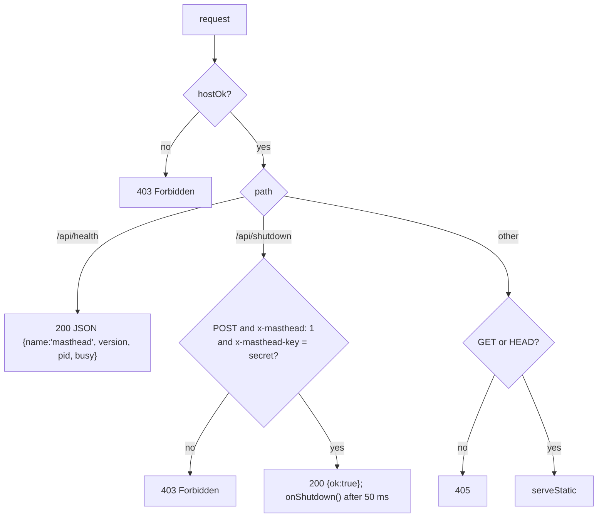

# server/http.ts

**Role:** the server's front door. It serves the built page as static files, two small HTTP endpoints (`/api/health` and `/api/shutdown`) and the WebSocket at `/ws` that carries the [protocol](Browser-Server-Protocol.md), and it applies the local-only security checks. Why each check exists is on [Security model](Security-Model.md); this page says exactly what the code does.

> Checked against the 0.1.3 source. The behaviour described here is read from the code, not run (`npm test` passes).

## Constants

| Name | Value | Purpose |
|---|---|---|
| `TYPES` | extension → content type | HTML, JS, CSS (all `charset=utf-8`), SVG, PNG, ICO, JSON, WOFF2, `.map` (as JSON). Anything else is `application/octet-stream`. |
| `MAX_WS_PAYLOAD` | 48 MiB | Largest single socket message; `ws` refuses a larger one and closes the socket. |
| `PING_MS` | 30 000 | How often each socket is pinged. |
| `PROTOCOL` | `masthead` | The only subprotocol the server ever answers with. |
| `KEY_PREFIX` | `key.` | The page offers the secret as a second subprotocol, `key.<secret>`. |
| `CSP` | see [Headers on the page](#headers-on-the-page) | Content-Security-Policy for every static reply. |

## Types

- `ServedApp`: `Pick<App, 'connect' | 'disconnect' | 'handle' | 'workingCount'>`. Only what the server needs from [App](Source-App.md), so tests can pass a stand-in.
- `ServeOptions`:
  - `port`: the port; 0 picks a free one (the tests use this).
  - `webDir`: the built page (`dist/web`).
  - `secret`: the local secret (`loadSecret()` in [server/config.ts](Source-Config.md)).
  - `extraOrigins`: extra page origins allowed to open the socket, e.g. the Vite development server on 7718.
  - `onShutdown`: called after an authorised `POST /api/shutdown`.

## secretOk(secret, given)

Whether `given` is the secret. It returns false at once if `given` is not a string or is empty. Otherwise it compares the two as byte buffers: the lengths first, then `crypto.timingSafeEqual`, which takes the same time wherever the first difference is. So the reply time does not leak how much of a guess was right. (The length check itself is not constant-time, but every real secret is 64 hex characters, so the length is no secret.)

## offeredKey(req)

Reads the `Sec-WebSocket-Protocol` header, splits it on commas, trims each entry, and returns the part after `key.` of the first entry that starts with `key.`; undefined if none does. The page offers `['masthead', 'key.<secret>']` (see `web/src/lib/store.svelte.ts`). A browser cannot set custom headers on a WebSocket, which is why the key travels as a subprotocol.

## serve(app, opts): Promise\<Server\>

The doc comment sums up the design: the server listens on `127.0.0.1` only, and because it can run commands as the person it also refuses what a web page elsewhere could trick a browser into sending. The Host header must name this server (defeats DNS rebinding), a socket must be opened by Masthead's own page (Origin), and the socket and shutdown need the local secret, which other users on the machine cannot read. The page itself holds no secret and is served to anyone who passes the Host check.

### Allowed hosts and origins

Both sets are filled in only once the server is listening, from the real port (`server.address()`, which matters when `port` was 0):

- `hosts` (accepted `Host` headers): `127.0.0.1:<port>`, `localhost:<port>`, plus the host part of each `extraOrigins` entry. In development that adds `localhost:7718` and `127.0.0.1:7718`, because the Vite development server forwards requests with its own Host header.
- `origins` (accepted socket `Origin` headers): `http://127.0.0.1:<port>`, `http://localhost:<port>`, plus `extraOrigins`.
- `hostOk(req)`: an exact, case-sensitive match of the Host header against `hosts`. A missing Host fails. There is no other exception.

### HTTP requests

- **`/api/health`** answers any method, with no secret. The body is `{name: 'masthead', version, pid, busy}`, where `busy` is `app.workingCount()`, the number of conversations with an agent working. The launcher uses `name` to recognise Masthead ([server/main.ts](Source-Main.md#healthp)); `scripts/install.sh` reads `busy` before restarting the service.
- **`/api/shutdown`** needs all three: method `POST`, header `x-masthead: 1`, and header `x-masthead-key` equal to the secret (`secretOk()`). As the code comment says, a page on another site cannot send a custom header without a CORS preflight, and this server never grants one; the key adds that only someone who can read the secret file may stop it. Every failure gets the same `403 Forbidden`, so the reply does not say which check failed. On success it replies first, then calls `onShutdown` 50 ms later so the reply gets out.
- Everything else must be `GET` or `HEAD` (otherwise `405 Method not allowed`) and goes to `serveStatic()`.

The query string is ignored for routing: `new URL(req.url, 'http://x')` keeps only the path.

### WebSocket upgrade

On the `upgrade` event every one of these must hold, or the server writes `HTTP/1.1 403 Forbidden` with `Connection: close` straight onto the raw socket and destroys it:

1. the path is `/ws`;
2. `hostOk(req)`;
3. the `Origin` header is in `origins` (a missing Origin fails, so non-browser clients cannot connect);
4. `secretOk(secret, offeredKey(req))`.

The `WebSocketServer` (from `ws`) is created with `noServer: true`, so this handler decides about every upgrade; `maxPayload` 48 MiB; and `handleProtocols: () => 'masthead'`. The answer therefore always names the plain `masthead` subprotocol and never echoes the key back. Accepted sockets go to `attach()`.

### Listening

`server.listen(port, '127.0.0.1')`. The promise rejects with the listen error (for example `EADDRINUSE`), which `runServer()` in [server/main.ts](Source-Main.md#runserver) reports; the `error` listener is removed once listening succeeds.

## attach(app, ws)

Connects one accepted socket to the app.

- Wraps it as a `Client` whose `send(msg)` JSON-encodes the message, and sends only while the socket is `OPEN` (messages to a closing socket are dropped, not thrown). Then `app.connect(client)`.
- Each incoming message is turned into text and parsed as JSON. On a parse error the client gets `{t: 'error', message: 'Malformed message.'}` and nothing else happens. Parsed values go to `app.handle(client, parsed)` ([server/app.ts](Source-App.md)), which answers any error it throws with an `error` message to that client.
- **Ping and terminate.** Every 30 seconds: if the previous ping got no pong, the socket is ended with `terminate()` (no closing handshake); otherwise it sends a new ping and waits. So a tab on a sleeping laptop or a dropped network is gone after 30–60 seconds instead of lingering. Ticks while the socket is not open do nothing.
- On `close`: the timer stops and `app.disconnect(client)` runs. `terminate()` also leads here.
- On `error`: the socket is closed, which then fires `close`.

## serveStatic(root, pathname, req, res)

1. **Path checks.** URL-decode the path, then `normalize` it. Bad percent-encoding → `400 Bad request`. A NUL byte → 400. Join it to the web root; if the result is neither the root itself nor below `root + sep`, → `403 Forbidden`. Because `normalize` turns `/../x` into `/x`, a `..` cannot climb above the root; the `startsWith` check is the backstop.
2. **Missing file** (`isFile()`): paths under `/assets/` or with a file extension → `404 Not found`. Any other path gets `index.html`, so the page can handle its own routes.
3. If `index.html` itself is missing → `503 The web page has not been built. Run: npm run build`.
4. **Headers** (below), then:
   - `HEAD`: status 200 and the headers, no body.
   - `GET`: open a read stream. Headers are written only once the file has opened, then the file is piped out.
5. **Stream errors.** The file can vanish between the check and the read (during a rebuild, as the comment says). If the stream fails before headers were sent, the reply is `404 Not found`; after, the response is destroyed. Either way the server does not crash. If the browser goes away, `res` `close` destroys the stream so no file handle is left open.

### Headers on the page

Every static reply (page and assets) gets:

| Header | Value | Why |
|---|---|---|
| `content-security-policy` | `default-src 'self'; img-src 'self' data: blob:; style-src 'self' 'unsafe-inline'; connect-src 'self' ws://127.0.0.1:* ws://localhost:*; frame-ancestors 'none'; base-uri 'none'; form-action 'none'` | Only Masthead's own scripts run; the page cannot be framed (clickjacking); no forms or `<base>` tricks. See [Security model](Security-Model.md#5-headers-on-the-page-itself). |
| `x-content-type-options` | `nosniff` | The browser trusts the content type instead of guessing. |
| `referrer-policy` | `no-referrer` | Also keeps the `?key=` in the address from leaking to any other site, as the code comment says. |
| `content-type` | from `TYPES` | |
| `cache-control` | `public, max-age=31536000, immutable` for `/assets/`; `no-cache` otherwise | Vite names assets by content hash, so they can be cached for a year; the page itself is always revalidated. |

Error replies from `send()` carry only `content-type: text/plain; charset=utf-8`.

## Helpers

- `send(res, status, body)`: a plain-text reply.
- `sendJson(res, status, body)`: a JSON reply with `cache-control: no-store`, so health and shutdown answers are never cached.
- `isFile(path)`: `statSync(path).isFile()`, treating any error as "not a file". It follows symbolic links.

## Related pages

[Security model](Security-Model.md) · [server/main.ts](Source-Main.md) · [server/app.ts](Source-App.md) · [Browser–server protocol](Browser-Server-Protocol.md) · [Command-line launcher](Command-Line-Launcher.md)
