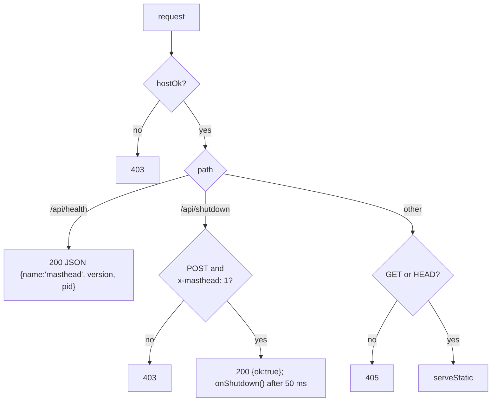

# server/http.ts

**Role:** the server's front door. It serves the built page as static files, two small HTTP endpoints, and the WebSocket that carries the protocol, and it applies the local-only security checks. The reasoning behind the checks is on [Security model](Security-Model.md).

## `serve(app, opts): Promise<Server>`

`ServeOptions`: `port`, `webDir` (the built page), `extraOrigins` (extra page origins allowed to open the socket, e.g. the Vite development server) and `onShutdown`.

It builds:

- `hosts`: `127.0.0.1:<port>` and `localhost:<port>`, plus the host part of each `extraOrigins` entry (in development, `localhost:7718` and `127.0.0.1:7718`, because the Vite development server forwards requests with its own Host header, as the code comment says). These are the accepted `Host` headers.
- `origins`: `http://127.0.0.1:<port>`, `http://localhost:<port>`, plus `extraOrigins`: the accepted `Origin` headers for the socket.
- `hostOk(req)`: the Host header is in `hosts`. There is no exception; development mode only widens the list by those two names.

### HTTP requests

### WebSocket upgrade

On `upgrade`, the path must be `/ws`, `hostOk` must pass, and the `Origin` must be in `origins`; otherwise the server writes `403 Forbidden` and closes the connection. Accepted sockets go to `attach()`. The `WebSocketServer` (from `ws`) is created with `noServer: true` (so this code decides about upgrades) and `maxPayload` 48 MiB.

### Listening

`server.listen(port, '127.0.0.1')`. The promise rejects on a listen error (for example the port being in use), which `server/main.ts` reports.

## `attach(app, ws)`

Wraps the socket as a `Client` whose `send()` JSON-encodes a message if the socket is open, then `app.connect(client)`. Each incoming message is parsed as JSON (failure: `{t:'error', message:'Malformed message.'}`) and passed to `app.handle()`. A ping every 30 seconds keeps the connection alive; on close, the timer stops and `app.disconnect()` is called; on error, the socket is closed.

## `serveStatic(root, pathname, req, res)`

1. URL-decodes and normalises the path (bad encoding → 400) and joins it to the web root; a result outside the root → 403.
2. If no such file: paths under `/assets/` or with a file extension → 404; anything else gets `index.html`, so the page can handle its own routes.
3. If `index.html` itself is missing → 503 "The web page has not been built. Run: npm run build".
4. Sends the file with a content type from `TYPES` (HTML, JS, CSS, SVG, PNG, ICO, JSON, WOFF2, source maps; otherwise `application/octet-stream`), and headers:
   - `cache-control`: a year and `immutable` for `/assets/` (Vite puts a content hash in those file names, so a changed file has a new name); `no-cache` for everything else, so the page itself is always fresh;
   - `x-content-type-options: nosniff`, `referrer-policy: no-referrer`;
   - the Content-Security-Policy described on [Security model](Security-Model.md).
5. `HEAD` gets headers only; `GET` streams the file.

`send()` and `sendJson()` are small helpers for plain-text and JSON replies (`sendJson` adds `cache-control: no-store`).

## Related pages

[Security model](Security-Model.md) · [server/main.ts](Source-Main.md) · [server/app.ts](Source-App.md)
