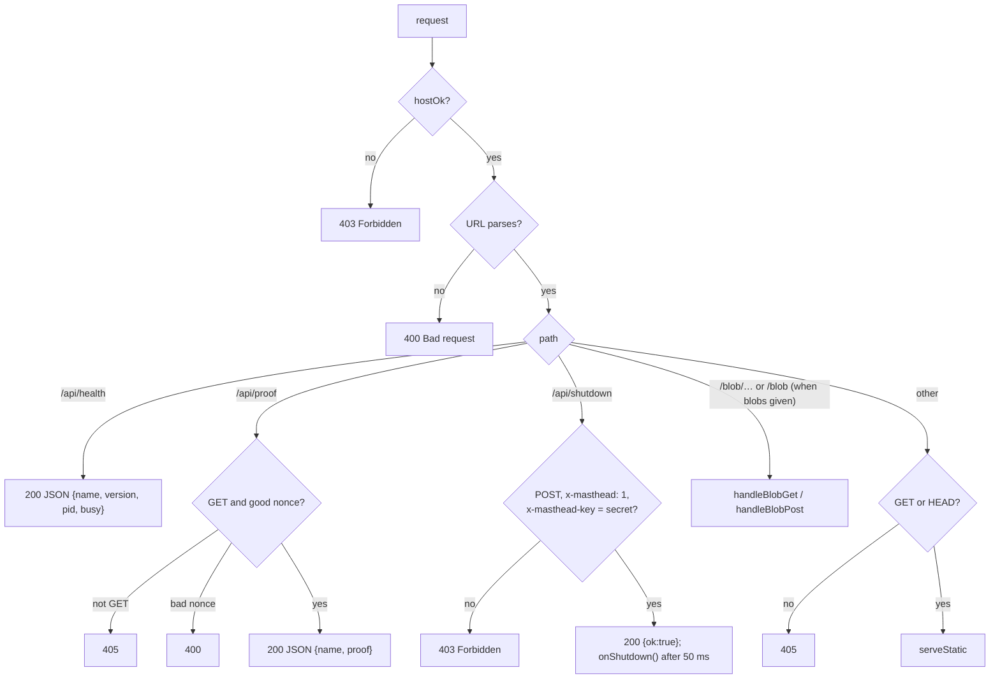

# server/transport/http.ts

**Role:** the local listener, the server's front door on `127.0.0.1`. It serves the built page as static files, three small HTTP endpoints (`/api/health`, `/api/proof` and `/api/shutdown`), the picture routes (`/blob`), and the WebSocket at `/ws` that carries the [protocol](Browser-Server-Protocol.md). It applies the local-only security checks. Why each check exists is on [Security model](Security-Model.md#the-local-listener); this page says what the code does. Two of its functions, `attach()` and `serveStatic()`, are also used by the remote listener in [server/transport/remote.ts](Source-Transport-Remote.md).

> Checked against the 0.2.0 source on branch `next`. Behaviour described here is read from the code, not run. Where a test in `test/http.test.ts` covers a point, its name is given; the tests were not run for this page.

## Constants

| Name | Value | Purpose |
|---|---|---|
| `TYPES` | extension → content type | HTML, JS, CSS (all `charset=utf-8`), SVG, PNG, ICO, JSON, WOFF2, `.map` (as JSON). Anything else is `application/octet-stream`. |
| `MAX_WS_PAYLOAD` | 48 MiB | Largest single socket message; `ws` refuses a larger one and closes the socket. |
| `DROP_BUFFERED` | 4 MiB | Bytes waiting in a socket's send buffer past which `draft` messages are dropped. |
| `CLOSE_BUFFERED` | 32 MiB | Bytes waiting past which the socket is closed. |
| `PING_MS` | 30 000 | How often each socket is pinged. |
| `PROTOCOL` | `masthead` | The only subprotocol the server ever answers with. |
| `KEY_PREFIX` | `key.` | The page offers the secret as a second subprotocol, `key.<secret>`. |
| `CSP` | see [Headers on the page](#headers-on-the-page) | The default Content-Security-Policy for static replies on this listener. |

## Types

- `ServedApp`: `Pick<App, 'connect' | 'disconnect' | 'handle' | 'workingCount'>`. Only what the transport needs from [App](Source-App.md), so tests can pass a stand-in.
- `ServeOptions`:
  - `port`: the port; 0 picks a free one (the tests use this).
  - `webDir`: the built page (`dist/web`).
  - `secret`: the local secret (`loadSecret()` in [server/transport/auth.ts](Source-Transport-Auth.md#loadsecretfile--secret_file)).
  - `extraOrigins`: extra page origins allowed to open the socket. `runServer()` in `server/main.ts` passes the Vite development server's two origins in development, and none otherwise.
  - `onShutdown`: called after an authorised `POST /api/shutdown`.
  - `blobs`: the picture store (`app.blobs`). Without it the `/blob` routes are not wired and fall through to static serving.
  - `convExists`: whether a conversation exists, so uploads only go to real ones. `server/main.ts` passes `app.hasConversation`. If it is missing, every upload is refused as "no longer exists".

## secretOk(secret, given)

Whether `given` is the secret. It returns false at once if `given` is not a string or is empty. Otherwise it compares the two as byte buffers: the lengths first, then `crypto.timingSafeEqual`. The reply time therefore does not show how much of a guess was right. (The length check is not constant-time, but every real secret is 64 hex characters, so the length is no secret.)

## pathOf(req)

Parses the request target with `new URL(req.url ?? '/', 'http://x')` inside a `try`. It returns the URL, or null when the target cannot be parsed (a malformed request line such as `GET http://[ HTTP/1.1`). Both the request handler and the upgrade handler answer null with `400`. Covered by "http: a request line that cannot be parsed gets 400 and the server keeps running".

## offeredKey(req)

Reads the `Sec-WebSocket-Protocol` header, splits it on commas and trims each entry. It returns the part after `key.` of the first entry that starts with `key.`, or undefined. A browser cannot set custom headers on a WebSocket, which is why the key travels as a subprotocol.

## serve(app, opts): Promise\<Server\>

The doc comment sums up the design. The server listens on `127.0.0.1` only. Because it can run commands as the person, it also refuses what a web page elsewhere could trick a browser into sending. The Host header must name this server (this defeats DNS rebinding). A socket must be opened by Masthead's own page (Origin). The socket, uploads and shutdown need the local secret, which other users on the machine cannot read. The page itself holds no secret and is served to anyone who passes the Host check. `masthead` opens the page with `#key=<secret>`; the fragment is never sent to the server.

`serve()` creates one `BlobTokens` (from `server/transport/blobs.ts`) for this listener. Each socket gets a token from it in `attach()`, and the `/blob` GET route checks tokens against it.

### Allowed hosts and origins

Both sets are completed only once the server is listening, from the real port (`server.address()`, which matters when `port` was 0):

- `hosts` (accepted `Host` headers): `127.0.0.1:<port>`, `localhost:<port>`, plus the host part of each `extraOrigins` entry.
- `origins` (accepted socket `Origin` headers): `extraOrigins` (added at the start), then `http://127.0.0.1:<port>` and `http://localhost:<port>`.
- `hostOk(req)`: an exact, case-sensitive match of the Host header against `hosts`. A missing Host fails.

### HTTP requests (`handleRequest`)

- **`/api/health`** answers any method, with no secret. The body is `{name: 'masthead', version, pid, busy}`. `version` is `VERSION` from `shared/protocol.ts`; `busy` is `app.workingCount()`, the number of conversations with an agent working. Covered by "http: health is open and reports the number of busy conversations".
- **`/api/proof`** lets the launcher check that this server knows its secret before sending it the secret. It needs no secret. Only `GET` is allowed (`405` otherwise). The `nonce` query parameter must match `NONCE_FORMAT` (64 lowercase hex characters) or the reply is `400 Bad request`. Otherwise the reply is `{name: 'masthead', proof}`, where `proof` is `proofOf(secret, boundPort, nonce)` from [auth.ts](Source-Transport-Auth.md#proofofsecret-port-nonce). `boundPort` is the port actually listened on. Covered by "http: proof answers a nonce with the HMAC for this port, never with the secret".
- **`/api/shutdown`** needs method `POST`, header `x-masthead: 1`, and header `x-masthead-key` equal to the secret (`secretOk()`). As the code comment says, a page on another site cannot send a custom header without a CORS preflight, and this server never grants one. Every failure gets the same `403 Forbidden`, so the reply does not say which check failed. On success it replies `{ok: true}` first, then calls `onShutdown` 50 ms later so the reply gets out. Covered by "http: shutdown needs POST, the custom header and the secret".
- **There is no `/api/whoami` on this listener.** The device endpoints (`/api/remote/whoami`, `/api/remote/request`) exist only on the [remote listener](Source-Transport-Remote.md#the-remote-endpoints). On this listener such a path is not an API: a `GET` gets `index.html` from `serveStatic()` (read from the code, not run).
- **Picture routes**, only when `opts.blobs` is set:
  - `handleBlobGet()` takes every path starting with `/blob/`. It needs `GET` or `HEAD` and a live socket token in `?t=` (checked against this listener's `BlobTokens`), and serves `/blob/<convId>/<sha256>`. No secret is needed, so an `` works.
  - `handleBlobPost()` takes exactly `/blob`. `authorised` is `secretOk(secret, x-masthead-key)`: as the code comment says, uploads need the secret in a custom header, which no other site can send without a preflight. `convExists` comes from the options (default: always false).
  - What the handlers answer is described in `server/transport/blobs.ts` and on [Security model](Security-Model.md#pictures-blobs).
- **Everything else** must be `GET` or `HEAD` (otherwise `405 Method not allowed`) and goes to `serveStatic()` with the default `CSP`.

Routing compares only `pathname`; the query string is ignored except where a route reads it (`nonce`, `t`, `conv`).

**Unexpected errors.** `createServer()` wraps `handleRequest` in a `try`. Anything thrown is logged as `Masthead could not answer <method> request: <message>` and answered `500 Internal error`, or, if headers were already sent, the response is destroyed. The upgrade handler has the same `try`: an error is logged and the socket destroyed.

### WebSocket upgrade

On the `upgrade` event the target is parsed first with `pathOf()`. If that fails, the server writes `HTTP/1.1 400 Bad Request` with `Connection: close` and destroys the socket. Then all of these must hold, or the server writes `HTTP/1.1 403 Forbidden` with `Connection: close` onto the raw socket and destroys it:

1. the path is `/ws`;
2. `hostOk(req)`;
3. the `Origin` header is in `origins` (a missing Origin fails, so non-browser clients cannot connect);
4. `secretOk(secret, offeredKey(req))`.

The `WebSocketServer` (from `ws`) is created with `noServer: true`, so this handler decides about every upgrade. It has `maxPayload` 48 MiB and `handleProtocols: () => 'masthead'`, so the answer always names the plain `masthead` subprotocol and never echoes the key. An accepted socket goes to `attach(app, ws, blobTokens)` with no `remote` argument: it is the local browser. Covered by "http: the socket needs the right Origin" and "http: the socket needs the secret".

### Listening

`server.listen(port, '127.0.0.1')`. The promise rejects with the listen error (for example `EADDRINUSE`); the `error` listener is removed once listening succeeds. Then `boundPort`, `hosts` and `origins` are filled in as above.

## attach(app, ws, tokens, remote?)

Connects one accepted socket to the app. Exported because the remote listener uses it too.

- **The client.** It issues a blob token with `tokens.issue()` and builds a `Client` (see [clients.ts](Source-Clients.md#client-and-hubhost)) with `blobToken` set. When `remote` is given, the client also gets `role: remote.role`; a client without `role` is the local browser. `remote.onClient(client)`, if given, is called before `app.connect(client)`, so the remote listener can track the socket (and change its role later).
- **`send(msg)` and back-pressure.** Messages to a socket that is not `OPEN` are dropped. If more than 32 MiB (`CLOSE_BUFFERED`) is waiting in `ws.bufferedAmount`, the socket is closed with code `4002` and reason "Too far behind."; the page resyncs when it reconnects. If more than 4 MiB (`DROP_BUFFERED`) is waiting and the message is a `draft`, it is dropped: as the comment says, a version 2 page notices the gap in `dseq` and asks for the whole text with `draft_sync`. Otherwise the message is JSON-encoded and sent.
- **Incoming messages.** Each is parsed as JSON. On a parse error the client gets `{t: 'error', code: 'invalid', message: 'Malformed message.'}`. Parsed values go to `app.handle(client, parsed)` ([App](Source-App.md#handleclient-raw-the-gate)), which never throws.
- **Ping and terminate.** Every 30 seconds: if the previous ping got no pong, the socket is ended with `terminate()`; otherwise it sends a new ping. So a tab on a sleeping laptop or a dropped network is gone after 30 to 60 seconds. Ticks while the socket is not open do nothing.
- **On `close`:** the timer stops, the blob token is released (`tokens.release()`, which keeps it valid for a further minute so cached images still load across a quick reconnect), and `app.disconnect(client)` runs.
- **On `error`:** the socket is closed, which then fires `close`.

## serveStatic(root, pathname, req, res, csp = CSP)

Serves the built page. Exported; the remote listener passes its own `csp` (see [`remoteCsp()`](Source-Transport-Remote.md#remotecsporigin)).

1. **Path checks.** URL-decode the path, then `normalize` it. Bad percent-encoding gives `400 Bad request`; a NUL byte gives 400. Join it to the web root; if the result is neither the root nor below `root + sep`, the reply is `403 Forbidden`. Covered by "http: paths cannot leave the web folder".
2. **Asset or not.** `isAsset` is decided on the URL path with `posix.normalize`, not on the file path: the comment notes that on Windows `normalize` turns `/assets/` into `\assets\`.
3. **Missing file** (`isFile()`): an asset path, or any path with a file extension, gets `404 Not found`. Any other path gets `index.html`, so the page can handle its own routes.
4. If `index.html` itself is missing: `503 The web page has not been built. Run: npm run build`.
5. **Headers** (below), then `HEAD` gets status 200 and no body, and `GET` opens a read stream; headers are written only once the file has opened, then the file is piped out.
6. **Stream errors.** The file can vanish between the check and the read (during a rebuild). If the stream fails before headers were sent, the reply is `404 Not found`; after, the response is destroyed. If the browser goes away, `res` `close` destroys the stream.

### Headers on the page

Every static reply gets:

| Header | Value | Why |
|---|---|---|
| `content-security-policy` | `csp`; on this listener `default-src 'self'; img-src 'self' data: blob:; style-src 'self' 'unsafe-inline'; connect-src 'self' ws://127.0.0.1:* ws://localhost:*; frame-ancestors 'none'; base-uri 'none'; form-action 'none'` | Only Masthead's own scripts run; the page cannot be framed; no forms or `<base>` tricks. See [Security model](Security-Model.md#page-headers). |
| `x-content-type-options` | `nosniff` | The browser trusts the content type instead of guessing. |
| `referrer-policy` | `no-referrer` | Also keeps a `?key` in the address from leaking to another site, as the code comment says. |
| `content-type` | from `TYPES` | |
| `cache-control` | `public, max-age=31536000, immutable` for `/assets/`; `no-cache` otherwise | Built assets carry a content hash in their name; the page itself is always revalidated. |

Covered by "http: the page and its assets are served to anyone, with the security headers".

## Helpers

- `send(res, status, body)`: a plain-text reply (`content-type: text/plain; charset=utf-8` only).
- `sendJson(res, status, body)`: a JSON reply with `cache-control: no-store`, so health, proof and shutdown answers are never cached.
- `isFile(path)`: `statSync(path).isFile()`, treating any error as "not a file". It follows symbolic links.

## Related pages

[Security model](Security-Model.md) · [Remote access](Remote-Access.md) · [Browser/server protocol](Browser-Server-Protocol.md) · [server/transport/auth.ts](Source-Transport-Auth.md) · [server/transport/remote.ts](Source-Transport-Remote.md) · [server/app/app.ts](Source-App.md) · [server/app/clients.ts](Source-Clients.md) · [server/main.ts](Source-Main.md) · [Command-line launcher](Command-Line-Launcher.md)
