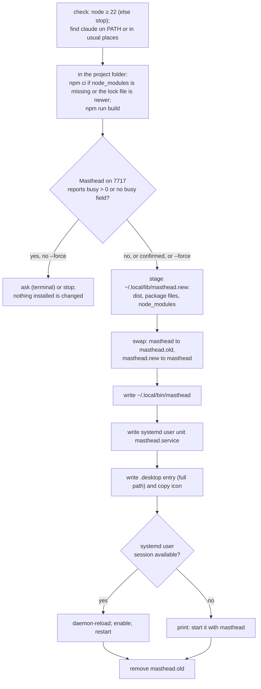

# Installing (scripts and packaging)

Files: `scripts/install.sh`, `scripts/uninstall.sh`, `scripts/path.sh`, `packaging/masthead.desktop`, `packaging/masthead.svg`, `packaging/README.md`, and the outlines `packaging/homebrew/masthead.rb`, `packaging/aur/PKGBUILD` and `packaging/scoop/masthead.json`. Read on branch `next` on 2026-11-27. Everything on this page is read from the files, not run.

## Which way to install

There are two ways:

| Way | For | Systems |
|---|---|---|
| `npm install -g --os=none --cpu=none <.tgz>`, then optionally `masthead service install` | everyone. The `.tgz` is attached to each GitHub release by `.github/workflows/release.yml` (see [CI](Source-CI.md#the-release-workflow)); nothing is on the npm registry | Linux, macOS, Windows ([Platforms](Platforms.md#background-service)) |
| `scripts/install.sh` from a checkout | **developers**, and 0.1.x installs | Linux with bash only |

`masthead service install` is the cross-platform way to start Masthead at login. It writes a systemd user unit on Linux, a launchd agent on macOS and a Task Scheduler task on Windows. `install.sh` does not call it: it builds, copies and writes its own unit, as described below. (`docs/plans/0.2.0/distribution.md` §2.2 has the plan to reduce it to "`npm pack`, `npm i -g`, `masthead service install`"; that is not done.)

The scripts install for the current user. Nothing needs root. Running `install.sh` again updates an existing installation.

## Where things go

| What | Path | Set by |
|---|---|---|
| The app | `~/.local/lib/masthead` (always under `$HOME`) | `lib` |
| The `masthead` command | `~/.local/bin/masthead` (always under `$HOME`) | `bin` |
| The systemd user unit | `~/.config/systemd/user/masthead.service` (always: where `systemctl --user` reads units) | `unit_dir` |
| The desktop entry | `$XDG_DATA_HOME/applications/masthead.desktop` (default `~/.local/share/…`) | `apps` |
| The icon | `$XDG_DATA_HOME/icons/hicolor/scalable/apps/masthead.svg` | `icons` |

The unit always goes to `~/.config/systemd/user`, where `systemctl --user` reads it. The desktop entry and icon follow `XDG_DATA_HOME`, and a set `XDG_CONFIG_HOME`/`XDG_DATA_HOME` is baked into the unit (see step 9), so run `install.sh` from a shell where those are either unset or set to the folders you really use. Any value with a line break is refused before the unit is written. `uninstall.sh` runs `masthead remote off` first (Masthead's own Tailscale entry), and removes the unit both from `~/.config/systemd/user` and from an older `$XDG_CONFIG_HOME` location.

## What `install.sh` does

`install.sh` sources `scripts/path.sh` from the project folder, which defines `clean_path` (see step 9).

Usage: `scripts/install.sh [--force]`. `--force` restarts even while agents are working. `-h` or `--help` prints the usage lines from the script's header and exits. Any other option is refused with exit code 2. The script runs with `set -euo pipefail`, so any failed command stops it.

Step by step:

1. **Options.** The `for arg` loop sets `force=1` for `--force`, prints help for `-h`/`--help`, and refuses anything else.
2. **Node check.** `node_bin` is `command -v node`. If it is missing, or `process.versions.node`'s major number is below 22, the script stops with exit 1.
3. **Claude Code lookup.** `claude_bin` is `command -v claude`. If that finds nothing, it tries `~/.local/bin/claude`, `~/.claude/local/claude`, `~/.npm-global/bin/claude` and `~/.bun/bin/claude`, taking the first that is executable. If there is none it only prints a note, because Masthead can be installed before Claude Code.
4. **Build in the project folder.** The `npm ci` rule: it runs `npm ci --no-audit --no-fund` when `node_modules` is missing or `package-lock.json` is newer than `node_modules/.package-lock.json`. npm rewrites that file on every install, so a pull or checkout that changes the lock file triggers a clean install. Then `npm run --silent build`.
5. **Busy check.** Before anything installed is touched, a short Node script fetches `http://127.0.0.1:7717/api/health` with a 1.5-second time-out and prints:
   - `0` if nothing answers, the answer is not JSON, or its `name` is not `masthead`;
   - the `busy` number (conversations with agents working) if there is one;
   - `unknown` if a Masthead answers without `busy` (an older version).

   If the result is not `0` and `--force` was not given, it asks "Continue? [y/N]" when standard input is a terminal; anything but y stops with "Nothing was changed." Without a terminal it prints the reason and stops with exit 1.
6. **Stage and swap.** It creates the folders above, deletes any old `masthead.new`, and builds the new copy there: `dist/`, `package.json` and `package-lock.json`.
   - **node_modules reuse.** If `~/.local/lib/masthead/node_modules` exists and the new lock file is byte-for-byte the installed one (`cmp -s`), it copies `node_modules` with hard links (`cp -al`), falling back to a full copy (`cp -a`) if hard links fail.
   - Otherwise it runs `npm ci --omit=dev --omit=optional` in the staged folder. The optional package holds a private copy of Claude Code; Masthead runs the one the person installed, as `AGENTS.md` requires.
   - Then it deletes any leftover `masthead.old`, renames the current `masthead` to `masthead.old` and `masthead.new` to `masthead`. The running server keeps its files until it is restarted.
   - If renaming `masthead.new` to `masthead` fails, it tries to keep the installed command and service working, then exits 1 with a message saying where each copy is: with no previous installation, `Could not move the new copy into <lib> (there was no previous installation). The new copy is in <lib>.new.`; otherwise, if nothing is at `<lib>` and `masthead.old` moves back, `… The previous installation is back in place; the new copy is in <lib>.new.`; if that fails too (or something is already at `<lib>`), `… nor put the previous one back. The previous copy is in <lib>.old and the new one in <lib>.new.` (Read from the code; not verified by running.)
7. **Quoting helpers.** Three shell functions make paths with spaces or odd characters safe in the generated files:

   | Function | Used for | What it escapes |
   |---|---|---|
   | `unit_quote` | One word in a unit file (`Environment=`) | `\` and `"`, doubles `%`, wraps the word in double quotes |
   | `exec_quote` | One word on the unit's `ExecStart=` line | Doubles `$`, then `unit_quote` |
   | `desktop_quote` | The desktop entry's `Exec=` argument | `\`, `"`, `` ` `` and `$` for the quoted argument; then `\` again (the value is a string) and doubles `%` |

8. **The `masthead` command.** It writes `~/.local/bin/masthead`, a two-line bash script: `exec <node> --disable-warning=CLAUDE_SDK_CAN_USE_TOOL_SHADOWED <lib>/dist/server/main.js "$@"`. Both paths are quoted with `printf %q`. It is made executable.
9. **The systemd user unit.** It writes `masthead.service`:
   - `ExecStart=` runs `node … main.js serve`, both paths through `exec_quote`. No port is given, so the service serves 7717 unless a `MASTHEAD_PORT` reaches it some other way.
   - `PATH`: Node's folder, Claude Code's folder (if found), the `PATH` the installer ran with, then `~/.local/bin`, `/usr/local/bin`, `/usr/bin` and `/bin`. This lets the service find tools in `~/.npm-global`, `~/.bun` and the like. The list is then passed through `clean_path` (`scripts/path.sh`): empty entries and relative ones (anything not starting with `/`, such as `.` or `bin`) are dropped, and so are repeats, keeping the first place each folder appears. A relative entry would be looked up from wherever the service happens to run. `test/launcher.test.ts` runs `clean_path` through bash.
   - `MASTHEAD_CLAUDE` is set to the `claude` found in step 3, whenever one was found.
   - `XDG_CONFIG_HOME` and `XDG_DATA_HOME` are set only if the installer had them set, so the service uses the same settings, conversations and secret as the `masthead` command.
   - All `Environment=` values go through `unit_quote`.
   - `Restart=on-failure`, `RestartSec=2`, `TimeoutStopSec=10`, `After=network-online.target`, and `WantedBy=default.target`, so it starts at login.
10. **Desktop entry and icon.** It reads `packaging/masthead.desktop` line by line: the `Exec=` line becomes `Exec=` plus `desktop_quote` of the full path of `~/.local/bin/masthead` (a desktop session's `PATH` often lacks `~/.local/bin`), every line starting with `#` is dropped, and the rest is copied. It copies `packaging/masthead.svg` to the icons folder.
11. **Start.** If `systemctl` exists and `systemctl --user show-environment` works, it runs `daemon-reload`, `enable --quiet masthead.service` and `restart masthead.service`, and says it is running as a user service. Otherwise it prints "start it with: masthead".
12. **Clean-up.** It deletes `masthead.old`. If a command in step 11 failed, `set -e` stops the script first, and `masthead.old` is left behind until the next run.
13. It warns if `~/.local/bin` is not on `PATH`, and prints "Done. Open it with: masthead".

The service always serves port 7717. The launcher's `masthead`, `masthead stop` and `masthead status` use systemd only for the unit's port; any other port is a separate copy handled over HTTP (see [Command-line launcher](Command-Line-Launcher.md)). A clean `masthead stop` makes the server exit with code 0, so `Restart=on-failure` does not start it again.

## `path.sh`

`scripts/path.sh` is sourced by `install.sh` and defines one bash function, `clean_path PATH`. It returns the same list without empty entries, relative entries (anything not starting with `/`) and repeats, in the original order. A relative entry in a service's `PATH` would be looked up from wherever the service happens to run. It is a separate file so `test/launcher.test.ts` can run it without running the installer (that test is skipped where there is no bash). `cleanPath()` in `server/service/common.ts` does the same for `masthead service install`.

## The packaging files

| File | Content | Status |
|---|---|---|
| `packaging/masthead.desktop` | `Type=Application`, `Name=Masthead`, `Comment=Run a tiered team of Claude agents`, `Exec=masthead` (replaced on install), `Icon=masthead`, `Terminal=false`, `Categories=Development;Utility;`, `StartupNotify=false`, and a `#` comment saying the installer replaces `Exec`. It puts Masthead in the Linux desktop's application launcher. | used by `install.sh` |
| `packaging/masthead.svg` | A 32×32 icon: a dark rounded square with three light bars of falling length, like lines of text, over a thin blue line. `Icon=masthead` finds it by name in the hicolor theme. | used by `install.sh` |
| `packaging/README.md` | Lists the outlines below and their status. Says nothing there is published yet, that every outline installs the GitHub release tarball, and that the package (`@luxorium/masthead`, `private: true`) is not on npm. | – |
| `packaging/homebrew/masthead.rb` | A tap formula (`Luxorium/homebrew-tap`): `depends_on "node"`, installs the npm tarball with `npm install *std_npm_args --os=none --cpu=none`, links the `bin`. A `service do` block runs `masthead serve`, restarts only after a crash, logs to `var/log/masthead.log`. Its test checks `masthead --version`. URL and `sha256` are placeholders. | outline, not published |
| `packaging/aur/PKGBUILD` | `arch=(any)`, `depends=(nodejs)`, `makedepends=(npm)`, `optdepends` Claude Code. `package()` runs `npm install -g --os=none --cpu=none --prefix "$pkgdir/usr"` on the tarball, makes folders 755 and installs the licence. `sha256sums=('SKIP')` until release. | outline; to be checked against Arch's Node.js packaging rules |
| `packaging/scoop/masthead.json` | Windows without admin: `depends: nodejs-lts`, the npm tarball as URL, an installer script running `npm install -g --os=none --cpu=none --prefix $dir`, then removing the tarball; `bin: masthead.cmd`. Hash is a placeholder. | outline, untested on Windows |

Every outline installs with `--os=none --cpu=none`, which skips the Agent SDK's private Claude Code binary (see [Build configuration](Source-Build-Config.md#optional-packages)). Homebrew users would use `brew services start masthead` instead of `masthead service install`.

## What `uninstall.sh` does

It runs with `set -euo pipefail`, but every command that may fail ignores its errors.

1. If `~/.local/bin/masthead` is executable, runs `masthead remote off` (turns off Masthead's own Tailscale entry if remote access was on; its output is shown), then `masthead stop` (output hidden). That stops the service, and also a copy started without it, on 7717 or `MASTHEAD_PORT`.
2. If `systemctl` exists, `systemctl --user disable --now masthead.service`.
3. Removes the unit file (from `~/.config/systemd/user` and from the older `$XDG_CONFIG_HOME/systemd/user` location), `~/.local/bin/masthead`, the desktop entry, the icon, `~/.local/lib/masthead`, and any leftover `masthead.new` or `masthead.old`.
4. Reloads systemd (`daemon-reload`).
5. Prints "Masthead was removed." and where the kept data is. Conversations and the local secret (`$XDG_DATA_HOME/masthead`) and settings (`$XDG_CONFIG_HOME/masthead`) are **not** removed.

Like the installer, it finds the desktop entry, icon and the older unit location through `XDG_DATA_HOME` and `XDG_CONFIG_HOME`, so run it with the same values the installer had. The current unit location, `~/.config/systemd/user`, is fixed.

## Points to be aware of

- `After=network-online.target` normally has no effect in a user unit, because user units cannot wait for that system target. It does no harm.
- The build step in the project folder uses a full `npm ci`, so the source checkout's `node_modules` includes the optional packages. It must: the build tools (esbuild, rolldown) need theirs. Only the installed copy omits them.
- `install.sh` is written for Linux (bash, systemd, a `.desktop` entry, `cp -al`). It is not meant for macOS or Windows; use the npm package and `masthead service install` there.
- The installed launcher and unit fix the paths to Node and Claude Code, and the whole `PATH`, as found at install time. If any of them changes, run `install.sh` again. Relative and empty entries in the installer's `PATH` are left out of the unit.
- The busy check only asks port 7717. A separate copy on another port is not checked. A copy on 7717 started without the service is not restarted. The service then exits with "Port 7717 is already in use" (`runServer` in `server/main.ts`), and `Restart=on-failure` retries it every 2 seconds until the old copy is stopped.
- Anything on 7717 that does not answer as Masthead counts as "not busy".

## Related pages

[Building, testing and installing](Building-Testing-Installing.md) · [Platforms](Platforms.md) · [Command-line launcher](Command-Line-Launcher.md) · [Storage on disk](Storage-on-Disk.md) · [Build configuration](Source-Build-Config.md)
