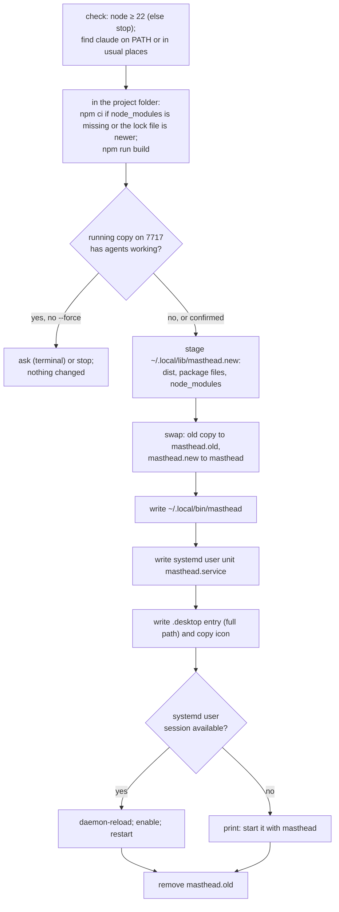

# Installing (scripts and packaging)

Files: `scripts/install.sh`, `scripts/uninstall.sh`, `packaging/masthead.desktop` and `packaging/masthead.svg`. These install Masthead for the current user. Nothing needs root, and running `install.sh` again updates an existing installation.

## What `install.sh` does

Usage: `scripts/install.sh [--force]`. `--force` restarts even while agents are working; any other option is refused.

Step by step:

1. **Checks.** It stops if `node` is missing or older than version 22. It looks for `claude` on `PATH`, then in `~/.local/bin`, `~/.claude/local`, `~/.npm-global/bin` and `~/.bun/bin`. If there is none it only prints a note, because Masthead can be installed before Claude Code.
2. **Build** in the project folder. It runs `npm ci` when `node_modules` is missing or `package-lock.json` is newer than `node_modules/.package-lock.json` (which npm updates on every install, so a pull or checkout that changes the lock triggers it), then `npm run build`.
3. **Busy check.** Before anything installed is touched, it asks `http://127.0.0.1:7717/api/health` for `busy`, the number of conversations with agents working. If that is more than 0, or the running copy is too old to say (0.1.0 has no `busy`), and `--force` was not given, it asks for confirmation in a terminal; without a terminal it stops. Either way, declining leaves everything as it was.
4. **Stage and swap.** It builds the new copy in `~/.local/lib/masthead.new`: `dist/`, `package.json` and `package-lock.json`. When the lock file matches the installed one, it reuses `node_modules` with hard links (`cp -al`, else a plain copy); otherwise it runs `npm ci --omit=dev --omit=optional` there. The optional package holds a private copy of Claude Code, and Masthead runs the one the person installed; `AGENTS.md` makes that a rule. Then the old folder is renamed to `masthead.old` and the new one to `masthead`, so the running server never loses half its files. `masthead.old` is removed after the restart.
5. **The `masthead` command.** It writes `~/.local/bin/masthead`, a two-line bash script that runs `dist/server/main.js` with the Node found in step 1 (and `--disable-warning=CLAUDE_SDK_CAN_USE_TOOL_SHADOWED`), passing on all arguments. Both paths are quoted with `printf %q`.
6. **The systemd user unit.** It writes `masthead.service` in `$XDG_CONFIG_HOME/systemd/user` (default `~/.config/systemd/user`). The unit:
   - runs `node … main.js serve`, with both paths quoted for systemd (`%` and `$` escaped), so a home folder with spaces works;
   - sets `PATH` to Node's folder, Claude Code's folder, the `PATH` the installer ran with, then `~/.local/bin`, `/usr/local/bin`, `/usr/bin` and `/bin`, so tools in `~/.npm-global`, `~/.bun` and the like are found;
   - sets `MASTHEAD_CLAUDE` to the `claude` found in step 1, whenever one was found;
   - sets `XDG_CONFIG_HOME` and `XDG_DATA_HOME` when the installer had them set, so the service uses the same settings, conversations and secret as the `masthead` command;
   - restarts on failure after 2 seconds, allows 10 seconds to stop, and is wanted by `default.target`, so it starts at login.

   It also has `After=network-online.target`.
7. **Desktop entry and icon.** It writes `~/.local/share/applications/masthead.desktop` from `packaging/masthead.desktop`, replacing `Exec=` with the full, quoted path of `~/.local/bin/masthead` (a desktop session's `PATH` often lacks `~/.local/bin`) and dropping the template's comment. It copies `masthead.svg` to `~/.local/share/icons/hicolor/scalable/apps/`. The entry (Name "Masthead", categories Development and Utility) makes Masthead appear in the desktop's application launcher.
8. **Start.** If a systemd user session is available, it reloads systemd, enables the unit and restarts it. Otherwise it prints "start it with: masthead".
9. It warns if `~/.local/bin` is not on `PATH`.

The service always serves port 7717. The launcher's `masthead`, `masthead stop` and `masthead status` use systemd only for that port; any other port is a separate copy handled over HTTP (see [Command-line launcher](Command-Line-Launcher.md)). A clean `masthead stop` makes the server exit with code 0, so `Restart=on-failure` does not start it again.

## What `uninstall.sh` does

1. Runs `~/.local/bin/masthead stop`, if present. That stops the service and also a copy started without it, on 7717 or `MASTHEAD_PORT` (errors ignored).
2. Disables and stops the unit (errors ignored).
3. Removes the unit file, `~/.local/bin/masthead`, the desktop entry, the icon, `~/.local/lib/masthead` and any leftover `masthead.new` or `masthead.old`.
4. Reloads systemd.
5. Prints where the kept data is. Conversations and the local secret (`$XDG_DATA_HOME/masthead`) and settings (`$XDG_CONFIG_HOME/masthead`) are **not** removed.

## Points to be aware of

- `After=network-online.target` normally has no effect in a user unit, because user units cannot wait for that system target. It does no harm.
- The build step in the project folder uses a full `npm ci`, so the source checkout's `node_modules` normally includes the optional package (npm installs optional packages unless told not to). Only the installed copy omits it.
- The installed launcher and unit fix the paths to Node and Claude Code, and the `PATH`, found at install time. If any of them changes, run `install.sh` again.
- The busy check only asks port 7717. A separate copy on another port is not checked, and a copy started without the service on 7717 is not restarted by systemd.

## Related pages

[Building, testing and installing](Building-Testing-Installing.md) · [Command-line launcher](Command-Line-Launcher.md) · [Storage on disk](Storage-on-Disk.md)
