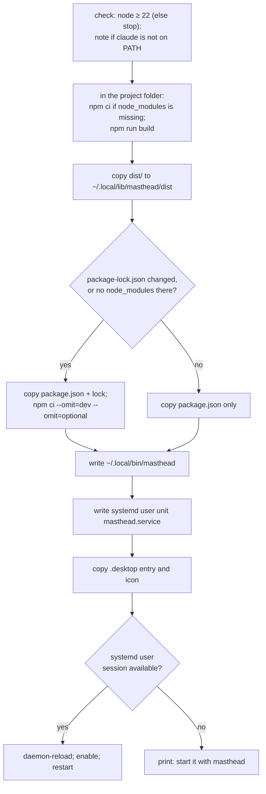

# Installing (scripts and packaging)

Files: `scripts/install.sh`, `scripts/uninstall.sh`, `packaging/masthead.desktop` and `packaging/masthead.svg`. These install Masthead for the current user. Nothing needs root, and running `install.sh` again updates an existing installation.

## What `install.sh` does

Step by step:

1. **Checks.** It stops if `node` is missing or older than version 22. If `claude` is not on `PATH`, it only prints a note, because Masthead can still be installed before Claude Code.
2. **Build** in the project folder. It runs `npm ci` only if `node_modules` is missing, then `npm run build`.
3. **Install the app** in `~/.local/lib/masthead`. The old `dist/` is replaced. Runtime dependencies are installed there with `npm ci --omit=dev --omit=optional`, but only when the lock file changed or `node_modules` is missing. The script's comment explains `--omit=optional`: the optional package holds a private copy of Claude Code, and Masthead runs the one the person installed. `AGENTS.md` makes this a rule: never bundle a private copy of Claude Code.
4. **The `masthead` command.** It writes `~/.local/bin/masthead`, a two-line bash script that runs `dist/server/main.js` with the Node found in step 1 (and `--disable-warning=CLAUDE_SDK_CAN_USE_TOOL_SHADOWED`), passing on all arguments.
5. **The systemd user unit.** It writes `masthead.service` in `$XDG_CONFIG_HOME/systemd/user` (default `~/.config/systemd/user`). The unit:
   - runs `node … main.js serve`;
   - sets `PATH` to Node's folder plus `~/.local/bin`, `~/.cargo/bin`, `/usr/local/bin`, `/usr/bin` and `/bin`;
   - sets `MASTHEAD_CLAUDE` to the `claude` found at install time, if one was found;
   - restarts on failure after 2 seconds, allows 10 seconds to stop, and is wanted by `default.target`, so it starts at login.

   It also has `After=network-online.target`.
6. **Desktop entry and icon.** It copies `masthead.desktop` to `~/.local/share/applications/` and `masthead.svg` to `~/.local/share/icons/hicolor/scalable/apps/`. The entry (Name "Masthead", Exec `masthead`, categories Development and Utility) makes Masthead appear in the desktop's application launcher.
7. **Start.** If a systemd user session is available, it reloads systemd, enables the unit and restarts it. Otherwise it prints "start it with: masthead".
8. It warns if `~/.local/bin` is not on `PATH`.

Because the unit exists after installation, the launcher's `masthead`, `masthead stop` and `masthead status` work through systemd (see [Command-line launcher](Command-Line-Launcher.md)). A clean `masthead stop` makes the server exit with code 0, so `Restart=on-failure` does not start it again.

## What `uninstall.sh` does

1. Disables and stops the unit (errors ignored).
2. Removes the unit file, `~/.local/bin/masthead`, the desktop entry, the icon and `~/.local/lib/masthead`.
3. Reloads systemd.
4. Prints where the kept data is. Conversations (`$XDG_DATA_HOME/masthead`) and settings (`$XDG_CONFIG_HOME/masthead`) are **not** removed.

## Points to be aware of

- The unit's `PATH` includes `~/.cargo/bin`, which nothing in Masthead needs.
- `After=network-online.target` normally has no effect in a user unit, because user units cannot wait for that system target. It does no harm.
- The build step in the project folder uses a full `npm ci`, so the source checkout's `node_modules` normally includes the optional package (npm installs optional packages unless told not to). Only the installed copy omits it.
- The installed launcher and unit fix the paths to Node and Claude Code found at install time. If either moves, run `install.sh` again.

## Related pages

[Building, testing and installing](Building-Testing-Installing.md) · [Command-line launcher](Command-Line-Launcher.md) · [Storage on disk](Storage-on-Disk.md)
