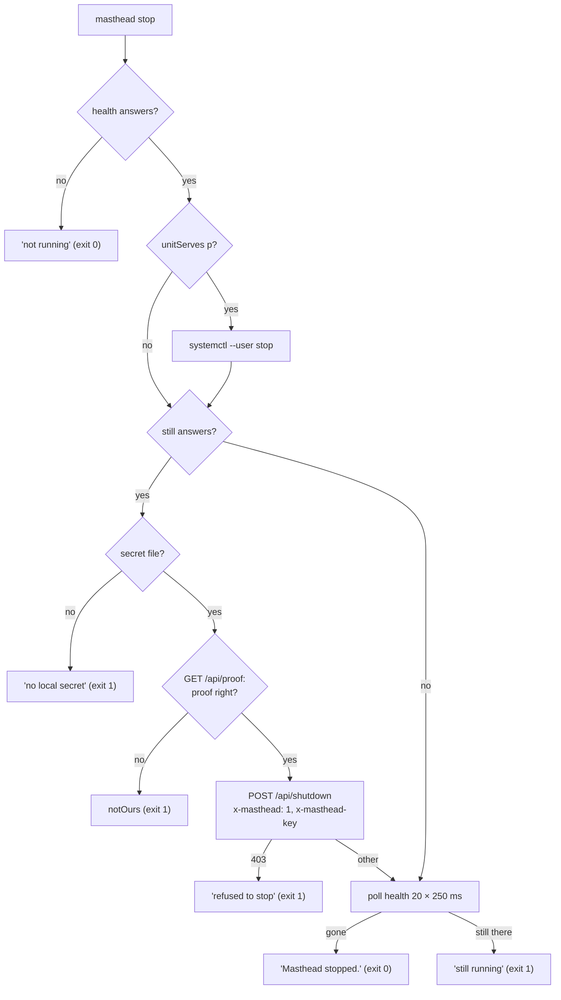

# server/main.ts

**Role:** the program's entry point and the `masthead` command. It is the `bin` in `package.json`, compiled to `dist/server/main.js`, and starts with a `#!/usr/bin/env node` line. The `~/.local/bin/masthead` script, the systemd unit written by `scripts/install.sh`, and the services written by `masthead service install` (systemd, launchd or Task Scheduler; see [server/service](Source-Service.md)) all run this file. The same file is the **launcher** (start a server if needed, open the browser, report status, stop), the **server** (`masthead serve`), the service installer (`masthead service`), the set-up check (`masthead doctor`, see [server/doctor.ts](Source-Doctor.md)) and `masthead remote off`. The parsing it relies on is in [server/cli.ts](Source-Cli.md). How to use the command is on [Command-line launcher](Command-Line-Launcher.md); this page walks through the code.

> Checked against the 0.2.0 source on branch `next` (2026-11-27). The behaviour described here is read from the code, not verified by running.

## Imports

| From | What |
|---|---|
| `../shared/protocol.js` | `VERSION`. |
| `./app/app.js` | `App`, the whole application ([server/app](Source-App.md)). |
| `./cli.js` | `UsageError`, `commandPort`, `onPath`, `openSignedIn`, `parseCommand`, `parseDevWebPort`, `parsePort`, `serverProves`, `signInDir`, `signInUrl`, `unitPortFrom` and the `Opener` type ([server/cli.ts](Source-Cli.md)). |
| `./paths.js` | `CONFIG_DIR`, `DATA_DIR`, `DEFAULT_PORT`, `mastheadCommand`, `SECRET_FILE` ([server/paths.ts](Source-Paths.md)). |
| `./transport/auth.js` | `isPrivate`, `loadSecret`, `readSecret` ([server/transport/auth.ts](Source-Transport-Auth.md)). |
| `./transport/http.js` | `serve` ([server/transport/http.ts](Source-Http.md)). |
| `./transport/remote.js`, `./remote/access.js`, `./remote/tailscale.js` | `chooseTarget`, `startRemote`, `RemoteAccess`, `targetUrl`, `tailscaleFor`: remote access over the person's own Tailscale ([server/transport/remote.ts](Source-Transport-Remote.md), [Remote access](Remote-Access.md)). |
| `./service/index.js` | `serviceFor`, `ServiceError` ([server/service](Source-Service.md)). |
| `./service/common.js` | `statusSummary`, the one-line service status ([server/service](Source-Service.md#commonts)). |
| `./service/awake.js` | `Awake`, `awakeCommand` ([Keep awake](Source-Service.md#keep-awake-awakets)). |
| `./doctor.js` | `doctor`, `doctorExitCode`, `formatChecks`, `sdkBinaryPackage`, `systemDoctorFs` ([server/doctor.ts](Source-Doctor.md)). |
| `./backends/claude/env.js` | `findClaude`, which finds the installed `claude` ([Claude back end](Source-Backend-Claude.md)). |

## Module-level set-up

- **Warning filter.** Before anything else, `process.emitWarning` is replaced by a wrapper that drops warnings with the code `CLAUDE_SDK_CAN_USE_TOOL_SHADOWED` and passes every other warning on unchanged. The code can arrive two ways: as `code` in an options object (`emitWarning(w, {code})`) or as the third positional argument (`emitWarning(w, type, code)`); the wrapper checks both. The reason, from the code comment: Masthead approves its own tools ahead of the permission callback on purpose, so the SDK's notice about that is noise. With this filter the warning stays quiet however the file is started. `npm start`, the launcher script, the unit and the detached start in `start()` also pass `--disable-warning=CLAUDE_SDK_CAN_USE_TOOL_SHADOWED`, which does the same job.
- `here`: the folder of the running file. `webDir = here/../web`. For the compiled file that is `dist/web`, where Vite puts the built page.
- `url(p)`: `http://127.0.0.1:
`. The launcher always talks to the loopback address, never `localhost`.

## Functions

### port()

Calls `parsePort(process.argv.slice(2), process.env)`. On a `UsageError` it prints the message to stderr and exits with code 2. Any other error is re-thrown. Only `runServer()` uses it: `masthead serve` serves the port asked for, or 7717.

### portFor(cmd)

The port every other command works on: `commandPort(cmd, args, process.env, installed)` ([server/cli.ts](Source-Cli.md)), where `installed` asks `serviceFor(process.platform)?.status()`. An explicit `--port` or `MASTHEAD_PORT` wins; otherwise `open`, `status`, `stop`, `service` and `doctor` use the installed background service's port when there is one (so `masthead stop` finds a service installed with `--port 7727`), else `DEFAULT_PORT`. A failing status query counts as no service. A `UsageError` prints its message and exits 2, any other error is re-thrown. `main()` calls it for every command, including `help` and unknown words, so a bad `--port` or `MASTHEAD_PORT` exits 2 before anything else happens. (`--help`, `-h` and `--version` are handled at the bottom of the file first; see [Entry at the bottom of the file](#entry-at-the-bottom-of-the-file).)

### health(p)

Sends `GET http://127.0.0.1:
/api/health` with a 1.5-second timeout (`AbortSignal.timeout(1500)`). It returns the reply body only if its `name` is `masthead`; otherwise null. Any failure (connection refused, timeout, a reply that is not JSON) is also null. So another program on the port is never mistaken for Masthead. It does not look at the HTTP status, and it does not send the secret: health needs none (see [server/transport/http.ts](Source-Http.md#http-requests-handlerequest)).

### notOurs(p)

The message for a server on `p` that did not prove it knows this data folder's secret (`serverProves()` in [server/cli.ts](Source-Cli.md#serverprovesbase-port-secret-fetchfn) returned false): `Another Masthead (or another program) is using port 
: it did not prove it knows <SECRET_FILE>, so it was not sent the key. If it is a Masthead started with another data folder (this one is <DATA_DIR>), use that one; if it is an older Masthead, restart it; otherwise use another port.` An older Masthead has no `/api/proof`, so it fails the check too; restarting it with this version fixes that. Both `open` and `stop` print it and exit 1.

### unitServes(p)

Returns false at once on any platform other than Linux. On Linux it runs `systemctl --user show -p LoadState -p Environment masthead.service` and returns true only if the command exits 0 **and** `unitPortFrom()` reads port `p` from its output. In words: the installed user service is the one that serves this port. If `systemctl` is missing, `spawnSync` gives a null status and the answer is false. Any port other than the unit's is "a server of its own", as the code comment says, so `masthead --port 7720` never touches the unit. On macOS and Windows the launcher always starts its own copy and stops it through `/api/shutdown`: per the code comment, launchd and Task Scheduler do not restart a server that exits cleanly, so going around them is safe there (not verified by running).

### removeRemoteServe()

Turns off Masthead's own `tailscale serve` entry if remote access was on; used by `service uninstall` and `masthead remote off` (which `scripts/uninstall.sh` runs). It builds a `RemoteAccess` for `<DATA_DIR>/remote` as `runServer()` does. Remote access off: no lines. Otherwise it asks Tailscale for the serve state on the remote port and target (`targetUrl()`), and only when the entry is `ours` removes it and returns `Turned off Masthead's Tailscale entry on port <n>.` If Tailscale refuses, it returns `Could not turn off Masthead's Tailscale entry (<message>). Run: tailscale serve --https=<port> off`. Only Masthead's own entry, on its port and target, is ever removed.

### systemOpener

The real `Opener` passed to `openSignedIn()` ([server/cli.ts](Source-Cli.md#opensignedinopts)):

- `has(cmd)`: `onPath(cmd, process.env, process.platform, existsSync)` ([server/cli.ts](Source-Cli.md#onpathcmd-env-platform-exists)). It looks through `PATH` itself, with no shell, so it works on Windows too.
- `run(cmd, args)`: spawns the command detached, with output ignored and `windowsHide: true` (no console window on Windows), and `unref()`s it, so an opener that runs the browser in the foreground does not keep `masthead` waiting; resolves with its exit code, or null if it could not start. `openSignedIn()` waits for it at most 3 seconds (`OPENER_WAIT_MS`).
- `detach(cmd, args)`: spawns detached with output ignored and `windowsHide: true`, ignores a start `error` (a missing program must not crash the launcher) and `unref()`s it. `openSignedIn()` uses it to run Node with `removeLaterArgs()`.
- `log(line)`: `console.log`.

### secretOrExit()

Returns `loadSecret()` ([server/transport/auth.ts](Source-Transport-Auth.md)): the secret in `SECRET_FILE` (`<DATA_DIR>/secret`; on Linux normally `~/.local/share/masthead/secret`, see [server/paths.ts](Source-Paths.md)), created once if it is missing. If it can be neither read nor created, it prints `Could not read or create <file>: <reason>` and exits 1. See [Security model](Security-Model.md#the-local-secret).

### runServer()

`masthead serve`.

1. Reads the port (`port()`). Creates `remote = new RemoteAccess({ dir: <DATA_DIR>/remote, tailscale: tailscaleFor(process.env), target: chooseTarget(process.env, DATA_DIR) })` (off by default; see [Remote access](Remote-Access.md)) and then `new App({ remote, awake: new Awake() })`, which loads settings and saved conversations (see [server/app](Source-App.md)). The `Awake` object keeps the computer from idling to sleep while agents work ([Keep awake](Source-Service.md#keep-awake-awakets)). It checks `MASTHEAD_DEV === '1'` for development mode and reads the dev page's port with `parseDevWebPort(process.env)` (`MASTHEAD_DEV_WEB_PORT`, default 7718). An invalid value prints `Invalid MASTHEAD_DEV_WEB_PORT: …` and exits 2, even outside development mode.
2. Defines `shutdown()`. A `closing` flag makes it run once however many signals or requests arrive. It calls `app.shutdown()` (releases the keep-awake hold, denies waiting approval requests, stops every agent, writes everything to disk) and exits with code 0 after 300 ms, so the Claude Code processes have a moment to end first.
3. Loads the secret with `secretOrExit()`.
4. Calls `serve(app, { port, webDir, secret, extraOrigins, onShutdown: shutdown, blobs: app.blobs, convExists })`, where `convExists(id)` is `app.hasConversation(id)` (used for pictures; see [server/transport/http.ts](Source-Http.md)). In development mode `extraOrigins` is `http://localhost:<dev port>` and `http://127.0.0.1:<dev port>`, the Vite development server; otherwise it is empty.
5. If `serve()` rejects: `EADDRINUSE` prints `Port 
 is already in use. Is Masthead already running?`; anything else prints `Could not start: <message>`. Both exit 1. (`app.shutdown()` is not called on this path; nothing has started yet.)
6. Starts remote access without waiting: `startRemote(app, remote, { webDir, blobs, convExists })` opens the private remote listener when remote access is on. A missing Tailscale is not an error; any other failure prints `Masthead: remote access did not start: <message>` and the server keeps running.
7. Only after the server listens does it install handlers that call `shutdown()` for `SIGINT`, `SIGTERM` and `SIGHUP`, plus `SIGBREAK` on Windows (the code comment: Windows never sends SIGTERM; closing the console window gives SIGHUP, Ctrl+Break gives SIGBREAK). It also installs and an `unhandledRejection` handler that logs `Masthead: unhandled rejection: <stack>` and keeps the server running for the agents that are working. Errors during start-up (steps 1–5) still end the process. Uncaught exceptions keep Node's default, which exits (an installed service restarts it: systemd `Restart=on-failure`, launchd `KeepAlive` on a failed exit, Task Scheduler `RestartOnFailure`), because after one the state cannot be trusted. (Read from the code; not verified by running.)
8. Prints `Masthead <version> is running at http://127.0.0.1:
`, then how to sign a browser in:
   - normal: ``Open it with `masthead` to sign the browser in.`` (`masthead.cmd` on Windows, through `mastheadCommand()`; with `--port 
` added when the port is not 7717);
   - development: `Development page (Vite, MASTHEAD_PORT=
 MASTHEAD_DEV_WEB_PORT=<dev port> npm run dev:web):` and on the next line `http://localhost:<dev port>/#key=<secret>` (`signInUrl()`). So it names the command that starts a Vite page forwarding to this server. This prints the secret to the terminal (or the service's log, if run as a service with `MASTHEAD_DEV=1`).

`POST /api/shutdown` reaches the same `shutdown()` through `onShutdown`.

### start(p)

Makes sure a server answers on `p`. Returns true when one does.

1. If `health(p)` already answers, return true. Nothing is started. Whether that server knows the same secret is checked afterwards in `main()` with `serverProves()`.
2. If `unitServes(p)`: run `systemctl --user start masthead.service` with its output shown. Its exit status is not checked; the health polling below decides.
3. Otherwise (always on macOS and Windows): spawn `process.execPath --disable-warning=CLAUDE_SDK_CAN_USE_TOOL_SHADOWED <this file> serve --port 
`, `detached: true`, `stdio: 'ignore'`, `windowsHide: true`, and `unref()` it. That is the same Node and the same file, in its own process group, with output discarded, so it keeps running after the launcher exits. It inherits the launcher's environment (so `MASTHEAD_DATA_DIR`, `XDG_DATA_HOME`, `MASTHEAD_DEV` and so on carry over).
4. Poll `health(p)` up to 40 times with a 250 ms pause between tries. With a refused connection each try is quick, so this is about 10 seconds; a try that hangs can take up to 1.5 s more each (read from the code, not run).
5. Return false if it never answered. Because output was discarded, `main()` then suggests `masthead serve` to see why.

### main()

Reads the command with `parseCommand()` and the port with `portFor(cmd)`, then:

| Command | What happens | Exit |
|---|---|---|
| `serve` | `runServer()`. The process stays up. | 1 on a start error |
| `open` | See [Control flow of open](#control-flow-of-open). | 0, or 1 |
| `status` | `health(p)`. Prints `Masthead <version> is running at <url> (pid <pid>)` or `Masthead is not running.` | 0 running, 3 not |
| `stop` | See [Control flow of stop](#control-flow-of-stop). | 0, or 1 |
| `service` | `serviceCommand(p)`. See [serviceCommand](#servicecommandp). | 0; 1 on failure; 2 for an unknown sub-command; `status`: 3 when not installed |
| `doctor` | `doctorCommand(p)`. See [doctorCommand](#doctorcommandp). | 0 all ok (warnings too), 1 otherwise |
| `remote off` | `removeRemoteServe()`, printing its lines, or `Masthead has no Tailscale entry to turn off.` Any other word after `remote` prints `Usage: masthead remote off   (switch remote access on in Settings → Remote access)`. Switching remote access on is done in the page. | 0; 2 for a wrong sub-command |
| `version`, `--version` | Prints `VERSION`. | 0 |
| anything else | Prints the usage text to stdout. It lists `masthead`, `serve`, `status`, `stop`, `service install\|uninstall\|status`, `doctor` (with `--json`), `remote off`, `--port N` ("use a port other than the installed service's or 7717 (or set MASTHEAD_PORT)") and `--no-browser`; it does not list `--force`. | 0 for `help` and `--help`; 2 otherwise |

The `--version` case in the switch cannot be reached in practice: `parseCommand()` skips words that start with `-`, and the bottom of the file catches `--version` first.

## serviceCommand(p)

`masthead service install|uninstall|status`.

1. The sub-command is the second word that is neither an option nor the value after `--port` (`--port=N` is one word and an option); with none it is `status`.
2. `serviceFor(process.platform)` picks systemd (Linux), launchd (macOS) or Task Scheduler (Windows). On any other platform it prints ``Masthead has no background service for <platform>; run `masthead serve` instead.`` and exits 1.
3. `install`: first asks `health(p)`. If the server on the port reports `busy` (the number of working conversations) above 0 and `--force` is not given, it prints `Masthead has agents working in <n> conversation(s); installing restarts it and stops them. Run again when they have finished, or with --force.` and exits 1. Then it calls `findClaude()` and `svc.install({ node: process.execPath, mainJs: <this file>, port: p, env: process.env, claudePath })` and prints each returned line. Then it says what is true now: if a server was already up it waits 1.5 s, then polls `health(p)` up to 11 times, 500 ms apart, and prints `statusSummary()` for the service's port (or `p`). If Masthead answers but the service is not the one running it (a copy started by hand keeps the port), it adds ``To let the service run it now: `masthead stop`, then `masthead service install` again.`` (`masthead.cmd` on Windows).
4. `uninstall`: `removeRemoteServe()`, then `svc.uninstall()`, printing each line.
5. `status`: `svc.status()`, with a health check of the service's own port (else `p`), printed by `statusSummary()` (`server/service/common.ts`): whether Masthead answers on the port and who started it, e.g. `Installed (taskscheduler). Masthead is running on port 7727, started by hand; the service starts it at login. (<detail>)`, or `Not installed (<kind>). Masthead is not running on port N.` Exit 0 when installed, 3 when not.
6. Any other word: `Usage: masthead service install|uninstall|status [--port N] [--force]`, exit 2.
7. A `ServiceError` (a required command failed) prints its message and exits 1; any other error is re-thrown.

What each service manager writes and runs is on [server/service](Source-Service.md).

## doctorCommand(p)

`masthead doctor [--json]`. Calls `doctor()` ([server/doctor.ts](Source-Doctor.md)) with the real system: `process.platform`, `process.versions.node`, `findClaude`, the paths `CONFIG_DIR`, `DATA_DIR`, `SECRET_FILE`, `systemDoctorFs`, the port, and:

- `isPrivate(file)`: from `server/transport/auth.ts`; on Windows it reads the file's ACL with `icacls` (elsewhere the POSIX mode), so the secret file's privacy can be checked;

- `probe(port)`: `free` when `health()` does not answer; otherwise `ours` when `readSecret()` finds a secret and `serverProves()` passes, else `other`;
- `service`: `serviceFor(process.platform)`;
- `sdkBinary`: `sdkBinaryPackage()`;
- `awakeTool`: the command from `awakeCommand(process.platform, process.pid)` and whether `onPath()` finds it.

With `--json` anywhere in the arguments it prints the checks as a JSON array (2-space indent); otherwise `formatChecks()`. It exits with `doctorExitCode()`: 0 when every check is ok (warnings count as ok), else 1.

## Control flow of open

1. If `webDir/index.html` does not exist: `The web page has not been built. Run: npm run build`, exit 1.
2. `start(p)`, or `Masthead did not start. Try \`masthead serve\` to see why.` (with `--port 
` when not 7717; `masthead.cmd` on Windows), exit 1.
3. Load the secret with `secretOrExit()`. If `serverProves(url(p), p, secret)` is false, print `notOurs(p)` and exit 1. The server is sent nothing that carries the key, and no browser is opened. Any failure counts: no answer, another program, a Masthead with another secret, or an older Masthead without `/api/proof`.
4. Print `Masthead is at http://127.0.0.1:
`.
5. Unless `--no-browser` is anywhere in the arguments, `openSignedIn({ base, secret, dir: signInDir(process.env, DATA_DIR), opener: systemOpener, tty: process.stdout.isTTY === true })`. It opens a private sign-in file that sends the browser to `<url>/#key=<secret>`; if it cannot, it prints that address when stdout is a terminal, and otherwise only says to run `masthead --no-browser` in a terminal (see [server/cli.ts](Source-Cli.md#opensignedinopts)). With `--no-browser`, the address is printed as `Sign-in address (keep it private):` only when stdout is a terminal (`process.stdout.isTTY`), so it does not end up in a log or a pipe. The page stores the key in `localStorage` for that origin and removes it from the address bar (`takeKey()` in `web/src/lib/signin.ts`); the server never sets a cookie. See [Security model](Security-Model.md#the-local-secret).

## Control flow of stop

1. If `health(p)` does not answer: `Masthead is not running.`, exit 0.
2. If `unitServes(p)` (Linux only): `systemctl --user stop masthead.service`, output shown, status not checked.
3. If the server still answers (it was not the unit's, or systemd did not stop it): `readSecret()`. If there is no valid secret file, print `There is no local secret (<SECRET_FILE>) for this data folder, so the Masthead on port 
 cannot be stopped from here. Use the data folder it was started with (MASTHEAD_DATA_DIR or XDG_DATA_HOME).` and exit 1. Then `serverProves(url(p), p, key)`; if it is false, print `notOurs(p)` and exit 1 without sending the key. Otherwise `POST /api/shutdown` with headers `x-masthead: 1` and `x-masthead-key: <secret>`. A network error is ignored. A `403` prints `Masthead on port 
 refused to stop: it was started with a secret other than <SECRET_FILE> (another data folder?).` and exits 1. After a passing proof the server knows the same secret, so this should not happen unless another server took the port between the two requests (read from the code). Any other status is not looked at.
4. Poll `health(p)` up to 20 times, 250 ms apart, until it stops answering.
5. Still answering: `Masthead is still running.`, exit 1. Otherwise `Masthead stopped.`, exit 0.

## Entry at the bottom of the file

Three cases, checked on the raw arguments before `main()`:

1. `--version` **anywhere** prints the version and nothing else runs. So `masthead stop --version` only prints the version.
2. Otherwise `--help` or `-h` anywhere replaces all the arguments with `help` and runs `main()`, which prints the usage and exits 0. `--port` is dropped too, so a bad `--port` value does not matter here; a bad `MASTHEAD_PORT` still exits 2 from `portFor()`. The usage text names `DEFAULT_PORT` (7717) whatever port was asked for.
3. Otherwise `main()` runs.

## Related pages

[server/cli.ts](Source-Cli.md) · [server/paths.ts](Source-Paths.md) · [server/doctor.ts](Source-Doctor.md) · [server/service](Source-Service.md) · [Command-line launcher](Command-Line-Launcher.md) · [server/transport/http.ts](Source-Http.md) · [Remote access](Remote-Access.md) · [Security model](Security-Model.md) · [Platforms](Platforms.md) · [Installing](Source-Install-Scripts.md)
