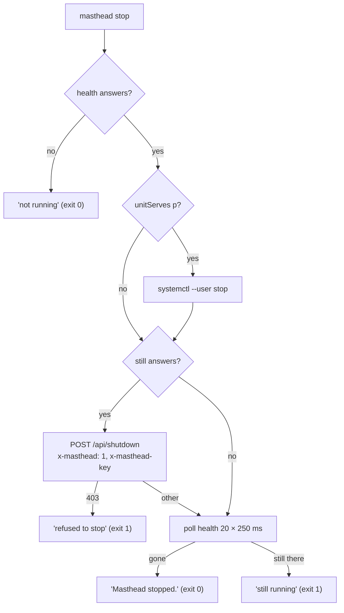

# server/main.ts

**Role:** the program's entry point and the `masthead` command. It is the `bin` in `package.json`, compiled to `dist/server/main.js`, and starts with a `#!/usr/bin/env node` line. The `~/.local/bin/masthead` script and the systemd unit written by `scripts/install.sh` both run this file. The same file is the **launcher** (start a server if needed, open the browser, report status, stop) and the **server** (`masthead serve`). The parsing it relies on is in [server/cli.ts](Source-Cli.md). How to use the command is on [Command-line launcher](Command-Line-Launcher.md); this page walks through the code.

> Checked against the 0.1.3 source. The behaviour described here is read from the code, not run (`npm test` passes).

## Imports

| From | What |
|---|---|
| `../shared/protocol.js` | `VERSION` (0.1.3 now). |
| `./app.js` | `App`, the whole application ([server/app.ts](Source-App.md)). |
| `./cli.js` | `UsageError`, `parseCommand`, `parsePort`, `unitPortFrom` ([server/cli.ts](Source-Cli.md)). |
| `./config.js` | `DEFAULT_PORT`, `SECRET_FILE`, `loadSecret`, `readSecret` ([server/config.ts](Source-Config.md)). |
| `./http.js` | `serve` ([server/http.ts](Source-Http.md)). |

## Module-level set-up

- **Warning filter.** Before anything else, `process.emitWarning` is replaced by a wrapper that drops warnings with the code `CLAUDE_SDK_CAN_USE_TOOL_SHADOWED` and passes every other warning on unchanged. The code can arrive two ways: as `code` in an options object (`emitWarning(w, {code})`) or as the third positional argument (`emitWarning(w, type, code)`); the wrapper checks both. The reason, from the code comment: Masthead approves its own tools ahead of the permission callback on purpose, so the SDK's notice about that is noise. With this filter the warning stays quiet however the file is started. `npm start`, the launcher script, the unit and the detached start in `start()` also pass `--disable-warning=CLAUDE_SDK_CAN_USE_TOOL_SHADOWED`, which does the same job.
- `here`: the folder of the running file. `webDir = here/../web`. For the compiled file that is `dist/web`, where Vite puts the built page.
- `url(p)`: `http://127.0.0.1:
`. The launcher always talks to the loopback address, never `localhost`.

## Functions

### port()

Calls `parsePort(process.argv.slice(2), process.env)`. On a `UsageError` it prints the message to stderr and exits with code 2. Any other error is re-thrown. `main()` calls it for every command, including `help` and unknown words, so a bad `--port` or `MASTHEAD_PORT` exits 2 before anything else happens. (`--help`, `-h` and `--version` are handled at the bottom of the file first; see [Entry at the bottom of the file](#entry-at-the-bottom-of-the-file).)

### health(p)

Sends `GET http://127.0.0.1:
/api/health` with a 1.5-second timeout (`AbortSignal.timeout(1500)`). It returns the reply body only if its `name` is `masthead`; otherwise null. Any failure (connection refused, timeout, a reply that is not JSON) is also null. So another program on the port is never mistaken for Masthead. It does not look at the HTTP status, and it does not send the secret: health needs none (see [server/http.ts](Source-Http.md#http-requests)).

### unitServes(p)

Runs `systemctl --user show -p LoadState -p Environment masthead.service` and returns true only if the command exits 0 **and** `unitPortFrom()` reads port `p` from its output. In words: the installed user service is the one that serves this port. If `systemctl` is missing, `spawnSync` gives a null status and the answer is false. Any port other than the unit's is "a server of its own", as the code comment says, so `masthead --port 7720` never touches the unit.

### secretOrExit()

Returns `loadSecret()`: the secret in `SECRET_FILE` (`<DATA_DIR>/secret`, normally `~/.local/share/masthead/secret`), created once if it is missing. If it can be neither read nor created, it prints `Could not read or create <file>: <reason>` and exits 1. See [Security model](Security-Model.md#4-the-local-secret).

### runServer()

`masthead serve`.

1. Reads the port (`port()`), creates the `App` (which loads settings and saved conversations; see [server/app.ts](Source-App.md)), and checks `MASTHEAD_DEV === '1'` for development mode.
2. Defines `shutdown()`. A `closing` flag makes it run once however many signals or requests arrive. It calls `app.shutdown()` (denies waiting approval requests, stops every agent, writes everything to disk) and exits with code 0 after 300 ms, so the Claude Code processes have a moment to end first.
3. Loads the secret with `secretOrExit()`.
4. Calls `serve(app, { port, webDir, secret, extraOrigins, onShutdown: shutdown })`. In development mode `extraOrigins` is `http://localhost:7718` and `http://127.0.0.1:7718`, the Vite development server; otherwise it is empty.
5. If `serve()` rejects: `EADDRINUSE` prints `Port 
 is already in use. Is Masthead already running?`; anything else prints `Could not start: <message>`. Both exit 1. (`app.shutdown()` is not called on this path; nothing has started yet.)
6. Only after the server listens does it install `SIGINT` and `SIGTERM` handlers that call `shutdown()`.
7. Prints `Masthead <version> is running at http://127.0.0.1:
`, then how to sign a browser in:
   - normal: ``Open it with `masthead` to sign the browser in.`` (with `--port 
` added when the port is not 7717);
   - development: `Development page: http://localhost:7718/?key=<secret>`. This prints the secret to the terminal (or the journal, if run under systemd with `MASTHEAD_DEV=1`).

`POST /api/shutdown` reaches the same `shutdown()` through `onShutdown`.

### start(p)

Makes sure a server answers on `p`. Returns true when one does.

1. If `health(p)` already answers, return true. Nothing is started, and nothing checks that the running server holds the same secret as this launcher.
2. If `unitServes(p)`: run `systemctl --user start masthead.service` with its output shown. Its exit status is not checked; the health polling below decides.
3. Otherwise: spawn `process.execPath --disable-warning=CLAUDE_SDK_CAN_USE_TOOL_SHADOWED <this file> serve --port 
`, `detached: true`, `stdio: 'ignore'`, and `unref()` it. That is the same Node and the same file, in its own process group, with output discarded, so it keeps running after the launcher exits. It inherits the launcher's environment (so `XDG_DATA_HOME`, `MASTHEAD_DEV` and so on carry over).
4. Poll `health(p)` up to 40 times with a 250 ms pause between tries. With a refused connection each try is quick, so this is about 10 seconds; a try that hangs can take up to 1.5 s more each (read from the code, not run).
5. Return false if it never answered. Because output was discarded, `main()` then suggests `masthead serve` to see why.

### openBrowser(target)

Finds `xdg-open` or `gio` (in that order) with `sh -c 'command -v <name>'`; the names are constants, so nothing typed by the person reaches the shell. It runs `xdg-open <target>` or `gio open <target>`, detached, output ignored, `unref()`ed. If neither exists, it prints `Open <target> in your browser.`, which includes the `?key=` part.

### main()

Reads the command with `parseCommand()` and the port with `port()`, then:

| Command | What happens | Exit |
|---|---|---|
| `serve` | `runServer()`. The process stays up. | 1 on a start error |
| `open` | See [Control flow of open](#control-flow-of-open). | 0, or 1 |
| `status` | `health(p)`. Prints `Masthead <version> is running at <url> (pid <pid>)` or `Masthead is not running.` | 0 running, 3 not |
| `stop` | See [Control flow of stop](#control-flow-of-stop). | 0, or 1 |
| `version`, `--version` | Prints `VERSION`. | 0 |
| anything else | Prints the usage text to stdout. | 0 for `help` and `--help`; 2 otherwise |

The `--version` case in the switch cannot be reached in practice: `parseCommand()` skips words that start with `-`, and the bottom of the file catches `--version` first.

## Control flow of open

1. If `webDir/index.html` does not exist: `The web page has not been built. Run: npm run build`, exit 1.
2. `start(p)`, or `Masthead did not start. Try \`masthead serve\` to see why.`, exit 1.
3. Print `Masthead is at http://127.0.0.1:
`.
4. Unless `--no-browser` is anywhere in the arguments, `openBrowser(<url>/?key=<secret>)` with `secretOrExit()`. The page stores the key in `localStorage` for that origin and removes it from the address bar (`takeKey()` in `web/src/lib/store.svelte.ts`); the server never sets a cookie. See [Security model](Security-Model.md#4-the-local-secret).

## Control flow of stop

1. If `health(p)` does not answer: `Masthead is not running.`, exit 0.
2. If `unitServes(p)`: `systemctl --user stop masthead.service`, output shown, status not checked.
3. If the server still answers (it was not the unit's, or systemd did not stop it): `POST /api/shutdown` with headers `x-masthead: 1` and `x-masthead-key: <readSecret()>` (an empty string if the file is missing or not a valid secret). A network error is ignored. A `403` prints `Masthead on port 
 refused to stop: it was started with a secret other than <SECRET_FILE> (another XDG_DATA_HOME?).` and exits 1. Any other status is not looked at.
4. Poll `health(p)` up to 20 times, 250 ms apart, until it stops answering.
5. Still answering: `Masthead is still running.`, exit 1. Otherwise `Masthead stopped.`, exit 0.

## Entry at the bottom of the file

Three cases, checked on the raw arguments before `main()`:

1. `--version` **anywhere** prints the version and nothing else runs. So `masthead stop --version` only prints the version.
2. Otherwise `--help` or `-h` anywhere replaces all the arguments with `help` and runs `main()`, which prints the usage and exits 0. `--port` is dropped too, so a bad `--port` value does not matter here; a bad `MASTHEAD_PORT` still exits 2 from `port()`. The usage text names `DEFAULT_PORT` (7717) whatever port was asked for.
3. Otherwise `main()` runs.

## Related pages

[server/cli.ts](Source-Cli.md) · [Command-line launcher](Command-Line-Launcher.md) · [server/http.ts](Source-Http.md) · [Security model](Security-Model.md) · [Installing](Source-Install-Scripts.md)
