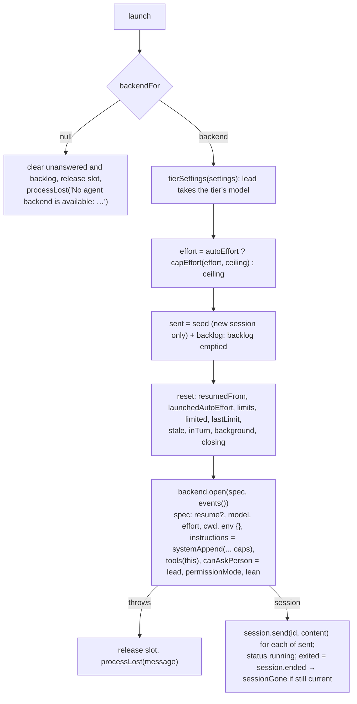

# server/runtime/agent.ts (0.2.0)

**Role:** one member of the team, on whichever backend it runs. An `Agent` owns one backend session at a time (see [Backend interface](Backend-Interface.md)), feeds it messages under ids of its own, and turns the session's neutral events into the app's view of the agent: transcript items, a live draft, a status, usage numbers and an activity line. It decides no team policy: it reports to its host (the `Conversation` in `server/core/conversation.ts`), and the core state machine (`server/core/machine.ts`) decides what an ended turn means. Nothing in this file is specific to Claude Code except the test seam `AgentHost.query` (below); the Claude Code side is in `server/backends/claude/session.ts` ([Claude Code backend](Source-Backend-Claude.md)).

In 0.1.4 a single file, `server/agent.ts`, held both the Claude Code session and this bookkeeping (`git show v0.1.4:server/agent.ts`). The rules below were carried over; the table [Every rule kept from 0.1.x](#every-rule-kept-from-01x-and-where-it-lives-now) says where each one lives now. How an agent moves through its life is on [Agent life cycle](Agent-Life-Cycle.md); statuses and holds are on [State machine](State-Machine.md).

## Types

### `AgentHost` (line 25)

What an agent needs from the conversation that owns it. `Conversation` implements it (the `// ---- AgentHost ----` section of `server/core/conversation.ts`).

| Member | Purpose | What `Conversation` does |
|---|---|---|
| `cwd` | Folder the agent works in. | The conversation's folder (`meta.cwd`). |
| `scheduler` | The shared slot scheduler ([Slot scheduling](Slot-Scheduling.md)). | The app's. |
| `settings()` | Current settings. | The app's. |
| `claudePath()` | Path to `claude`, or null. Used only to build the test-seam backend (`query`, below). | The app's. |
| `parentName(agent)` | For the system prompt. | The parent's name, or null for the lead. |
| `tools(agent)` | The team tools as neutral `ToolDef`s, bound to this agent. Built once per process, at launch. | `teamToolDefs(agent, this)`. |
| `agentChanged(agent)` | Something on `agent.info` changed. | Feeds a `Status` event to the machine when the runtime's status differs from the machine's phase, forgets messages it held for a non-live agent, passes it up. |
| `itemChanged(agent, item)`, `draftChanged(agent, draft)`, `rateLimit(notice)` | Change notifications. | Passed up to the app. |
| `askPermission(agent, ask)` | An approval or question from the backend. | Feeds `ApprovalOpened`/`ApprovalClosed` around the app's request (approval time does not count toward the run-time limit). |
| `turnEnded(agent, outcome)` | A turn finished and nothing the agent was sent is still unanswered, or the turn hit the usage limit. Also called when background work still runs. | `TurnEnded` event (`conversation.ts` line 478); reads the lead's context size; reminds or releases agents waiting for this one's answer. |
| `processLost(agent, message, usageLimit?)` | The process went away without being asked, or a start failed. | Cancels open approvals; `ProcessLost` event (`conversation.ts` line 489). |
| `backgroundIdle?(agent)` | Optional. Background work ended, the last turn is over, and no new turn started within `BACKGROUND_GRACE_MS`. | `BackgroundIdle` event (`conversation.ts` line 496). |
| `storeImage?(agent, data, mediaType)` | Optional. Stores an image from a tool result; returns `{ ref }` or `{ error }`. | Stores it as a blob of the conversation, or `{ error: 'images are not stored here' }` when the app has no store. |
| `backend?(agent)` | Optional. The backend this agent runs on, or undefined when none can be used. | `host.backend(agent.tier)`; the app looks up the tier's `backend` in its profile (`'claude-code'` when the tier names none) and the registry returns undefined for one that is not available. |
| `query?` | Optional test seam: a stand-in for the Agent SDK's `query()`. Only tests set it. | Not set. |

The doc comment on `backend?` says "undefined (or absent) means Claude Code at claudePath()". The code does not do that: see `backendFor()` below.

### `UsageLimit` (line 57)

`{ resetsAt?, backgroundStopped? }`: the usage limit stopped the agent. `resetsAt` is in ms since the epoch, if known; `backgroundStopped` is set when background commands were running and were stopped with the process.

### `TurnOutcome` (line 63)

`{ text, error?, interrupted, usageLimit? }`: what the agent said since it last took up work (the run text, below), an error if the turn failed, whether it was interrupted, and a `UsageLimit` when it failed at the usage limit.

### `Msg` (private)

`{ id, content }`: a message the runtime sent or will send. Its `id` (a random UUID) comes back in a turn's `consumed` ids.

`Content` is re-exported from `server/backends/types.ts`: a string, or an array of text and image parts.

## Constants and helpers

| Name | Line | Value / what it does |
|---|---|---|
| `TOOL_RESULT_LIMIT` | 81 | 12,000: tool results are clipped to this many characters for the transcript. |
| `DRAFT_INTERVAL_MS` | 82 | 70: the live draft is sent at most this often. |
| `RUN_TEXT_TURNS`, `RUN_TEXT_CHARS` | 84, 85 | 8 turns and 60,000 characters: the most a run text keeps. |
| `BACKGROUND_GRACE_MS` (exported) | 91 | 3,000: how long to wait, after the last background command ends, for the turn the backend starts by itself. The comment records that with Claude Code 2.1.331 `init` followed the empty `background_tasks_changed` within 0.1 s. |
| `clip(text, limit)` (exported) | 93 | Cuts text and appends "… (N more characters not shown)". |
| `describeTool(name, input)` (exported) | 98 | One line for the activity display: `toolLine(name, input, true)` from [shared/toolline.ts](Source-Shared-Toolline.md), verb and target joined, cut to 90 characters. |

## `class Agent` (line 113)

### Public state

- `info: AgentInfo` (read-only reference; its fields are changed in place and broadcast through `agentChanged`).
- `sessionId`: the backend's session id, set from the `sessionStarted` event; null before the first session and after a fresh-session retry.
- `owesReport`: whether it owes its parent a report when it next finishes. The conversation copies it into and out of the machine's state on every event.
- `lastText`: the run text of its most recent run (given to the machine as `ctx.lastText`, used when a parent settles a child that ended without a report).

### Private state

| Field | Meaning |
|---|---|
| `session` | The backend `Session` of the running process, or null. |
| `starting` | A slot request or launch is in progress. |
| `backlog` | Messages accepted while no usable process exists; handed to the next process. |
| `unanswered` | Ids of messages sent to the session that no finished turn has consumed. |
| `seed` | The first message of a brand-new session (a sub-agent's task); dropped once a session id is known. |
| `closing` | Masthead asked the process to end, so its end is not a crash. Stays true for a finished agent. |
| `exited` | Settles when the current process has fully exited (`session.ended`); a new launch waits for it. |
| `costBefore` | Cost of earlier processes; the backend reports `costUsd` per session process. |
| `openTools` | Tool items waiting for their result, by tool id. |
| `draft`, `draftTimer` | The block being streamed and its throttle timer. |
| `runTexts`, `runTextsCut` | Final texts of the turns of the current run, and whether older ones were dropped. |
| `generation` | Increased by `end()` and `dispose()`; a start waiting for a slot or for the old process checks it. |
| `sent` | Everything put into the current process, so unanswered messages can be sent again (fresh session, usage limit). |
| `resumedFrom` | The session the current process was asked to resume, if any. |
| `freshRetried` | A fresh session was already tried after a missing one; there is never a second try. |
| `background` | Ids of the background tasks the current process reports as running (replace semantics). |
| `idleTimer` | The `BACKGROUND_GRACE_MS` timer. |
| `inTurn` | Between the first sign of a turn and its result. |
| `launchedAutoEffort` | The `autoEffort` setting the current process's tools were built with. |
| `stale` | The running process cannot take a settings change; relaunch it before its next turn. |
| `limits` | The latest rate-limit notice of each window this process reported (keyed by `type`). |
| `held` | Content of messages a usage-limit turn or loss never answered; sent again first by the next `deliver()`. |
| `limited` | This process hit the usage limit; its later results only repeat that. |
| `lastLimit` | The usage limit this process last reported. |

### Getters

`id`, `name`, `tier`, `status` (from `info`); `live` (status `queued`, `running` or `waiting`); `hasProcess` (`session !== null`); `pendingSeed` (the task text of an agent whose session has not started yet, otherwise null; the conversation saves it so the task survives a restart); `hasBackgroundWork` (`background` is not empty); `busy` (something unanswered, or a start in progress).

### Public methods

| Method | Line | What it does |
|---|---|---|
| `constructor(info, host, opts)` | 181 | `opts`: `sessionId`, `owesReport`, `seed` (default none/false). Sets `costBefore` from the saved usage, so cost keeps adding up across restarts. The conversation creates every agent (create, restore, spawn). |
| `setStatus(status, error?)` | 223 | Sets status and error; clears the activity line unless `running`; sets `endedAt` for done/failed/stopped and clears it otherwise; calls `agentChanged` only if something changed. |
| `addItem(item)` | 233 | Gives a `NewItem` an id (unless it has one) and a timestamp, and passes it to `itemChanged`. |
| `start()` | 240 | `ensureProcess()`. |
| `deliver(content)` | 245 | Clears `limited`. Builds the messages to send: the `held` ones first (each under a new id), then this one, all added to `unanswered`. If the process is `stale` and the agent is between turns (nothing unanswered before this call, no turn running, no background work), closes it gracefully, marks `closing`, puts the messages in `backlog` and calls `ensureProcess()`. Otherwise, with a usable process, sends each one into it, keeps it in `sent` and sets `running`; with none, adds them to `backlog` and calls `ensureProcess()`. |
| `dropHeld()` | 274 | Forgets the held messages. Called by `end()`, `dispose()` and the conversation's `dropHeld` effect. |
| `static imageContent(text, images)` | 278 | Plain text, or image parts followed by a text part. |
| `currentDraft()` | 696 | The current draft, for `{t:'items'}` replies. |
| `interrupt()` | 706 | If there is a session and the status is `running`, `session.interrupt()`. Keeps the process and session. |
| `end(status, error?)` | 715 | Cancels a queued slot request, increases `generation`, clears `starting`, marks `closing`, clears backlog, unanswered and run texts, drops held messages, clears `limited`, closes the session (`graceful` for `done` with no background work; `now` for `stopped`, `failed`, or `done` while background commands run), clears the background set, releases the slot, sets the status. |
| `dispose()` | 735 | Like `end()` but always closes at once and leaves the status alone. Used by `Conversation.shutdown()` for agents that are not live sub-agents (the lead and finished agents). |
| `setEffort(level)` | 751 | Sets `info.effort`, broadcasts, and calls `session.setEffort(level)` on a running session; if that throws or rejects (and the session is still the same), the process is marked `stale`. |
| `applySettings(settings)` | 772 | Only with a usable process (`launch()` reads settings anyway). Effort: the agent's level capped at the tier's ceiling with `autoEffort`, else the tier's level, through `setEffort()`. Lead only: a changed model is set on `info` and sent with `session.setModel`; no `setModel`, or a rejection, marks `stale`. A change of `autoEffort` since launch marks `stale` (tools are built at launch). Called by `Conversation.settingsChanged()`. |
| `refreshContext()` | 795 | If the session has `contextUsage`, reads `{ used, max }` into `usage.context`/`contextMax` (ignored if the session changed meanwhile or the call fails). |

### Private methods

| Method | Line | What it does |
|---|---|---|
| `userMessage(content)` | 283 | Wraps content as a `Msg` with a fresh id and adds the id to `unanswered`. Every message goes through it, so the unanswered rule sees all of them. |
| `ensureProcess()` | 289 | Returns if a start is in progress or a usable process exists. Sets `starting`, notes `generation`, asks the scheduler for a slot (owner = parent id, or the conversation id for the lead), shows `queued` only if the slot was not granted by the next microtask, then waits for `exited`. If the generation changed meanwhile, gives the slot back (unless a newer start or a session now holds it) and does not launch. Otherwise `launch()`; an exception becomes `processLost`. A refused slot: `SlotCancelled` is dropped quietly, anything else (e.g. `TierOff`) goes to `processLost`. |
| `backendFor()` | 329 | `host.backend?.(this)`; if that gives nothing and `host.query` is set (tests), a `ClaudeBackend` with that `query` and `claudePath()`; otherwise null. There is no silent default. |
| `launch()` | 337 | See below. |
| `events()` | 407 | The `SessionEvents` given to `backend.open()`; see the table below. |
| `onSessionStarted(id)` | 450 | Clears `freshRetried`; a new id is stored, the seed dropped and the change broadcast. |
| `tierSettings(settings)` | 460 | `findTier(settings, tier)` from the profiles; if the profiles do not list the tier, the 0.1.x `settings.tiers` view, with `lean` from `leanSubagents` (sonnet, haiku) and `leanOpus` (opus). |
| `onDraft(d)` | 468 | `null` ends the draft; `append: ''` starts a new block (clears the activity line, empty draft sent now); text of the same kind is appended (throttled); a different kind starts a new draft. |
| `onUsage(u)` | 478 | Adds `output`, sets `context`, sets `costUsd` to `costBefore + u.costUsd`. |
| `sessionGone()` | 486 | Clean-up when a session ends either way: no session, cost carried forward, draft cleared, open tools closed, `inTurn` off, background cleared. |
| `onExited(r)` | 496 | The `exited` event: see [Every rule](#every-rule-kept-from-01x-and-where-it-lives-now) (fresh session, usage limit, process lost). |
| `startFresh()` | 515 | Once per missing session: forgets session and seed, adds the info notice, launches with a note to the agent, the unanswered messages from `sent`, then the backlog. |
| `handleResult(r)` | 534 | The `turnEnded` event: consumed ids, usage limit, run text, `turnEnded` to the host. |
| `usageLimitFor(error, apiError)` | 600 | The usage-limit rule. |
| `holdUnanswered()` | 611 | Moves the content of every message in `sent` that is still unanswered into `held`. |
| `addRunText(text)`, `runText()`, `clearRunTexts()` | 616, 626 | The run text. |
| `turnStarted()` | 636 | `idle`/`waiting` → `running` unless `info.pausedUntil` is set; sets `inTurn`; cancels the grace timer. |
| `backgroundChanged(ids)`, `clearBackground()`, `checkIdleSoon()` | 645, 653, 664 | The background set and its grace timer. |
| `setActivity(text)` | 675 | Sets and broadcasts the activity line. |
| `setDraft(draft, now)` | 681 | Sends at once when `now`, otherwise at most once per `DRAFT_INTERVAL_MS`. |
| `closeOpenTools()` | 700 | Marks every tool item still waiting for a result as done. |

### `launch()` in detail

- `lean` is the tier's `lean` flag, never for the lead.
- `instructions` is `systemAppend()` from `server/core/prompts.ts`, given the effort the agent launches at and the backend's `efforts`, `background` and `midTurnDelivery` caps, so the prompt names only what the backend can do.
- A backend's `open()` should not throw for an ordinary failure (it reports `exited({ failure })`); the catch is for the rest.

### Events from the session

| Event | What the runtime does |
|---|---|
| `sessionStarted(id)` | `onSessionStarted`. |
| `turnStarted()` | `turnStarted()`. |
| `text(final, isError)` | A `text` item, or an error notice when `isError`. |
| `thinking(text)` | A `thinking` item. |
| `draft(d)` | `onDraft`. |
| `toolStarted(t)` | A `tool` item with id `tool-<id>`, kept in `openTools`; activity line from `describeTool()`. |
| `toolFinished(t)` | The tool item done, result clipped to 12,000 characters. Images go to `host.storeImage`; the refs are put on the item, a failure is written into the result next to `[image]`. When no tool is open any more, the activity line is cleared. |
| `turnEnded(r)` | `handleResult`. |
| `rateLimit(n)` | Passed to the host and kept in `limits` by window. |
| `background(ids)` | `backgroundChanged`. |
| `usage(u)` | `onUsage`. |
| `exited(r)` | `onExited`. |
| `askPermission(ask)` | `host.askPermission`. |
| `compacted()` | Info notice "Earlier context was summarized to free up space." |
| `activity(text)` | Activity line. |

## Compaction: `compact()`

`compact(): Promise<{ ok, error? }>` compacts the agent's memory for the team's compact step ([Compact team](Compact-Team.md)). It refuses (`ok: false`) while the agent is in a turn, has unanswered input or is starting; returns `ok: true` with nothing to do for an agent that never had a session; and returns the same promise to a second caller. An agent without a process has its session resumed quietly: `launch()` sends nothing and sets no status (so a finished agent stays done), holds a slot meanwhile, and `closeQuietly()` closes it and gives the slot back afterwards. Messages delivered during compaction wait in the backlog and are delivered afterwards. It is not a turn: no `turnEnded`, no turn counted, `lastText` and the report debt unchanged; the context size is read again afterwards. Tested on the fake backend and live on Claude Code (`test/compact.live.ts`, Haiku, 2026-11-28: passed).

## Every rule kept from 0.1.x and where it lives now

"Runtime" is `server/runtime/agent.ts`; "Claude adapter" is `server/backends/claude/session.ts`; "machine" is `server/core/machine.ts` with its shell `server/core/conversation.ts`.

| Rule | Runtime | Claude adapter | Machine / conversation |
|---|---|---|---|
| **Unanswered / consumed ids.** Every message has an id in `unanswered`; a turn is over for the agent only when nothing is unanswered. `consumed: [...]` removes those ids; `[]` (a turn the backend started by itself) removes none; `null` (cannot tell) clears all, so an agent never stays busy for ever. | `userMessage()`, `handleResult()` (line 534). | `result()` (line 441) builds `consumed` from `user_message_uuids` or `user_message_uuid`; a result naming none gives `[]` if this process named one before (`namesConsumed`, also set by an assistant message's `user_message_uuid`), else `null` (line 453). | Reads `agent.busy` as `ctx.busy`. |
| **Backlog and seed.** Messages accepted with no usable process wait in `backlog`; a new session gets the seed first. The seed is dropped once the session id is known and saved as `pendingSeed` until then. | `deliver()`, `launch()`, `onSessionStarted()`. | — | The conversation saves `pendingSeed`. |
| **Generation ghost-start guard.** A start waiting for a slot or the old process's exit is dropped if `end()`/`dispose()` ran meanwhile; the slot is given back unless a newer start holds it. | `ensureProcess()` (line 289), `end()`, `dispose()`. | — | — |
| **Wait for the old process before a resume.** | `exited` from `session.ended`; `ensureProcess()` waits for it. | `ended` settles when `consume()` finishes (line 300). | — |
| **Fresh session once on a missing session.** Only for a resume that ended before the session started and whose output names the missing session; never twice in a row; the flag clears when a session starts. Re-sends a note, the unanswered messages, the backlog. | `onExited()` → `startFresh()` (line 515). | Decides `sessionMissing` (line 312): `spec.resume`, no `init` seen, and `MISSING_SESSION` (line 57) in the failure, the stderr tail, or a result set aside before `init` (`missingSaid`, line 406). | — |
| **Stale relaunch between turns.** Set by an `autoEffort` switch since launch, a failed `setModel`/no `setModel`, or a failed `setEffort`. Acted on only by `deliver()` between turns; the old process closes gracefully and the same session resumes, keeping the slot. Never mid-turn. | `applySettings()`, `setEffort()`, `deliver()`. | `setEffort` → `applyFlagSettings({ effortLevel })` (line 274); `setModel` → `Query.setModel` (line 278). | `settingsChanged()` calls `applySettings()`. |
| **Held messages at a usage limit.** The process is closed (`now`) *before* `turnEnded`, so anything the host delivers from inside it goes to a new process. Only unconsumed messages are held (the consumed one is in the session with the error). Held messages go first, under new ids, on the next `deliver()`. A late result from the closed process is reported with `usageLimit` too. `end()`/`dispose()`/`dropHeld()` forget them. A process lost at the limit holds the same way. | `handleResult()`, `onExited()`, `holdUnanswered()`, `dropHeld()`. | — | The machine pauses (`pause()`, line 216): `releaseSlot`, `pauseRuntime`; the conversation keeps its own `held` list for messages delivered *during* the pause (`deliverTo()`, line 629) and delivers it on `resumeRuntime` (line 591); `Stop` emits `dropHeld` (line 587). |
| **Usage-limit rule.** Only if the latest notice of some window this process reported is `rejected` **and** `apiError` is `rate_limit` or the error text matches `rate[ _]limit`, `usage limit`, `limit reached` or `hit your limit`. Never for an interrupted turn. `resetsAt` arrives in seconds and is turned into ms. | `usageLimitFor()` (line 600). | Reports `rateLimit` per window (`unifiedWindows`, read defensively) and `apiError` from the assistant message's `error`. | Pause, give up after the 4th window in a row ([State machine](State-Machine.md) rows 11, 11a). |
| **Run texts.** The outcome text is every turn's final text since the agent last took up work, oldest first, joined by blank lines, a repeat of the previous one not added. At most 8 texts and 60,000 characters (the newest always kept); then it starts with "(earlier text not shown)". Emptied when the outcome is sent unless background work runs, and by `end()`, `dispose()`, a lost process and a failed fresh start. | `addRunText()`, `runText()`, `clearRunTexts()`. | `turnEnded.text` prefers the result string over the last text block. | Uses `text` and `lastText`. |
| **Background set, 3 s grace, `backgroundIdle`.** The set is per process and replaced on each event; emptied when a process starts or ends and by `end()`/`dispose()`. When it empties, a 3 s timer calls `host.backgroundIdle` only if the same session is open, not closing, not in a turn, not busy and with no background work. `end('done')` with background work closes at once. | `backgroundChanged()`, `checkIdleSoon()`, `end()`. | Non-ambient task ids from `system/background_tasks_changed`. | `holds.background` read fresh; `BackgroundIdle` (row 19); 10-minute background cap (row 22). |
| **`turnStarted` moves `idle`/`waiting` to `running`** unless `info.pausedUntil` is set. | `turnStarted()` (line 636). | Sent on `init`, every stream event and every assistant message. | `Status` event (line 415): ignored while a pause holds the agent. |
| **Draft throttle.** 70 ms; `append: ''` starts a block and clears the activity line. | `onDraft()`, `setDraft()`. | `content_block_start` (text or thinking) → `append: ''`; deltas → appends; an assistant message → `null`. | — |
| **Tool results** clipped to 12,000 characters; images through `host.storeImage`. | `toolFinished` handler. | `toolResultText()` (images as `[image]`) and base64 image parts. | `storeImage` stores a blob. |
| **Context size at every turn end** (read while the process is still up). | `handleResult()` calls `refreshContext()` (line 590) for every agent, before `turnEnded`. | `contextUsage()` → `Query.getContextUsage()`. | `turnEnded()` calls it again for the lead (line 484). |
| **Tiers read with `findTier`**, falling back to the 0.1.x `tiers` view. | `tierSettings()` (line 460). | — | — |
| **System text with the backend's caps.** | `launch()`: `systemAppend({ …, caps })`. | Appended to the `claude_code` preset. | `server/core/prompts.ts`. |
| **Backend choice.** No silent default: no backend → the agent fails with "No agent backend is available: the program this tier runs on was not found on this machine." `host.query` is only a test seam. | `backendFor()` (line 329), `launch()`. | — | `backend(agent)` (line 433) → the app's registry. |
| **Neutral texts.** Notices and errors written by the runtime name no CLI ("the program this tier runs on", "The agent process ended unexpectedly."). | `launch()`, `onExited()`. | — | — |

Not in the runtime any more (now in the Claude adapter): the `Channel` input stream, `DISALLOWED` tools, `STDERR_KEEP`, `toolResultText`, the SDK `Options`, the `[ede_diagnostic]` filter and the interrupted flag.

## Points to be aware of

- The `AgentHost.backend?` doc comment (line 51) still says an undefined backend means Claude Code at `claudePath()`; the code fails the agent instead unless `host.query` is set.
- With `BackendCaps.midTurnDelivery` false, a message delivered during a turn is kept in `afterTurn` (still unanswered, so the agent stays busy) and sent when that turn's result arrives, before the run's end is decided; the next turn is part of the same run. `caps.consumedIds` is not read by the runtime (a `null` from the backend is enough).
- For the lead the context size is read twice per turn end (`handleResult()` and `Conversation.turnEnded()`); harmless.
- If `launch()` threw after `backend.open()` succeeded, the catch in `ensureProcess()` would drop the session without closing it. Nothing after `open()` is expected to throw.

## Tests

`test/agent.test.ts` (30 tests, all passing on 2026-11-27): the `agent:` tests drive this runtime through `ClaudeBackend` with a fake `query` (the `AgentHost.query` seam); the `runtime on fake:` tests drive it on the fake backend ([Fake backend](Source-Backend-Fake.md)). What was checked against a real Claude Code is listed on [Agent life cycle](Agent-Life-Cycle.md#checked-against-a-real-claude-code).

## Related pages

[Agent life cycle](Agent-Life-Cycle.md) · [State machine](State-Machine.md) · [server/core/machine.ts](Source-Core-Machine.md) · [server/core/conversation.ts](Source-Core-Conversation.md) · [Backend interface](Backend-Interface.md) · [Claude Code backend](Source-Backend-Claude.md) · [Fake backend](Source-Backend-Fake.md) · [Permissions and questions](Permissions-and-Questions.md)
