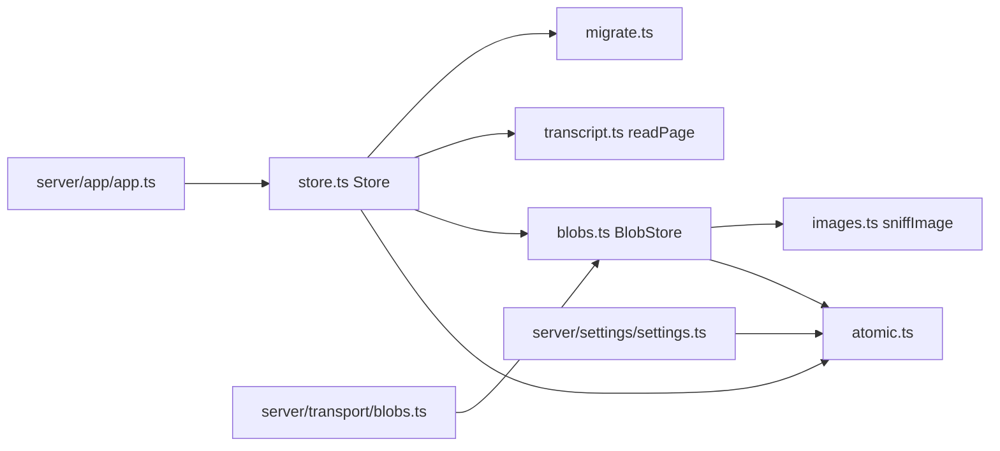

# server/storage/

**Role:** everything Masthead writes under its data folder: conversations and their transcripts (`store.ts`), paged reading of a transcript (`transcript.ts`), image files (`blobs.ts`, `images.ts`), file-format versions (`migrate.ts`) and crash-safe writes (`atomic.ts`). The layout on disk is described on [Storage on disk](Storage-on-Disk.md). This page goes through the code file by file.

## store.ts

### Types

- `StoredAgent`: `info` (the whole `AgentInfo`), `sessionId` (the backend session to resume, or null), `owesReport`, and `seed?` (the task of an agent that never got to start, so a later wake-up still has it).
- `StoredConversation`: `format?` (absent in 0.1.x files, which are format 1; always written as `FORMAT`), `meta` (`ConversationMeta`, including `profileId` since 0.2.0), `agents`, `stoppedByPerson?` and `agentMessages?` (both since 0.1.4).

### Ids

`SAFE_ID` = `/^[A-Za-z0-9_-]{1,64}$/`. `assertId()` throws `bad id: <id>` for any conversation or agent id that does not match, so a crafted id cannot point outside the conversations folder.

### `class Store`

- **`constructor(root = CONVERSATIONS_DIR)`**: creates `root` (mode `0700`) and its `BlobStore`, then writes the whole-store format marker. The marker is `<root>/../format` when `root` is named `conversations` (the normal data folder). Otherwise, as with a test store in a temporary folder, it is `<root>/.format`. The marker holds `2` and a newline. It is only ever raised: it is written (with `writeFileAtomic`) when it is missing, unreadable or below `FORMAT`, and a marker from a newer Masthead is left as it is. A read-only data folder still loads, because a failed write is ignored.
- **`loadAll()`**: reads every folder whose name matches `SAFE_ID`. A conversation is skipped silently when its `conversation.json` does not parse, when its `meta.id` does not match the folder name, or when `agents` is not an array. Each file goes through `migrateConversation()`. A `null` result means a newer Masthead wrote the file, and it is left alone and not loaded. A file from an older format is remembered in `needsBackup`.
- **`saveConversation(conv)`**: creates `<id>/items/`. For a conversation in `needsBackup`, it first copies the old file to `conversation.json.v1.bak`, unless that backup already exists. It then writes `{ ...conv, format: FORMAT }` as compact JSON with `writeFileAtomic`.
- **`appendItem(convId, agentId, item)`**: drops the `input` of a finished tool (`withoutRepeatedInput()`, below; the tool's start line already has it), then appends `JSON.stringify(item)` and a newline to `items/<agent>.jsonl` (mode `0600`). The first append to a file in a run checks whether the file ends without a newline (a line torn by a crash, `endsWithoutNewline()`); if so it writes a newline first, so the new item does not join the torn line. If the append fails, it creates the folder and tries once more.
- **`hasTornLine(convId)`**: whether any `items/*.jsonl` of the conversation has a non-empty line that does not parse.
- **`loadItems(convId, agentId)`**: reads the whole transcript. The last line for an id wins, and the item keeps the position where its id first appeared (a `Map` keeps a key's place when it is set again). A finished tool line without `input` gets the input of the earlier line (`mergeLines(had, item)`). Lines that do not parse, such as a torn last line after a crash, are skipped. A missing file gives `[]`.
- **`readItems(convId, agentId, { before, limit })`**: one page, from `readPage()` (below).
- **`referencedBlobs(convId)`**: the set of blob hashes that any item in any of the conversation's transcripts refers to (`blobsOf`).
- **`collectBlobs(convId)`**: `blobs.collect(convId, referencedBlobs(convId))`, which removes images that no item refers to. When `hasTornLine(convId)` is true it removes nothing and returns 0, logging once per conversation, because a damaged line may have lost a reference. `App`'s constructor runs it for every conversation it loads.
- **`deleteConversation(convId)`**: removes the conversation's whole folder (transcripts and images) with `rmSync(..., { recursive, force, maxRetries: 5, retryDelay: 100 })`. The retries cover Windows, where a file that is still open somewhere else blocks removal for a moment.

## transcript.ts

Three helpers handle finished tools, which are stored without their input since 0.2.1:

- `withoutRepeatedInput(item)`: a `tool` item with `done: true` and an `input` comes back without `input`; anything else unchanged.
- `lacksInput(item)`: true for a `tool` line with `done: true` and no `input` key.
- `mergeLines(older, newer)`: `newer`, plus `older.input` when `newer` lacks its input and `older` has one.

`readPage<T extends { id: string }>(file, { before, limit })` returns `Page<T>`: `items` (oldest first within the page), `cursor` (a byte offset to pass as `before` for the next older page, or null) and `more`.

How it works:

- It reads the file **backwards** in 64 KiB chunks (`CHUNK`), starting at `before` (or the end of the file). It never reads the whole file. A line that starts in an earlier chunk is carried over until that chunk has been read.
- It walks complete lines from the back. Blank lines, lines that do not parse and lines without a string `id` are skipped.
- It collects up to `limit` **distinct** ids. When an id is seen again (an older line for the same item), the version already held is kept. That is the newer one, because the scan runs backwards. The item's position moves to the older line, so the item keeps its place in transcript order.
- An older line for an id already held is merged into it with `mergeLines()`, so a finished tool on the page gets its input back. Ids still lacking input are kept in `needInput`.
- When a new id would go past `limit`, the cursor is set to the end of that line (`cutoff`), so the next page starts there, and `more` is true. If no item on the page still needs its input it returns at once; otherwise it scans on past the page's start only to merge inputs into items already on the page, and returns as soon as none is missing (or at the start of the file). The page and its cursor are not changed by that extra scan.
- The page is sorted by position. A missing file gives an empty page.

An item updated after an older page boundary may also show up in an older page, as an older version. The doc comment tells the reader to keep the copy it already holds.

The page asks with `{t:'items', limit}`. `App` clamps `limit` to 1–500. Without `limit`, `App` sends the whole transcript from `loadItems` (protocol version 1 behaviour). `App` also reads the newest item of each agent (`readItems(..., { limit: 1 })`) for the snapshot a subscribing page receives.

## blobs.ts

Image files of one conversation are stored at `<conversation>/blobs/<sha256>.<ext>`, named by the hash of their bytes, so the same image is stored only once.

### Limits

| Constant | Value |
|---|---|
| `MAX_BLOB_BYTES` | 5 MB per image |
| `MAX_MESSAGE_IMAGE_BYTES` | 30 MB per message (exported, but nothing in `server/` uses it) |
| `MAX_CONVERSATION_BLOB_BYTES` | 500 MB per conversation |
| `MAX_SIDE` | 8192 pixels a side |
| `MAX_PIXELS` | 40 000 000 |

`BlobError` carries a `code`: `too_large`, `invalid` or `not_found`.

### `class BlobStore(root)`

`root` is the conversations folder.

- **`put(convId, bytes, declared?)`**: checks the image and stores it. It refuses an empty image ("The image is empty."), an image over 5 MB ("An image may be at most 5 MB."), a type other than PNG, JPEG, GIF or WebP ("Only PNG, JPEG, GIF and WebP images can be stored."), a declared type that differs from the type sniffed from the bytes, an image too large in pixels, and a new file that would take the conversation past 500 MB ("This conversation has reached its 500 MB of images."). The bytes go to a hidden temporary file (`.<hash>.<random>.tmp`, mode `0600`), which is then renamed into place with `renameRetry`. It returns a `BlobRef`: `{ blob, mediaType, w, h, bytes }`.
- **`find(convId, hash)`**: `{ file, mediaType }` or null. It looks up only names Masthead itself writes (a safe id and a 64-character hex hash) and tries each of the four extensions.
- **`total(convId)`**: the bytes used by the conversation's blobs.
- **`collect(convId, referenced)`**: deletes each blob whose hash is not in `referenced` and returns how many it deleted.

`blobsOf(item)`: the valid hashes in `item.images` (a `user` item's attachments, a `tool` item's result images). A 0.1.x `user` item, whose `images` is a count, gives `[]`.

The HTTP routes `POST /blob?conv=<id>` and `GET /blob/<convId>/<hash>?t=<token>` are in `server/transport/blobs.ts` ([Security model](Security-Model.md)).

## images.ts

`sniffImage(bytes)`: the image's type and size, read from its header bytes without any native library. It returns null unless the bytes are clearly PNG (signature plus `IHDR`), JPEG (it walks the markers to the first start-of-frame, skipping `C4`, `C8` and `CC`), GIF (`GIF87a`/`GIF89a`) or WebP (`VP8 `, `VP8L` or `VP8X`), with a width and height of at least 1. `EXT` and `TYPE_OF_EXT` map types to the file extensions `png`, `jpg`, `gif` and `webp`.

## migrate.ts

- `FORMAT = 2`: the current `conversation.json` format.
- `Migrated<T>`: `{ value, from }`.
- `migrateConversation(raw)` returns `{ value, from }`, or `null` when `raw.format` is above `FORMAT`. A file without `format` counts as format 1. Formats 1 and 2 have the same shape, so the 1 → 2 step only stamps `format: 2`. Each later format is to add one step here. `from < FORMAT` tells `Store` to back up the file before it rewrites it.

`core.md` also planned adding `profileId: 'claude'` and a tier snapshot in this step. The code does not do that. A conversation without `meta.profileId` is simply treated as a `claude` conversation, because its agents' tier ids (`lead`, `opus`, …) belong to the claude profile.

## atomic.ts

- `writeFileAtomic(path, data)`: creates the folder (mode `0700`), writes `<path>.<pid>.tmp` (mode `0600`), then renames it over `path`. A crash leaves either the old file or the new one, never half of one. Used for `settings.json`, `conversation.json` and the format marker.
- `renameRetry(from, to, platform, rename)`: a plain rename. On Windows only, an `EPERM`, `EBUSY` or `EACCES` error (another program, such as antivirus or the search indexer, briefly holding the target) is retried, up to ten tries in all, waiting 20 ms × attempt between tries (about a second in all).

## Not in the code

`core.md` (section 6) also planned transcript **compaction** (rewriting a `.jsonl` file that holds more than twice as many lines as distinct ids) and optional `items/<agent>.idx` offset files. Neither exists in `server/storage/` today: transcripts only grow, and paging always scans from the end.

Written from the code; `test/storage.test.ts` (13 tests) passed on 2026-11-27. Tests: `test/storage.test.ts`, `test/storage-wiring.test.ts`.

## Related pages

[Storage on disk](Storage-on-Disk.md) · [Settings code](Source-Settings.md) · [Browser/server protocol](Browser-Server-Protocol.md) · [Security model](Security-Model.md)
