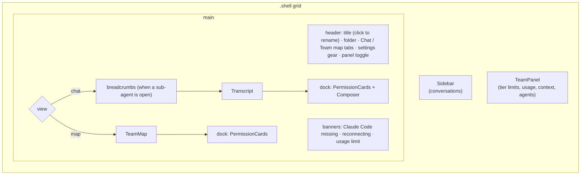

# Web front end

The page you use in the browser. It is a **Svelte 5** app in `web/`, built by Vite into `dist/web/` and served by the Masthead server. **Svelte** is a framework that compiles components (`.svelte` files holding markup, script and style together) into plain JavaScript. Svelte 5 uses **runes** to mark reactive state: `$state` (a value the page redraws when it changes), `$derived` (a value computed from others) and `$effect` (code that reruns when what it reads changes).

The page holds no authority. Everything it shows comes from the server over one WebSocket, and everything it does is a protocol message ([Browser/server protocol](Browser-Server-Protocol.md)). This page describes version 0.1.3.

## Signing in

The page itself holds no secret and is served to anyone who may reach the server; the socket is what needs a key. `masthead` opens `http://127.0.0.1:PORT/?key=<secret>`. On load the store saves that key in `localStorage` under `masthead.key` and removes it from the address bar with `history.replaceState`, so it is not left in history or bookmarks. The socket is then opened with the subprotocols `masthead` and `key.<secret>`; the server checks the key and answers with plain `masthead`.

- **No stored key:** the page does not try to connect. It shows a full-page message: "Open Masthead with the `masthead` command (or its launcher entry) to sign this browser in."
- **Refused:** if the socket closes three times in a row without ever opening, the same message appears with a note that a key from an earlier start no longer works, and a **Try again** button. A drop after a socket did open keeps the normal reconnect.

## Files

| File | Role |
|---|---|
| `web/index.html` | The page shell (below). |
| `web/src/main.ts` | The entry script (below). |
| `web/src/App.svelte` | The layout and header (below). |
| `web/src/app.css` | Global styles: colour tokens for light and dark, tier colours, status dots, buttons, Markdown styles. See [web/src/app.css](Source-Web-Styles.md). |
| `web/src/lib/store.svelte.ts` | The single store: connection, all state, every protocol message. See [Web store](Source-Web-Store.md). |
| `web/src/lib/Sidebar.svelte`, `Transcript.svelte`, `Composer.svelte`, `FolderPicker.svelte`, `PermissionCard.svelte`, `TeamPanel.svelte`, `TeamMap.svelte`, `SettingsMenu.svelte`, `StopControl.svelte` | The components. See [Web components](Source-Web-Components.md). |
| `web/src/lib/markdown.ts` | Safe Markdown rendering (below). |
| `web/src/lib/tools.ts` | Re-exports `toolLine` and the `ToolLine` type from `shared/toolline.ts` (below). |
| `web/public/favicon.svg` | The tab icon, copied as-is into the build. |

## The page shell (`index.html`)

`web/index.html` is 14 lines. It holds:

- `<meta charset="utf-8">` and a `viewport` tag (`width=device-width, initial-scale=1`) so the page fits a narrow window.
- `<meta name="color-scheme" content="light dark">`. This tells the browser the page supports both schemes, so built-in parts (scroll bars, form controls, the blank page before the CSS loads) follow the system setting. The colours themselves switch in `app.css` ([web/src/app.css](Source-Web-Styles.md#light-and-dark)).
- The title "Masthead" (`App.svelte` replaces it once a conversation is open) and the favicon `/favicon.svg`.
- An empty `
` and one module script, `/src/main.ts`. Vite rewrites this tag to the built, hashed bundle when building.

There is no inline script or inline style and no Content-Security-Policy `<meta>` tag. The policy is sent as an HTTP header by the server instead (`CSP` in `server/http.ts`; see [Security model](Security-Model.md)). It allows scripts only from the server itself, which is why the page has no inline script. It allows inline styles (`style-src 'self' 'unsafe-inline'`), which Svelte and highlight.js may need. Images may come only from the server, `data:` or `blob:`.

## The entry script (`main.ts`)

`web/src/main.ts` is 6 lines and exports nothing. It:

1. imports `app.css`, so the global styles load once for the whole page;
2. imports highlight.js's `github-dark.min.css`, the colours for highlighted code. A dark theme is used in both light and dark mode because code blocks always have a dark background (`--code-bg`);
3. calls Svelte 5's `mount(App, { target: document.getElementById('app')! })`.

It does not connect to the server. `App.svelte` does that in `onMount` by calling `store.connect()`.

## `tools.ts`

`web/src/lib/tools.ts` is one line: `export { toolLine, type ToolLine } from '../../../shared/toolline.ts'`. It keeps no state. It exists so components import tool wording from `./tools.ts` instead of reaching into `shared/` themselves. `toolLine` is used by `Transcript.svelte` (tool lines in a chat), `TeamMap.svelte` (what each card is doing) and `PermissionCard.svelte` (the approval card). Nothing in `web/src` imports the `ToolLine` type at present. See [shared/toolline.ts](Source-Shared-Toolline.md) for what it returns.

## Layout (`App.svelte`)

`App.svelte` is the root component. It keeps four pieces of local state: `showSidebar` and `showPanel` (whether each side column is shown), `renaming` (whether the title is being edited) and `titleDraft` (the text in the rename box). Everything else comes from `store` ([Web store](Source-Web-Store.md)). It also derives `path`: when the open agent is not the lead, `store.pathTo(id)` gives the chain from the lead down to it, for the breadcrumbs.

### Signed-out screen

If `store.signedOut` is set, `App.svelte` shows only a centred box and none of the layout below. The box has the heading "Masthead" and the line asking the person to open Masthead with the `masthead` command. When `store.signedOut` is `'refused'` it adds the note about an old key and a **Try again** button that calls `store.retryConnect()`. See [Signing in](#signing-in).

### Signed-in layout

- **Grid:** `.shell` is a CSS grid of three columns: sidebar 264 px, main area `minmax(0, 1fr)`, team panel 316 px. The classes `no-sidebar` and `no-panel` drop a column. On mount, the panel starts hidden below 1100 px of window width and the sidebar below 760 px (checked once, not on resize). Below 900 px the grid has one column and both side columns (`aside`) become fixed overlays with a shadow, the team panel on the right. Hiding the sidebar shows a ☰ button in the header; the ◧ button toggles the panel. (Layout not re-checked in a browser for 0.1.3.)
- **`onMount`** calls `store.connect()` and listens for `hashchange`: when the hash is `#/c/<id>` for a known conversation other than the open one, it opens it, so the browser's back and forward buttons can switch conversations. The listener is removed when the component goes away.
- **`$effect`** keeps the document title as "<conversation title> · Masthead", or "Masthead" with none open.
- **Header**, left to right: ☰ (only when the sidebar is hidden); the title button and the working folder (`shortPath`, full path in its tooltip), or "New conversation"; the **Chat / Team map** tabs (`role="tablist"`, only with a conversation open), the map tab carrying `store.liveCount` live sub-agents as a badge; the settings gear; the panel toggle.
- **Renaming:** clicking the title turns it into a text box (`autofocus`, at most 120 characters). Enter or leaving the box calls `finishRename(true)`, which sends `{t:'rename'}` only if the trimmed text is non-empty and different; Escape calls `finishRename(false)`. `finishRename` returns at once when `renaming` is already false, because removing the box fires a blur that would otherwise save after Escape.
- **Settings gear:** at the top right of the header, next to the panel toggle, so it stays reachable when the sidebar is hidden. It opens `SettingsMenu.svelte` ([Web components](Source-Web-Components.md)).
- The Composer sits in a `{#key store.composerKey}` block, so it is rebuilt for each conversation and agent and shows that pair's unsent draft.
- **Main area by view:** in the map view (`store.view === 'map'` with a conversation open) it shows `TeamMap` and, if the open conversation has approval requests (`store.convPending`), a dock of `PermissionCard`s. Otherwise it shows the breadcrumbs, `Transcript`, and a dock with the cards above the `Composer`.
- **Breadcrumbs:** when a sub-agent's chat is open (`path` has more than one agent), the chain from the lead down is shown with `displayName` (e.g. "Alpha / Bravo / Charlie · its title"; later rounds read "Alpha II"), each name a button that opens that agent, plus "Back to Alpha".
- **Banners:**
  - Claude Code was not found (`AppState.claude.error`), in red;
  - the connection was lost ("Lost the connection to Masthead. Reconnecting…"), shown only once a `state` has been received (`!store.connected && store.app`);
  - a usage limit is near ("You are close to your Claude usage limit.") or reached (in red), with "Resets <weekday, time>" from `resetsAt` (seconds) and a **Dismiss** button that clears `store.rateLimit` until the next notice. The store points it at the worst usage window it knows of (any `rejected`, else any `allowed_warning`), not whichever notice arrived last.
- A **toast** (`role="alert"`) at the bottom shows `store.error`; the store clears it after 8 seconds.

## Rendering Markdown safely (`markdown.ts`)

Agents write Markdown, and their output is untrusted: it can quote web pages, files and tool results that an attacker wrote. `markdown.ts` turns it into HTML that cannot run script, restyle the page or imitate Masthead's own controls. How this fits the rest of Masthead's protections: [Safety model](Safety-Model.md). It exports two functions, `renderMarkdown` and `handleCopyClick`, and is used only by `Transcript.svelte` (assistant text, thinking, inbound tasks/reports/messages, and the live draft).

`renderMarkdown(text)` runs these steps, in this order:

1. **Parse.** A private `Marked` instance parses the text with `gfm: true` (tables, strikethrough, task lists, autolinks) and `breaks: false` (a single line break is not a ` `). `marked.parse(text, { async: false })`.
2. **Raw HTML becomes text.** The renderer's `html` hook receives every piece of HTML written in the Markdown, block or inline, and returns it escaped with `escapeHtml` (`&`, `<`, `>`, `"` replaced), wrapped in `
` when it is a block. So `<a href=… style=…>Allow</a>` or a hand-written `
<button data-copy>` appears literally as text. The only markup that reaches the next step is what marked and this renderer generate. A side effect: an agent writing ` `, `
` or `<kbd>` sees the tag as text.
3. **Code blocks.** The `code` hook takes the first word of the info string as the language. If highlight.js knows it (`hljs.getLanguage`), the code is highlighted (`hljs.highlight(text, { language }).value`, which escapes the code itself); otherwise, or if highlighting throws, the code is escaped with `escapeHtml`. The block is `
` with an optional `` (the escaped language name), a `<button class="code-copy" type="button" data-copy>Copy</button>`, and `<pre><code class="hljs">…</code></pre>`. highlight.js is the `common` build (36 common languages).
4. **Sanitize with DOMPurify**, as a second line of defence: `DOMPurify.sanitize(html, config)` with
   - DOMPurify's defaults (no `<script>`, no event-handler attributes such as `onclick`, no `javascript:` or other unsafe URLs in `href`/`src`), plus
   - `FORBID_TAGS: ['style', 'form', 'input', 'iframe']` (GFM task-list checkboxes are therefore dropped),
   - `FORBID_ATTR: ['style', 'id', 'name']` (no inline styling, no ids or names that could clash with the page's own),
   - `ADD_ATTR: ['data-copy']` (the one extra attribute the Copy button needs).
5. **Class filter.** A DOMPurify `uponSanitizeAttribute` hook checks every `class` attribute against `OWN_CLASS`, `^(code-block|code-lang|code-copy|hljs(-[\w-]+)?|language-[\w-]+|[\w-]+_)$`, and keeps only the matching class names: Masthead's own code-block classes, highlight.js token classes (`hljs`, `hljs-keyword`, and its trailing-underscore sub-scope classes such as `function_`) and `language-…`. If none match, the attribute is removed. Because of step 2 nothing agent-written reaches a `class` attribute anyway; the filter makes sure app classes such as `btn primary` or `toast` could not be borrowed even if that changed.
6. **Links.** An `afterSanitizeAttributes` hook sets `target="_blank"` and `rel="noopener noreferrer"` on every `<a>`, so a link opens in a new tab, cannot reach back into Masthead through `window.opener`, and sends no referrer.

The DOMPurify hooks are added once, when the module loads, to DOMPurify's shared instance; nothing else in the page uses DOMPurify.

Other limits come from outside this file: the server's Content-Security-Policy header (`img-src 'self' data: blob:`) stops a Markdown image from loading anything from another site, so an image cannot be used as a tracking pixel ([Security model](Security-Model.md)).

The result is inserted with Svelte's `{@html}`. Everything else the page shows from agents or tools (the person's own messages, tool input and results, notices, permission-card text, previews on the map) is inserted as plain text, which Svelte escapes.

**`handleCopyClick(ev)`** is one click handler, set on the transcript's column, that serves every Copy button: it finds the nearest `[data-copy]` element, copies the `textContent` of the `<code>` in the same block with `navigator.clipboard.writeText`, and shows "Copied" for 1.2 seconds. Clicks elsewhere are ignored. (Clipboard access needs a secure context; `127.0.0.1` and `localhost` count as one. Not re-checked in a browser for 0.1.3.)

## Related pages

[Web store](Source-Web-Store.md) · [Web components](Source-Web-Components.md) · [Styles and web build files](Source-Web-Styles.md) · [Browser/server protocol](Browser-Server-Protocol.md) · [Security model](Security-Model.md) · [Safety model](Safety-Model.md) · [Build configuration](Source-Build-Config.md)
