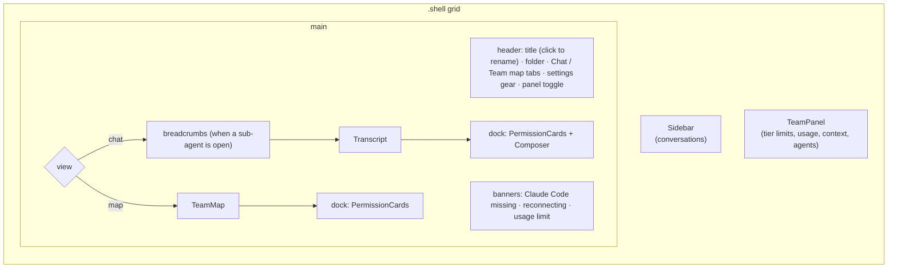

# Web front end

The page you use in the browser. It is a **Svelte 5** app in `web/`, built by Vite into `dist/web/` and served by the Masthead server. **Svelte** is a framework that compiles components (`.svelte` files holding markup, script and style together) into plain JavaScript. Svelte 5 uses **runes** to mark reactive state: `$state` (a value the page redraws when it changes), `$derived` (a value computed from others) and `$effect` (code that reruns when what it reads changes).

The page holds no authority. Everything it shows comes from the server over one WebSocket, and everything it does is a protocol message ([Browser/server protocol](Browser-Server-Protocol.md)). This page describes version 0.1.2.

## Signing in

The page itself holds no secret and is served to anyone who may reach the server; the socket is what needs a key. `masthead` opens `http://127.0.0.1:PORT/?key=<secret>`. On load the store saves that key in `localStorage` under `masthead.key` and removes it from the address bar with `history.replaceState`, so it is not left in history or bookmarks. The socket is then opened with the subprotocols `masthead` and `key.<secret>`; the server checks the key and answers with plain `masthead`.

- **No stored key:** the page does not try to connect. It shows a full-page message: "Open Masthead with the `masthead` command (or its launcher entry) to sign this browser in."
- **Refused:** if the socket closes three times in a row without ever opening, the same message appears with a note that a key from an earlier start no longer works, and a **Try again** button. A drop after a socket did open keeps the normal reconnect.

## Files

| File | Role |
|---|---|
| `web/index.html` | The page shell: a `
`, the favicon, `color-scheme: light dark`, and the script `/src/main.ts`. Vite rewrites it when building. |
| `web/src/main.ts` | Mounts `App.svelte` into `#app` and loads `app.css` and highlight.js's `github-dark` code theme. |
| `web/src/App.svelte` | The layout and header (below). |
| `web/src/app.css` | Global styles: colour tokens for light and dark (switching on `prefers-color-scheme`), a colour per tier (`--tier-opus` etc.), status dots, buttons, Markdown styles. |
| `web/src/lib/store.svelte.ts` | The single store: connection, all state, every protocol message. See [Web store](Source-Web-Store.md). |
| `web/src/lib/Sidebar.svelte`, `Transcript.svelte`, `Composer.svelte`, `FolderPicker.svelte`, `PermissionCard.svelte`, `TeamPanel.svelte`, `TeamMap.svelte`, `SettingsMenu.svelte`, `StopControl.svelte` | The components. See [Web components](Source-Web-Components.md). |
| `web/src/lib/markdown.ts` | Safe Markdown rendering (below). |
| `web/src/lib/tools.ts` | Re-exports `toolLine` from `shared/toolline.ts`. |
| `web/public/favicon.svg` | The tab icon, copied as-is into the build. |

## Layout (`App.svelte`)

- Three columns: sidebar, main area, team panel. Either side can be hidden. On mount, the panel starts hidden below 1100 px of window width, and the sidebar below 760 px. Below 900 px the side columns float over the main area.
- `onMount` connects the store and listens for `hashchange`, so the browser's back and forward buttons can switch conversations (the URL is `#/c/<conversation id>`).
- The document title becomes "<conversation title> · Masthead".
- **Renaming:** clicking the title turns it into a text box. Enter or leaving the box saves (`{t:'rename'}`); Escape cancels (the blur that follows when the box disappears does not save).
- **Settings gear:** at the top right of the header, next to the panel toggle, so it stays reachable when the sidebar is hidden. It opens `SettingsMenu.svelte` ([Web components](Source-Web-Components.md)).
- The Composer sits in a `{#key store.composerKey}` block, so it is rebuilt for each conversation and agent and shows that pair's unsent draft.
- **Breadcrumbs:** when a sub-agent's chat is open, the path from the lead down to it is shown (e.g. "Alpha / Bravo / Charlie · its title"), with a "Back to Alpha" button.
- **Banners:**
  - Claude Code was not found (`AppState.claude.error`);
  - the connection was lost ("Reconnecting…");
  - a usage limit is near or reached, with the reset time and a Dismiss button. It follows the worst usage window the page knows of (any `rejected`, else any `allowed_warning`), not whichever notice arrived last.
- A **toast** at the bottom shows errors for 8 seconds.

## Rendering Markdown safely (`markdown.ts`)

Agents write Markdown, and their output is untrusted: it can quote web pages and files. `renderMarkdown(text)` turns it into HTML in these steps:

1. **marked** parses the Markdown, with GitHub-style extensions on and single line breaks not turned into ` `.
2. **Raw HTML is shown as text.** A custom `html` renderer escapes every HTML tag or block written in the Markdown, so an agent's `<a style=…>` or hand-made Copy block appears literally. Only HTML that the renderer builds itself reaches the next step. (A side effect: an agent writing ` ` or `
` sees it as text.)
3. A custom renderer for code blocks highlights code with **highlight.js** when the language is known (otherwise it escapes the text) and wraps it with a language label and a **Copy** button.
4. **DOMPurify** cleans the result as a second line of defence. It forbids the tags `style`, `form`, `input` and `iframe` and the attributes `style`, `id` and `name`; allows `data-copy`; keeps a `class` only if it is one of Masthead's own (`code-block`, `code-lang`, `code-copy`) or a highlight.js class; and makes every link open in a new tab with `rel="noopener noreferrer"`.

`handleCopyClick` is one click handler on the transcript that serves every Copy button: it copies the code block's text and shows "Copied" for 1.2 seconds.

The result is inserted with Svelte's `{@html}`. Everything else (the person's messages, tool input and results, notices) is inserted as plain text.

## Related pages

[Web store](Source-Web-Store.md) · [Web components](Source-Web-Components.md) · [Browser/server protocol](Browser-Server-Protocol.md) · [Build configuration](Source-Build-Config.md)
