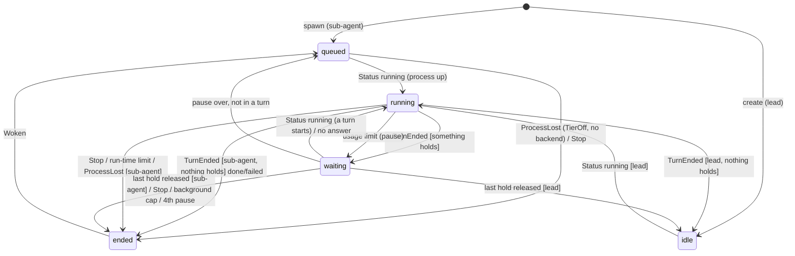

# The agent state machine

Every agent's life cycle (queued, running, waiting, idle, ended, and why it waits) is one record, `AgentState`, changed only by one pure function, `step()`, in `server/core/machine.ts`. The conversation (`server/core/conversation.ts`) is a thin shell around it: it turns what happens (a turn ends, a report arrives, the person presses stop) into **events**, runs them through `step()`, and carries out the **effects** `step()` returns.

This page explains the machine for someone reading the code for the first time. The design is in `docs/plans/0.2.0/core.md` §3; where the two differ, this page follows the code. For the life cycle as the person sees it, see [Agent life cycle](Agent-Life-Cycle.md).

`step()` touches no process, timer, disk or other agent. Effects that involve other agents (a report to the parent, stopping children, reminding someone) are requests; the shell carries them out, often by feeding events to those agents' machines in turn.

## The state

### Phase

`Phase` is `'queued' | 'running' | 'waiting' | 'idle' | 'ended'`.

| Phase | Meaning |
|---|---|
| `queued` | Wants a process but has not got one yet (waiting for a slot, or woken and not started). |
| `running` | In a turn. |
| `waiting` | Its turn is over, but something still holds it (see Holds). A sub-agent does not finish while waiting. |
| `idle` | The lead only: nothing to do until the next message. |
| `ended` | A sub-agent that finished. `end.kind` says how: `done`, `failed` or `stopped`. |

`statusOf(s)` turns this into the `AgentStatus` the page and the agents see: the phase, or `end.kind` when ended. So an `AgentStatus` is one of `queued`, `running`, `waiting`, `idle`, `done`, `failed`, `stopped`.

### Holds

`Holds` lists why a `waiting` agent is not finished. Several can hold at once.

| Field | Meaning |
|---|---|
| `children` | Number of live agents it started. |
| `answer?: { from, reminded }` | It asked its parent or the lead with `send_message` and `wait: true`; `from` is the id of the agent it waits on, `reminded` whether that agent was reminded once already. Only sub-agents get this hold (`Asked` is ignored for the lead). |
| `background` | Background commands its backend reports as running. |
| `backgroundSince?` | Since when (awake time) a sub-agent has waited on background work **alone**; used for the 10-minute cap. |
| `pause?: { until, personWoke, backgroundStopped }` | Paused at a usage limit until `until` (wall clock). `personWoke`: the person sent it a message during the pause. `backgroundStopped`: closing the process at the limit ended background commands (the resume note then says so). |
| `approvals` | Approval cards open. Only matters while `running`: the run clock stops meanwhile. It does not keep an agent waiting. |

`holding(s)` is true when anything except approvals holds: `children > 0`, an `answer`, `background > 0`, or a `pause`.

### AgentState

| Field | Meaning |
|---|---|
| `lead` | Whether this is the lead (the agent with no parent). The lead never ends. |
| `phase`, `end?` | As above. `end` is `{ kind, error?, by? }`; `by` is a `StopBy`: `'person' \| 'agent' \| 'limit' \| 'restart'`. |
| `holds` | As above. |
| `owesReport` | It must send a report to its parent when it ends. Set at spawn, and on waking if the parent can receive one. |
| `limitStreak` | Usage-limit pauses in a row; reset by a turn that gets through. More than `MAX_PAUSES` (3) gives up. |
| `run: { ms, since? }` | Run clock for the current piece of work. It counts only time in `running` with no approval card open. `ranMs(s, now)` reads it. |
| `liveSince?` | When it last became live (awake time); shown as "for 3m" in `list_agents`. |
| `stoppedByPerson` | The person stopped it while it was working; other agents may not wake it. Saved with the conversation. |

`initial(lead)` makes a new state: the lead starts `idle` and owes nothing; a sub-agent starts `queued` and owes a report.

### The context `step()` is given

`Ctx` carries the facts `step()` needs but does not own:

- `now`: awake time (see Clocks below) for the run clock, `liveSince` and `backgroundSince`;
- `wall`: wall-clock time, for a usage limit's reset time (defaults to `now`);
- `busy`: the runtime still has input that no finished turn consumed, or a start pending. A waiting agent that is busy is never finished: a turn is about to start;
- `inTurn`: the agent is in a turn right now (used when a pause ends); defaults to `running && busy`;
- `autoEffort`: the setting; when on, ending a piece of work emits `setEffortLow`;
- `lastText`: the agent's last run's text, used as its report when it finishes without a turn of its own (a hold went away).

## Events

`Event` is a union of these types. The "Fed by the shell" column says whether `Conversation` actually sends the event; the machine handles every one (and `test/machine.test.ts` tests every one), but several facts reach it another way in the shell.

| Event | What it means | Fed by the shell |
|---|---|---|
| `Spawned` | A new sub-agent. Resets to `initial(false)`. | No: `spawn()` stores `initial(false)` directly. |
| `Launched` | The runtime got a process: `queued` → `running`. | No: the runtime's `launch()` sets status `running`, which arrives as `Status`. |
| `LaunchFailed { error }` | It could not start: a sub-agent fails with a report; the lead goes `waiting`/`idle`. | No: every start failure (no backend, `TierOff`, an exception in `launch()`) reaches the shell as `processLost()` and enters as `ProcessLost`, with the same outcome. |
| `Input { from: 'agent' \| 'person' \| 'masthead' }` | Something is about to be delivered. Emits `send`; a person's input during a pause sets `pause.personWoke`. It does not change the phase. | Yes: `deliverTo()` and `userSend()`. |
| `TurnStarted` | A turn began. | No: the runtime's `turnStarted()` sets status `running` (unless paused), which arrives as `Status`. |
| `TurnEnded { text, error?, interrupted, usageLimit? }` | A turn ended. | Yes: `turnEnded()`. |
| `ProcessLost { error, usageLimit? }` | The process died, or could not be started. | Yes: `processLost()`. |
| `Asked { from }` | It sent `send_message` with `wait` to `from`. | Yes: `message()`. |
| `AnswerArrived` | A message from the agent it waits on, or from the person, arrived. | Yes: `message()`, `userSend()`, both with `busy: true`. |
| `RecipientTurnEnded { recipientIsLead, interrupted }` | The agent it waits on finished a turn. | Yes: `checkWaitsOn()`. |
| `RecipientEnded` | The agent it waits on ended. | Yes: `releaseWaitsOn()`, run by the `end` effect. |
| `ChildStarted` | A child went live. | No: `apply()` counts live children fresh before every step. |
| `ChildEnded { reported }` | A child ended. | Only `reported: false`, from `settle()`. A reported end needs no event: the report is delivered as `Input` and the child count is read fresh. |
| `Background { active }` | The backend's count of background commands. | No: `apply()` reads `hasBackgroundWork` fresh (as 0 or 1). |
| `BackgroundIdle` | Background work ended and no turn followed within the grace time. | Yes: `backgroundIdle()`. |
| `Tick { maxRunMs, backgroundCapMs }` | The 30-second timer. | Yes: `tick()`. |
| `Stop { by, why }` | Stop this agent. | Yes: `stopAgent()`, `stopTree()`, `stop()`, `shutdown()`. |
| `ApprovalOpened` / `ApprovalClosed` | An approval card opened or closed. | Yes: `askPermission()`. |
| `Woken { by, parentCanReceive }` | A message is about to wake it. | Yes: `message()` (`by: 'agent'`) and `userSend()` (`by: 'person'`). |
| `Restored` | The app restarted. | No: `Conversation.restore()` rewrites the stored statuses itself, and `st()` builds each state from them. |
| `Status { status }` | The runtime changed the agent's status itself. | Yes: `agentChanged()`. Added after core.md; see below. |

## Effects

`Effect` is a union of these types. `exec()` in `server/core/conversation.ts` carries each out.

| Effect | Meaning | What `exec()` does |
|---|---|---|
| `send { urgent }` | Let the runtime send what was delivered; `urgent` (the person's own message) passes a pause. | Nothing: the caller (`deliverTo()`, `userSend()`) has the content and delivers it, or holds it while paused. |
| `report { status, text }` | Report to the parent. | `report(parent, agent, status, text)`: if the parent is the lead or live, an `inbound` item (`via: 'report'`) and a `deliverTo()` of `reportEnvelope()`. |
| `end { kind, error? }` | End the agent. | `agent.end(kind, error)` (closes the process, cancels a queued slot request, gives the slot back, sets the status), then `releaseWaitsOn()` so nobody keeps waiting for its answer. |
| `setEffortLow` | Back to low effort. | `agent.setEffort('low')`. |
| `releaseSlot` | Give the slot back without ending. | `scheduler.release(tier, id)`. |
| `pauseRuntime` | Hold further input. | Nothing: held messages are kept in the conversation's `held` map (see `deliverTo()`). |
| `resumeRuntime { note }` | Send what was held, then `note` if not null. | Delivers every held message in order, then the note. |
| `dropHeld` | Forget what was held. | Clears `held` for the agent and calls `agent.dropHeld()`. |
| `stopChildren { why? }` | Stop its live children. | `stopTree()` on each live child, with `why` or '"<name>" ended before this agent finished.' |
| `notice { text, level? }` | A line in its transcript. | `addItem({ kind: 'notice' })`. |
| `remind { recipient }` | Remind the agent it waits on. | Nothing here: `checkWaitsOn()` sees the effect and sends one reminder per recipient for all its waiters. |
| `noAnswer { from }` | Tell it there will be no answer. | A notice 'No answer from "X".' and a `deliverTo()` of 'No answer from "X"; carry on with your best judgment or report what you have.' |
| `childEndedQuietly` | It ended without a report. | `settle(parent)`, which feeds the parent `ChildEnded { reported: false }`, so a parent waiting only on it moves on. |
| `save` | Something saved changed (`stoppedByPerson`). | `host.metaChanged()`, which schedules a save. |

## `step()`

`step(prev, event, ctx)` returns `{ state, effects }` and never changes `prev` (it works on a deep `clone()`).

1. **Ended agents ignore stale news.** An `ended` agent reacts only to `Woken`, `Restored`, `Input` (an `Input` only emits `send`), and a `Status` of `queued` or `running`. Anything else returns the state unchanged with no effects.
2. **The event's case** (see the table of rows below).
3. **The epilogue**, run after every event:
   - `liveSince` is set to `now` when the agent becomes live (or is live without one) and cleared when it is not live;
   - the run clock runs while `phase === 'running'` and no approval is open: `run.since` is set when it starts, and when it stops the elapsed time is added to `run.ms`;
   - `backgroundSince` is set (if unset) whenever the agent is `waiting` on background work alone, and cleared otherwise, however it got there (a turn ended, a child ended, a hold was released);
   - a change of `stoppedByPerson` emits `save`.

Three helpers inside `step()` hold the common outcomes:

- `finish(kind, text, error?)`: stop children (if any), end, `setEffortLow` (automatic effort), then `report` if it owed one (a failure reads "The agent failed: <error>", plus "Its last message:" and the text when there is one) or else `childEndedQuietly`.
- `endAs(kind, error?, by?)`: phase `ended`, holds cleared, `owesReport` and `limitStreak` reset, and the `end` effect. There is no `releaseSlot` here: the runtime's `end()` gives the slot back once.
- `released()`: when a `waiting` agent has nothing holding it and is not busy, the lead goes `idle` (with `setEffortLow`) and a sub-agent finishes `done` with `lastText`.

The usage-limit `pause(limit)` helper: the pause lasts until `resetsAt`, or 15 minutes (`DEFAULT_PAUSE_MS`) when no reset time is known or it is already past. A repeat while already paused, and not woken by the person, is the same window: no new notice, no count. A new window counts one more in `limitStreak` and adds "Paused at the usage limit until HH:MM; Masthead resumes it then."; the fourth window in a row gives up instead (returns false; a paused lead gets `resumeRuntime(null)` so what was held goes out). A pause sets phase `waiting` and emits `releaseSlot` and `pauseRuntime`.

## Derived helpers

- `live(s)`: `queued`, `running` or `waiting`.
- `holding(s)`: as above.
- `backgroundOnly(s)`: a sub-agent that is `waiting` with background work and no children, answer or pause.
- `waitReason(s)`: the one reason to show, by priority: `paused` (a pause, in any phase) > `approval` (running with a card open) > `answer` > `children` > `background` (the last three only while `waiting`). It is not called anywhere in `server/`, `shared/` or `web/src` yet; the page gets `waitingFor` and `pausedUntil` from `show()` instead.
- `statusOf(s)`: the `AgentStatus`.
- `ranMs(s, now)`: `run.ms` plus the running stretch in progress.

## The transition table

The rows are those of `docs/plans/0.2.0/core.md` §3.3. `test/machine.test.ts` has one test per row, named "row N: …" ("rows 12-14" share one). The last column says where the code differs from core.md.

| # | Event (guard) | Result in `step()` | Effects | Code vs core.md |
|---|---|---|---|---|
| 1 | `Spawned` | `initial(false)`: `queued`, owes a report | — | The shell stores `initial(false)` in `spawn()`; the slot is asked for by `agent.start()`, not an effect. |
| 2 | `Launched` | `queued` → `running`; epilogue sets `liveSince`, `run.since` | — | Arrives as `Status: running` from the runtime. |
| 3 | `LaunchFailed` | sub-agent: `finish('failed')`; lead: `waiting`/`idle` | `end`, report "The agent failed: …" | In the shell `TierOff` and a missing backend come through `ProcessLost`, which also adds an error notice and `releaseSlot`. |
| 4 | `Input` from an agent | phase unchanged | `send { urgent: false }` | core.md says "→ running"; in code the phase follows the runtime's `Status: running`. |
| 5 | `Input` from an agent, paused | unchanged | `send { urgent: false }` | The shell (`deliverTo()`) puts the text in `held`. |
| 6 | `Input` from the person, paused | `pause.personWoke = true`; phase stays `waiting` | `send { urgent: true }` | The page shows `running` (first "runtime wins" rule). |
| 7 | `TurnEnded` ok, nothing holds, sub-agent | `ended(done)` | `end`, `setEffortLow`, `report(text)` | |
| 8 | `TurnEnded` ok, nothing holds, lead | `idle` | `setEffortLow` | |
| 9 | `TurnEnded` ok, something holds | `waiting`; `backgroundSince` if background alone | — | Reminding is done for the *recipient's* waiters by `checkWaitsOn()` after its own `TurnEnded`. The lead goes `waiting` even after an error. |
| 10 | `TurnEnded` with error, sub-agent | `ended(failed)` | `stopChildren`, `end`, `setEffortLow`, report "The agent failed: …" | An interrupted turn adds the notice "Stopped."; an error adds an error notice. |
| 11 | `TurnEnded`/`ProcessLost` at a usage limit | `waiting` with `pause` | `releaseSlot`, `pauseRuntime`, one notice per window | The count is `limitStreak`, not `pause.count`. An interrupted turn never pauses. |
| 11a | the 4th window in a row | sub-agent `ended(failed)` as row 10; lead `waiting`/`idle` | as 10 | |
| 12 | `RecipientTurnEnded`, not reminded | `answer.reminded = true` | `remind` | |
| 13 | `RecipientTurnEnded`, reminded, recipient not lead (or interrupted) | answer cleared; `waiting` → `running` if nothing else holds | `noAnswer` | |
| 14 | `RecipientTurnEnded`, reminded, recipient is lead | unchanged | — | |
| 15 | `AnswerArrived` | answer cleared, then `released()` | — | The shell passes `busy: true`, so the asker is not finished: the turn the answer starts decides. |
| 16 | `ChildEnded { reported: true }` | `children - 1` | — | Not sent by the shell; the report arrives as `Input`. |
| 17 | `ChildEnded { reported: false }` | `children - 1`, then `released()` | `end`, `report(lastText)` (sub-agent) / `setEffortLow` (lead) | Sent by `settle()`. |
| 18 | `Background { active }` | `background = active`; `backgroundSince` set/cleared | — | Not sent; `apply()` reads background work fresh. |
| 19 | `BackgroundIdle` | background 0, then `released()` | as 17 | |
| 20 | `Tick`, pause over | pause cleared; not in a turn: `queued`; in a turn: `running` | `resumeRuntime(note)`, and, when not in a turn, the notice "The usage limit has reset; resumed." | The note is "The usage limit has reset. Carry on from where you stopped." plus " Background commands you had running were stopped." when so; `null` in a turn. |
| 21 | `Tick`, sub-agent, `ranMs > maxRunMs` | `ended(stopped, by: 'limit')` | `stopChildren(why)`, `dropHeld`, notice, `end`, `report` if owed else `childEndedQuietly` | why = "Stopped after N minutes: the run-time limit set by the person." Not checked while paused. |
| 22 | `Tick`, background alone ≥ cap | `ended(done)` | notice, then as row 7 with text + "A background command was still running when Masthead closed this agent." | Cap is 10 minutes (`BACKGROUND_WAIT_MS` in the shell). |
| 23 | `Stop { by: 'person' }`, live sub-agent | `ended(stopped, by: 'person')`, `stoppedByPerson = true` | `stopChildren(why)`, `dropHeld`, `end`, notice, `report(stopped)` if owed else `childEndedQuietly`; `save` | A sub-agent that is not live is not touched (not marked). |
| 24 | `Stop { by: 'agent' }` | `ended(stopped, by: 'agent')` | as 23 but `childEndedQuietly`, never a report, not marked | `Stop { by: 'restart' }` emits neither. The lead: pause cleared, `dropHeld`, `released()`. |
| 25 | `ApprovalOpened` / `Closed` | `approvals ± 1`; the epilogue stops/starts the run clock | — | |
| 26 | `Woken`, ended sub-agent | `queued`, `end` cleared, run clock reset to 0, `owesReport` if `parentCanReceive`; by the person: mark cleared | — | The guards (`stoppedByPerson`, tier off) are checked by the shell in `message()` and `userSend()`, not by the machine. |
| 27 | `Restored` | holds, streak, run clock and debt cleared; lead `idle`; a live sub-agent `ended(stopped, by: 'restart')` with "Masthead was closed while this agent was working." | — | Not sent: `Conversation.restore()` does the same to the stored statuses. |

### Added since core.md

- **`Status` event** (`agentChanged()` in the shell): the runtime changed the status itself, for instance `launch()` set `running`, `ensureProcess()` set `queued`, `turnStarted()` set `running`, or `end()` set an end status. In the machine:
  - `queued` / `running`: taken as the phase (and `end` cleared), unless a pause holds the agent;
  - `waiting` / `idle`: taken as the phase;
  - `done` / `failed` / `stopped`: the lead goes `waiting` or `idle` (it never ends); a sub-agent in `queued` keeps its state (second "runtime wins" rule); otherwise it becomes `ended` with that kind, holds and report debt cleared.
- **Review fixes** (two tests named "fix: …"): the background cap starts when a child ends and background work is left as the only hold (done by the epilogue); a pause that ends during a turn the person started leaves the agent `running` with its run clock on.

## Diagram

The lead moves only between `idle`, `queued`, `running` and `waiting`; it never reaches `ended`.

## How the shell carries it out

Every change goes through `Conversation.apply(agent, event, opts)`:

1. `st(agent)` gets the agent's state, creating it from the agent's current status the first time (this is how restored agents get a state).
2. Facts owned elsewhere are copied in fresh: `holds.children` = the number of live children; `holds.background` = 1 if the runtime has background work, else 0; `owesReport` from the `Agent`.
3. `step()` runs with `now` = awake time, `wall` = wall clock, `busy` = `agent.busy` (or `opts.busy`), `inTurn` if given, `autoEffort` from the settings and `agent.lastText`.
4. The new state is stored and `agent.owesReport` set from it.
5. `show()` updates what the page sees: `info.waitingFor` (the name of the agent waited on) and `info.pausedUntil`. It sets the status itself only to `waiting` or `idle`, only when the event was not a `Status` event, and only when it differs; `queued`/`running` are the runtime's to show, and an end comes with the `end` effect.
6. Each effect runs through `exec()`, unless `opts.drop` filters it out.
7. If no timer runs, `ensureTimer()` starts the 30-second tick when something needs watching (a pause, a background-only wait, or a run-time limit with a live sub-agent).

Two effect filters:

- `QUIET` = `report`, `childEndedQuietly`, `stopChildren`. Used by `stopTree()` when an agent is stopped as part of stopping an agent above it: its parent is being stopped too, so nobody is told and children are stopped by the tree walk itself.
- `SHUTDOWN` = `QUIET` plus `notice`. Used by `shutdown()`: the app is closing, nothing is told or shown, but `end` still runs, so the runtime and the machine agree the agent ended.

### The two "runtime wins" rules

The runtime (`server/runtime/agent.ts`) changes statuses itself when it starts a process or a turn. Two rules keep its view and the machine's from fighting:

1. **A paused agent the person woke shows `running` during that turn.** The person's message goes through at once (`userSend()` delivers held messages, then theirs); the runtime sets `running`; the `Status: running` event is ignored by the machine because a pause holds the agent, so its phase stays `waiting`. `show()` does not overwrite a status the runtime just reported (it pushes nothing for `Status` events), so the page shows `running`. When the pause's time is up, the `Tick` with `inTurn` true makes the phase `running` too.
2. **An end status from the runtime does not end a `queued` state.** A `queued` state that the runtime still shows as `done`/`failed`/`stopped` is a wake-up the runtime has not acted on yet (`message()` applies `Woken` before delivering). The `Status` event leaves it alone.

And the lead never ends: every path that would end a sub-agent leaves the lead `waiting` or `idle`.

## Clocks

The machine gets two times. `now` is the shell's awake-time clock (`active()`): it follows the wall clock but advances by at most 60 seconds per reading, and a 15-second unref'd timer reads it, so a sleep counts as at most one capped step. It is used for the run clock, `liveSince` and the background cap. `wall` is plain `Date.now()`, used for a usage limit's reset time. When the clock sees a gap over 60 seconds, a working conversation's lead gets the notice "This computer was asleep from HH:MM to HH:MM; work carried on afterwards." (`Conversation.wokeFromSleep()`). Tests pass their own `Clock`.

## Invariants the tests check

`test/machine.test.ts`, on `step()` alone:

- "invariants: …": 300 random runs of 25 events each, from a running sub-agent, on a fixed seed. After each step: `step()` did not change its input; a sub-agent that is `waiting` has something holding it; an `ended` agent holds nothing.
- "invariants, wider: …": 400 runs of 30 events each, every third one the lead, over every event type (including `Stop`, `Woken`, `Status`, `Restored`) and with `busy` varied. After each step: the input is unchanged; the lead never ends; a sub-agent `waiting` while not busy has a hold; `ended` holds nothing; an `end` effect means the phase is `ended`.

`test/conversation.test.ts`, "shell invariants: random team activity …": 25 runs of 40 random actions on a real `Conversation` whose host has no backend, with the Opus and Sonnet slots filled so new agents stay queued; turns are simulated by calling `turnEnded()` directly (spawn, end a turn, ask the parent with `wait`, stop by an agent, lose a process, hit the usage limit, advance time and tick, a message from the person, stop by the person). After each action: the lead never shows an end status; a sub-agent `waiting` and not busy has a live child, an answer hold, a pause or background work; an ended agent holds no scheduler slot.

`npm test` passed (369 of 370, one skipped) when this page was written on 2026-11-27; the app itself was not run.

Related pages: [Agent life cycle](Agent-Life-Cycle.md) · [Team rules](Team-Rules.md) · [Source: core/machine.ts](Source-Core-Machine.md) · [Source: core/conversation.ts](Source-Core-Conversation.md) · [Slot scheduling](Slot-Scheduling.md) · [Source tests](Source-Tests.md)
