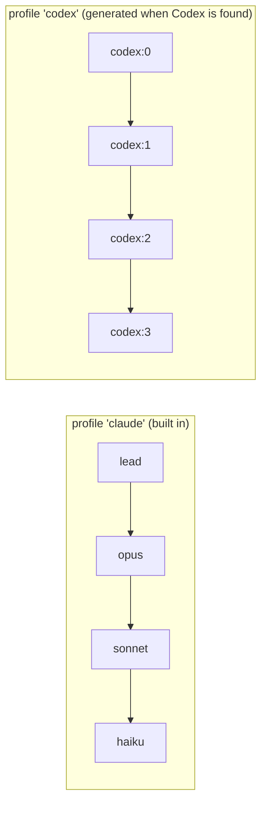

# Team profiles and settings

From 0.2.0 the team's tiers are data, not a fixed list of four. A **team profile** says which tiers a conversation's team has, which backend and model each tier runs on, and how many agents of each may run. This page explains profiles, the settings format (version 2) that holds them, how a 0.1.x settings file is migrated, and which changes apply while agents run. The code is in `server/settings/settings.ts` ([settings code](Source-Settings.md)) and the types are in `shared/protocol.ts` ([shared protocol](Source-Shared-Protocol.md)).

## Tiers and profiles



- **`TierSpec`**: `id`, `label`, `backend` (for example `claude-code` or `codex`), `model`, `effort`, `max`, `lean`, `colour`.
  - `effort`: with automatic effort on, the highest level an agent of the tier may reach. With it off, the level the tier always runs at.
  - `max`: how many agents of this tier may run at once, across the whole app. It is ignored for the first tier, and it can be at most 12 (`MAX_PER_TIER`).
  - `lean`: the tier's agents skip the person's own MCP servers, which keeps their context small. The lead (the agent with no parent, `Agent.isLead`) never runs lean, whatever its tier says (`launch()` in `server/runtime/agent.ts`).
  - `colour`: one of the `PALETTE` slots `amber`, `violet`, `blue`, `teal`, `rose`, `green`, `slate`, `orange`. The page decides the actual colours.
- **`TeamProfile`**: `id`, `label`, `description?`, `builtIn`, `tiers`. Tier 0 is the lead, the agent the person talks to. Tier *i* may start only tier *i + 1* (`childTierOf()`), and the last tier starts nothing. A profile has 1 to `MAX_TIERS` = 5 tiers.
- **Tier ids** are unique across all profiles:
  - The built-in `claude` profile keeps the 0.1.x ids `lead`, `opus`, `sonnet`, `haiku`, so 0.1.x conversations and their agents load unchanged. It always has exactly these four tiers. Only their settings can be changed.
  - Every other profile's tiers are numbered from 0 as `<profile>:<index>`, for example `codex:0` and `codex:1`. The server assigns these ids whatever the page sends.
- **Built-in profiles**:
  - `claude` (`claudeProfile()`): Fable 5.2 lead at `xhigh`; Opus 5.5 at `xhigh`, max 3; Sonnet 5.5 at `high`, max 4; Haiku 5.5 at `medium`, max 4; Sonnet and Haiku are lean, the lead and Opus are not (Opus stopped being lean in 0.2.1; a profile already stored keeps its own switch). It always exists and cannot be removed.
  - `codex` (`codexProfile()` in `server/backends/registry.ts`): built from the installed Codex's model list when Codex is detected as usable. It has up to four tiers, from the most capable model down. Each tier uses the effort the model supports up to `xhigh`/`xhigh`/`high`/`medium`, with max 1/3/4/4; the third and fourth tiers are lean, the first two are not (the second stopped being lean in 0.2.1). Its description reads "Built from the installed Codex's model list. Change it in the settings." `withBuiltInProfiles()` adds it to the settings once. After that the stored copy is kept, even if the person edits it.
  - A built-in profile can be put back to its defaults with `{t:'reset_profile', id}` (`resetProfile()`). For any other profile, `App` answers "Only a built-in team can be reset."
- **People's profiles**: any other id matching `^[a-z0-9][a-z0-9-]{0,30}$`, with 1–5 tiers that each have a model.

### A conversation's profile

Each conversation stores `meta.profileId`. A page using protocol version 2 may send `profile` with a `send` that starts a new conversation (`app.ts`, case `send`):

- If no profile is named, `settings.defaultProfile` is used.
- If the named profile does not exist, the message is refused with "There is no team profile "<id>"."
- The lead tier's backend must be usable, or the message is refused with the backend's reason ("Claude Code was not found." for Claude).

`Conversation.create()` starts the lead on the profile's tier 0. A 0.1.x conversation has no `profileId`; its tier ids are the claude profile's, so it runs on `claude`.

The scheduler's limit for each tier is looked up by id across all profiles (`tierLimit()`): unlimited for any profile's first tier, `max` for the others, and 0 for a tier id that no profile has any more. So a conversation whose profile was deleted keeps its lead but cannot start helpers. See [Scheduler](Source-Core-Scheduler.md).

### The compatibility view

Pages written for 0.1.x, and parts of the current page not yet moved to profiles, still read and send the old shape: `settings.tiers.<lead|opus|sonnet|haiku>` (`model`, `effort`, `max`), `leanSubagents` (Sonnet and Haiku lean) and `leanOpus`. The server keeps these fields equal to the `claude` profile (`withCompat()`) every time it returns settings. A patch that changes them changes the claude profile (`applyCompat()`). The profiles remain the source of truth.

`AgentInfo.tier` is still typed as the four-name `Tier` union. Agents of other profiles carry their `<profile>:<index>` string there.

## Settings format, version 2

The file is `settings.json` in the config folder ([Configuration and settings](Configuration-and-Settings.md#where-the-settings-file-is)). It is written pretty-printed, with mode `0600`.

```json
{
  "version": 2,
  "profiles": [ { "id": "claude", "label": "Claude", "builtIn": true, "tiers": [ … ] } ],
  "defaultProfile": "claude",
  "tiers": { "lead": { "model": "claude-fable-5-2", "effort": "xhigh", "max": 1 }, … },
  "permissionMode": "inherit",
  "autoEffort": true,
  "leanSubagents": true,
  "leanOpus": false,
  "collapseReports": false,
  "maxRunMinutes": 0,
  "keepAwake": true,
  "autoCompact": true,
  "defaultCwd": "/home/you"
}
```

## Validation in one place

`sanitizeSettings(raw, base)` is the only code that checks settings. It is used for the file (over the defaults) and for every `{t:'settings'}` patch from a page (over the current settings). It always returns valid settings. A field that is missing, unknown or malformed keeps its value from `base`, so a partial patch changes only what it names. The checks:

| Field | Accepted |
|---|---|
| profile id | `^[a-z0-9][a-z0-9-]{0,30}$`, unique |
| profile label / tier label | non-empty after trimming; cut to 40 characters |
| profile description | whitespace collapsed; cut to 200 characters |
| tier count | `claude`: always its four; others: 1–5, or the profile is dropped |
| model | `^[A-Za-z0-9._\-\[\]:]{1,80}$`; a non-claude tier without a model drops its profile |
| backend | `^[a-z0-9][a-z0-9-]{0,30}$` (form only) |
| effort | `low`, `medium`, `high`, `xhigh` (there is no `max` level) |
| max | integer, clamped to 0–12; never taken for a first tier |
| lean | boolean |
| colour | one of `PALETTE` |
| `builtIn` | never taken from input |
| `defaultProfile` | an existing profile id; otherwise it stays as it was, or becomes `claude` if that profile is gone |
| `permissionMode` | `inherit`, `default`, `acceptEdits`, `auto`, `bypassPermissions` |
| `autoEffort`, `collapseReports`, `keepAwake`, `autoCompact` | boolean (a `keepAwake` or `autoCompact` still missing becomes `true`) |
| `maxRunMinutes` | integer, clamped to 0–1440 |
| `defaultCwd` | an absolute path for this system (`absoluteFolder()`), at most 4096 characters |

## Migration from 0.1.x

A 0.1.x `settings.json` has no `version` field. `loadSettings()`:

1. If `settings.json.v1.bak` does not exist yet, copies the file there, untouched, before anything can overwrite it. This happens once; a later load never replaces the backup.
2. Runs the old object through `sanitizeSettings()` over the defaults. Because it has no `profiles`, its `tiers`, `leanSubagents` and `leanOpus` are applied to the `claude` profile. The other fields carry over as they are, and `keepAwake`, `autoCompact` and `maxRunMinutes` take their defaults if the file lacks them (so `autoCompact` starts on).
3. Keeps the result in memory. The file is rewritten in format 2 at the next save, which is the next settings change (or the next time a new conversation's folder becomes the default, or a Codex profile is added).

To go back to 0.1.x, restore `settings.json.v1.bak` as `settings.json`. A 0.1.x Masthead reading a version 2 file would take what it knows (`tiers` and the switches), because those fields are still written. That was not tested.

## What applies at run time

`App.updateSettings()` stores the new settings, saves the file (a failed write is logged once, and the new settings still apply), updates keep-awake, calls `scheduler.limitsChanged()`, calls `settingsChanged()` on every conversation (which calls `applySettings()` on each agent and restarts the run-time limit timer), and broadcasts `{t:'settings'}` to every page.

| Setting | Takes effect |
|---|---|
| tier `max` | Each time a slot is requested or freed (`tierLimit`). A raised limit starts queued agents at once. Lowering it does not stop agents that are already running. |
| tier `model` | The lead (`isLead`: no parent) follows the setting, in any profile. `launch()` takes it at each launch, and `applySettings()` changes a running lead's model (`setModel`, or a relaunch with the same session). Other agents keep the model they were started with. An agent whose tier no profile lists any more keeps its own model and effort. |
| tier `effort` | At launch, and at once for running agents: a lowered ceiling caps them, and with automatic effort off the fixed level is set. A raised ceiling raises nobody. See [Thinking effort](Thinking-Effort.md). |
| tier `lean` | When an agent's process is next launched; a running process keeps what it started with. |
| `permissionMode` | At once: running sessions get `setPermissionMode()` (or are relaunched, same session, before their next turn), and open approval cards the new mode would not have asked for are allowed. See [Permissions and questions](Permissions-and-Questions.md#changing-the-mode-while-agents-run). |
| tier `backend` | When an agent of the tier next launches (`App.backend()` looks it up by tier id). |
| `autoEffort` | The tool list is built at launch. A change marks running processes stale, so each is relaunched (same session) before its next turn. The tools themselves read the setting on every call. |
| `maxRunMinutes` | From the next tick of the conversation timer, including for agents already running. |
| `keepAwake` | At once. |
| `autoCompact` | At run time: read each time the lead's turn ends (`Conversation.autoCompactOn()`), and when a compaction starts. A compaction already under way keeps its `auto` flag (card or no card). The per-conversation switch (`meta.autoCompact: false`, message `auto_compact`) can only turn it off for one conversation; see [Configuration and settings](Configuration-and-Settings.md) and [Compact team](Compact-Team.md). |
| `collapseReports` | Display only (the page). |
| `defaultProfile`, `defaultCwd` | When the next conversation is started. |
| a new profile | Can be chosen for new conversations at once. |

These rows come from reading `server/app/app.ts`, `server/core/conversation.ts` and `server/runtime/agent.ts`; they were not checked against a running app.

## Related pages

[Settings code](Source-Settings.md) · [Configuration and settings](Configuration-and-Settings.md) · [Team rules](Team-Rules.md) · [Scheduler](Source-Core-Scheduler.md) · [Backend interface](Backend-Interface.md) · [shared/protocol.ts](Source-Shared-Protocol.md) · [Compact team](Compact-Team.md)
