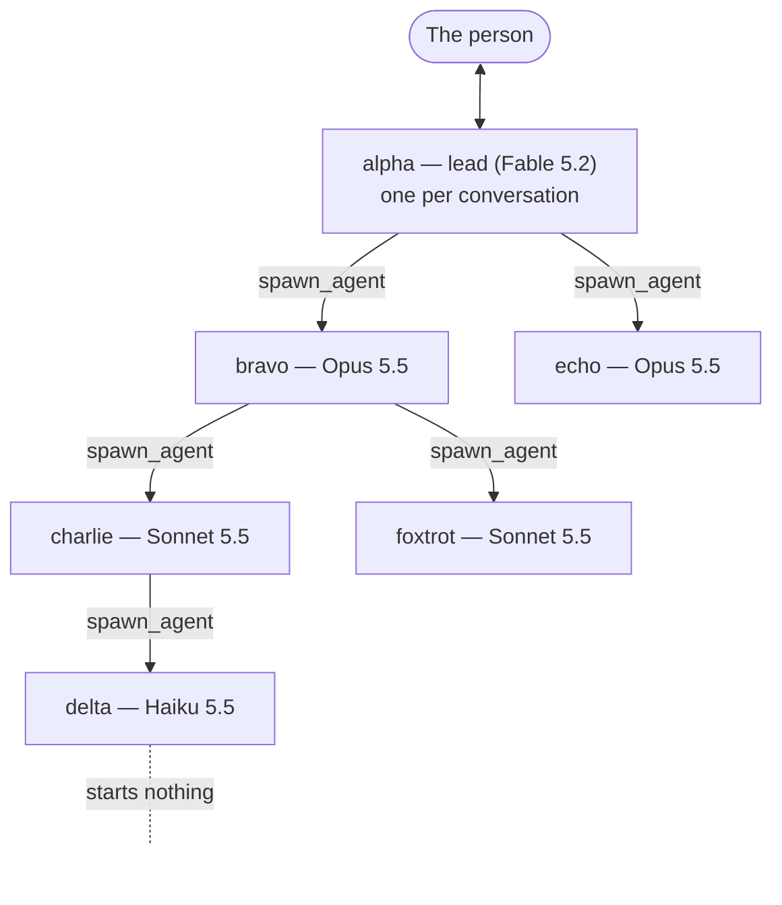

# Team rules

This page lists the rules of a Masthead team and where each one is enforced. Almost all of them live in the `Conversation` class (`server/conversation.ts`), which implements the `TeamActions` interface that the agents' tools call. Two groups of rules have their own pages: [Slot scheduling](Slot-Scheduling.md) (limits and fair queueing) and [Thinking effort](Thinking-Effort.md).

## Tiers

A **tier** is an agent's level in the team. `Tier` in `shared/protocol.ts` is `'lead' | 'opus' | 'sonnet' | 'haiku'`, and `CHILD_TIER` says which tier each one may start:

(Names are given in order of starting, so the exact letters depend on who started first.)

- Each conversation has exactly one lead, created with the conversation.
- An agent can start only the tier directly below its own. This is enforced twice: Haiku agents simply do not get the `spawn_agent` tool (`teamTools()` in `server/tools.ts`), and `Conversation.spawn()` returns an error if `CHILD_TIER[parent.tier]` is null. `AGENTS.md` makes the fixed tiers a rule for anyone changing the code.
- The model each tier runs comes from the settings (`tiers.<tier>.model`; the defaults are in `defaultSettings()` in `server/config.ts`). The name shown for a tier, to agents and to people, is made from that id by `modelLabel()` ("Opus 5.5"). `Conversation.label(tier)` is used in prompts, tool descriptions and replies.
- A sub-agent's model is fixed when it is created (`newInfo()` copies it from the settings). The lead's model is read from the settings again each time its process is launched.

## Names and titles

Agents are not named by whoever starts them. Each conversation hands out names from the radio spelling alphabet, in the order agents are created (`AGENT_NAMES` and `agentName()` in `shared/protocol.ts`):

- The lead is always `alpha`. The first agent started is `bravo`, then `charlie`, and so on up to `zulu`; then `alpha-ii`, `bravo-ii`, … (shown as "Alpha II"), then `alpha-iii`, …
- `spawn()` takes `agentName(agents.size)` and moves on to the next name if that one is taken.
- People see the name with a capital letter ("Bravo", `displayName()`). The lead's system prompt tells it that the person may refer to any agent by name.

The `spawn_agent` code comment gives the reason: "Names are handed out in order, so the person can call any agent by a name they can say."

What the parent supplies instead is a **title**: a few words on the job, at most 60 characters ("Review the API layer"). It is stored in `AgentInfo.title`, shown on the page next to the name, and used by `list_agents`. The lead's title is empty.

When an agent is looked up (`find()`):

- `parent` means the caller's parent;
- `lead` means the lead;
- otherwise the name is matched case-insensitively, then as a slug (so "Bravo " still finds `bravo`).

## Limits per conversation

| Limit | Value | Where |
|---|---|---|
| Agents in one conversation | 200 (`MAX_AGENTS`) | `spawn()` refuses beyond it and suggests reusing an agent. |
| Messages between agents | 1000 (`MAX_AGENT_MESSAGES`) | `message()` refuses beyond it, and so does an effort request to a parent (`setOwnEffort()`), which also counts. The counter is saved with the conversation, so it carries on after a restart. |
| Task text kept in `AgentInfo.task` | 400 characters (`TASK_PREVIEW`) | Only this stored preview is shortened; the agent receives the full task. |
| Agents of a tier running at once | Settings, 0–12 (`MAX_PER_TIER`) | Enforced by the `Scheduler`; see [Slot scheduling](Slot-Scheduling.md). A limit of 0 switches the tier off: `spawn()` refuses, agents of that tier already queued fail, and a finished agent of that tier cannot be woken (`message()` refuses; a message from the person only adds an error notice). |

## Starting an agent

`spawn_agent` (`title`, `task`, optional `effort`) leads to `Conversation.spawn()`, which:

1. checks the tier, the switch-off, the agent count and an empty task;
2. picks the name and cleans the title;
3. creates the `Agent` with `owesReport: true` and the task as its seed;
4. records a `task` inbound item in the new agent's transcript;
5. calls `agent.start()`;
6. returns a sentence to the parent immediately, for example "Started Opus 5.5 agent "bravo" (Review the API layer) at low effort. Its report will arrive as a message when it finishes.", adding a note if the agent will have to queue.

The tool call does not wait for the agent's work. Full walkthrough: [An agent starting another](Walkthrough-Starting-an-Agent.md).

## Reports

A **report** is a sub-agent's final message, delivered to the agent that started it.

- An agent **owes a report** (`Agent.owesReport`) from the moment it is spawned. It owes one again when any agent wakes it with a message after it has finished (`message()`), as long as its parent can receive a report (see below), so the result of the woken run always reaches the parent. An agent that is still live keeps the debt it already has, so nothing is reported twice. If the parent cannot receive, the woken agent owes nothing.
- When a sub-agent finishes (`Conversation.finish()`) and owed a report, `report()` does two things. It gives the parent an `inbound` item (`via: 'report'`) for the screen, and it delivers the text wrapped by `reportEnvelope()`:
  `<agent-report from="charlie" tier="sonnet" status="done"> … </agent-report>`. Any envelope tag inside the text (`<agent-report`, `</agent-message`, …) is escaped to `&lt;…`, so a report cannot close its envelope and add text that looks as if it came from outside it.
- The report text is what the agent said since it last took up work: the final text of every turn in that run, oldest first (`Agent.handleResult()` in `server/agent.ts`). A message that lands just as a turn ends makes Claude Code run one more turn; its short reply is added after the real work instead of replacing it.
- A failed agent's report says "The agent failed: …", followed by its last message if it had one.
- A report is only delivered if the parent can receive it, meaning the parent is the lead or is live. Otherwise it is dropped without notice.
- If the agent did not owe a report, `settle(parent)` runs instead. When the parent is `waiting`, not busy, and has no other live children, no open wait for an answer and no background work, nothing else will wake it. So the lead goes `idle`, and a sub-agent is finished as `done`, with what it said in its last run of turns (`lastText`) as its own report upward if it owes one.
- A question asked with `send_message` and `wait: true` is not a report: the asker's turn ends, but it goes `waiting` and still owes its report (see [Waiting for an answer](#waiting-for-an-answer)).
- Delivering a report to a `waiting` parent starts a new turn for it. Delivering one to a `running` parent adds it to the turn in progress.

The system prompt tells sub-agents that their last message is their report and is all their parent sees (`systemAppend()`). See [A report coming back](Walkthrough-Report-Coming-Back.md).

## Waiting for children

A sub-agent whose turn ends while agents it started are still live does not finish. It becomes `waiting` and keeps its slot (`turnEnded()`), and the next report or message wakes it. This is why the prompt says "If you have nothing else to do, end your turn; you are woken when a report arrives." The same prompt asks agents that can start others to reuse a finished agent with `send_message` when it already has the context for the work, rather than starting a new one. A sub-agent whose turn ends with an error does not wait: it fails, and its live children are stopped. A usage limit is the exception: the agent (the lead too) pauses as `waiting` until the limit resets ("Paused at the usage limit until HH:MM; Masthead resumes it then."), sends no report, gives up its slot, and its children keep going; messages from agents to it are held until it resumes (the person's are delivered at once); `tick()` resumes it with "The usage limit has reset. Carry on from where you stopped." After 3 pauses in a row (`MAX_PAUSES`) the 4th fails as before. It gets no such note if a message from the person has already started a turn, and the note adds "Background commands you had running were stopped." when the pause ended them. A sub-agent that has spent longer than `settings.maxRunMinutes` in status `running` (no approval open) on one piece of work (if set) is stopped with everything under it, and its parent gets "Stopped after N minutes: the run-time limit set by the person." See [server/conversation.ts](Source-Conversation.md#usage-limit-pause-and-run-time-limit-014).

The same holds for background work: an agent (the lead included) whose turn ends while background commands still run (`agent.hasBackgroundWork`) goes `waiting` instead of finishing or going `idle`. When the background work ends and no new turn follows, the agent calls `host.backgroundIdle()`, which runs `settle()`. A sub-agent waiting only on background work for 10 minutes is finished with "A background command was still running when Masthead closed this agent."; `list_agents` shows "waiting on a background command for 4m". If Claude Code starts a turn by itself after the command finishes, its result comes through `turnEnded()` as usual, and its text includes the earlier turn's text.

## Waiting for an answer

A sub-agent (never the lead; the lead's `send_message` has no `wait` input) can send `send_message` with `wait: true` to its parent or the lead. Toward anyone else the message is delivered but the reply adds "(Not waiting: you can wait only for your parent or the lead.)"; a counted wait adds "End your turn when you have nothing else to do; you resume when the answer arrives."

- The recipient's envelope ends with ""charlie" is waiting for your answer: reply with send_message to "charlie"." When the recipient is the lead, a notice in its transcript makes the question plain to the person: ""charlie" is waiting for an answer to this. You can also answer it yourself by messaging charlie directly."
- The asker's turn ending does not finish it: it goes `waiting`, keeps its slot and still owes its report. `settle()` will not finish it either.
- The wait ends when any message from the recipient arrives, or when the person messages the asker directly.
- While the wait lasts, the asker's `info.waitingFor` holds the recipient's name, so the page can show it.
- If the recipient's turn ends without answering, it is reminded once. For a non-lead recipient, the next time (or at once if its turn was interrupted), the asker gets "No answer from "X"; carry on with your best judgment or report what you have." It gets the same when such a recipient finishes or is stopped.
- The lead is reminded with "… is still waiting for your answer. Answer with send_message, or ask the person; it keeps waiting." After that the asker keeps waiting, even while the lead is idle or has lost its process, because the lead may be asking the person and the person can answer the asker directly. It is told "No answer" only if the person interrupts the lead's turn; Stop everything stops the asker itself.
- `list_agents` shows the asker as "waiting for your answer" to the recipient and "waiting for an answer from X" to everyone else.
- Waits are kept in memory only.

## Messaging

`send_message` leads to `Conversation.message(from, to, text, wait)`:

- Any agent can message any other agent in the same conversation by name. That includes the lead, finished agents, and agents in other branches. `"lead"` and `"parent"` also work as names.
- An agent cannot message itself.
- The target gets an `inbound` item (`via: 'message'`), and the text wrapped by `messageEnvelope()`: `<agent-message from="…" tier="…"> … </agent-message>`, with envelope tags in the text escaped as for reports. When the sender is not the target's parent, one line follows: "To answer, use send_message to "…"." A message from the parent gets no such line, because the target's report answers it. A question with `wait` gets the waiting line instead (see [Waiting for an answer](#waiting-for-an-answer)).
- An agent cannot wake an agent the person stopped (see [Stopping](#stopping)). A finished agent whose tier is switched off cannot be woken either.
- A finished target is resumed with its context so it can read the message (see [Agent life cycle](Agent-Life-Cycle.md)).
- The tool returns at once with "Delivered to "name" (status)", where the status is the target's status before delivery. When the sender woke a finished agent that is not its own child, the reply adds "Its report goes to "parent"; it answers you only with send_message." Any answer arrives later as another message.
- `list_agents` (`Conversation.list()`) gives one line per agent: status (with the activity when running, e.g. "running: Reading a.ts"), "for 3m" while live or "ended 5m ago", context ("41k ctx") and cost ("$0.12") when non-zero, effort, who started it, and its title. A paused agent shows "paused until HH:MM (usage limit)".

The prompt tells every agent that `<agent-report>` and `<agent-message>` text comes from colleagues, not from the person, and never carries the person's authority or approval.

The person can also type directly to any agent, not only the lead. In the page, open the agent's chat and type; the message box then says "Message Bravo directly". The browser sends a `{t:'send'}` with an `agentId`, and `Conversation.userSend()` delivers it as a plain user message, not in an envelope.

## Who may ask the person

Only the lead talks to the person. Sub-agents have Claude Code's `AskUserQuestion` tool disallowed (`launch()` in `server/agent.ts`), and their prompt says "You cannot ask the person anything. If you are blocked, ask [parent] with send_message and wait: true." Tool **permission** prompts are a separate matter: any agent's tool use can raise an approval request to the person. See [Permissions and questions](Permissions-and-Questions.md).

## Stopping

- An agent may stop an agent it started, or any agent below that, with `stop_agent` (`Conversation.stop()`, which checks `isAncestor(caller, target)`). Only agents that can start others get this tool. Its description says it is only for unwanted work: a stopped agent sends no report, so it must never be used to collect a result.
- Stopping always takes the whole subtree: `stopTree()` stops the children first, then the agent.
- When an agent stops one of its own descendants, the target's `owesReport` is cleared, because the caller asked for the stop.
- The person can stop any agent (`{t:'stop_agent'}`, the square button on each agent) or everything (`{t:'stop_all'}`, "Stop everything"). When the person stops an agent that owed a report, its parent gets a report with status `stopped`.
- An agent the person stopped, and every live agent under it, is marked (a finished helper is not, so the lead can reuse it) (`stoppedByPerson`). Other agents cannot wake a marked agent with `send_message`; the person can, by messaging it, which clears the mark. The mark is saved with the conversation, so it holds after a restart too.
- An agent stopped while it was waiting for a slot, or for its old process to exit, is never launched afterwards; a slot granted to it in the meantime is given back (`Agent.ensureProcess()`).
- Stopping the lead from the browser stops all its children, interrupts the lead's turn, and then settles the lead, so a lead that was only waiting goes `idle`. The lead keeps its session.

Walkthrough: [Stopping an agent](Walkthrough-Stopping-an-Agent.md).

## Effort

With automatic effort on, the lead starts at low and a sub-agent at the level its parent chose (low by default); the system prompt states the actual level. The lead changes its own effort; the others ask their parent; any agent may set the effort of an agent below it. Masthead resets an agent to low after each piece of work: the lead when it goes idle, a sub-agent when it finishes. Waking does not change effort, so a level set on a finished child holds. Full rules: [Thinking effort](Thinking-Effort.md).

## Related pages

[server/conversation.ts](Source-Conversation.md) · [server/tools.ts](Source-Tools.md) · [server/prompts.ts](Source-Prompts.md)
