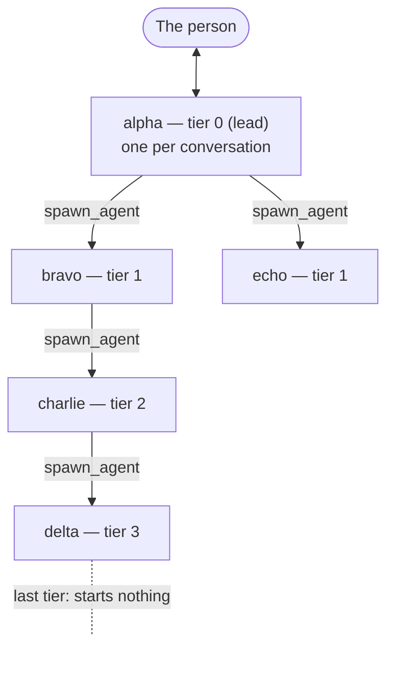

# Team rules

This page lists the rules of a Masthead team in 0.2.0 and where each one is enforced. The rules live in the `Conversation` class (`server/core/conversation.ts`), which implements the `TeamActions` interface the agents' tools call (`server/core/tools.ts`). Every change to an agent's life cycle goes through the state machine in `server/core/machine.ts`; [State machine](State-Machine.md) explains it. Two groups of rules have their own pages: [Slot scheduling](Slot-Scheduling.md) and [Thinking effort](Thinking-Effort.md).

## Tiers come from a team profile

A **team profile** (`TeamProfile` in `shared/protocol.ts`) is an ordered list of 1 to 5 tiers (`MAX_TIERS`). Index 0 is the lead's tier; an agent of tier *i* may start only tier *i + 1*; the last tier starts nothing (`childTierOf()`). Each tier (`TierSpec`) names its backend, model, label, effort ceiling, how many may run at once (`max`), whether it is lean, and a colour. Profiles are edited in the settings; see [Team profiles and settings](Team-Profiles-and-Settings.md).

- The built-in Claude profile (`claudeProfile()` in `server/settings/settings.ts`) keeps the 0.1.x tier ids: `lead` (Fable 5.2), `opus` (Opus 5.5), `sonnet` (Sonnet 5.5), `haiku` (Haiku 5.5). Tiers of every other profile have ids `<profile>:<index>`, from `<profile>:0`.
- A conversation is created on one profile (`Conversation.create(host, cwd, profileId)`): the one asked for, else the settings' `defaultProfile`, else the Claude profile. It is stored as `meta.profileId`. The lead gets that profile's first tier.
- The **lead** is the agent with no parent (`isLead()`: `info.parentId === null`), whatever its tier id. Each conversation has exactly one, created with it, named `alpha`.

The rule "only the tier directly below" is enforced twice: an agent of the last tier gets no `spawn_agent`, `stop_agent` or `set_agent_effort` tools (`teamToolDefs()` builds them only when `childTier()` is not null), and `spawn()` returns "Error: <label> agents cannot start other agents." when there is no child tier.

Tier names shown to agents and people come from `Conversation.label(tier)`: the tier's `label`, or `modelLabel(model)` ("Opus 5.5") when it has none. A tier whose profile was deleted reads as switched off (`spec()` returns it with `max: 0`), so its agents still show and can be stopped, but none start.

A sub-agent's model is fixed when it is created (`newInfo()` copies it). The runtime re-reads the lead's model from its tier at each launch and on a settings change (`launch()` and `applySettings()` in `server/runtime/agent.ts`, using `Agent.isLead`: no parent), for every profile. An agent whose tier no profile lists any more keeps its own model and effort.

## Names and titles

Names come from the radio alphabet in order of creation (`AGENT_NAMES`, `agentName()` in `shared/protocol.ts`): the lead is `alpha`, then `bravo`, `charlie`, … `zulu`, then `alpha-ii`, `bravo-ii`, … (shown as "Alpha II" by `displayName()`). `spawn()` takes `agentName(agents.size)` and moves on while that name is taken. The code comment: "Names are handed out in order, so the person can call any agent by a name they can say."

The parent gives a **title** instead: a few words on the job, cut to 60 characters, stored in `AgentInfo.title`. The lead's title is empty.

`find(name, relativeTo)` resolves a name: `parent` is the caller's parent, `lead` the lead, otherwise the name case-insensitively, then as a slug (so "Bravo " finds `bravo`).

## Limits per conversation

| Limit | Value | Where |
|---|---|---|
| Agents in one conversation | 200 (`MAX_AGENTS`) | `spawn()`: "Error: this conversation already has 200 agents. Reuse one with send_message." |
| Messages between agents | 1000 (`MAX_AGENT_MESSAGES`) | `message()` and an effort request to a parent (`setOwnEffort()`) both count and both refuse at the cap: "Error: this conversation has reached its limit of messages between agents." The counter is saved with the conversation. |
| Task text kept in `AgentInfo.task` | 400 characters (`TASK_PREVIEW`) | Only the stored preview is cut; the agent receives the full task as its seed. |
| Agents of a tier running at once | The tier's `max`, 0–12 (`MAX_PER_TIER`); the first tier of any profile is unlimited | The `Scheduler`, app-wide; see [Slot scheduling](Slot-Scheduling.md). `max` 0 switches the tier off: `spawn()` refuses ("Error: <label> agents are switched off in the settings. Do this work yourself."), queued agents of the tier fail, and a finished agent of the tier cannot be woken. |
| Run time of one piece of work | `maxRunMinutes`, 0 (off) to 1440 | The `Tick` event; see [State machine](State-Machine.md) row 21. Never the lead. |

## Starting an agent

`spawn_agent` (`title`, `task`, optional `effort` when the backend has effort levels) calls `Conversation.spawn()`, which:

1. finds the child tier, and refuses if there is none, if its `max` is 0, at 200 agents, or for an empty task;
2. picks the name and cleans the title;
3. works out the starting effort (with automatic effort on, the `effort` argument or `low`, capped at the tier's ceiling; with it off, the ceiling);
4. creates the `Agent` with `owesReport: true` and the task as its seed, and stores `initial(false)` as its machine state (`queued`, owes a report);
5. adds a `task` inbound item to the new agent's transcript and calls `agent.start()`, which asks the scheduler for a slot;
6. returns at once, for example: 'Started Opus 5.5 agent "bravo" (Review the API layer) at low effort. Its report will arrive as a message when it finishes.' It adds " (queued: N may run at once)" when the tier is full or has a queue.

Walkthrough: [An agent starting another](Walkthrough-Starting-an-Agent.md).

## Reports

A **report** is a sub-agent's final message, delivered to its parent.

- An agent owes a report (`AgentState.owesReport`, mirrored in `Agent.owesReport`) from the moment it is spawned. When it is woken after finishing, `message()` and `userSend()` apply `Woken`; a message from another agent sets the debt again if the parent can receive a report (it is the lead, or live). A message from the person does not (`parentCanReceive: false`). An agent that is still live keeps the debt it has.
- When a sub-agent finishes (the machine's `finish()`), the `report` effect runs `Conversation.report()`: the parent gets an `inbound` item (`via: 'report'`) and, through `deliverTo()`, the text in `reportEnvelope()`: `<agent-report from="charlie" tier="sonnet" status="done"> … </agent-report>`. Envelope tags inside the text are escaped to `&lt;…`. An empty report reads "(The agent ended without writing a report.)".
- The text is what the agent said since it last took up work: the final text of every turn in that run, oldest first (`Agent.handleResult()` in `server/runtime/agent.ts`).
- A failed agent's report starts "The agent failed: <error>", followed by "Its last message:" and its text if it had one.
- A report is delivered only if the parent is the lead or live; otherwise it is dropped.
- An agent that ends without owing a report emits `childEndedQuietly`; the shell runs `settle(parent)`, which feeds the parent `ChildEnded { reported: false }`. A parent that was waiting on nothing else then goes `idle` (the lead) or finishes `done` with its last text.

The system prompt tells sub-agents their last message is their report (`systemAppend()` in `server/core/prompts.ts`). Walkthrough: [A report coming back](Walkthrough-Report-Coming-Back.md).

## Waiting

A sub-agent whose turn ends does not finish while something holds it: live children, an answer it waits for, background commands, or a usage-limit pause. It goes `waiting` and keeps its slot (except during a pause). The lead goes `waiting` the same way, or `idle` when nothing holds it. A sub-agent whose turn ends with an error fails at once and its children are stopped. The details, the usage-limit pause, the run-time limit and the 10-minute background cap are in [State machine](State-Machine.md).

## Waiting for an answer

Only a sub-agent can wait: the lead's `send_message` has no `wait` input. `message()` counts a wait only toward the asker's parent or the lead; otherwise the reply adds " (Not waiting: you can wait only for your parent or the lead.)". A counted wait adds " End your turn when you have nothing else to do; you resume when the answer arrives." and applies `Asked` to the asker.

- The recipient's envelope ends with '"charlie" is waiting for your answer: reply with send_message to "charlie".' When the recipient is the lead, a notice makes the question plain to the person: '"charlie" is waiting for an answer to this. You can also answer it yourself by messaging charlie directly.'
- The wait ends (`AnswerArrived`) when any message from the recipient arrives, or the person messages the asker.
- When the recipient's turn ends unanswered, `checkWaitsOn()` sends one reminder for all its waiters (notice "Reminded: "charlie" still waiting for an answer."). After that, a non-lead recipient's askers get 'No answer from "X"; carry on with your best judgment or report what you have.', and so they do at once when the person interrupted the recipient's turn or the recipient ends. The lead's askers keep waiting, because the lead may be asking the person.
- `info.waitingFor` holds the recipient's name for the page; `list_agents` shows "waiting for your answer" or "waiting for an answer from X". Waits live in memory only.

## Messaging

`send_message` calls `Conversation.message(from, to, text, wait)`:

- Any agent can message any agent in the conversation by name, including the lead and finished agents. It cannot message itself ("Error: that is you."), an agent the person stopped ('Error: the person stopped "X"; only they can wake it.'), or a finished agent of a tier that is off.
- A finished target is woken (`Woken`, then the message is delivered and its runtime resumes the session).
- The target gets an `inbound` item and the text in `messageEnvelope()`. When the sender is not the target's parent, the line 'To answer, use send_message to "X".' follows; a message from the parent gets none, because the report answers it.
- Messages to an agent paused at a usage limit are held and delivered in order when the pause ends.
- The reply is 'Delivered to "X" (status).', where status is the target's status before, "the lead", or "was done, now resuming". When the sender woke an agent that reports to someone else: ' Its report goes to "Y"; it answers you only with send_message.'

`list_agents` (`Conversation.list()`) gives one line per agent: its status (with the activity when running; "paused until HH:MM (usage limit)"; "waiting on a background command for 4m"), "for 3m" while live or "ended 5m ago", context and cost when non-zero, effort, who started it, and its title.

The person can type to any agent directly (`userSend()` with an `agentId`); the message goes in as a plain user message, not in an envelope, and passes a usage-limit pause.

## Who may ask the person

Only the lead talks to the person. The runtime opens each session with `canAskPerson: this.isLead` (`launch()` in `server/runtime/agent.ts`), so only the lead of any profile may ask; the Claude backend then disallows `AskUserQuestion`, and the Codex backend answers such a request with no answers. Sub-agents' prompt says "You cannot ask the person anything. If you are blocked, ask "X" with send_message and wait: true." Tool approval requests are separate: any agent's tool use can raise one; see [Safety model](Safety-Model.md).

## Stopping

- `stop_agent` (`Conversation.stop()`) stops an agent the caller started or any agent below it (`isAncestor()`), with everything under it. It applies `Stop { by: 'agent' }`: no report, not marked, the target's parent is settled. Only agents with a child tier get the tool.
- The person stops one agent (`stopAgent()`) or everything (`stopAll()`). `Stop { by: 'person' }` marks agents that were working (`stoppedByPerson`), drops what was held for them, and reports `stopped` to a parent that was owed a report.
- Stopping the lead stops its subtree, interrupts its turn and ends its pause; the lead keeps its session and goes `idle` if nothing else holds it.

Walkthrough: [Stopping an agent](Walkthrough-Stopping-an-Agent.md).

## Effort

With automatic effort on, the lead starts at low and a sub-agent at the level its parent chose (low by default), capped at its tier's ceiling. The lead changes its own effort; the others ask their parent; any agent may set the effort of an agent below it. The machine resets an agent to low when a piece of work ends. Full rules: [Thinking effort](Thinking-Effort.md).

Related pages: [State machine](State-Machine.md) · [Source: core/conversation.ts](Source-Core-Conversation.md) · [Source: core/tools.ts](Source-Core-Tools.md) · [Source: core/prompts.ts](Source-Core-Prompts.md) · [Team profiles and settings](Team-Profiles-and-Settings.md)
