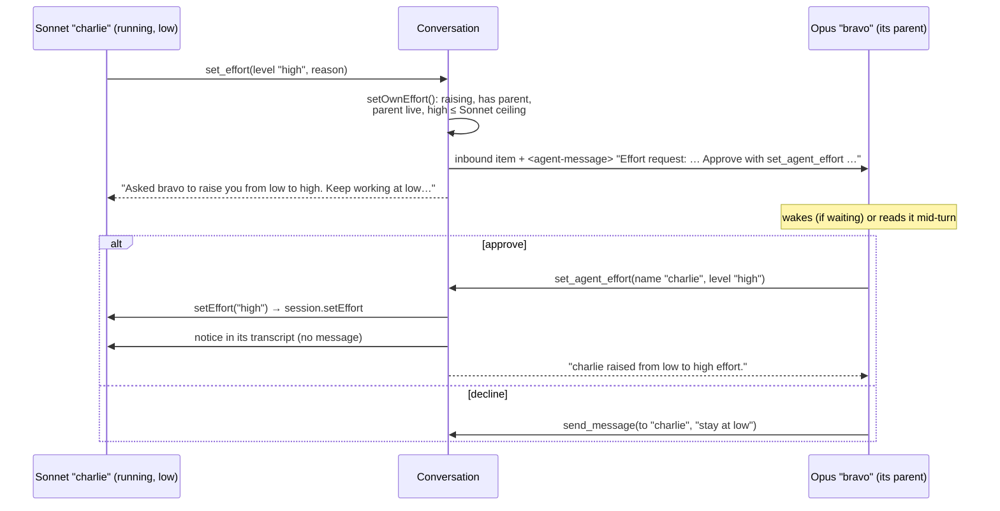

# Thinking effort

**Effort** is a setting the agent's backend passes to the model that controls how much it reasons before acting (Claude Code's effort level; Codex's reasoning effort). Higher effort is slower and uses more tokens; lower is faster and cheaper. Masthead manages effort per agent. This page explains the rules and where they live.

## Levels

`Effort` in `shared/protocol.ts` is `'low' | 'medium' | 'high' | 'xhigh'`, shown as Low, Medium, High and Extra (`EFFORT_LABEL`). Claude Code also knows a `max` level; Masthead deliberately leaves it out, so no agent can reach it. `effortRank()` orders the levels and `capEffort(wanted, ceiling)` returns the lower of two.

### Levels per backend

Each backend says which levels it has in `BackendCaps.efforts` (`server/backends/types.ts`). `Conversation.caps(agent)` returns the agent's backend's caps, or all four levels when no backend is known, and the tools use it (`teamToolDefs()` in `server/core/tools.ts`):

- the `effort` inputs of `spawn_agent`, `set_effort` and `set_agent_effort` list only those levels, and a level outside them is refused with "Error: unknown effort level.";
- a backend with no levels gets no effort tools and no `effort` input on `spawn_agent`;
- the system prompt's effort line is left out when the backend has one level or none (`systemAppend()` in `server/core/prompts.ts`).

Today the Claude Code, Codex and fake backends all advertise all four levels in their `caps`. (Models also carry their own `efforts` list in `ModelInfo`; the tools do not read it.)

## Two modes: automatic effort on or off

The settings field `autoEffort` (default on) chooses the mode. Each tier also has an `effort` value in the settings, which means different things in the two modes:

| | Automatic effort **on** | Automatic effort **off** |
|---|---|---|
| Tier `effort` setting | The **ceiling**: the highest level an agent of that tier may reach. | The level every agent of that tier runs at. |
| Starting level | `low` (the lead) or what the parent asked for, capped (sub-agents). | The tier's level. |
| `set_effort` / `set_agent_effort` tools | Given to agents. | Not given; and the conversation refuses them if called. |
| Prompt text about effort | Included, naming the level the agent runs at. | Left out. |

The ceiling is the tier's `effort` in its team profile. Default ceilings of the built-in Claude profile (`claudeProfile()` in `server/settings/settings.ts`): lead `xhigh`, Opus `xhigh`, Sonnet `high`, Haiku `medium`. A new tier of another profile defaults to `medium`. How the page offers these settings is not described here; see [Team profiles and settings](Team-Profiles-and-Settings.md).

## Rules with automatic effort on

1. **Agents start low unless their parent says otherwise.** The lead is created at `low` (`Conversation.create()`; with automatic effort off, at its tier's level). A sub-agent starts at the `effort` argument its parent gave `spawn_agent`, or `low` if none, capped at its tier's ceiling (`spawn()`). So a parent can start a child above low without anyone's approval; that is one way the rule "agents higher up set the effort of those below" shows up. The system prompt tells each agent its real level ("You run at high thinking effort. …", `systemAppend()` gets `effort: info.effort` from `launch()` in `server/runtime/agent.ts`), so an agent started high knows that asking for medium would lower it.
2. **The lead changes its own effort.** `set_effort` from the lead applies at once (`setOwnEffort()`: no parent, so no approval step).
3. **Any agent may lower its own effort** at once. The reply says which way it went and from where: "Effort lowered from medium to low, from your next step on."
4. **Other agents must ask to raise it.** `set_effort` from a sub-agent with a higher level sends an *effort request* message to its parent and returns "Asked "bravo" to raise you from low to high. Keep working at low; if approved, the change applies by itself." The parent must be the lead or live, otherwise the request is refused.
5. **Agents above can set anyone below.** `set_agent_effort` works on any descendant (checked with `isAncestor()`), not just direct children. It is how a parent approves a request, picks a different level, or changes effort as work changes. Only agents that can start others get this tool.
6. **Ceilings always apply.** Both tools refuse a level above the target tier's ceiling ("The person sets that limit"); `set_effort`'s refusal also names the agent's current level.
7. **Effort goes back to low after each piece of work.** The state machine (`server/core/machine.ts`) emits a `setEffortLow` effect, which the conversation carries out with `agent.setEffort('low')`, whenever a piece of work ends and automatic effort is on: when the lead goes `idle` (its turn ends with nothing holding it, or its last hold is released), and when a sub-agent finishes `done` or `failed` (the machine's `finish()`). A sub-agent stopped by the person, by another agent or by the run-time limit is not reset. See [State machine](State-Machine.md). Nothing changes effort when an agent is woken, so a level its parent set with `set_agent_effort` while it was finished holds for its next piece of work. The prompt says so: "Masthead resets you to low after each piece of work."
8. **Approval is silent.** `set_agent_effort` changes the level and adds a notice to the target's transcript ("Effort set to high by "bravo" (was low)."); it sends the target no message. A message would make the agent run one more turn, whose reply ("Noted") could become its report. The caller's reply says ""charlie" raised from low to high effort."

## How a change reaches the backend

`Agent.setEffort(level)` (`server/runtime/agent.ts`) updates `info.effort`, broadcasts the change, and calls `session.setEffort(level)` on the live session. The Claude backend calls the SDK's `applyFlagSettings({ effortLevel })`, so it applies from the next step on; the Codex backend stores it and sends it with the next turn. If that call fails, the session is marked stale and relaunched (same session) before its next turn. With no session, the stored level is used at the next launch: `launch()` caps `info.effort` at the ceiling (or sets the tier's level with automatic effort off) and opens the session with it.

## An effort request, end to end

Walkthrough with every function: [An effort request](Walkthrough-Effort-Request.md).

## Known limitations

These are deliberate, carried over from 0.1.4:

- **Turning automatic effort off and on.** If automatic effort is turned off, `launch()` sets each agent's stored effort to its tier level, and turning it back on later only caps that level at the ceiling.
- **A raised ceiling does not raise anyone.** When the person lowers a ceiling, `App.updateSettings()` calls `Conversation.settingsChanged()`, and `Agent.applySettings()` caps every running agent's effort at the new ceiling at once (through `setEffort()`); agents without a process are capped at their next launch. Raising a ceiling only allows more: agents stay where they are until they ask, or are set, higher. Switching automatic effort on or off changes an agent's tools, so its process is relaunched with the same session before its next turn (see [Agent life cycle](Agent-Life-Cycle.md)).

Related pages: [Team rules](Team-Rules.md) · [State machine](State-Machine.md) · [Source: core/conversation.ts](Source-Core-Conversation.md) · [Source: core/tools.ts](Source-Core-Tools.md) · [Team profiles and settings](Team-Profiles-and-Settings.md)
