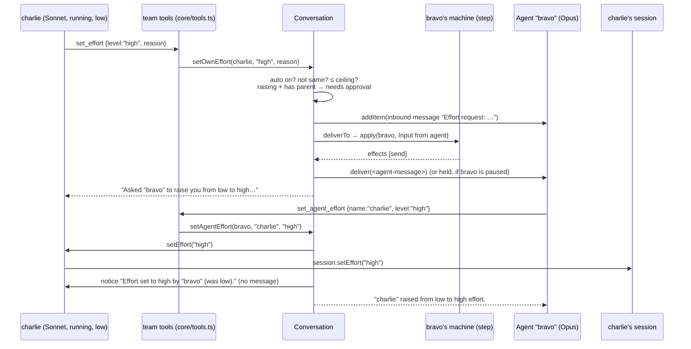

# Walkthrough: an effort request

This follows the Sonnet agent `charlie` (running at low effort) asking its parent, the Opus agent `bravo`, for high effort, and `bravo` approving it. It assumes the built-in Claude profile, automatic effort on, and the Sonnet ceiling at least `high` (the default is `high`). The rules are on [Thinking effort](Thinking-Effort.md); the state machine on [State machine](State-Machine.md).

## The path



## Step by step

1. **The tool.** `charlie`'s tools were built by `teamToolDefs()` in `server/core/tools.ts`. `set_effort` exists because automatic effort is on and its backend has effort levels (`Conversation.caps()`); the `level` input lists only those levels. For a sub-agent the description says raising needs the approval of the agent that started it and that an approved level applies by itself. `charlie` knows it is at low from its system prompt ("You run at low thinking effort. …"). The tool checks the level against the backend's levels ("Error: unknown effort level." otherwise) and calls `Conversation.setOwnEffort(charlie, 'high', reason)`.
2. **Checks in `setOwnEffort()`** (`server/core/conversation.ts`):
   - automatic effort must be on, else "Error: automatic effort is switched off in the settings.";
   - the same level returns "You are already at low effort.";
   - above the tier's ceiling returns "Error: Sonnet 5.5 agents may go up to <ceiling> effort; you are at low. The person sets that limit.";
   - **lowering, or no parent (the lead)**: applied at once with `agent.setEffort()` and a notice, reply "Effort lowered from medium to low, from your next step on." (or "raised"). Here it is raising and `charlie` has a parent, so approval is needed;
   - the parent must be the lead or live, else 'Error: "bravo" is no longer running, so nobody can approve this. Stay at low.';
   - the conversation's message counter must be below 1000.
3. **Sending the request.** The text is:

   ```text
   Effort request: "charlie" asks to go from low to high effort.
   Reason: …
   Approve with set_agent_effort (name "charlie", level "high"), choose another level, or decline with send_message.
   ```

   The counter goes up by one and `host.metaChanged()` asks for a save. `bravo` gets an `inbound` `message` item, and `deliverTo(bravo, messageEnvelope(…), 'agent')` sends it, with no reply line (the request says how to answer).
4. **Through `bravo`'s machine.** `deliverTo()` first runs `apply(bravo, { type: 'Input', from: 'agent' })`. `apply()` copies in the facts owned elsewhere (live children, background work, report debt), runs `step()`, which returns one effect, `send { urgent: false }`, and leaves the phase alone. `exec()` does nothing for `send`; `deliverTo()` then either delivers or holds:
   - if `bravo` is paused at a usage limit, the text goes into the conversation's `held` list and reaches it when the pause ends;
   - otherwise `bravo.deliver()` sends it. If `bravo` was `running`, the message joins its turn. If it was `waiting` (on its children, say), the runtime sends it into the open session and sets status `running`; `agentChanged()` sees the status differs from the machine's and applies `Status: running`, so the machine's phase follows.
5. **`charlie` is told.** A notice in its transcript ('Asked "bravo" for high effort: …') and the tool's reply: 'Asked "bravo" to raise you from low to high. Keep working at low; if approved, the change applies by itself.' Nothing in the machine records an open request; it is just a message.
6. **Approval.** `bravo` calls `set_agent_effort` with `name: "charlie"`, `level: "high"` → `Conversation.setAgentEffort(bravo, 'charlie', 'high')`:
   - automatic effort on; `find('charlie', bravo)` finds it; `isAncestor(bravo, charlie)` is true (any ancestor may do this); `high` is within the Sonnet ceiling; the level differs.
   - `charlie.setEffort('high')` (`server/runtime/agent.ts`) stores the level, broadcasts the agent's info and calls `session.setEffort('high')`. On the Claude backend that is the SDK's `applyFlagSettings({ effortLevel: 'high' })`, so it applies from `charlie`'s next step. If it fails, the session is marked stale and relaunched (same session) before its next turn.
   - `charlie` gets the notice 'Effort set to high by "bravo" (was low).' but no message: a message would make it run one more turn, whose reply could become its report.
   - `bravo` gets '"charlie" raised from low to high effort.'

   This step does not go through the state machine: effort is not part of `AgentState`.
7. **Declining or adjusting.** `bravo` can pick another level with `set_agent_effort`, or decline with `send_message` (which costs `charlie` a turn).
8. **Back to low.** When `charlie` finishes (`TurnEnded` with nothing holding it), `step()`'s `finish()` emits `setEffortLow` along with `end` and `report`, and `exec()` calls `charlie.setEffort('low')`. If `bravo` later sets a level on the finished `charlie` and wakes it, that level holds: `Woken` does not touch effort.

## The lead

The lead has no parent, so step 2 applies its own change at once, raising or lowering. It can start an agent at a higher effort with `spawn_agent`'s `effort`, and set the effort of any agent with `set_agent_effort`, since every agent descends from it. Its effort goes back to low when it goes `idle` (the machine emits `setEffortLow` then).

What was not verified by running: this page was written from the code and the unit tests (`test/conversation.test.ts`, "conversation: effort changes, approval and ceilings" and "effort: back to low when a piece of work ends; …"); no real session was run.

Related pages: [Thinking effort](Thinking-Effort.md) · [State machine](State-Machine.md) · [Team rules](Team-Rules.md) · [Source: core/conversation.ts](Source-Core-Conversation.md) · [Source: core/tools.ts](Source-Core-Tools.md)
