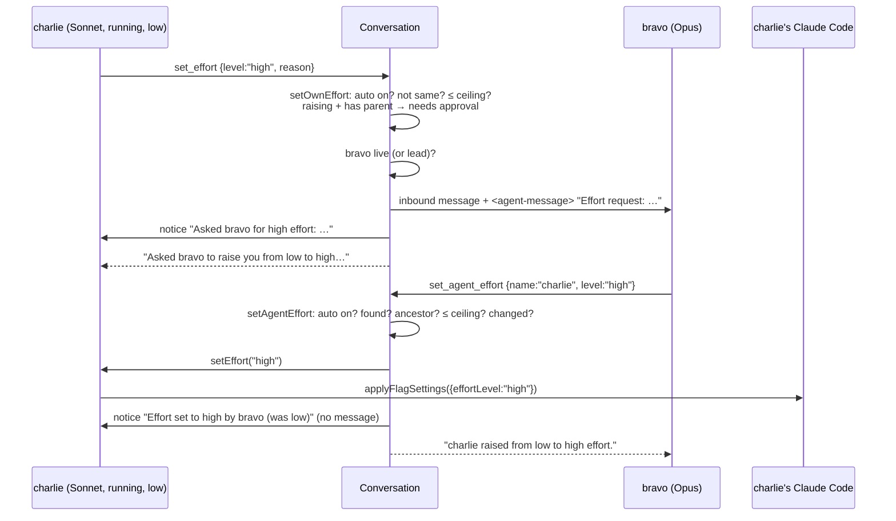

# Walkthrough: an effort request

This follows the Sonnet agent `charlie` (running at low effort) asking its parent, the Opus agent `bravo`, for high effort, and `bravo` approving it. It assumes automatic effort is on and the Sonnet ceiling is at least `high` (the default ceiling is `high`). The rules are on [Thinking effort](Thinking-Effort.md).

## The path



## Step by step

1. **The request.** `charlie` calls `set_effort` with `level: "high"` and a one-sentence `reason`. For a non-lead agent the tool's description says raising needs approval, to keep working at the current level, and that an approved level applies by itself. `charlie` knows it is at low because its system prompt says "You run at low thinking effort". The call goes to `Conversation.setOwnEffort(charlie, 'high', reason)`.
2. **Checks in `setOwnEffort()`:**
   - automatic effort must be on, otherwise an error;
   - the same level as now returns "You are already at low effort.";
   - above the Sonnet ceiling returns "Error: Sonnet 5.5 agents may go up to … effort; you are at low. The person sets that limit.";
   - **lowering, or the lead** would apply at once (`agent.setEffort()` plus a notice), with a reply such as "Effort lowered from medium to low, from your next step on." Here it is raising and `charlie` has a parent, so approval is needed;
   - the parent must be the lead or live; if `bravo` had already finished: "Error: "bravo" is no longer running, so nobody can approve this. Stay at low."
3. **Sending the request.** The text is:

   ```text
   Effort request: "charlie" asks to go from low to high effort.
   Reason: …
   Approve with set_agent_effort (name "charlie", level "high"), choose another level, or decline with send_message.
   ```

   It is added to `bravo`'s transcript as an `inbound` `message` item and delivered wrapped in `messageEnvelope()` (without the reply line; the request says how to answer). The inter-agent message counter goes up by one. `charlie` gets an info notice ("Asked "bravo" for high effort: …"), and the tool returns "Asked "bravo" to raise you from low to high. Keep working at low; if approved, the change applies by itself."
4. **`bravo` sees it.** If `bravo` was `waiting`, the delivery starts a new turn; if it was `running`, the message joins its turn in progress.
5. **Approval.** `bravo` calls `set_agent_effort` with `name: "charlie"`, `level: "high"` → `Conversation.setAgentEffort(bravo, 'charlie', 'high')`:
   - automatic effort on; `find('charlie', bravo)` succeeds; `isAncestor(bravo, charlie)` is true (any ancestor may do this, not only the parent); `high` is within the Sonnet ceiling; the level differs from the current one.
   - `charlie.setEffort('high')` stores the level, broadcasts `{t:'agent'}`, and calls `applyFlagSettings({ effortLevel: 'high' })` on charlie's live Claude Code process, so it applies from charlie's next step.
   - `charlie` gets a notice in its transcript, "Effort set to high by "bravo" (was low).", but no message. A message would make `charlie` run one more turn, and that turn's reply could end up in its report.
   - `bravo` gets "\"charlie\" raised from low to high effort."
6. **Declining or adjusting.** `bravo` can instead pick another level with `set_agent_effort` (for example `medium`), or reply with `send_message` to decline (that message does cost `charlie` a turn). Nothing in the code tracks an open request; it is just a message.

## The lead

When the lead calls `set_effort`, it has no parent, so step 2 applies the change at once, raising or lowering. The lead can also start an agent at a higher effort directly by passing `effort` to `spawn_agent`, and can change the effort of any agent in the conversation with `set_agent_effort`, since every agent descends from it.

## Related pages

[Thinking effort](Thinking-Effort.md) · [server/conversation.ts](Source-Conversation.md) · [server/tools.ts](Source-Tools.md)
