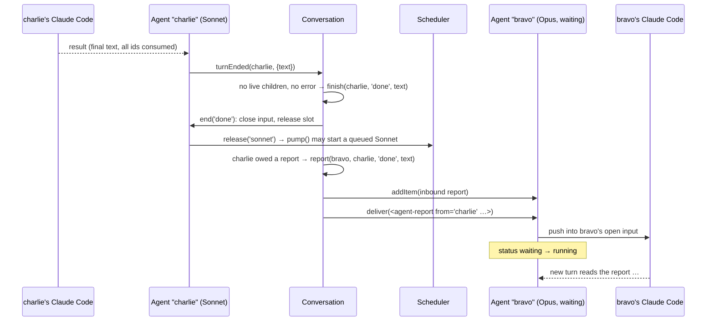

# Walkthrough: a report coming back

This follows a Sonnet agent `charlie`, started by the Opus agent `bravo` (which the lead `alpha` started), finishing its task and its report reaching `bravo`, which is `waiting` for it.

## The path



## Step by step

1. **The last turn ends.** `charlie`'s final message (its report, as its system prompt asks) is the turn's `result`. `Agent.handleResult()` sees nothing left unanswered and calls `turnEnded(charlie, { text, error: undefined, interrupted: false })`. Each turn's final text is the result's `result` string, or the last text block if that is empty. `text` joins the final texts of every turn since `charlie` last took up work, oldest first. Usually that is one turn; if a message landed just as a turn ended, Claude Code ran one more, and its short reply is added after the real report instead of replacing it.
2. **`Conversation.turnEnded()`.** `charlie` is not the lead, has no live children and no error, so `finish(charlie, 'done', text)`.
3. **`finish()`.** No live children to stop. It reads `owesReport` (true: set at spawn) and clears it, then `charlie.end('done')`:
   - the input channel is closed so Claude Code finishes cleanly;
   - the Sonnet slot is released, and `pump()` may grant it to a queued Sonnet straight away;
   - the status becomes `done` with `endedAt`.
4. **`report(bravo, charlie, 'done', text)`.** `bravo` is live (`waiting`), so it can receive. It gets:
   - an `inbound` item `{via: 'report', from: 'charlie', text, status: 'done'}` (what the screen shows);
   - a delivered message built by `reportEnvelope()`:

     ```text
     <agent-report from="charlie" tier="sonnet" status="done">
     …charlie's final message…
     </agent-report>
     ```

5. **`bravo` wakes.** A `waiting` agent still has its process and input channel open (it kept its slot). `deliver()` pushes the envelope in and sets `running`; Claude Code starts a new turn to read it.
6. **`bravo` decides.** If it still has other live children, it may end this turn and go back to `waiting`. When its last report is in and its turn ends, it finishes the same way and its own report goes to the lead.

## Variations

- **Failure.** If `charlie`'s turn ends with an error, or its process is lost, `finish(charlie, 'failed', …)` sends a report beginning "The agent failed: …", with its last message appended if there was one, and status `failed`.
- **Stopped by the person.** `stopAgent()` sends a report with status `stopped` and the reason, if `charlie` was live and owed one.
- **Stopped by `bravo` itself** (`stop_agent`): no report, since `bravo` asked for it.
- **Woken by someone else.** If `charlie` had finished and a sibling woke it with a message, it owes `bravo` a report again (as long as `bravo` can receive one), so its new result comes back to `bravo` just like the first. The sibling hears back only if `charlie` uses `send_message`.
- **No report owed** (for example `charlie` was woken while `bravo` could not receive, or was stopped by `bravo`): `settle(bravo)` runs. If `bravo` is waiting, not busy and has no other live children, it is finished as `done` with its own `lastText`, which then goes to the lead as its report.
- **Parent cannot receive.** If the parent is not the lead and not live, `report()` does nothing.
- **Tier switched off while queued.** If the person sets Sonnet to Off while `charlie` is still queued, `charlie` fails with "This tier was switched off in the settings while the agent was waiting to start." and `bravo` gets the failure report as above.
- **Escaping.** `reportEnvelope()` escapes any `<agent-report` or `<agent-message` tag inside the report text, so the text cannot close the envelope early.
- **Report to the lead.** The lead can always receive. If the lead is idle with an open process, the report starts a new lead turn; if it has no process (for example after a restart), the lead's session is resumed to read it.

## Related pages

[Team rules](Team-Rules.md#reports) · [Agent life cycle](Agent-Life-Cycle.md) · [server/conversation.ts](Source-Conversation.md) · [server/prompts.ts](Source-Prompts.md)
