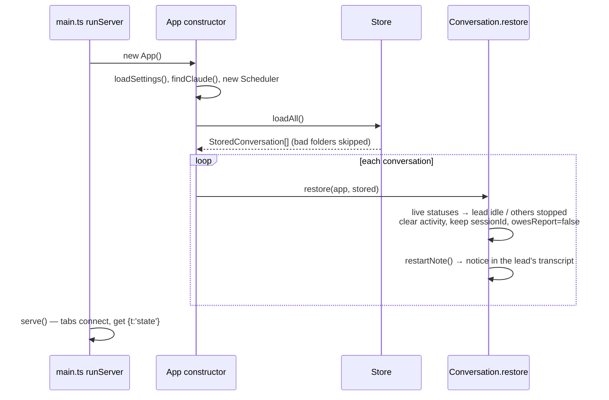

# Walkthrough: restarting the app with saved conversations

This follows Masthead being stopped while agents are working, started again, and the person continuing an old conversation.

## Shutting down

`App.shutdown()` (see [Stopping an agent](Walkthrough-Stopping-an-Agent.md#the-app-shuts-down)) stops every agent's process and calls `flush()`, which writes each conversation with a pending save to `conversation.json`. Transcript items were already appended as they happened. Each agent's stored record keeps its `sessionId`, the pointer to Claude Code's own saved session.

Note on statuses: `Conversation.shutdown()` sets live sub-agents to `stopped` and the lead to `idle` before the flush, so after a clean shutdown the file already says so. After a crash, the file may still say `running` etc.; restoring handles that case (below).

## Starting again

1. `runServer()` in `server/main.ts` creates `new App()`, then loads the local secret, which was kept on disk, so browsers signed in before the restart stay signed in.
2. The constructor loads settings, finds Claude Code, creates the scheduler, and calls `Store.loadAll()`. Each folder with a readable `conversation.json` whose `meta.id` matches the folder name is returned.
3. `Conversation.restore()` rebuilds each conversation: one `Agent` per stored agent, with its `info`, its `sessionId`, `owesReport: false` and, for an agent that never started, its saved `seed`. Any agent whose stored status is live is corrected: the lead to `idle`; others to `stopped` with the error "Masthead was closed while this agent was working." (`CLOSED_WHILE_WORKING`). Nothing is started and no slots are taken. If any agents carry that exact error, `restartNote()` returns "Masthead was restarted; these agents were stopped while working: bravo (Audit). Message one to resume it.", and an info notice with that text is added to the lead's transcript (deferred with `queueMicrotask`, because the app registers the conversation only after `restore()` returns). The note is found from the stored error, so it survives saves and further restarts until the lead is told.
4. A tab connects and gets `{t:'state'}` with the conversation list (newest first). Opening one sends `{t:'open'}` → `{t:'conversation'}` with every agent's info; `{t:'items'}` reads a transcript from its `.jsonl` file.

## Continuing the conversation

The person sends a message to the lead. If there is a restart note, `userSend()` prepends it: the lead receives "[Masthead was restarted; these agents were stopped while working: bravo (Audit). Message one to resume it.]", a blank line, then the person's text; the transcript shows only what they typed. Those agents' error becomes "Masthead was closed while this agent was working. The lead was told.", so the lead is told once. The lead has no process, so `deliver()` puts it in the backlog and `ensureProcess()` → `launch()` starts Claude Code with `resume: sessionId`. Claude Code reloads its saved session, so the lead remembers the conversation. If the session file is gone (deleted or moved), the resume fails before the session starts; Masthead then starts one fresh session in its place, tells the agent its context is lost, and re-sends the unanswered message (see [Agent life cycle](Agent-Life-Cycle.md#7a-a-session-that-no-longer-exists)). Its model and effort ceiling come from the current settings; its effort is the saved one, capped at the ceiling.

## What survives

- Every conversation, agent record and transcript, and each agent's Claude Code session id.
- **The task of an agent that never started.** An agent still `queued` at shutdown has no session yet. Its task is saved as `seed` (`Agent.pendingSeed` → `Conversation.toStored()`) and restored, so if it is woken later its new session begins with the original task, followed by the new message.
- The URL: a reloaded page reopens the conversation named in `#/c/<id>`.

The marks of agents the person stopped and the count of messages between agents are saved too (`stoppedByPerson` and `agentMessages` in `StoredConversation`). `restore()` reads them back, keeping only marks for agents that exist and clamping the count to 0–1000, so agents still cannot wake an agent the person stopped, and the message limit carries on where it was.

## What does not survive a restart

- **Work in progress.** Sub-agents that were working are `stopped`, and their reports were never sent (`owesReport` is reset to false). When an agent later wakes one of them with `send_message`, `message()` sets `owesReport` again only if its parent can receive a report: the lead always can; any other parent only while it is live. So an Opus agent woken by the lead reports to the lead, but a Sonnet whose Opus parent is also stopped does not report to anyone, and answers only with `send_message`.
- **Waits for an answer** (`send_message` with `wait`): memory only; the waiting agents are stopped anyway.
- **Open approval requests** and the **live draft**: memory only.
- **Usage notices** (`AppState.usage`) start empty until Claude Code reports again.
- **Usage-limit pauses.** `restore()` clears `pausedUntil`; `shutdown()` also clears the conversation's 30 s timer. An agent that was paused is treated like any other agent stopped while working.
- **Processes and slots**: nothing runs until something is delivered.

## Related pages

[Storage on disk](Storage-on-Disk.md) · [server/store.ts](Source-Store.md) · [server/conversation.ts](Source-Conversation.md) · [Agent life cycle](Agent-Life-Cycle.md)
