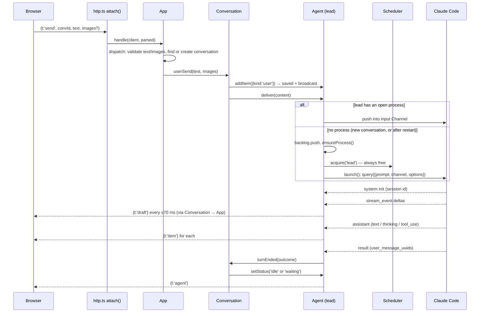

# Walkthrough: sending a message

This follows the person typing a message to the lead (`alpha`), from the browser to Claude Code and back to the screen.

## In the page

1. The person types in the message box (`Composer.svelte`) and presses Enter. `submit()` calls `store.sendMessage(text, images)`.
2. In an open conversation, the store sends `{t:'send', convId, text, images}`, with `agentId` added if a sub-agent's chat is open. On the new-conversation screen it sends `convId: null`, the chosen folder (`newCwd`) and a fresh `ref`, and shows "Starting…" until `created` comes back with that `ref`. The store then opens the new conversation.
3. If the socket is not open, `send()` shows "Not connected to Masthead…" and the text stays in the box.

What comes back is drawn by `Transcript.svelte`: `item` messages append or replace entries, `draft` messages show the text being written, and `agent` messages update the status line ("Working…", the activity line). See [Web store](Source-Web-Store.md).

## On the server

### The path

### Step by step

1. **Socket.** `attach()` in `server/http.ts` receives the text frame, parses JSON, and calls `app.handle(client, parsed)`.
2. **Dispatch.** `App.dispatch()` case `send` (`server/app.ts`):
   - `text` must be a string; `checkImages()` validates attachments; empty or over 400,000 characters throws, which `handle()` turns into `{t:'error'}`.
   - `convId: null` means a new conversation: Claude Code must have been found; `checkDir()` validates the folder (default `defaultCwd`); `Conversation.create()` makes it with an idle lead; a different folder becomes the new default; the tab gets `{t:'created', convId, ref}`.
   - Otherwise `conv(convId)` finds the existing conversation.
3. **`Conversation.userSend()`** picks the target (the lead unless `agentId` names another agent), sets the conversation title from the first message, adds a `user` item (only the image count is kept), calls `target.deliver(Agent.imageContent(text, images))`, and `touch()`es the conversation (new `updatedAt`, list broadcast, save scheduled).
4. **`Agent.deliver()`** wraps the content as an SDK user message with a fresh id and records the id in `unanswered`.
   - If the lead's process is open (the usual case after its first message: the lead's process stays open between turns), the message is pushed into its input `Channel` and the status becomes `running`.
   - Otherwise it goes to `backlog` and `ensureProcess()` runs: the scheduler grants a lead slot immediately (the lead is never limited), and `launch()` starts Claude Code with the backlog as the first input, resuming the saved session if there is one.
5. **Claude Code works.** `consume()` passes each SDK message to `handle()`:
   - `init` records the session id (and the conversation file is saved soon after, via `agentChanged`).
   - `stream_event`s build the **draft**, broadcast at most every 70 ms as `{t:'draft'}`, and update the context and output token counts (`{t:'agent'}`).
   - `assistant` messages become `text`, `thinking` and `tool` items (`{t:'item'}`, each appended to `items/<lead id>.jsonl`). A tool call also sets the activity line.
   - Tool results arrive as `user` messages and update the matching tool item (same id, new line in the file).
   - If a tool needs approval, the turn pauses in `canUseTool` until the person answers ([Permissions and questions](Permissions-and-Questions.md)).
6. **Turn end.** The `result` message lists the consumed ids. If the person typed again during the turn, that id is still unanswered and Claude Code runs another turn; the lead stays `running`. Otherwise `turnEnded()` runs.
7. **`Conversation.turnEnded()`** adds an error notice if any, sets the lead to `idle` (or `waiting` if agents it started are still live), and calls `refreshContext()` to get the real context size from Claude Code. Each change is broadcast as `{t:'agent'}`.

## Sending to an agent other than the lead

The same path, with `agentId` set in `{t:'send'}`: in the page, open the agent's chat (click it in the team panel or map); the box then says "Message Bravo directly". `userSend()` targets that agent. If it has finished, `deliver()` resumes its session (it must get a slot in its tier first, so it may queue). It arrives as a plain user message, and since `owesReport` is not set by this path, a finished agent woken this way does not send a new report to its parent when it is done.

## Related pages

[Browser/server protocol](Browser-Server-Protocol.md) · [Agent life cycle](Agent-Life-Cycle.md) · [server/agent.ts](Source-Agent.md)
