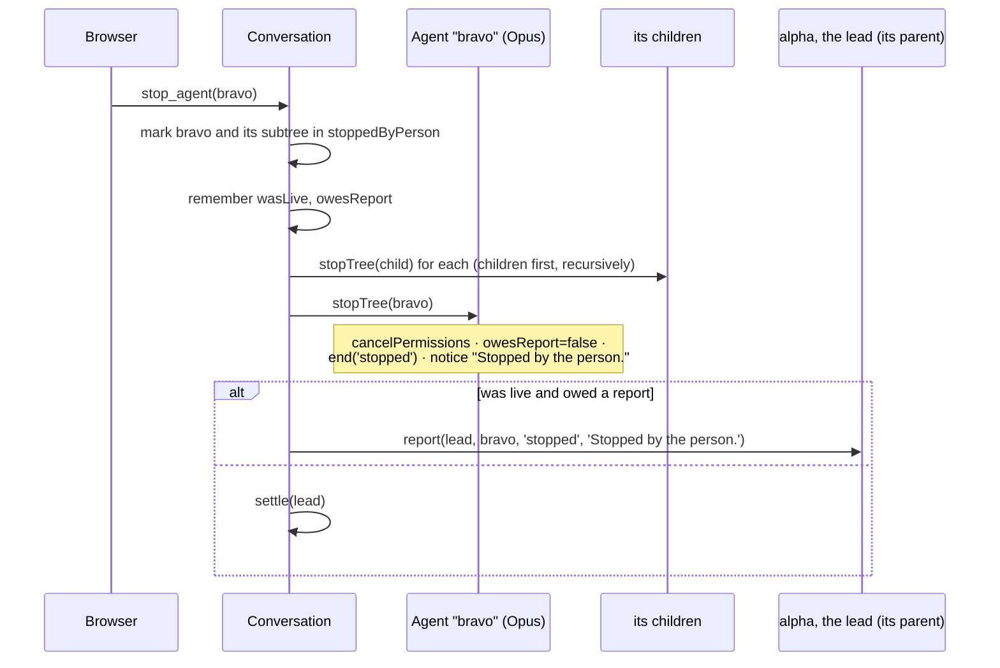

# Walkthrough: stopping an agent

There are four ways an agent gets stopped: the person stops one agent, the person stops everything, an agent stops one below it, and the app shuts down. Interrupting the lead is related but different: it ends the lead's turn without stopping anything. All the code is in `server/conversation.ts` and `server/agent.ts`.

## The person stops a sub-agent

The person presses the ■ button on an agent in the team panel or the team map, and the browser sends `{t:'stop_agent', convId, agentId}`. `App.dispatch()` calls `conv.stopAgent(agentId, 'Stopped by the person.')`.

Step by step:

1. `stopAgent()` finds the agent and marks it and every agent under it in `stoppedByPerson`. From now on other agents cannot wake them with `send_message` ("Error: the person stopped "bravo"; only they can wake it."); the person can, by messaging the agent, which clears its mark. The marks are in memory only and are gone after a restart. It then records whether it was live and whether it owed a report **before** stopping, because `stopTree()` clears `owesReport`.
2. `stopTree(agent, why)` recurses into the children first, so the deepest agents stop first. For each agent that is live:
   - `host.cancelPermissions(agent.id)` denies any approval request from it ("The agent was stopped.");
   - `owesReport = false`;
   - `agent.end('stopped', why)`: cancels a queued slot request (rejecting it with `SlotCancelled`), marks the agent as closing, clears its backlog and unanswered set, closes the Claude Code process at once (`q.close()`), releases its slot (which may start a queued agent of that tier), and sets status `stopped` with the reason as the error;
   - adds an info notice with the reason.
   Agents that are not live (already done, failed or stopped) are skipped.
3. If the agent was live and owed a report, its parent gets a report with status `stopped` and the text "Stopped by the person.". That wakes the parent, so it can react. Otherwise `settle(parent)` moves a parent that was only waiting on it to `idle` (lead) or `done`.

When the process ends, `consume()` sees `closing` is set and does not report a lost process.

An agent stopped while it was still queued, or while its old process was exiting, is never launched afterwards. `end()` bumps the agent's generation counter; when the slot (or the old process's exit) arrives, `ensureProcess()` sees the counter changed, does not call `launch()`, and gives back a slot that was granted in the meantime. Without this, stopping one queued agent could free a slot that went straight to another agent already being stopped.

## The person asks for a safe shut-down

Each live sub-agent's box on the team map has an ✕ button (`web/src/lib/TeamMap.svelte`). The first press sends `close_agent`. `Conversation.closeAgent` (`server/conversation.ts`) then:

1. Does nothing for the lead, for an agent that is not live, or for one already closing. A queued agent has nothing to finish, so it goes through `stopAgent` as above.
2. Sets `closing` on the agent's `AgentInfo` and adds a notice to its transcript. Nothing is cut off.
3. Delivers a message to the agent that started it, as text from the person: have the agent stop at a safe point, leave its work usable and report, or use `stop_agent` if nothing is worth finishing. If that agent cannot receive (it is neither the lead nor live), the request goes to the agent itself.

While `closing` is set the box reads "Shutting down safely…" and the ✕ turns red; pressing it again sends `stop_agent`, the forceful stop described in the first section. How the shut-down goes is up to the owning agent: Masthead does not enforce a time limit. When the agent stops being live, however it ended, `agentChanged` clears `closing` and marks it as stopped by the person, so other agents cannot wake it.

Tried in a browser on a test server with Haiku agents on 2026-11-26: the owner wound the agent down and it ended as done; a second press stopped it at once.

## The person stops the lead or everything

- `{t:'stop_agent'}` with the lead's id: `stopTree()` on each of the lead's children, then `lead.interrupt()`, then `settle(lead)`. The lead keeps its session and process. `interrupt()` only acts if the lead is `running` (its turn then ends as interrupted); if the lead was `waiting` on those children, `settle()` moves it to `idle`.
- `{t:'stop_all'}` (the "Stop everything" button): `stopAll()` does the same, then calls `settle(lead)` once more.

No reports are sent in either case: `stopTree()` clears `owesReport` and the lead is not told. Every sub-agent is marked in `stoppedByPerson`, so the lead cannot wake them again; the person can.

## Interrupting the lead

`{t:'interrupt'}` → `interruptLead()` → `lead.interrupt()`: sets `interrupted` and calls the SDK's `q.interrupt()`. Claude Code ends the turn; the `result` arrives; `handleResult()` ignores any error on an interrupted turn; `turnEnded()` adds the notice "Stopped." and sets the lead `idle` or `waiting`. Agents the lead started keep working.

## An agent stops one below it

An agent that can start others has `stop_agent`. `Conversation.stop(caller, name)`:

1. finds the target (`parent` means the caller's parent, which then fails the next check);
2. requires `isAncestor(caller, target)`: only agents started by the caller or below it;
3. returns "\"name\" is not running (status)." if it is not live;
4. clears `owesReport` (the caller asked for it, so no report is needed), `stopTree(target, 'Stopped by "caller".')`. This does not mark the target in `stoppedByPerson`, so agents may wake it again later;
5. if the target's parent is not the caller (a grandchild was stopped), `settle()`s that parent;
6. returns "Stopped "name" and everything under it."

## The app shuts down

`App.shutdown()` (from Ctrl+C, SIGTERM, `masthead stop` or `POST /api/shutdown`) denies all pending approvals, then `Conversation.shutdown()` for each conversation: live sub-agents are ended as `stopped` with "Masthead was closed while this agent was working."; every other agent, including the lead, gets `dispose()`, which closes any process without changing the recorded status; then the lead is set to `idle`. Pending saves are flushed to disk. `server/main.ts` exits 300 ms later.

## Related pages

[Team rules](Team-Rules.md#stopping) · [Agent life cycle](Agent-Life-Cycle.md) · [Command-line launcher](Command-Line-Launcher.md)
